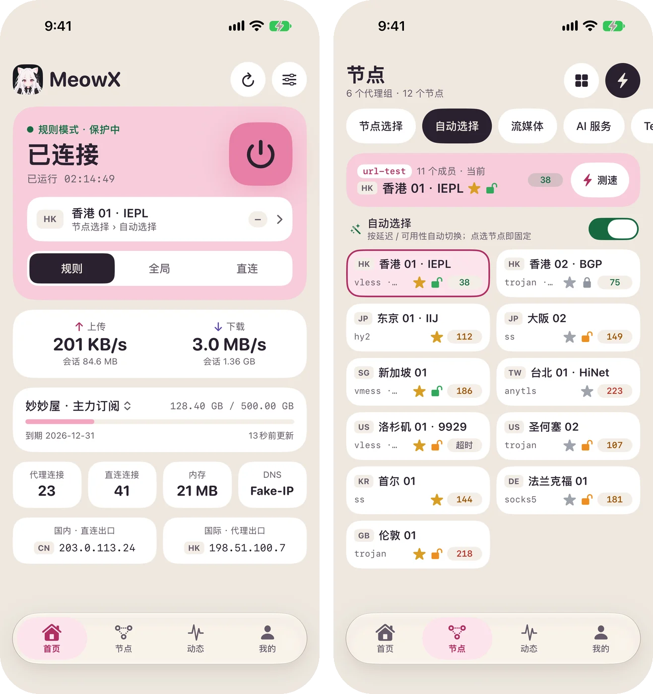
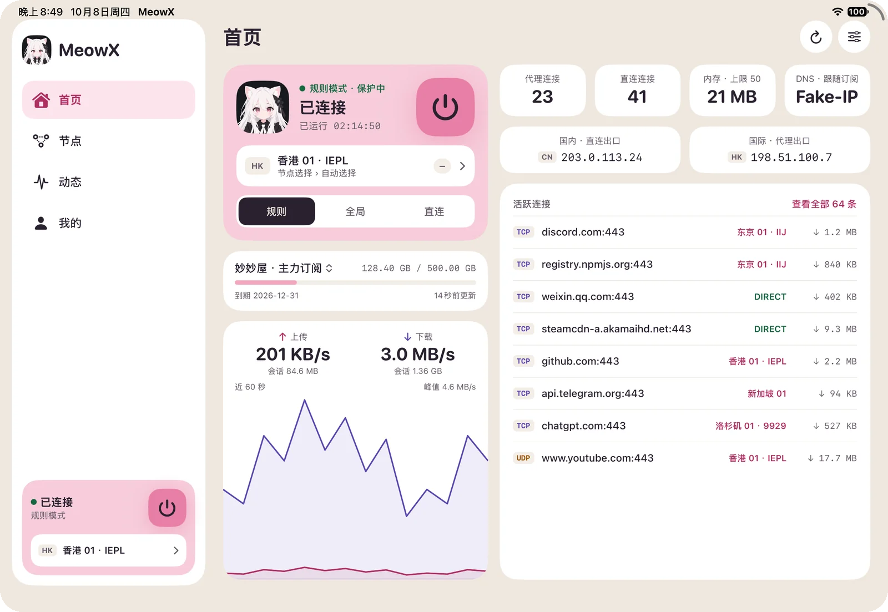
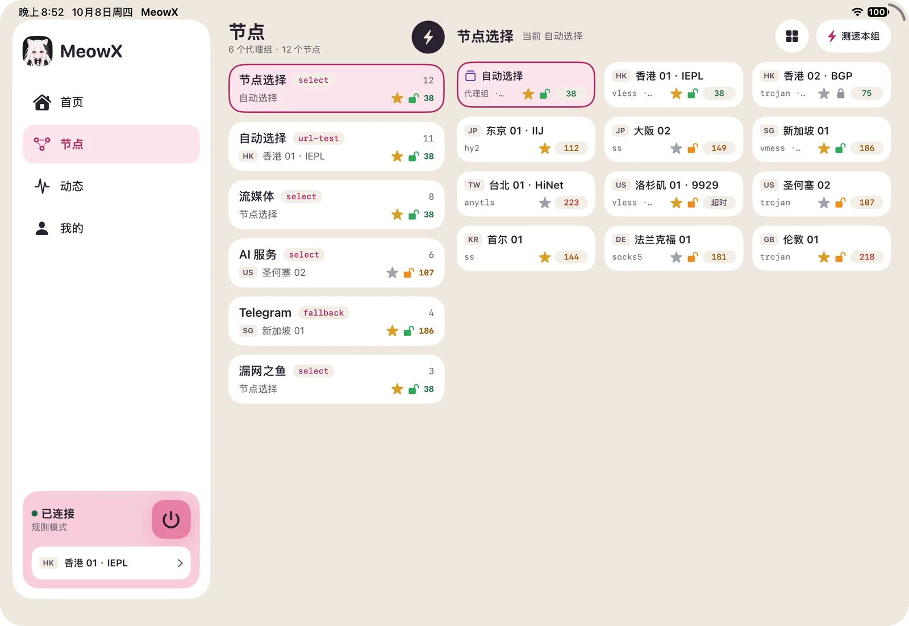
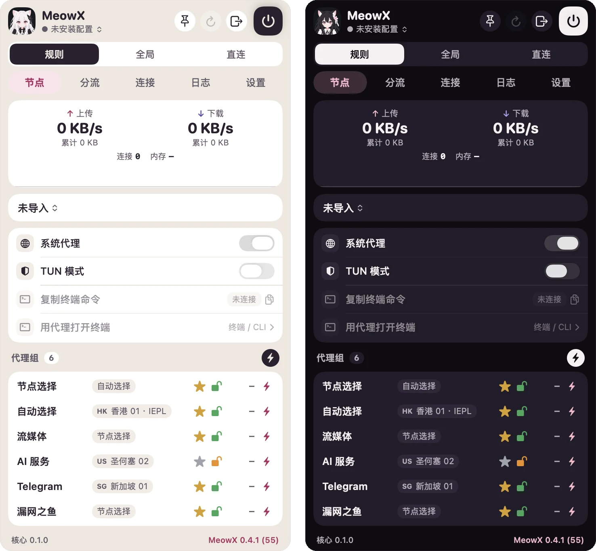
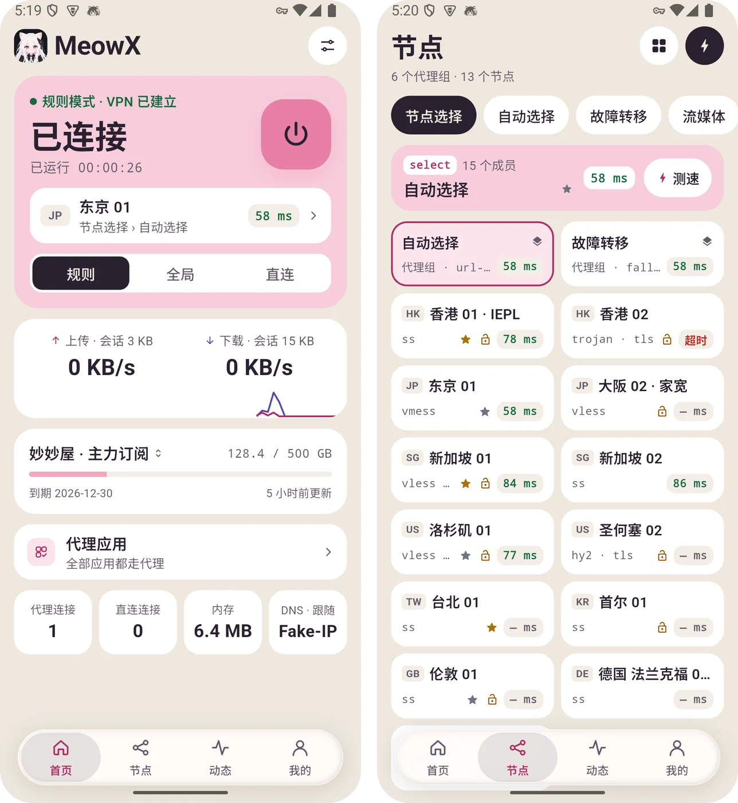
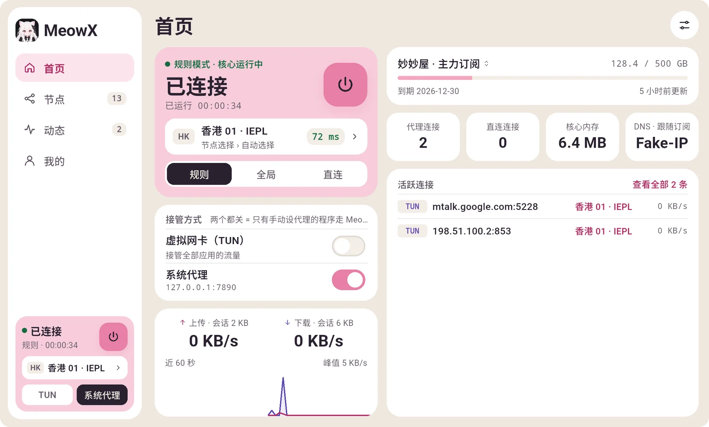
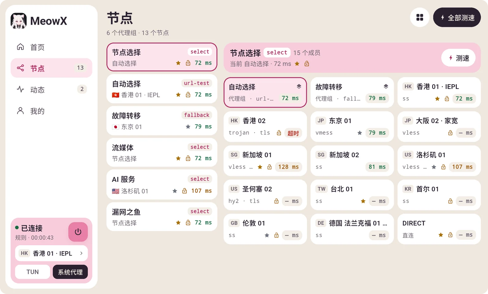
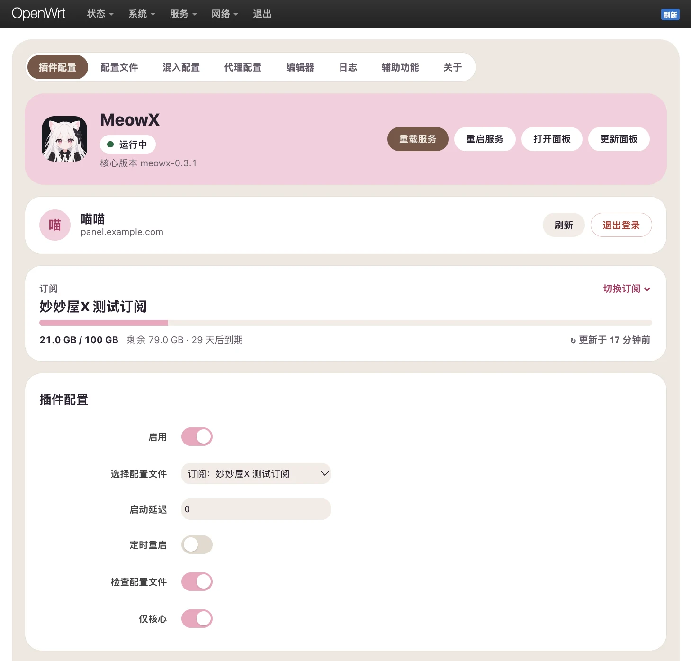
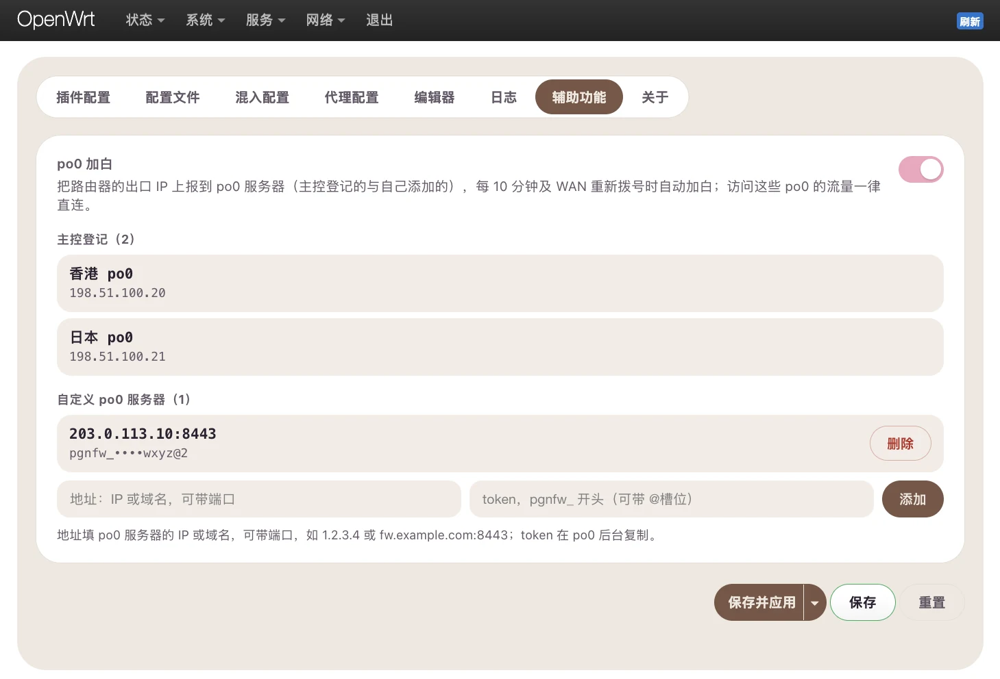

import { ClientDownload } from "@/components/docs/islands/client-download";
import { Tabs, TabItem } from "@astrojs/starlight/components";

MeowX 是一款独立的代理客户端，也是妙妙屋X 官方推荐的客户端：登录面板账号或粘贴订阅链接即可使用，并支持面板的实时同步、回程线路奖牌与流媒体解锁标记。下方版本信息自动读取最新发布，下载地址均为 `dl.miaomiaowux.com`。

<ClientDownload lang="zh" client:load />

## 界面预览

各端是同一套界面：首页连接与用量、节点（代理组与延迟、回程线路奖牌、流媒体解锁标记）、动态（连接与日志）、我的（账户、订阅与设置）。截图里是示例订阅。

<Tabs>
  <TabItem label="iPhone">
    
  </TabItem>
  <TabItem label="iPad">
    

    
  </TabItem>
  <TabItem label="macOS">
    
  </TabItem>
  <TabItem label="Android">
    
  </TabItem>
  <TabItem label="Windows">
    

    
  </TabItem>
  <TabItem label="OpenWrt">
    

    
  </TabItem>
</Tabs>

Linux 版与 Windows 版是同一套桌面界面。OpenWrt 版是路由器上的网页界面（LuCI「服务 → MeowX」），不是上面那套 App 界面：订阅、主控账户、po0 加白的用法与客户端一致。

## 安装说明

### macOS

1. 打开 DMG，把 MeowX 拖到「应用程序」。App 已做 Developer ID 签名与公证，可直接打开。
2. MeowX 是菜单栏应用，没有主窗口：所有功能都在菜单栏图标的下拉面板里。
3. 「系统代理」模式首次连接会请求管理员授权，用于安装修改系统代理的辅助工具；「TUN 模式」需要在「系统设置 → 通用 → 登录项与扩展」里允许 MeowX 的系统扩展。
4. 仅提供 Apple Silicon（M 系列）版本。

### Android

1. 下载 APK 直接安装（系统可能提示允许安装未知来源应用）。
2. 首次连接会弹出 VPN 授权，确认即可。
3. 默认使用 `mips` 网络栈；在「我的 → 高级」里可以切换。

### Windows

1. 安装包未做代码签名，SmartScreen 可能提示「Windows 已保护你的电脑」：点「更多信息 → 仍要运行」。
2. 便携版解压即用，数据保存在程序目录。
3. 系统代理模式开箱即用；TUN 模式需要管理员权限，首次启动核心会弹出 UAC 提示。

### Linux

支持 Ubuntu 22.04 / Debian 12 及以后（x64 与 arm64），提供 deb 安装包和 AppImage 两种：

- **deb 安装包（推荐）**：下载后在终端执行（arm64 换成对应的文件名）：

  ```shell
  sudo apt install ./MeowX-*-linux-amd64.deb
  ```

  apt 会自动装好依赖。装好后在应用菜单里打开 MeowX，或在终端运行 `meowx`。内核随包带好了所需权限，首页「接管方式」里的虚拟网卡（TUN）可以直接打开。卸载：`sudo apt remove meowx`。
- **AppImage**：免安装，`chmod +x MeowX-*.AppImage` 后直接运行（需要 FUSE 2：Ubuntu 22.04 装 `libfuse2`，24.04 装 `libfuse2t64`）。AppImage 只能用系统代理，不能开虚拟网卡（TUN）。

系统代理模式会设置 GNOME 系桌面或 KDE 的系统代理；不读系统代理的程序请改用 TUN。

### OpenWrt

要求 OpenWrt 24.10 及以后（或同代的 ImmortalWrt）、使用 firewall4；内核约 40MB，小闪存机型先用 `df -h /overlay` 确认剩余空间。SSH 登录路由器后执行：

```shell
# 一键安装：自动识别系统版本与架构，装好内核、服务、界面与中文翻译
wget -O - https://dl.miaomiaowux.com/meowx/openwrt/install.sh | ash
```

想以后像系统软件一样升级，可以改为添加软件源再安装：

```shell
# 添加软件源（只需一次）
wget -O - https://dl.miaomiaowux.com/meowx/openwrt/feed.sh | ash
# OpenWrt 24.10（opkg）
opkg install meowx luci-app-meowx luci-i18n-meowx-zh-cn
# OpenWrt 25.12 及以后（apk）
apk add meowx luci-app-meowx luci-i18n-meowx-zh-cn
```

装好后打开 LuCI「服务 → MeowX」：在「插件配置」里登录主控账户或粘贴订阅链接，打开「启用」后「保存并应用」。缺省是「仅核心」（只运行内核、开放代理端口，不接管路由器流量），确认订阅可用后关掉它，再按「代理配置」设置透明代理。卸载：`wget -O - https://dl.miaomiaowux.com/meowx/openwrt/uninstall.sh | ash`（会删掉全部设置）。更多说明见 [GitHub 仓库](https://github.com/mmwx-group/meowx-openwrt)。

OpenWrt 版基于开源项目 [OpenWrt-nikki](https://github.com/nikkinikki-org/OpenWrt-nikki) 改造，以 GPL-3.0 开源。

### 飞牛 NAS

要求飞牛 fnOS（带 Docker），x86 与 ARM 机器各有一个安装包。

1. 在上方下载对应架构的 fpk 安装包。
2. 飞牛「应用中心」→ 侧栏底部「手动安装」→ 上传 fpk。应用以 Docker 项目运行，镜像在 NAS 上就地构建，不需要连镜像仓库。
3. 装好后在飞牛桌面打开 MeowX，或用浏览器访问 `http://<NAS 的地址>:7899`。在「订阅」页登录主控账户或粘贴订阅链接，再到「概览」启动。

用法：

- **代理端口**：局域网里的设备可以直接把 HTTP / SOCKS5 代理设成 `<NAS 的地址>:7890`（同一个端口两种都认）。局域网与 NAS 本机免密，从外网（经路由器端口转发）连进来要密码，账号在「混入设置」里。
- **透明代理**：在「透明代理」页分别打开 NAS 本机、NAS 上的其它容器、局域网设备（旁路由：把设备的网关和 DNS 都改成 NAS 的地址，只代理 IPv4）。打开或改动后有几分钟试用期，顶部提示条倒计时，确认网络正常后点「保留设置」；没点的话到时间自动关掉并撤掉全部规则，不会把 NAS 的网络（连同 SSH 和管理页面）弄断。
- **喵窝**：用管理员账号登录主控后可以入网，并开放 NAS 所在的局域网，见 [喵窝](/docs/meownest#飞牛-nas-入网)。

升级：0.1.1 起在管理页面的「设置」里检查更新，有新版时顶栏也会提示。点「立即更新」后 MeowX 自己下载新版安装包、校验 sha256，交给飞牛应用中心原地升级（同应用中心的「手动安装」，设置、订阅和喵窝的设备身份都保留），一两分钟后自动重启，页面自动刷新。连不上应用中心的升级接口时，「设置」里给出安装包的下载地址，照旧手动安装。0.1.0 没有这个功能，要先手动装一次 0.1.1：下载新版 fpk 再「手动安装」，提示已安装时先在应用中心卸载再装——设置、订阅和喵窝的设备身份保存在 `/vol1/@appdata/meowx`，卸载不会删除（要彻底清除就删掉这个目录）。

管理页面缺省没有密码，NAS 的 7899 端口会开放到外网时，请在「设置」里设一个网页密码。更多说明见 [GitHub 仓库](https://github.com/mmwx-group/meowx-fnos)。

飞牛 NAS 版和 OpenWrt 版用同一个内核，以 GPL-3.0 开源。

## 登录与导入订阅

- **网页端登录客户端**（macOS / Windows）：在面板网页「个人菜单 → 扫码登录手机」里点「登录客户端」，MeowX 会自动打开并完成登录。
- **手机扫码**（Android / iOS）：在桌面端「个人菜单 → 扫码登录手机」出示二维码，用 MeowX 扫一扫即可。
- **账号登录**（Linux，其它客户端也可用）：在「我的」页点「账号登录」，填主控地址、用户名和密码（开了二步验证再填验证码）。Linux 版暂不支持网页端的「登录客户端」唤起。
- **复制登录链接**（OpenWrt / 飞牛 NAS）：路由器和 NAS 上没法扫码，在面板网页「个人菜单 → 扫码登录手机」里点「复制登录链接」，粘贴到 OpenWrt 版「插件配置」页或飞牛版「订阅」页的「主控账户」卡里登录；链接只能用一次、5 分钟内有效。飞牛版登录时如果还没有在用的订阅、账号下又恰好只有一份，会自动导入并切过去。
- **订阅链接**：在「我的」页点「导入订阅」，粘贴订阅 URL 或妙妙屋X 短链；也支持 `clash://install-config` 深链。

登录后「我的订阅」会列出账号下的全部订阅，点一下即下载并切换为当前配置；面板更新订阅后客户端会自动同步。退出登录时，从该面板导入的订阅会一并删除。

主控需要先填好对外域名并激活许可证，客户端才能登录。各种登录方式的详细步骤、前提条件和报错排查见 [客户端登录主控](/docs/client-login)。

## iOS

iOS 版通过 TestFlight 内测分发，暂不提供公开下载，需要先在许可证服务器申请内测：

1. 登录 [许可证服务器](https://license.miaomiaowux.com)，打开顶部菜单的「内测报名」（或直接访问 [license.miaomiaowux.com/beta](https://license.miaomiaowux.com/beta)）。
2. 填写 **Apple ID 邮箱**（必须是 Apple ID 本身的邮箱，TestFlight 邀请会发到这里，填错收不到）、测试设备（如 iPhone 15 / iOS 18），提交报名。
3. 状态变为「已邀请」后，到邮箱里点 TestFlight 邀请链接，在 TestFlight 里安装 MeowX；之后的更新也在 TestFlight 里推送。

报名暂未开放时页面会提示「内测报名暂未开放」，请留意群内通知；更换 Apple ID 后状态会重置为待邀请，会重新发送邀请。iOS 版要求 iOS 17 及以上，登录与导入订阅方式与 Android 相同（手机扫码或粘贴订阅链接）。

## 常见问题

见 [订阅与客户端](/docs/faq-sub-client)。
