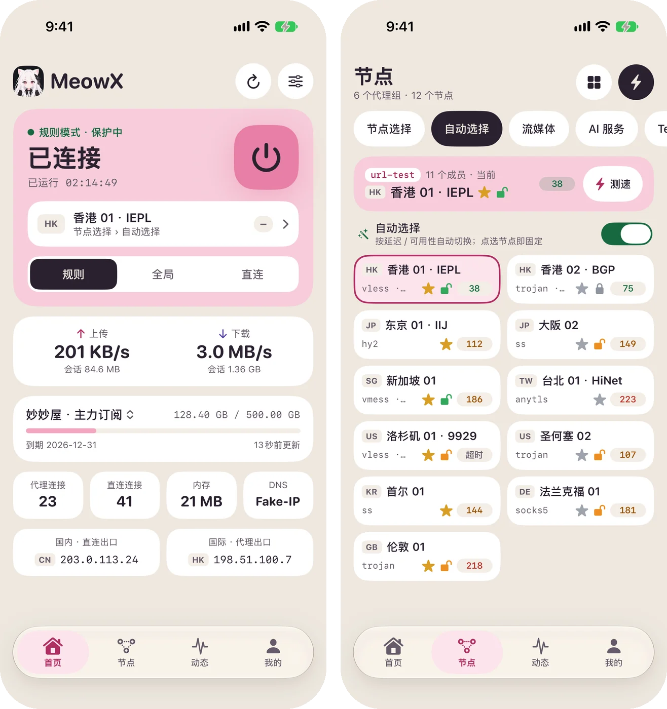
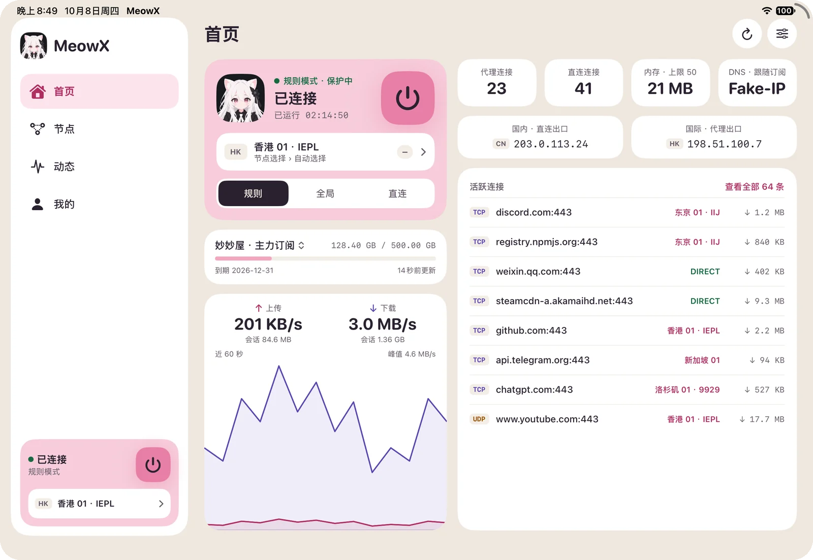
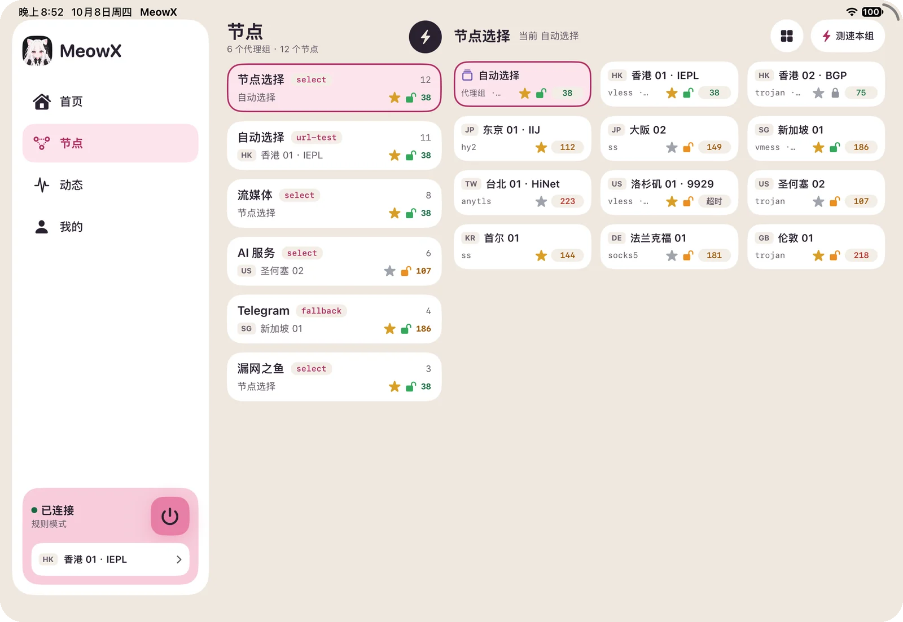
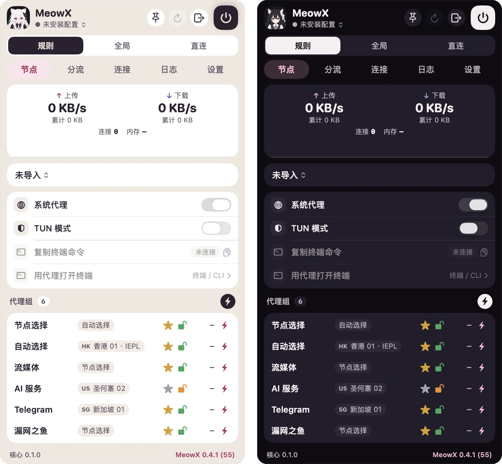
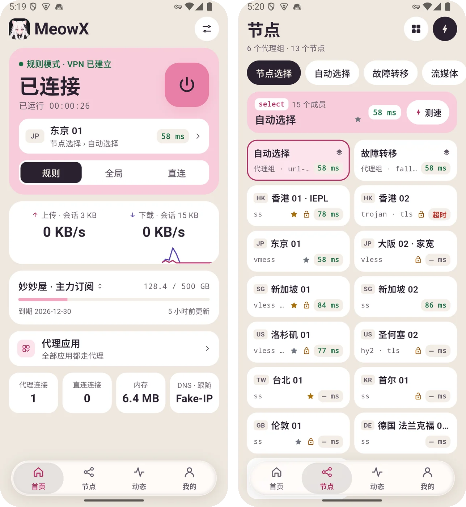
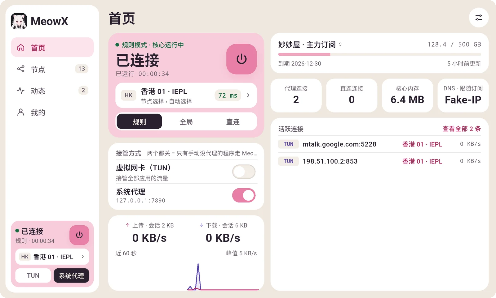
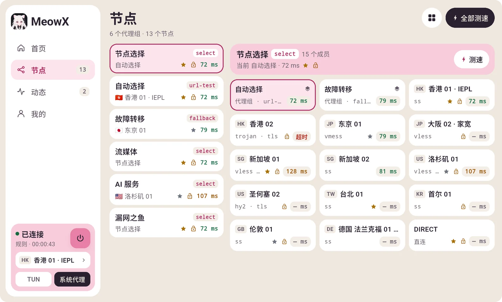
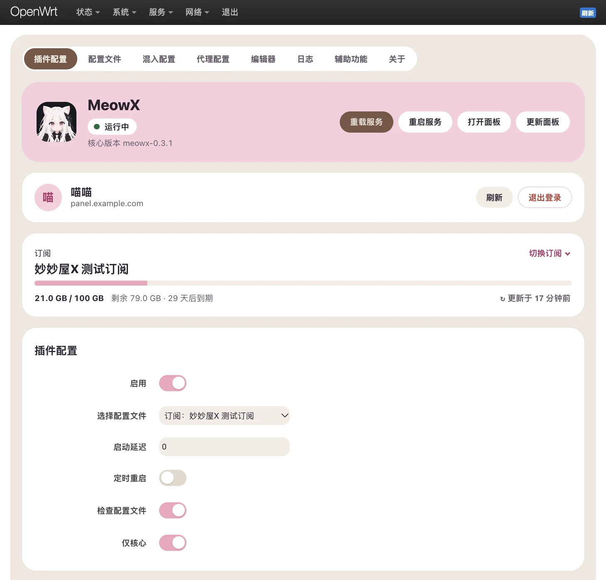
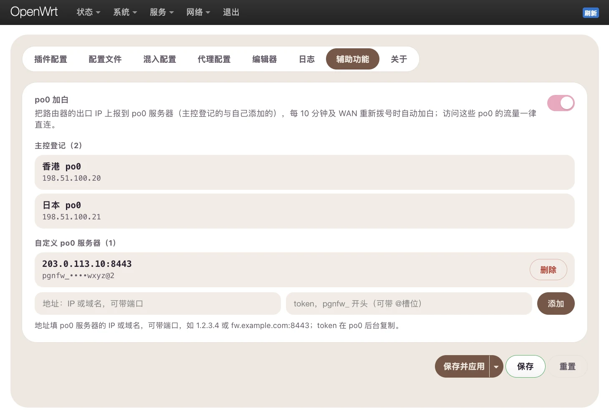

import { ClientDownload } from "@/components/docs/islands/client-download";
import { Tabs, TabItem } from "@astrojs/starlight/components";

MeowX is a standalone proxy client and the officially recommended client for MiaoMiaoWu X. Sign in with your panel account or paste a subscription link to get started; it supports real-time subscription sync, return-route medals and streaming unlock badges from the panel. The version information below is fetched from the latest release, and all downloads are served from `dl.miaomiaowux.com`.

<ClientDownload lang="en" client:load />

## Screenshots

All platforms share the same design: Home (connection and usage), Nodes (proxy groups and latency, return-route medals, streaming unlock badges), Activity (connections and logs) and Me (account, subscriptions and settings). The screenshots use a sample subscription.

<Tabs>
  <TabItem label="iPhone">
    
  </TabItem>
  <TabItem label="iPad">
    

    
  </TabItem>
  <TabItem label="macOS">
    
  </TabItem>
  <TabItem label="Android">
    
  </TabItem>
  <TabItem label="Windows">
    

    
  </TabItem>
  <TabItem label="OpenWrt">
    

    
  </TabItem>
</Tabs>

The OpenWrt edition is a web interface on the router (LuCI “Services → MeowX”) rather than the app design above; subscriptions, the panel account and the po0 whitelist work the same way as in the apps.

## Installation

### macOS

1. Open the DMG and drag MeowX into Applications. The app is signed with a Developer ID and notarized, so it opens without extra steps.
2. MeowX lives in the menu bar and has no main window: everything is in the drop-down panel behind the menu bar icon.
3. The first connection in System Proxy mode asks for an administrator password to install the helper that changes the system proxy. TUN mode requires allowing the MeowX system extension under System Settings → General → Login Items & Extensions.
4. Apple Silicon (M-series) only.

### Android

1. Download and install the APK (Android may ask you to allow installs from unknown sources).
2. The first connection shows a VPN permission prompt; confirm it.
3. The `mips` network stack is used by default; it can be changed under Me → Advanced.

### Windows

1. The installer is not code-signed, so SmartScreen may show "Windows protected your PC": click "More info → Run anyway".
2. The portable build runs from any folder and keeps its data next to the executable.
3. System Proxy mode works out of the box; TUN mode needs administrator rights and triggers a UAC prompt when the core starts.

### OpenWrt

Requires OpenWrt 24.10 or later (or the matching ImmortalWrt) with firewall4. The core takes about 40 MB, so on small-flash routers check the free space first with `df -h /overlay`. SSH into the router and run:

```shell
# One-line install: detects the release and architecture, installs the core, service, web UI and translations
wget -O - https://dl.miaomiaowux.com/meowx/openwrt/install.sh | ash
```

To upgrade it later like any system package, add the package feed and install from it instead:

```shell
# Add the feed (once)
wget -O - https://dl.miaomiaowux.com/meowx/openwrt/feed.sh | ash
# OpenWrt 24.10 (opkg)
opkg install meowx luci-app-meowx
# OpenWrt 25.12 or later (apk)
apk add meowx luci-app-meowx
```

Then open LuCI “Services → MeowX”: sign in to your panel account or paste a subscription link under “App Config”, turn on “Enable” and click “Save & Apply”. “Core Only” is on by default (it only runs the core and opens the proxy port, without taking over router traffic); once the subscription works, turn it off and set up the transparent proxy under “Proxy Config”. Uninstall with `wget -O - https://dl.miaomiaowux.com/meowx/openwrt/uninstall.sh | ash` (this removes all settings). See the [GitHub repository](https://github.com/mmwx-group/meowx-openwrt) for more.

The OpenWrt edition is built on the open-source project [OpenWrt-nikki](https://github.com/nikkinikki-org/OpenWrt-nikki) and is released under GPL-3.0.

## Sign in and import subscriptions

- **Sign in from the web panel** (macOS / Windows): open "Account menu → QR login" in the panel and click "Sign in to client"; MeowX opens and signs in automatically.
- **Scan with your phone** (Android): show the QR code under "Account menu → QR login" on a desktop browser and scan it with MeowX.
- **Copy the login link** (OpenWrt): routers can't scan QR codes, so click "Copy login link" under "Account menu → QR login" in the panel and paste it into the "Panel Account" card on the OpenWrt "App Config" page. The link works once, within 5 minutes.
- **Subscription link**: tap “Import subscription” on the Me page and paste a subscription URL or a MiaoMiaoWu X short link; `clash://install-config` deep links are supported too.

After signing in, "My subscriptions" lists every subscription on the account; tap one to download it and make it active. Changes made in the panel are synced to the client automatically. Signing out removes the subscriptions imported from that panel.

## iOS

The iOS build is distributed through TestFlight and is not available for public download yet. You need to apply for the beta on the license server first:

1. Sign in to the [license server](https://license.miaomiaowux.com) and open "Beta signup" in the top menu (or go straight to [license.miaomiaowux.com/beta](https://license.miaomiaowux.com/beta)).
2. Enter your **Apple ID email** (it must be the email of the Apple ID itself — the TestFlight invitation is sent there, and a wrong address never receives it) and your test device (e.g. iPhone 15 / iOS 18), then submit.
3. Once the status changes to "Invited", open the TestFlight invitation link in your mailbox and install MeowX from TestFlight; later updates are delivered through TestFlight as well.

If signups are closed the page says so — watch the community group for announcements. Changing your Apple ID resets the status to "Pending" and a new invitation is sent. The iOS build requires iOS 17 or later; signing in and importing subscriptions work the same way as on Android (scan the QR code with your phone or paste a subscription link).

## FAQ

See [Subscriptions & Clients](/docs/en/faq-sub-client).
