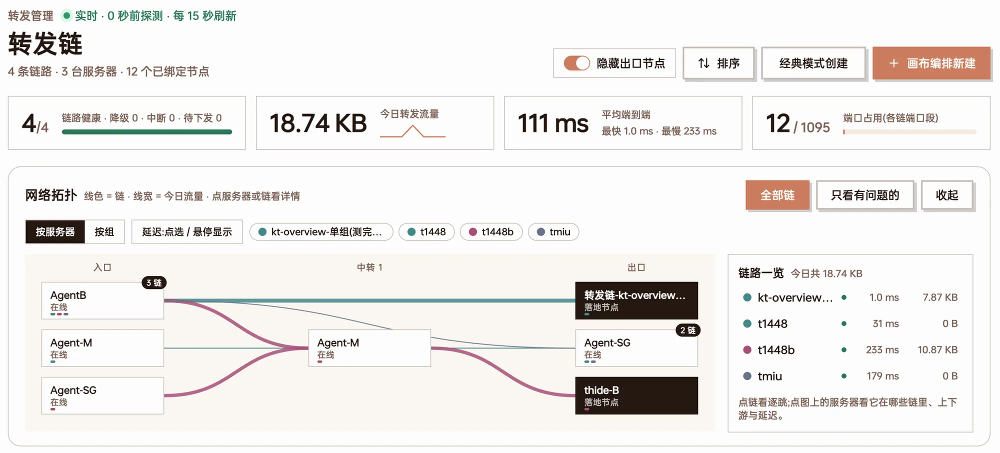
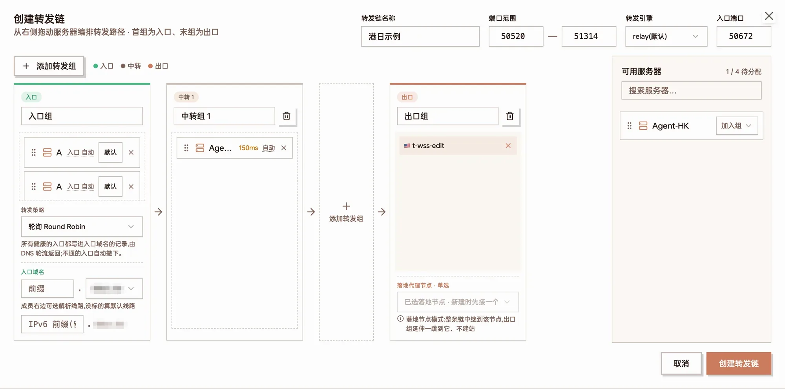
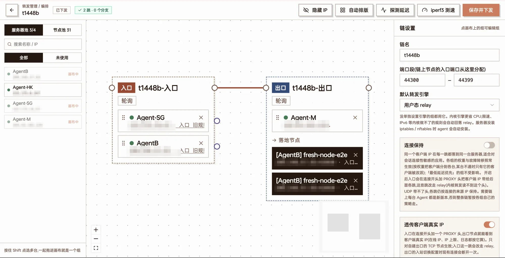
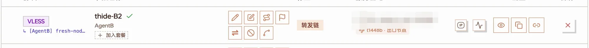
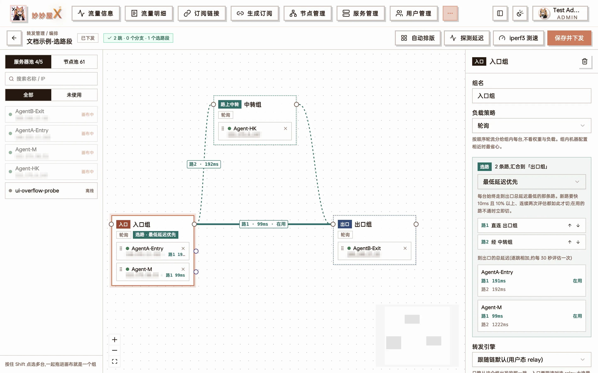
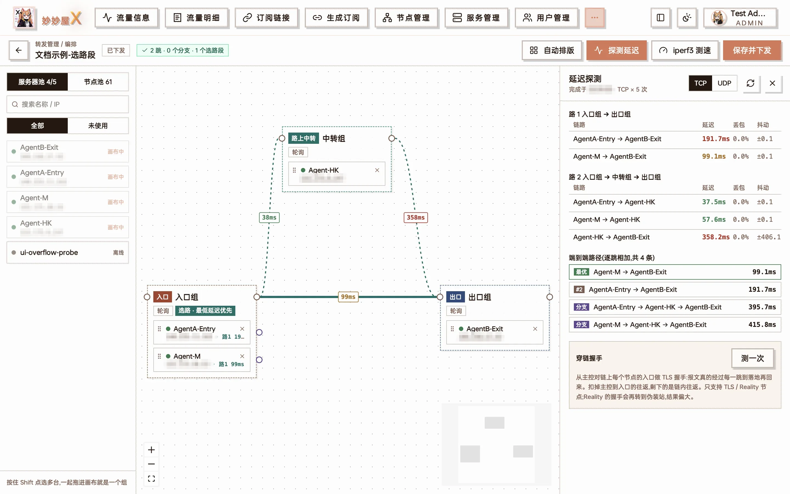
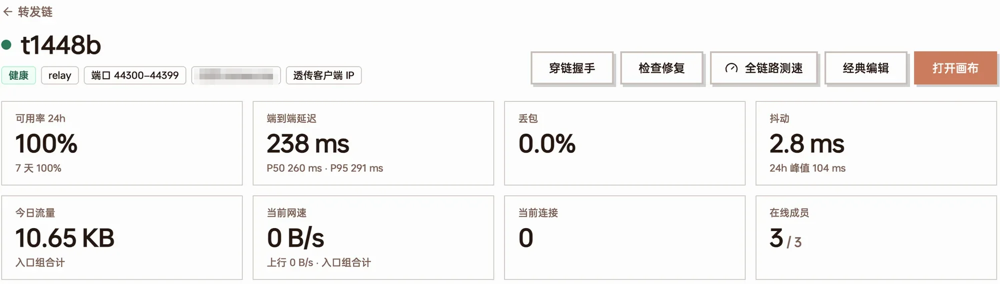
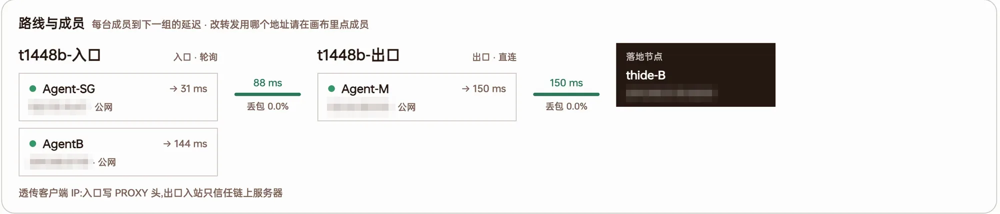

import { Steps } from "@astrojs/starlight/components";
import ForwardDiagram from "@/components/docs/forward-diagram.astro";
import DocShot from "@/components/docs/doc-shot.astro";
import shotCanvasStrategy from "../../../assets/screenshots/ft-canvas-strategy.webp";
import shotCanvasFailover from "../../../assets/screenshots/ft-canvas-failover.webp";
import shotChainSettingsTop from "../../../assets/screenshots/ft-chain-settings-top.webp";
import shotChainSettingsBottom from "../../../assets/screenshots/ft-chain-settings-bottom.webp";
import shotBindNew from "../../../assets/screenshots/ft-bind-new.webp";
import shotBindExisting from "../../../assets/screenshots/ft-bind-existing.webp";
import shotBindComplete from "../../../assets/screenshots/ft-bind-complete.webp";
import shotChangeChain from "../../../assets/screenshots/ft-change-chain.webp";
import shotAddrPicker from "../../../assets/screenshots/ft-addr-picker.webp";
import shotPortPicker from "../../../assets/screenshots/ft-port-picker.webp";
import shotServerPortrange from "../../../assets/screenshots/ft-server-portrange.webp";
import shotDetailDns from "../../../assets/screenshots/ft-detail-dns.webp";
import shotDetailActual from "../../../assets/screenshots/ft-detail-actual.webp";
import shotEntryAddr from "../../../assets/screenshots/ft-entry-addr.webp";

This tutorial is organised by "what you want to do", and every step comes with screenshots and diagrams (the screenshots show the Chinese UI). For the full description and parameters of each feature see [Forwarding](/docs/en/forward); this page only covers how to use them.

## A few terms first

A forward chain strings several servers together: the client connects to the **entry**, traffic passes through **relays** and reaches the **exit**, and the exit then connects to the actual proxy node.

<ForwardDiagram
  caption="A three-hop forward chain: two entry servers form the entry group, one relay in the middle, and the node lives on the exit"
  nodes={[
    { id: "c", x: 0, y: 0.5, label: "Client", kind: "client" },
    { id: "a1", x: 1, y: 0, label: "Entry-Guangzhou", sub: "entry port 50600", kind: "entry" },
    { id: "a2", x: 1, y: 1, label: "Entry-Shanghai", sub: "entry port 50600", kind: "entry" },
    { id: "r", x: 2.15, y: 0.5, label: "Relay-Hong Kong", kind: "relay" },
    { id: "e", x: 3.3, y: 0.5, label: "Exit-Japan", sub: "node lives here", kind: "exit" },
  ]}
  groups={[
    { label: "Entry group", kind: "entry", members: ["a1", "a2"] },
    { label: "Relay group", kind: "relay", members: ["r"] },
    { label: "Exit group", kind: "exit", members: ["e"] },
  ]}
  edges={[
    { from: "c", to: "a1" },
    { from: "c", to: "a2", style: "dim" },
    { from: "a1", to: "r" },
    { from: "a2", to: "r" },
    { from: "r", to: "e" },
  ]}
/>

| Term | Meaning |
| --- | --- |
| Group | The set of servers on one hop. However many servers a group has, that hop can spread traffic across them and they back each other up |
| Entry group | The first hop — the one clients connect to. The node address in subscriptions is the entry's address or the entry domain |
| Relay group | Hops between entry and exit; there can be none, or several |
| Exit group | The last hop. Either the node is built directly on the exit servers (self-built exit), or the exit is followed by an existing landing node |
| Entry port | The port clients connect to; every server in the entry group listens on it |

Before you start, make sure of two things:

- All the servers you want to use are connected and show as online in "Servers"
- If a server has a cloud provider security group / firewall, open the port range the chain will use (default 50520–51314; how to change it is covered below)

## 1. Create a forward chain

There are two buttons at the top right: "Classic create" suits simple straight chains, "New on canvas" gives you every feature. Both create the same kind of chain, and a chain made in classic mode can be opened on the canvas and extended at any time.

Forwarding home page: summary and network topology at the top, "Classic create" and "New on canvas" at the top right

### Option 1: classic mode

<Steps>

1. Click "Classic create" and fill in the "Chain name". Leave "Port range" and "Forwarding engine" at their defaults for now
2. An "Entry group" and an "Exit group" are already there. To add a relay, click "＋ Add a group", which inserts a "Relay group" before the exit group
3. Drag servers from "Available servers" on the right into each group, or use the "Add to group" dropdown at the right of each row
4. Pick one of two exits:
   - **Self-built exit**: drag servers into the exit group; nodes will later be built on them
   - **Landing node**: under the exit group, in "Landing proxy node · single choice", click "＋ Choose landing node…" and pick an existing node; an "Entry port" field appears at the top
5. Click "Create chain". It takes effect as soon as it is saved — classic mode has no separate "push" step

</Steps>

Classic mode: 2 servers in the entry group, 1 in the relay group, the exit attached to a landing node, and the "Entry port" field at the top

When the entry group has two or more servers, a "Forwarding strategy" option appears; below the entry group you can fill in an entry domain (see [Balancing the entry group](#entry-group-balancing-via-the-entry-domain)).

### Option 2: canvas

<Steps>

1. Click "New on canvas". The "Server pool" and "Node pool" are on the left, the settings panel on the right
2. Drag a server from the left onto an empty spot on the canvas to create a group; drop it on an existing group to add it to that group. Shift-click several servers and drag them together to make one group in one go
3. Drag a line from the **dot at the top right of a group** to the next group. The leftmost group is the entry, the rightmost is the exit
4. To use a landing node as the exit, switch to the "Node pool" and drag the node into the exit group
5. Click an empty spot on the canvas and fill in the chain name under "Chain settings" on the right
6. Click "Auto layout" to tidy up, then "Save and push"

</Steps>

Canvas: server pool on the left, "entry group → exit group → landing node" in the middle, chain settings on the right

Changes on the canvas (including changing strategies, adding servers and switching engines) only take effect after "Save and push"; until then the badge at the top shows "Unsaved changes". Double-click a line to delete it.

### Adding servers to an existing chain

Click "Open canvas" on the chain card, drag servers from the left into the group you want, and click "Save and push". "Unused" in the server pool only means "not on this chain" — not that no other chain uses it. A server can appear only once in a chain; dragging it from another group moves it.

After you add servers to the **entry group**, forwarding rules are pushed to the new entries automatically, but subscription nodes don't necessarily gain them:

- The chain has an entry domain: new entries are added to DNS once they are healthy — nothing to do
- No entry domain, or the node has [separate entries](#separate-entries-one-node-per-entry-server) on: on the chain detail page, click "Bind nodes" → "Complete entries", which builds nodes only for the new entries, reusing the existing port and exit

<DocShot src={shotBindComplete} alt="Complete entries" />

"Complete entries": nodes using the entry domain are skipped automatically; nodes built per entry IP list the new entries as "to complete"

:::caution[Classic edit resets weights]
Saving a chain with "Classic edit" resets every member's weight to 1. If you set "Weighted" weights on the canvas, always edit that chain on the canvas.
:::

## 2. Bind nodes

A freshly created chain has no nodes, so clients have nothing to connect to. After you bind a node, subscriptions gain a node whose address is the **entry** and whose port is the **entry port**:

<ForwardDiagram
  caption="Before binding the client connects to the exit directly; after binding it connects to the entry and traffic travels the chain to the exit"
  nodes={[
    { id: "c1", x: 0, y: 0, label: "Client", kind: "client" },
    { id: "n1", x: 2.6, y: 0, label: "Japan node", sub: "jp.example.com:443", kind: "exit" },
    { id: "c2", x: 0, y: 1.6, label: "Client", kind: "client" },
    { id: "a", x: 1.3, y: 1.6, label: "Entry-Guangzhou", sub: "gz.example.com:50600", kind: "entry", w: 1.05 },
    { id: "e", x: 2.6, y: 1.6, label: "Exit-Japan", kind: "exit" },
  ]}
  edges={[
    { from: "c1", to: "n1", style: "dim", label: "Before: direct" },
    { from: "c2", to: "a", label: "After binding" },
    { from: "a", to: "e" },
  ]}
/>

Where to find it: a chain card with no bound node shows "Bind nodes" directly; once bound, it's in the card's "…" menu, or at the top right of "Bound nodes" on the chain detail page. The dialog has three tabs, and all three **add** nodes — none replaces an existing one.

### Option A: new node (self-built exit)

Use this when the exit group contains your own servers.

<Steps>

1. On the "New node" tab, fill in "Node name (optional)"; left empty, it is called "转发链-" (forward chain) followed by the chain name
2. Turn on "Separate entries" / "Separate exits" as needed (see [the next section](#separate-entries-and-separate-exits)); the dialog then shows "N nodes will be created"
3. Click "Next" and choose the protocol, transport and certificate. The master creates the same inbound on every server in the exit group (credentials are shared across the chain) and assigns the port automatically

</Steps>

<DocShot src={shotBindNew} alt="New node" />

New node: with "Separate entries" on, 2 entry servers produce 2 nodes

You can't create a new node if the exit group has an offline server, or if the chain has only one group. WireGuard can't go through a forward chain.

### Option B: bind an existing node (landing node)

Use this when the exit is followed by an existing node (which may be someone else's landing machine).

<Steps>

1. Switch to "Bind existing node" and pick a node under "Choose existing node"
2. "Port" is the entry port; leave it empty to have a free one picked automatically
3. Click "Bind and create entry node"

</Steps>

<DocShot src={shotBindExisting} alt="Bind existing node" />

Bind existing node: pick the node; leave the port empty to have one assigned

Whether TCP or UDP is forwarded is decided by the landing node's protocol (Hysteria2 and the like use UDP). If the node has "related nodes" sharing the same IP and port (its parent node, or routed-outbound children of the same parent), a dialog lets you tick whether to move them onto this chain too.

You can also attach a landing node on the canvas: drag the node from the "Node pool" into the exit group; in the right panel you can fill in the "Entry port" and choose the "Forwarding protocol" (TCP / UDP / TCP + UDP), then "Save and push".

### Adding from Nodes

Under "Nodes → Add node", choose the "Forward chain" tab: pick the chain, set "Exit type" to "New node" or "Existing node"; the "Random" button next to the port picks a free port within the range the entry servers allow.

### What address goes into subscriptions

- **Address**: the entry domain if the chain has one; otherwise the "entry address" of the first server in the entry group (see below)
- **Port**: the entry port
- **Protocol and credentials**: from the inbound on the exit, or from the landing node itself

### IP or domain as the entry address

Each server in the entry group can choose which address goes into subscriptions. Open the canvas and click the "入口 …" (entry) button on an entry-group member row (tooltip: "订阅里写的入口地址,点击切换" — the entry address written into subscriptions); the top of the popover is the "entry address" section (written into subscriptions / entry nodes; this is what clients connect to):

<DocShot src={shotEntryAddr} alt="Entry address" />

The entry address popover: this chain existed before the feature shipped, so it has an extra "legacy rule" row; the lower half is the outbound address this server uses to reach the next hop

| Option | Address written into subscriptions |
| --- | --- |
| Auto (follow the server address) | Same as regular nodes: the server's domain if it has one, otherwise its IP; follows the server address when it changes. Default for new chains and for servers newly added to the entry group |
| IPv4 / IPv6 | This server's public IPv4 / IPv6 (the manually entered address when "lock node entry IP" is on); greyed out if the server has no such address |
| Manual / registered domain | "Specify" a domain or IP, e.g. a CDN-fronted domain; domains registered for this server in Server management are listed directly |
| Legacy rule (IP first) | Only shown on chains created before this feature: IP if there is one, otherwise the domain. Stays this way until you change it |

- Clicking an option saves immediately; entry nodes still on this server's old address move to the new one, and clients pick it up after refreshing the subscription
- If the chain has an entry domain, the single (non-separated) entry node keeps using the entry domain; this setting only applies to the per-server nodes created by [separate entries](#separate-entries-one-node-per-entry-server) and "Complete entries"
- Without an entry domain and without separate entries, the chain has a single entry node that uses the setting of the **first** server in the entry group
- If the chosen option yields no address (e.g. IPv6 was chosen and the server later lost its IPv6), it falls back to the legacy rule instead of writing an empty address
- When creating a chain in classic mode, the "入口 自动" (entry: auto) button on entry-group member rows changes the same setting

### How to unbind

There is no dedicated "Unbind" button; use any of these:

- Delete that entry node in Nodes; related nodes automatically go back to their original address
- Landing node: remove it from the exit group on the canvas / in classic edit, and save
- Rebind to another chain: in the ["Change forward chain" dialog](#change-the-entry-port-of-a-bound-node), click another chain

## Separate entries and separate exits

These two switches exist only under "New node". With both off, a chain produces **one** node; with them on, it is split into several nodes by entry / exit.

### Separate entries: one node per entry server

<ForwardDiagram
  caption="Not separated: subscriptions have just one node, its address is the entry domain, and DNS decides which entry is used"
  nodes={[
    { id: "n", x: 0, y: 0.5, label: "Node", sub: "hk.example.com:50600", kind: "plain", w: 1.1 },
    { id: "d", x: 1.3, y: 0.5, label: "Entry domain", kind: "dns" },
    { id: "a1", x: 2.5, y: 0, label: "Entry-CT", kind: "entry" },
    { id: "a2", x: 2.5, y: 1, label: "Entry-CU", kind: "entry" },
  ]}
  edges={[
    { from: "n", to: "d", style: "dns" },
    { from: "d", to: "a1", style: "dns" },
    { from: "d", to: "a2", style: "dns" },
  ]}
/>

<ForwardDiagram
  caption="Separate entries: one node per entry server, addressed by that entry's IP; users pick for themselves (CT = China Telecom, CU = China Unicom)"
  nodes={[
    { id: "m1", x: 0, y: 0, label: "Node [Entry-CT]", sub: "1.1.1.1:50600", kind: "plain", w: 1.2 },
    { id: "m2", x: 0, y: 1, label: "Node [Entry-CU]", sub: "2.2.2.2:50600", kind: "plain", w: 1.2 },
    { id: "b1", x: 1.6, y: 0, label: "Entry-CT", kind: "entry" },
    { id: "b2", x: 1.6, y: 1, label: "Entry-CU", kind: "entry" },
  ]}
  edges={[
    { from: "m1", to: "b1" },
    { from: "m2", to: "b2" },
  ]}
/>

- Each node's address is that entry server's own IP, and the port is the same for all; forwarding rules don't change (every server in the entry group already listens on that port)
- These nodes don't use the entry domain, so the entry group's DNS strategy and [split-line DNS](#split-line-dns) have **no effect** on them — users choose the entry in their client
- Good for: no entry domain, or a DNS provider without split lines, while still letting users pick a China Telecom or China Unicom entry themselves

### Separate exits vs exit-group load balancing

When the exit group has several servers, there are two opposite ways to use it:

<ForwardDiagram
  caption="Not separated: one node, and the exit group's load strategy spreads connections across both exits (this is exit load balancing)"
  nodes={[
    { id: "n", x: 0, y: 0.5, label: "Node", sub: ":50600", kind: "plain" },
    { id: "a", x: 1.2, y: 0.5, label: "Entry", kind: "entry" },
    { id: "e1", x: 2.6, y: 0, label: "Exit-Japan", kind: "exit" },
    { id: "e2", x: 2.6, y: 1, label: "Exit-US", kind: "exit" },
  ]}
  groups={[{ label: "Exit · round robin", kind: "exit", members: ["e1", "e2"] }]}
  edges={[
    { from: "n", to: "a" },
    { from: "a", to: "e1", label: "by strategy", dx: -6, dy: -8 },
    { from: "a", to: "e2" },
  ]}
/>

<ForwardDiagram
  caption="Separate exits: one node and one dedicated entry port per exit server; connections always land on that server"
  nodes={[
    { id: "n1", x: 0, y: 0, label: "Node [→Japan]", sub: ":50601", kind: "plain" },
    { id: "n2", x: 0, y: 1, label: "Node [→US]", sub: ":50602", kind: "plain" },
    { id: "a", x: 1.45, y: 0.5, label: "Entry", kind: "entry" },
    { id: "e1", x: 2.9, y: 0, label: "Exit-Japan", kind: "exit" },
    { id: "e2", x: 2.9, y: 1, label: "Exit-US", kind: "exit" },
  ]}
  edges={[
    { from: "n1", to: "a", label: ":50601" },
    { from: "n2", to: "a", label: ":50602", dy: 22 },
    { from: "a", to: "e1", label: "Japan only" },
    { from: "a", to: "e2", label: "US only", dy: 22 },
  ]}
/>

| | Separate exits off | Separate exits on |
| --- | --- | --- |
| Number of nodes | 1 | One per server in the exit group |
| Entry port | One shared by the whole group | One per exit server |
| Which exit a connection goes to | Decided by the exit group's load strategy | Always the server the node belongs to; the exit group's strategy doesn't apply |
| Good for | Several exits sharing traffic and backing each other up | Exits with different purposes (unlocking, regions), where users need to pick a specific one |

If you want "traffic spread over several exits", **don't** turn on separate exits — choose a load strategy on the exit group instead (see [Load balancing](#4-load-balancing)). With both switches on, the number of nodes = entries × exits, named "name [entry→exit]".

## 3. Change ports

### How ports are assigned

A binding has a single entry port, and every server in the entry group listens on it. Later relays and exits each use their own port: if the entry port is inside the range that server allows, it is reused; otherwise the server picks another port from its own range, and the previous hop points at it automatically.

<ForwardDiagram
  caption="Entry port 50600; the relay has no range limit, so it reuses it; the exit is limited to 45000–45009, so it picks 45003 within that range"
  nodes={[
    { id: "c", x: 0, y: 0.5, label: "Client", kind: "client" },
    { id: "a1", x: 1.2, y: 0, label: "Entry A", sub: "listens :50600", kind: "entry" },
    { id: "a2", x: 1.2, y: 1, label: "Entry B", sub: "listens :50600", kind: "entry" },
    { id: "r", x: 2.45, y: 0.5, label: "Relay", sub: "reuses :50600", kind: "relay" },
    { id: "e", x: 3.75, y: 0.5, label: "Exit", sub: "picks :45003 in range", kind: "exit", w: 1.2 },
  ]}
  edges={[
    { from: "c", to: "a1", label: ":50600", dx: -8, dy: -6 },
    { from: "c", to: "a2", style: "dim" },
    { from: "a1", to: "r" },
    { from: "a2", to: "r" },
    { from: "r", to: "e", label: "→ :45003" },
  ]}
/>

### Change the chain's port range

The chain's port range determines where new nodes' entry ports are picked from; the default is 50520–51314. On the canvas, click an empty spot and edit "Port range (entry ports of nodes on this chain are allocated from here)" under "Chain settings", then "Save and push"; in classic mode the field is called "Port range" as well.

<DocShot src={shotChainSettingsTop} alt="Chain settings" />

Chain settings: chain name, port range, default forwarding engine, sticky connections

Changing the port range only affects ports allocated from now on; nodes that are already bound keep their ports.

### Limit the port range of a particular server

When a NAT machine maps only a block of ports, or a server only allows some ports, give it a range:

- **For all chains**: "Servers" → edit the server → "Random port range (optional)". Whenever this server gets nodes or takes part in forwarding, its ports fall within that range

<DocShot src={shotServerPortrange} alt="Server random port range" />

The port range set on a server in Servers is respected by forwarding too

- **For this chain only**: open the canvas, click "· Port" on the member row, fill in "Start port" and "End (empty = single port)", and click "Save and push" inside the popover — it takes effect immediately (no need to click the save button at the top). "Reset to default" goes back to the server's own range

<DocShot src={shotPortPicker} alt="Member port settings" />

Member port popover: this server has no chain-specific range, so it uses its own range 45000–45009; below it, how entry ports map to the ports this server actually listens on

Priority: set on the chain > the server's own range > unrestricted. A range on an entry server limits which entry ports can be chosen; the ranges of the entry group's servers must intersect, otherwise your only option is [separate entries](#separate-entries-one-node-per-entry-server).

### Change the entry port of a bound node

This is done not in Forwarding but in **Nodes**:

<Steps>

1. Find the node in Nodes and click the forward chain mark under its address (the tooltip says "Click to change forward chain")

   

2. In the "Change forward chain" dialog that opens, edit "Entry port" and click "Change port"

   <DocShot src={shotChangeChain} alt="Change forward chain dialog" />

3. Once it reports "Entry port changed to …, takes effect after clients update their subscription", ask users to update their subscriptions

</Steps>

Forwarding rules, sibling nodes on the same port (produced by separate entries), related nodes and the inbound on the exit all move together: everything is built on the new port and pushed successfully before the old one is removed, and a failure midway rolls the whole thing back, so connections are not interrupted. Clicking a chain in the list at the bottom of the dialog rebinds the node to that chain (the port is assigned automatically).

### Port-related errors

| Message | Cause and fix |
| --- | --- |
| The port ranges open on the entry group's servers don't intersect | The ranges of the entry servers don't overlap; adjust the ranges or turn on separate entries |
| Entry server "X" only opens ports a-b | The port you entered is outside that entry server's range |
| Already used by this chain or another forward on the same entry server | Pick another, or leave it empty to have one assigned |
| This port is already in use by another program on entry / exit server X | Something else on the server is using the port |

## 4. Load balancing

### Remember one rule: the strategy goes on the group being balanced

A group's "Load strategy" decides **how connections are spread across that group's members**, and it is carried out by the **previous hop**. To change how the "entry → relay" hop distributes traffic, edit the **relay group's** strategy.

<ForwardDiagram
  caption={'Choose "Weighted" on the relay group with weights 2 : 1, and each entry server splits connections 2 : 1 across the two relays'}
  nodes={[
    { id: "a", x: 0, y: 0.5, label: "Entry A", kind: "entry" },
    { id: "r1", x: 1.5, y: 0, label: "Relay 1", sub: "weight 2", kind: "relay" },
    { id: "r2", x: 1.5, y: 1, label: "Relay 2", sub: "weight 1", kind: "relay" },
    { id: "e", x: 3, y: 0.5, label: "Exit", kind: "exit" },
  ]}
  groups={[{ label: "Relay · weighted", kind: "relay", members: ["r1", "r2"] }]}
  edges={[
    { from: "a", to: "r1", label: "~2/3" },
    { from: "a", to: "r2", label: "~1/3", dy: 20 },
    { from: "r1", to: "e" },
    { from: "r2", to: "e" },
  ]}
/>

### The seven group load strategies

Select a group on the canvas and pick one under "Load strategy" on the right:

<DocShot src={shotCanvasStrategy} alt="Load strategy" />

The load strategy dropdown in the group settings

| Strategy | How it spreads | Good for |
| --- | --- | --- |
| Round robin | Gives connections to each server in turn | Servers with similar specs |
| Weighted | By weight; weight 2 gets about twice as much as weight 1 | Different bandwidth or specs |
| Least connections | Prefers the server with the fewest current connections | Long-lived connections, large downloads |
| Most remaining traffic | The more traffic left, the larger the share; recalculated every 5 minutes | Servers with traffic quotas |
| By period | The closer to the traffic reset day, the larger the share — quota about to expire is used first | Servers with different reset days |
| Lowest latency | Uses only the server with the lowest total latency to the exit, the rest stand by; switches within seconds when it fails | Latency first |
| Primary / backup | Uses only the first server in the list that is still reachable; later ones take over only when the ones before them are down, and traffic moves back once they recover | One primary, the rest standby |

- **Weights**: after choosing "Weighted", each row under "Members and weights" on the right gets a number box
- **Primary / backup order**: it is simply the member order; adjust it with the up / down buttons on each member row
- In classic mode the option is called "Forwarding strategy" and offers only five: round robin, least connections, primary / backup, most remaining traffic and by period. For weighted and lowest latency, use the canvas

### Failover

Turn on "Failover" in the group settings and fill in "Latency above … ms counts as unhealthy (0 = only check for down)". When a server in the group fails its probes or exceeds the threshold, it is temporarily taken out, and it is added back automatically once it recovers. The same threshold is what the overview uses to mark a chain "degraded".

<DocShot src={shotCanvasFailover} alt="Failover" />

Failover: with the threshold at 0, a server is only removed when it's down

### Entry group: balancing via the entry domain

The entry group has no previous hop; which entry a client connects to is decided by the **DNS records of the entry domain**. So the entry group's strategy only works once an entry domain is set: click an empty spot on the canvas, choose a wildcard certificate under "Entry domain (optional)", and fill in a v4 prefix (and an optional v6 prefix). Every 17 seconds the master maintains the DNS records according to entry health and the entry group's strategy.

<DocShot src={shotChainSettingsBottom} alt="Entry domain settings" />

Lower half of the chain settings: real client IP passthrough and the entry domain

| Entry-group strategy | Actual effect |
| --- | --- |
| Round robin | Every healthy entry goes into DNS and DNS rotates between them; unreachable ones are withdrawn automatically |
| Lowest latency | Only the entry with the lowest total latency to the exit is published; another entry must be 15% faster plus 5ms before it takes over |
| Primary / backup | Only the first entry in the list that is still healthy is published |
| Least connections | Every healthy entry is published; entries with clearly more connections than the least busy one are withdrawn for now (a coarse, minute-level adjustment) |
| Most remaining traffic / By period | Entries that lag far behind are withdrawn for now |
| Weighted | Not possible with DNS; treated as round robin (the UI shows "Weighted (not for entry)") |

The "Entry DNS" card on the chain detail page shows whether each entry is published and whether public resolution matches:

<DocShot src={shotDetailDns} alt="Entry DNS card" />

Entry DNS: the expected records match public resolution, and both entries are published

### Split-line DNS

When the entry domain's DNS provider is Alibaba Cloud, Tencent Cloud or DNSPod, entry-group members can be tagged with a line: Default / China Telecom / China Unicom / China Mobile / Overseas. China Telecom users resolve to the entries tagged China Telecom, China Unicom users to the ones tagged China Unicom.

<ForwardDiagram
  caption="One entry domain: users on different carriers resolve to the entries on their own line (CT = China Telecom, CU = China Unicom)"
  nodes={[
    { id: "u1", x: 0, y: 0, label: "CT users", kind: "client" },
    { id: "u2", x: 0, y: 1, label: "CU users", kind: "client" },
    { id: "d", x: 1.25, y: 0.5, label: "Entry domain", sub: "hk.example.com", kind: "dns" },
    { id: "a1", x: 2.5, y: 0, label: "Entry-CT", sub: "line: CT", kind: "entry" },
    { id: "a2", x: 2.5, y: 1, label: "Entry-CU", sub: "line: CU", kind: "entry" },
  ]}
  edges={[
    { from: "u1", to: "d", style: "dns" },
    { from: "u2", to: "d", style: "dns" },
    { from: "d", to: "a1", style: "dns", label: "CT line" },
    { from: "d", to: "a2", style: "dns", label: "CU line", dy: 22 },
  ]}
/>

Pick the line on the member rows of the entry group on the canvas, or next to each server in the entry group in classic mode. Within each line, entries are still chosen by the entry group's strategy; when every entry on a line is down, users on that network fall back to the default line. Cloudflare, NameSilo and GoDaddy don't support lines, so tags have no effect there.

### Sticky connections

"Sticky connections" is a chain-wide switch (in the chain settings): when on, the same client IP lands on the same server at **every hop**, while each group's weights and failover still apply. It suits sites that apply risk control by exit IP, multi-connection downloads, and limits on the number of online IPs. Turning it on also turns on "Pass through real client IP", and requires every Agent on the chain to be a recent version.

### Which to choose

| You want | Set it up like this |
| --- | --- |
| Several entries sharing the load, with failed ones removed automatically | An entry domain + "Round robin" on the entry group |
| Users connect only to the fastest entry | An entry domain + "Lowest latency" on the entry group |
| China Telecom / China Unicom users each on their own entry | An entry domain (Alibaba Cloud / Tencent Cloud) + split-line DNS |
| Several exits sharing load in proportion to bandwidth | "Weighted" on the exit group, with weights |
| One exit as primary, another as backup | "Primary / backup" on the exit group, primary listed first |
| A user's exit IP should not change | Turn on "Sticky connections" |
| Let users pick the exit themselves | Turn on "Separate exits" when creating the node |

## 5. Private networking between servers

When two servers are in the same data centre / on the same private network, having the previous hop reach this server over its private address saves public traffic and lowers latency.

<ForwardDiagram
  caption="Relay and exit are on the same private network: the previous hop connects to the exit's private address instead of going over the internet"
  nodes={[
    { id: "a", x: 0, y: 0.5, label: "Entry", kind: "entry" },
    { id: "r", x: 1.3, y: 0.5, label: "Relay-Tokyo 1", sub: "10.0.0.11", kind: "relay" },
    { id: "e", x: 2.9, y: 0.5, label: "Exit-Tokyo 2", sub: "10.0.0.12 / public IP", kind: "exit", w: 1.2 },
  ]}
  edges={[
    { from: "a", to: "r" },
    { from: "r", to: "e", style: "lan", label: "LAN 10.0.0.12" },
  ]}
/>

<Steps>

1. Open the chain's canvas (the chain must have been saved), and on the member row of **the server being connected to** (the exit in the example above) click the address button (tooltip: "Address used for forwarding, click to switch")
2. The popover "Address used for forwarding (used when the previous hop connects here)" lists all of this server's addresses, marks private ones "Private", and shows the probe results from each previous hop
3. Two ways to use it:
   - **Auto (by probe results)**: click "Latency probe" at the top and the master tries the private addresses as well; each previous hop picks the fastest reachable one, preferring the private address on a tie. If the two servers aren't on the same private network, they automatically keep using the public address
   - **Click a private address directly**: every previous hop switches to that address

</Steps>

<DocShot src={shotAddrPicker} alt="Address used for forwarding" />

Address popover: the upper half chooses which address the previous hop uses to reach this server, the lower half chooses which address this server connects to the next hop from (this server has no private network interface, so only public addresses are listed)

A few notes:

- Clicking an option **saves and re-pushes immediately** — no need to click "Save and push"
- The private addresses come from the network interface list read live from the Agent when the popover opens; only 10.x / 172.16–31.x / 192.168.x, 100.64.x and IPv6 ULA are marked "Private"
- If you pick a private address by hand but the previous hop can't actually reach it, that forward stops working. Saving doesn't validate it, so click "Latency probe" first to check the result, or just use "Auto"
- Auto mode only tries private addresses when you click "Latency probe"; there is no periodic background probe
- When the upstream is a private address, the kernel forwarding engine falls back to relay automatically
- The "Outbound address" in the lower half of the popover is for servers with several public IPs where you need to choose which IP connects to the next hop; normally leave it at "System default"

## 6. Route selection between servers

Servers in the same group may have very different line quality to the next hop. There are two ways to let them take different routes.

### Branch: make one server always detour through an extra hop

<ForwardDiagram
  caption="Entry B's direct route to the exit is poor, so give it a branch: it goes through its own branch relay and then rejoins at the exit"
  nodes={[
    { id: "a1", x: 0, y: 0, label: "Entry A", kind: "entry" },
    { id: "a2", x: 0, y: 1.2, label: "Entry B", kind: "entry" },
    { id: "b", x: 1.4, y: 1.2, label: "Branch relay", kind: "relay" },
    { id: "e", x: 2.8, y: 0.6, label: "Exit", kind: "exit" },
  ]}
  groups={[{ label: "Entry group", kind: "entry", members: ["a1", "a2"] }]}
  edges={[
    { from: "a1", to: "e", label: "main line" },
    { from: "a2", to: "b", style: "branch", label: "branch" },
    { from: "b", to: "e", style: "branch" },
  ]}
/>

<Steps>

1. On the canvas, drag a line from the **small purple dot on the right of the member row** that should detour, to a group (it becomes a "branch relay" group)
2. Then connect the dot at the top right of the branch relay group back to the **next hop** of the main line
3. "Save and push"

</Steps>

A branch must rejoin the next hop, a server can have only one branch, and the exit group cannot branch. Until it rejoins, the canvas warns "X's branch has not rejoined the main line yet".

### Path set: each server picks its own fastest route

<ForwardDiagram
  caption="Two routes from the entry group to the exit group: A is faster direct and uses route 1, B is faster through the relay and uses route 2"
  nodes={[
    { id: "a1", x: 0, y: 0, label: "Entry A", sub: "R1 20ms · R2 90ms", kind: "entry", w: 1.1 },
    { id: "a2", x: 0, y: 1.3, label: "Entry B", sub: "R1 180ms · R2 70ms", kind: "entry", w: 1.1 },
    { id: "r", x: 1.55, y: 1.3, label: "Relay-Japan", kind: "relay" },
    { id: "e", x: 3, y: 0.65, label: "Exit", kind: "exit" },
  ]}
  groups={[{ label: "Entry · path set", kind: "entry", members: ["a1", "a2"] }]}
  edges={[
    { from: "a1", to: "e", style: "path", label: "Route 1 direct · used by A" },
    { from: "a2", to: "r", style: "path", label: "Route 2" },
    { from: "r", to: "e", style: "path", label: "used by B", dx: 14, dy: 20 },
  ]}
/>

<Steps>

1. From the **dot at the top right of a group**, draw 2–4 lines, each through a different relay (connecting straight to the converging group is the "direct" route), all converging on **the same group**
2. These lines turn teal; select the group they start from and a "Route selection strategy" appears on the right: "Lowest latency", "Primary / backup", "Split by weight"
3. "Save and push". The chain needs bound nodes before there is probe data and a route result

</Steps>

The route-selection section lists, per server, each route's total latency to the exit and marks the route each one is using

"Lowest latency" is decided **per server**: evaluated roughly every 30 seconds, it switches only when the new route is at least 10ms and 10% faster for two consecutive rounds, and moves off immediately if the current route fails. On the canvas the active route is a thick solid line labelled "路N · Xms · 在用" (route N · X ms · in use); "Actual path" on the chain detail page shows the route each entry is really taking right now:

<DocShot src={shotDetailActual} alt="Actual path" />

Actual path: every hop each of the two entries passes through, and the total latency

### Branch or path set

| | Branch | Path set |
| --- | --- | --- |
| Who decides the route | You, fixed | Each server, automatically by latency |
| Scope | One server in the group | Every server in the whole group |
| Servers added later | Take the main line by default | Join route selection automatically |
| Good for | You know a particular server's direct route is poor | You're not sure which route is better, or lines fluctuate |

## 7. Check whether the chain works

- **"Latency probe" on the canvas**: temporarily opens listeners in the chain's port range, measures latency / loss / jitter hop by hop, and ranks every entry-to-exit combination end to end; for TLS / Reality nodes it also performs a real handshake through the whole chain

The latency probe panel

- **Chain detail page**: availability, end-to-end latency, loss, jitter and traffic at the top; "Route and members" lists each server's latency to the next group

Top of the chain detail page: health status, engine, port range, entry domain, plus "Through-chain handshake", "Full-chain speed test", "Classic edit" and "Open canvas"

Route and members: latency and loss from the two entries to the exit, then from the exit to the landing node

- **Full-chain speed test**: a button at the top of the detail page that runs iperf3 from every entry to every exit over the real forwarding path
- **Alerts**: "Forward chain node down / entry DNS abnormal alert" under "System settings → Notifications" sends a Telegram message when a node stays unreachable or entry resolution goes wrong

## FAQ

**I changed the canvas but nothing happened?**
Canvas changes need "Save and push". Only the member row's "Port" and the address popover take effect the moment you click them.

**I chose a strategy for the entry group, but it seems to have no effect?**
The entry group works through the entry domain's DNS; without an entry domain, clients connect to one fixed entry. Also, nodes with separate entries on don't use the entry domain and aren't affected by the entry group's strategy.

**I added a server to the entry group, but it's not in the subscription?**
With an entry domain it is added to DNS automatically; without one, or for separate-entry nodes, use "Bind nodes → Complete entries" to build them.

**The whole chain stopped working after I picked a private address?**
The previous hop can't reach that private address. Switch back to "Auto (by probe results)", or click "Latency probe" first to confirm it works before picking it by hand.

**After saving with classic edit, all weights became 1?**
Classic mode doesn't save weights. Edit chains with weights on the canvas; fill the weights in again and "Save and push".

**I changed the chain's port range, but existing nodes kept their ports?**
The port range only governs newly allocated ports. To change an existing node, click the forward chain mark in Nodes and use "Change port".
