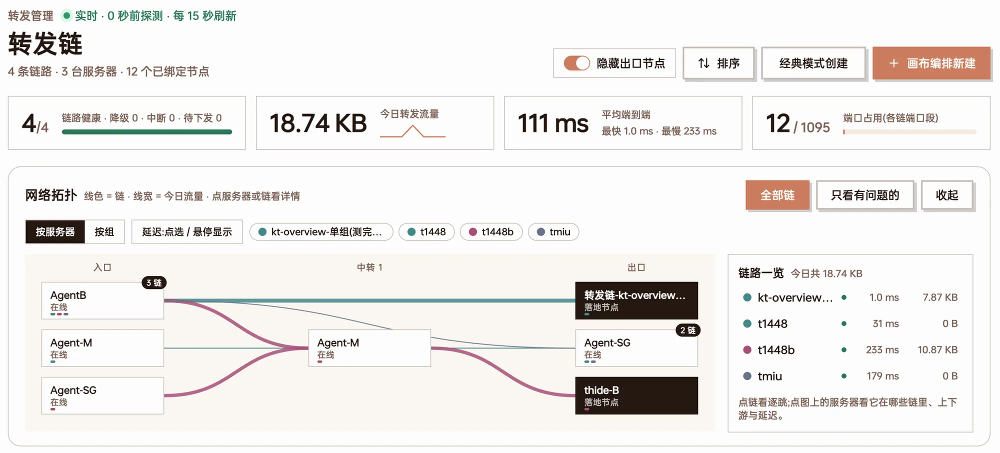
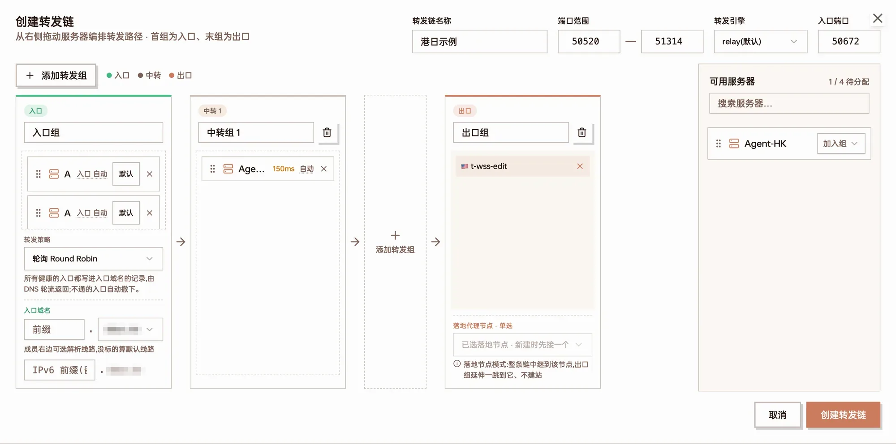
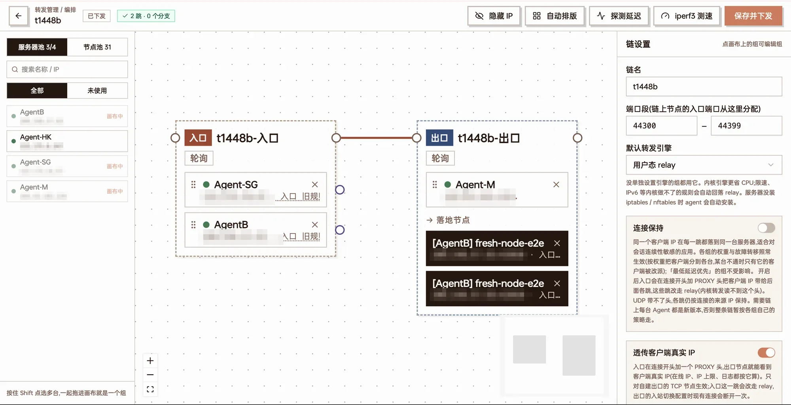
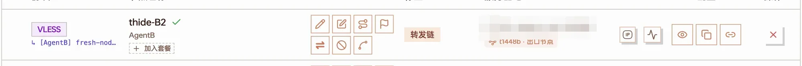
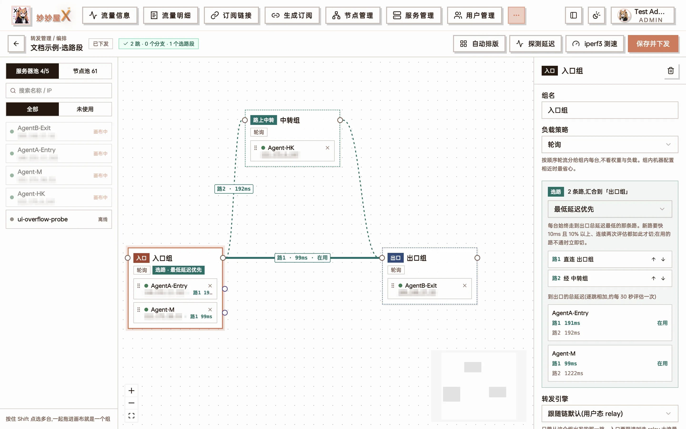
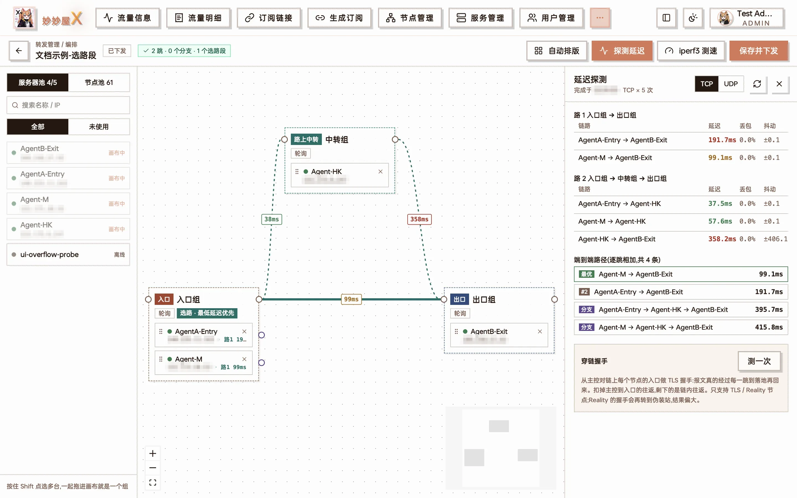
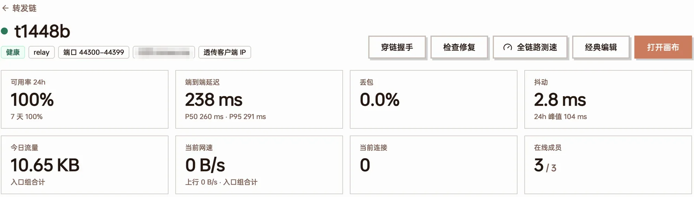
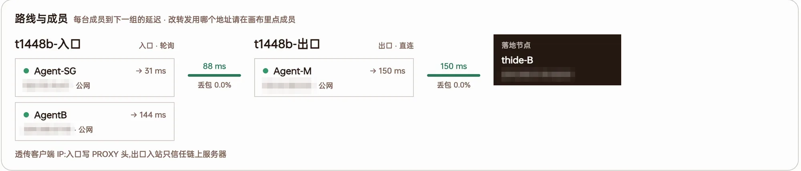
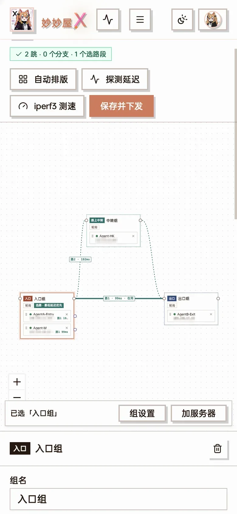

import { Steps } from "@astrojs/starlight/components";
import ForwardDiagram from "@/components/docs/forward-diagram.astro";
import DocShot from "@/components/docs/doc-shot.astro";
import shotCanvasStrategy from "../../../assets/screenshots/ft-canvas-strategy.webp";
import shotCanvasFailover from "../../../assets/screenshots/ft-canvas-failover.webp";
import shotChainSettingsTop from "../../../assets/screenshots/ft-chain-settings-top.webp";
import shotChainSettingsBottom from "../../../assets/screenshots/ft-chain-settings-bottom.webp";
import shotBindNew from "../../../assets/screenshots/ft-bind-new.webp";
import shotBindExisting from "../../../assets/screenshots/ft-bind-existing.webp";
import shotBindComplete from "../../../assets/screenshots/ft-bind-complete.webp";
import shotChangeChain from "../../../assets/screenshots/ft-change-chain.webp";
import shotAddrPicker from "../../../assets/screenshots/ft-addr-picker.webp";
import shotPortPicker from "../../../assets/screenshots/ft-port-picker.webp";
import shotServerPortrange from "../../../assets/screenshots/ft-server-portrange.webp";
import shotDetailDns from "../../../assets/screenshots/ft-detail-dns.webp";
import shotDetailActual from "../../../assets/screenshots/ft-detail-actual.webp";
import shotEntryAddr from "../../../assets/screenshots/ft-entry-addr.webp";

Forwarding (转发管理) links several servers into a forward chain: clients connect to an entry server, traffic is forwarded hop by hop to the exit, and the exit lands on a proxy node. Forwarding is implemented natively by the Agent (not through Xray). Each hop is an independent port forward, and the master orchestrates, pushes and monitors the whole chain.

Typical uses:

- Route optimisation: a client-friendly machine as entry (e.g. a domestic relay), a landing machine as exit, extra relay hops as needed
- A group of entry servers sharing the load, with a failed one taken out automatically
- Several possible routes from a group to the exit, with each server picking its own fastest one
- Servers connected by a private network or a private line (IX / IPLC), with forwarding going over it instead of the internet

This page is organised by "what you want to do"; steps come with screenshots (of the Chinese UI) and diagrams, and the detailed rules of each feature sit in the matching section. Forwarding is an admin feature. Regular users get "My forwards", see [Opening forwarding to users](#opening-forwarding-to-users).

## A few terms first

A forward chain strings several servers together: the client connects to the **entry**, traffic passes through **relays** and reaches the **exit**, and the exit then connects to the actual proxy node.

<ForwardDiagram
  caption="A three-hop forward chain: two entry servers form the entry group, one relay in the middle, and the node lives on the exit"
  nodes={[
    { id: "c", x: 0, y: 0.5, label: "Client", kind: "client" },
    { id: "a1", x: 1, y: 0, label: "Entry-Guangzhou", sub: "entry port 50600", kind: "entry" },
    { id: "a2", x: 1, y: 1, label: "Entry-Shanghai", sub: "entry port 50600", kind: "entry" },
    { id: "r", x: 2.15, y: 0.5, label: "Relay-Hong Kong", kind: "relay" },
    { id: "e", x: 3.3, y: 0.5, label: "Exit-Japan", sub: "node lives here", kind: "exit" },
  ]}
  groups={[
    { label: "Entry group", kind: "entry", members: ["a1", "a2"] },
    { label: "Relay group", kind: "relay", members: ["r"] },
    { label: "Exit group", kind: "exit", members: ["e"] },
  ]}
  edges={[
    { from: "c", to: "a1" },
    { from: "c", to: "a2", style: "dim" },
    { from: "a1", to: "r" },
    { from: "a2", to: "r" },
    { from: "r", to: "e" },
  ]}
/>

| Term | Meaning |
| --- | --- |
| Forward chain | A complete path from entry to exit, made of groups in order |
| Group | The set of servers on one hop. However many servers a group has, that hop can spread traffic across them and they back each other up. How connections are spread across members is decided by **this group's own** load strategy and carried out by the previous hop |
| Entry group | The first hop — the one clients connect to. The node address in subscriptions is the entry's address or the entry domain |
| Relay group | Hops between entry and exit; there can be none, or several |
| Exit group | The last hop. Either the node is built directly on the exit servers (self-built exit), or the exit is followed by an existing landing node |
| Entry port | The port clients connect to; every server in the entry group listens on it |
| Branch | One server of a group detours through its own relay group, then rejoins the next hop |
| Path set | 2–4 routes leaving one group and converging on the same group; each server picks the route with the lowest total latency to the exit |
| Address pool / private line | Several addresses the previous hop can use to reach a server: the server's own IPs, or a "line IP:port" given by a private-line provider |

Before you start, make sure of two things:

- All the servers you want to use are connected and show as online in "Servers"
- If a server has a cloud provider security group / firewall, open the port range the chain will use (default 50520–51314; how to change it is covered below)

## 1. Create a forward chain

Open "Forwarding" from the sidebar. There are two buttons at the top right: "Classic create" suits simple straight chains, "New on canvas" gives you every feature. Both create the same kind of chain, and a chain made in classic mode can be opened on the canvas and extended at any time.



Forwarding home page: summary and network topology at the top, "Classic create" and "New on canvas" at the top right

The page has three parts:

- **Top**: a summary of all chains (average end-to-end latency, port usage) with a topology map
- **To do**: pending push, unreachable, offline and other problems — the same source as Telegram alerts
- **Chain cards**: online members per group, end-to-end latency, loss, 24-hour availability and today's traffic. Latency is coloured green under 50ms, orange 50–200ms, red over 200ms

Click a chain name to open its **detail page**: route and members (latency and loss from each member to the next group, and the route each entry server is actually using), latency history, per-hop latency, availability (15-minute cells) and traffic, with "Full-chain speed test", "Bind nodes" and other actions at the top. A chain with no node bound has no forwarding rules and therefore no regular probe data; when you open the overview or the detail page the master measures each hop once on demand, so unbound chains still show latency instead of "unreachable".

### Option 1: classic mode

<Steps>

1. Click "Classic create" and fill in the "Chain name". Leave "Port range" and "Forwarding engine" at their defaults for now
2. An "Entry group" and an "Exit group" are already there. To add a relay, click "＋ Add a group", which inserts a "Relay group" before the exit group
3. Drag servers from "Available servers" on the right into each group, or use the "Add to group" dropdown at the right of each row
4. Pick one of two exits:
   - **Self-built exit**: drag servers into the exit group; nodes will later be built on them
   - **Landing node**: under the exit group, in "Landing proxy node · single choice", click "＋ Choose landing node…" and pick an existing node; an "Entry port" field appears at the top
5. Click "Create chain". It takes effect as soon as it is saved — classic mode has no separate "push" step

</Steps>



Classic mode: 2 servers in the entry group, 1 in the relay group, the exit attached to a landing node, and the "Entry port" field at the top

When the entry group has two or more servers, a "Forwarding strategy" option appears; below the entry group you can fill in an entry domain (see [Balancing the entry group](#entry-group-balancing-via-the-entry-domain)). Classic mode can do less than the canvas, see [Classic mode vs canvas](#classic-mode-vs-canvas).

### Option 2: canvas

The canvas is the main way to build chains: "Server pool" and "Node pool" on the left, the chain in the middle, settings of the selected item on the right.

<Steps>

1. Click "New on canvas"
2. Drag a server from the left onto an empty spot on the canvas to create a group; drop it on an existing group to add it to that group. Shift-click several servers, then click "group the N selected" to make one group in one go
3. Drag a line from the **dot at the top right of a group** (the group output) to the next group. The leftmost group is the entry, the rightmost is the exit
4. To use a landing node as the exit, switch to the "Node pool" and drag the node into the exit group
5. Click an empty spot on the canvas and fill in the chain name under "Chain settings" on the right
6. Click "Auto layout" to tidy up, then "Save and push"

</Steps>



Canvas: server pool on the left, "entry group → exit group → landing node" in the middle, chain settings on the right

Three kinds of lines:

| Line | Meaning |
| --- | --- |
| Solid (rust) | Main line |
| Dashed (purple) | [Branch](#branch-make-one-server-always-detour-through-an-extra-hop): one server detouring on its own |
| Teal | [Path set](#path-set-each-server-picks-its-own-fastest-route): multiple routes leaving the same group. The route in use is a thick solid line, the others thin dashed lines, each labelled "路N · Xms · 在用" (route N · latency · in use) |

- Changes on the canvas (including changing strategies, adding servers and switching engines) only take effect after "Save and push". Badges show "Draft · not pushed", "Unsaved changes", "Pushed"; when something is wrong, an issue badge lists each problem
- Double-click a line to delete it
- Saving validates the chain: the main line must be straight, a server may appear only once per chain, branches must rejoin the next hop, and the exit group cannot branch. Actions that affect live connections — removing landing nodes, switching engines — ask for confirmation before saving

### Adding servers to an existing chain

Click "Open canvas" on the chain card, drag servers from the left into the group you want, and click "Save and push". "Unused" in the server pool only means "not on this chain" — not that no other chain uses it. A server can appear only once in a chain; dragging it from another group moves it.

After you add servers to the **entry group**, forwarding rules are pushed to the new entries automatically, but subscription nodes don't necessarily gain them:

- The chain has an entry domain: new entries are added to DNS once they are healthy — nothing to do
- No entry domain, or the node has [separate entries](#separate-entries-one-node-per-entry-server) on: on the chain detail page, click "Bind nodes" → "Complete entries", which builds nodes only for the new entries, reusing the existing port and exit

<DocShot src={shotBindComplete} alt="Complete entries" />

"Complete entries": nodes using the entry domain are skipped automatically; nodes built per entry IP list the new entries as "to complete"

:::caution[Classic edit resets weights]
Saving a chain with "Classic edit" resets every member's weight to 1. If you set "Weighted" weights on the canvas, always edit that chain on the canvas.
:::

## 2. Bind nodes

A freshly created chain has no nodes, so clients have nothing to connect to. After you bind a node, subscriptions gain a node whose address is the **entry** and whose port is the **entry port**:

<ForwardDiagram
  caption="Before binding the client connects to the exit directly; after binding it connects to the entry and traffic travels the chain to the exit"
  nodes={[
    { id: "c1", x: 0, y: 0, label: "Client", kind: "client" },
    { id: "n1", x: 2.6, y: 0, label: "Japan node", sub: "jp.example.com:443", kind: "exit" },
    { id: "c2", x: 0, y: 1.6, label: "Client", kind: "client" },
    { id: "a", x: 1.3, y: 1.6, label: "Entry-Guangzhou", sub: "gz.example.com:50600", kind: "entry", w: 1.05 },
    { id: "e", x: 2.6, y: 1.6, label: "Exit-Japan", kind: "exit" },
  ]}
  edges={[
    { from: "c1", to: "n1", style: "dim", label: "Before: direct" },
    { from: "c2", to: "a", label: "After binding" },
    { from: "a", to: "e" },
  ]}
/>

The last hop is attached in one of two ways: a **self-built exit** (the node lives on the exit servers) or a **landing node** (the exit is followed by an existing node). Exit-group servers and landing nodes are mutually exclusive; WireGuard nodes can't go through a forward chain.

Where to find it: a chain card with no bound node shows "Bind nodes" directly; once bound, it's in the card's "…" menu, or at the top right of "Bound nodes" on the chain detail page. The dialog has three tabs, and all three **add** nodes — none replaces an existing one.

### Option A: new node (self-built exit)

Use this when the exit group contains your own servers.

<Steps>

1. On the "New node" tab, fill in "Node name (optional)"; left empty, it is called "转发链-" (forward chain) followed by the chain name
2. Turn on "Separate entries" / "Separate exits" as needed (see [the next section](#separate-entries-and-separate-exits)); the dialog then shows "N nodes will be created"
3. Click "Next" and choose the protocol, transport and certificate. The master creates the same inbound on every server in the exit group (credentials are shared across the chain) and assigns the port automatically

</Steps>

<DocShot src={shotBindNew} alt="New node" />

New node: with "Separate entries" on, 2 entry servers produce 2 nodes

You can't create a new node if the exit group has an offline server, or if the chain has only one group. When a server has an allowed port range, the chain's ports avoid ports outside it.

### Option B: bind an existing node (landing node)

Use this when the exit is followed by an existing node (which may be someone else's landing machine).

<Steps>

1. Switch to "Bind existing node" and pick a node under "Choose existing node"
2. "Port" is the entry port; leave it empty to have a free one picked automatically
3. Click "Bind and create entry node"

</Steps>

<DocShot src={shotBindExisting} alt="Bind existing node" />

Bind existing node: pick the node; leave the port empty to have one assigned

- **Forwarded protocol**: "Bind existing node" on a card and classic mode pick TCP or UDP automatically from the landing protocol (Hysteria2 / TUIC etc. use UDP). To choose TCP / UDP / TCP + UDP yourself, use the canvas side panel (for a newly dropped landing node) or "Nodes → Add node → Forward chain"
- **Related nodes**: if the node has related nodes sharing the same IP and port (its parent node, or routed-outbound children of the same parent), a dialog lists them when you bind; the ones you tick are pointed at this chain's entry address too and show the entry address in node management. Deleting the entry node later puts them back on their original address

You can also attach a landing node on the canvas: drag the node from the "Node pool" into the exit group; in the right panel you can fill in the "Entry port" and choose the "Forwarding protocol", then "Save and push".

### Adding from Nodes

Under "Nodes → Add node", choose the "Forward chain" tab: pick the chain, set "Exit type" to "New node" or "Existing node"; the "Random" button next to the port picks a free port within the range the entry servers allow.

### What address goes into subscriptions

- **Address**: the entry domain if the chain has one; otherwise the "entry address" of the first server in the entry group (see below)
- **Port**: the entry port
- **Protocol and credentials**: from the inbound on the exit, or from the landing node itself

### IP or domain as the entry address

Each server in the entry group can choose which address goes into subscriptions. Open the canvas and click the "入口 …" (entry) button on an entry-group member row (tooltip: "订阅里写的入口地址,点击切换" — the entry address written into subscriptions); the top of the popover is the "entry address" section (written into subscriptions / entry nodes; this is what clients connect to):

<DocShot src={shotEntryAddr} alt="Entry address" />

The entry address popover: this chain existed before the feature shipped, so it has an extra "legacy rule" row; the lower half is the outbound address this server uses to reach the next hop

| Option | Address written into subscriptions |
| --- | --- |
| Auto (follow the server address) | Same as regular nodes: the server's domain if it has one, otherwise its IP; follows the server address when it changes. Default for new chains and for servers newly added to the entry group |
| IPv4 / IPv6 | This server's public IPv4 / IPv6 (the manually entered address when "lock node entry IP" is on); greyed out if the server has no such address |
| Manual / registered domain | "Specify" a domain or IP, e.g. a CDN-fronted domain; domains registered for this server in Server management are listed directly |
| Legacy rule (IP first) | Only shown on chains created before this feature: IP if there is one, otherwise the domain. Stays this way until you change it |

- Clicking an option saves immediately; entry nodes still on this server's old address move to the new one, and clients pick it up after refreshing the subscription
- If the chain has an entry domain, the single (non-separated) entry node keeps using the entry domain; this setting only applies to the per-server nodes created by [separate entries](#separate-entries-one-node-per-entry-server) and "Complete entries"
- Without an entry domain and without separate entries, the chain has a single entry node that uses the setting of the **first** server in the entry group
- If the chosen option yields no address (e.g. IPv6 was chosen and the server later lost its IPv6), it falls back to the legacy rule instead of writing an empty address
- When creating a chain in classic mode, the "入口 自动" (entry: auto) button on entry-group member rows changes the same setting

### How to unbind

There is no dedicated "Unbind" button; use any of these:

- Delete that entry node in Nodes; related nodes automatically go back to their original address
- Landing node: remove it from the exit group on the canvas / in classic edit, and save (this deletes the entry node created for it)
- Rebind to another chain: in the ["Change forward chain" dialog](#change-the-entry-port-of-a-bound-node), click another chain

## Separate entries and separate exits

These two switches exist only under "New node". With both off, a chain produces **one** node; with them on, it is split into several nodes by entry / exit.

### Separate entries: one node per entry server

<ForwardDiagram
  caption="Not separated: subscriptions have just one node, its address is the entry domain, and DNS decides which entry is used"
  nodes={[
    { id: "n", x: 0, y: 0.5, label: "Node", sub: "hk.example.com:50600", kind: "plain", w: 1.1 },
    { id: "d", x: 1.3, y: 0.5, label: "Entry domain", kind: "dns" },
    { id: "a1", x: 2.5, y: 0, label: "Entry-CT", kind: "entry" },
    { id: "a2", x: 2.5, y: 1, label: "Entry-CU", kind: "entry" },
  ]}
  edges={[
    { from: "n", to: "d", style: "dns" },
    { from: "d", to: "a1", style: "dns" },
    { from: "d", to: "a2", style: "dns" },
  ]}
/>

<ForwardDiagram
  caption="Separate entries: one node per entry server, addressed by that entry's IP; users pick for themselves (CT = China Telecom, CU = China Unicom)"
  nodes={[
    { id: "m1", x: 0, y: 0, label: "Node [Entry-CT]", sub: "203.0.113.10:50600", kind: "plain", w: 1.2 },
    { id: "m2", x: 0, y: 1, label: "Node [Entry-CU]", sub: "198.51.100.20:50600", kind: "plain", w: 1.2 },
    { id: "b1", x: 1.6, y: 0, label: "Entry-CT", kind: "entry" },
    { id: "b2", x: 1.6, y: 1, label: "Entry-CU", kind: "entry" },
  ]}
  edges={[
    { from: "m1", to: "b1" },
    { from: "m2", to: "b2" },
  ]}
/>

- Each node's address is that entry server's own IP, and the port is the same for all; forwarding rules don't change (every server in the entry group already listens on that port)
- These nodes don't use the entry domain, so the entry group's DNS strategy and [split-line DNS](#split-line-dns) have **no effect** on them — users choose the entry in their client
- Good for: no entry domain, or a DNS provider without split lines, while still letting users pick a China Telecom or China Unicom entry themselves

### Separate exits vs exit-group load balancing

When the exit group has several servers, there are two opposite ways to use it:

<ForwardDiagram
  caption="Not separated: one node, and the exit group's load strategy spreads connections across both exits (this is exit load balancing)"
  nodes={[
    { id: "n", x: 0, y: 0.5, label: "Node", sub: ":50600", kind: "plain" },
    { id: "a", x: 1.2, y: 0.5, label: "Entry", kind: "entry" },
    { id: "e1", x: 2.6, y: 0, label: "Exit-Japan", kind: "exit" },
    { id: "e2", x: 2.6, y: 1, label: "Exit-US", kind: "exit" },
  ]}
  groups={[{ label: "Exit · round robin", kind: "exit", members: ["e1", "e2"] }]}
  edges={[
    { from: "n", to: "a" },
    { from: "a", to: "e1", label: "by strategy", dx: -6, dy: -8 },
    { from: "a", to: "e2" },
  ]}
/>

<ForwardDiagram
  caption="Separate exits: one node and one dedicated entry port per exit server; connections always land on that server"
  nodes={[
    { id: "n1", x: 0, y: 0, label: "Node [→Japan]", sub: ":50601", kind: "plain" },
    { id: "n2", x: 0, y: 1, label: "Node [→US]", sub: ":50602", kind: "plain" },
    { id: "a", x: 1.45, y: 0.5, label: "Entry", kind: "entry" },
    { id: "e1", x: 2.9, y: 0, label: "Exit-Japan", kind: "exit" },
    { id: "e2", x: 2.9, y: 1, label: "Exit-US", kind: "exit" },
  ]}
  edges={[
    { from: "n1", to: "a", label: ":50601" },
    { from: "n2", to: "a", label: ":50602", dy: 22 },
    { from: "a", to: "e1", label: "Japan only" },
    { from: "a", to: "e2", label: "US only", dy: 22 },
  ]}
/>

| | Separate exits off | Separate exits on |
| --- | --- | --- |
| Number of nodes | 1 | One per server in the exit group |
| Entry port | One shared by the whole group | One per exit server |
| Which exit a connection goes to | Decided by the exit group's load strategy | Always the server the node belongs to; the exit group's strategy doesn't apply |
| Good for | Several exits sharing traffic and backing each other up | Exits with different purposes (unlocking, regions), where users need to pick a specific one |

If you want "traffic spread over several exits", **don't** turn on separate exits — choose a load strategy on the exit group instead (see [Load balancing](#4-load-balancing)). With both switches on, the number of nodes = entries × exits, named "name [entry→exit]".

## 3. Change ports

### How ports are assigned

A binding has a single **entry port** — the one clients connect to; every server in the entry group listens on it. Later relays and exits each use their own port:

- If the entry port falls inside the range a server allows, the server reuses it (a chain with no port-restricted servers still uses one port end to end)
- Otherwise the server picks a free port from its own range; the previous hop forwards to that port, and a self-built exit inbound is created on it
- If the server's address pool uses a [private line](#6-multiple-ips-and-private-line-relays), the port must also fall inside the line's mappings, see [How ports line up](#how-ports-line-up)

<ForwardDiagram
  caption="Entry port 50600; the relay has no range limit, so it reuses it; the exit is limited to 45000–45009, so it picks 45003 within that range"
  nodes={[
    { id: "c", x: 0, y: 0.5, label: "Client", kind: "client" },
    { id: "a1", x: 1.2, y: 0, label: "Entry A", sub: "listens :50600", kind: "entry" },
    { id: "a2", x: 1.2, y: 1, label: "Entry B", sub: "listens :50600", kind: "entry" },
    { id: "r", x: 2.45, y: 0.5, label: "Relay", sub: "reuses :50600", kind: "relay" },
    { id: "e", x: 3.75, y: 0.5, label: "Exit", sub: "picks :45003 in range", kind: "exit", w: 1.2 },
  ]}
  edges={[
    { from: "c", to: "a1", label: ":50600", dx: -8, dy: -6 },
    { from: "c", to: "a2", style: "dim" },
    { from: "a1", to: "r" },
    { from: "a2", to: "r" },
    { from: "r", to: "e", label: "→ :45003" },
  ]}
/>

### Change the chain's port range

The chain's port range determines where new nodes' entry ports are picked from; the default is 50520–51314. Temporary ports for latency probes and iperf3 come from here too. On the canvas, click an empty spot and edit "Port range (entry ports of nodes on this chain are allocated from here)" under "Chain settings", then "Save and push"; in classic mode the field is called "Port range" as well.

<DocShot src={shotChainSettingsTop} alt="Chain settings" />

Chain settings: chain name, port range, default forwarding engine, sticky connections

Changing the port range only affects ports allocated from now on; nodes that are already bound keep their ports.

### Limit the port range of a particular server

When a NAT machine maps only a block of ports, or a server only allows some ports, give it a range:

- **For all chains**: "Servers" → edit the server → "Random port range (optional)". Whenever this server gets nodes or takes part in forwarding, its ports fall within that range

<DocShot src={shotServerPortrange} alt="Server random port range" />

The port range set on a server in Servers is respected by forwarding too

- **For this chain only**: open the canvas, click "· Port" on the member row, fill in "Start port" and "End (empty = single port)", and click "Save and push" inside the popover — it takes effect immediately (no need to click the save button at the top). "Reset to default" goes back to the server's own range

<DocShot src={shotPortPicker} alt="Member port settings" />

Member port popover: this server has no chain-specific range, so it uses its own range 45000–45009; below it, how entry ports map to the ports this server actually listens on

- **Priority**: set on the chain > the server's own range > unrestricted
- A range on an **entry server** limits which entry ports can be chosen: the entry port comes from the intersection of the entry servers' ranges, or from the entry range itself when it does not overlap the chain's port range. Entry servers whose ranges do not intersect cannot share one entry port — adjust the ranges or enable [separate entries](#separate-entries-one-node-per-entry-server)
- When binding an existing node or adding a node, the port field lists the servers that will use a different port
- Temporary ports for latency probes and the full-chain speed test follow each server's own range as well

### Change the entry port of a bound node

This is done not in Forwarding but in **Nodes**:

<Steps>

1. Find the node in Nodes and click the forward chain mark under its address (the tooltip says "Click to change forward chain")

   

2. In the "Change forward chain" dialog that opens, edit "Entry port" and click "Change port"

   <DocShot src={shotChangeChain} alt="Change forward chain dialog" />

3. Once it reports "Entry port changed to …, takes effect after clients update their subscription", ask users to update their subscriptions

</Steps>

Forwarding rules, sibling nodes on the same port (produced by separate entries), related nodes and the inbound on the exit all move together, with no need to recreate the node: everything is built on the new port and pushed successfully before the old one is removed, and a failure midway rolls the whole thing back, so connections are not interrupted. Clicking a chain in the list at the bottom of the dialog rebinds the node to that chain (the port is assigned automatically).

### Port-related errors

| Message | Cause and fix |
| --- | --- |
| The port ranges open on the entry group's servers don't intersect | The ranges of the entry servers don't overlap; adjust the ranges or turn on separate entries |
| Entry server "X" only opens ports a-b | The port you entered is outside that entry server's range |
| Already used by this chain or another forward on the same entry server | Pick another, or leave it empty to have one assigned |
| This port is already in use by another program on entry / exit server X | Something else on the server is using the port |

## 4. Load balancing

### Remember one rule: the strategy goes on the group being balanced

A group's "Load strategy" decides **how connections are spread across that group's members**, and it is carried out by the **previous hop**. Take "entry group → relay group → exit group": to have the 3 relay servers share load by weight, choose "weighted" on the **relay group**; to prefer the exit server with the fewest connections, choose "least connections" on the **exit group** (the relay group carries it out). To change how one hop distributes traffic, edit the **next-hop group**.

<ForwardDiagram
  caption={'Choose "Weighted" on the relay group with weights 2 : 1, and each entry server splits connections 2 : 1 across the two relays'}
  nodes={[
    { id: "a", x: 0, y: 0.5, label: "Entry A", kind: "entry" },
    { id: "r1", x: 1.5, y: 0, label: "Relay 1", sub: "weight 2", kind: "relay" },
    { id: "r2", x: 1.5, y: 1, label: "Relay 2", sub: "weight 1", kind: "relay" },
    { id: "e", x: 3, y: 0.5, label: "Exit", kind: "exit" },
  ]}
  groups={[{ label: "Relay · weighted", kind: "relay", members: ["r1", "r2"] }]}
  edges={[
    { from: "a", to: "r1", label: "~2/3" },
    { from: "a", to: "r2", label: "~1/3", dy: 20 },
    { from: "r1", to: "e" },
    { from: "r2", to: "e" },
  ]}
/>

### The seven group load strategies

Select a group on the canvas; on the right you can set the group name, load strategy, member order, [forwarding engine](#forwarding-engines) and [failover](#failover):

<DocShot src={shotCanvasStrategy} alt="Load strategy" />

The load strategy dropdown in the group settings

| Strategy | How it spreads | Good for |
| --- | --- | --- |
| Round robin | Gives connections to each server in turn | Servers with similar specs |
| Weighted | By weight; weight 2 gets about twice as much as weight 1 | Different bandwidth or specs |
| Least connections | Prefers the server with the fewest current connections | Long-lived connections, large downloads |
| Most remaining traffic | The more traffic left, the larger the share; recalculated every 5 minutes | Servers with traffic quotas |
| By period | The closer to the traffic reset day, the larger the share — quota about to expire is used first | Servers with different reset days |
| Lowest latency | Uses only the server with the lowest total latency to the exit, the rest stand by; switches within seconds when it fails (needs a recent Agent) | Latency first |
| Primary / backup | Uses only the first server in the list that is still reachable; later ones take over only when the ones before them are down, and traffic moves back once they recover (needs a recent Agent; older Agents only use the first member) | One primary, the rest standby |

- **Weights**: after choosing "Weighted", the member list heading becomes "Members and weights" and each row gets a number box
- **Primary / backup order**: it is simply the member order; adjust it with the up / down buttons on each member row
- For relay and exit groups, the previous hop's Agent applies the strategy to every connection and switches within seconds when a member fails. When the next group uses "lowest latency", each member row of the previous group on the canvas shows the server it currently picks ("· → server name Xms")
- In classic mode the option is called "Forwarding strategy" and offers only five: round robin, least connections, primary / backup, most remaining traffic and by period. For weighted and lowest latency, use the canvas

### Failover

Turn on "Failover" in the group settings and fill in "Latency above … ms counts as unhealthy (0 = only check for down)". When a server in the group fails its probes or exceeds the threshold, it is temporarily taken out, and it is added back automatically once it recovers. The same threshold decides "degraded" on the overview: a hop slower than it, or with loss ≥1%, shows as degraded.

<DocShot src={shotCanvasFailover} alt="Failover" />

Failover: with the threshold at 0, a server is only removed when it's down

### Entry group: balancing via the entry domain

The entry group has no previous hop; which entry a client connects to is decided by the **DNS records of the entry domain**, so the entry group's strategy only works once an entry domain is set. Click an empty spot on the canvas, pick a wildcard certificate under "Entry domain (optional)" (only `*.` certificates are listed), then fill in a v4 prefix and an optional v6 prefix; the DNS provider bound to the certificate is used automatically. Every 17 seconds the master maintains the A / AAAA records from entry health and the entry group's strategy — a failed entry server drops out of DNS automatically.

<DocShot src={shotChainSettingsBottom} alt="Entry domain settings" />

Lower half of the chain settings: real client IP passthrough and the entry domain

| Entry-group strategy | Actual effect |
| --- | --- |
| Round robin | Every healthy entry goes into DNS and DNS rotates between them; unreachable ones are withdrawn automatically |
| Lowest latency | Only the entry with the lowest total latency to the exit is published, the rest are standby; it is replaced when unreachable, or when another entry is faster by more than 15% plus 5ms |
| Primary / backup | Only the first healthy entry in the member list is published, the rest are standby; it is replaced when unreachable and comes back once it recovers |
| Least connections | Every healthy entry is published, but entries with far more forwarded connections than the least busy one (more than twice as many plus 50) are withdrawn for now, and come back once they drop below 1.5 times plus 25; at most half of the entries are withdrawn, busiest first |
| Most remaining traffic / By period | Entries that lag far behind (less than a quarter of the best one's remaining traffic, or quota used up) are withdrawn for now |
| Weighted | Not possible with DNS (plain records have no weight); treated as round robin (the UI shows "Weighted (not for entry)") |

Entry-group strategies take effect with a delay because of DNS caching (least connections is a coarse, minute-level adjustment, not per-connection balancing). Withdrawn entries are marked "standby entry · not published" on the detail page. To publish several IPs of one entry server on the entry domain, see [Entry address pool](#entry-address-pool).

The "Entry DNS" card on the chain detail page shows whether each entry is published and whether public resolution matches:

<DocShot src={shotDetailDns} alt="Entry DNS card" />

Entry DNS: the expected records match public resolution, and both entries are published

### Split-line DNS

When the entry domain's DNS provider is Alibaba Cloud or Tencent Cloud (DNSPod), entry-group members can be tagged with a line: **Default / China Telecom / China Unicom / China Mobile / Overseas**. The entry domain then gets one record set per line: China Telecom users resolve to the entries tagged China Telecom, China Unicom users to those tagged China Unicom.

<ForwardDiagram
  caption="One entry domain: users on different carriers resolve to the entries on their own line (CT = China Telecom, CU = China Unicom)"
  nodes={[
    { id: "u1", x: 0, y: 0, label: "CT users", kind: "client" },
    { id: "u2", x: 0, y: 1, label: "CU users", kind: "client" },
    { id: "d", x: 1.25, y: 0.5, label: "Entry domain", sub: "hk.example.com", kind: "dns" },
    { id: "a1", x: 2.5, y: 0, label: "Entry-CT", sub: "line: CT", kind: "entry" },
    { id: "a2", x: 2.5, y: 1, label: "Entry-CU", sub: "line: CU", kind: "entry" },
  ]}
  edges={[
    { from: "u1", to: "d", style: "dns" },
    { from: "u2", to: "d", style: "dns" },
    { from: "d", to: "a1", style: "dns", label: "CT line" },
    { from: "d", to: "a2", style: "dns", label: "CU line", dy: 22 },
  ]}
/>

Pick the line on the member rows of the entry group on the canvas, or next to each server in the entry group in classic mode.

- **Each line still follows the entry group's strategy**: with "primary / backup", for example, each line publishes only the first entry in its own list
- **When every entry on a line is down**: that line's records are removed, and users on that network fall back to the default line
- **The default line is never empty**: it serves every other network. Untagged entries belong to the default line; if there are none, or none of them is healthy, the default line publishes every healthy entry
- **Only Alibaba Cloud and Tencent Cloud (DNSPod)**: Cloudflare, NameSilo and GoDaddy have no lines, so tags have no effect there and all entries go into one record set as before; the UI points this out
- The master only manages records on the default line and these four carrier lines; records you added by hand on province or custom lines are left alone
- The "Entry DNS" card on the chain detail page lists each entry's line and the records per line. The master can only resolve the line of its own network, so it no longer reports "not resolved yet" for split-line chains
- MeowX clients receive the list of healthy entries directly (without waiting for DNS); that list is the union of all lines, not split by line

Only the entry group has lines: connections to relay and exit groups come from the previous hop's servers, not from users, so there is no carrier to split by. To send different entries through different relays, use a [branch](#branch-make-one-server-always-detour-through-an-extra-hop) or a [path set](#path-set-each-server-picks-its-own-fastest-route).

### Sticky connections

"Sticky connections" is a **chain-wide switch** (in the chain settings), not a group strategy: when on, the same client IP lands on the same server at **every hop**.

- **Works together with load strategies**: weights and failover still apply — clients are spread across members by weight and each client then stays on its member; when a member fails, only its clients are reassigned. "Lowest latency" groups use a single member anyway and are unaffected
- **Turns on client IP passthrough automatically**: for later hops to recognise the client, the entry writes a PROXY header carrying the client IP, so enabling sticky connections also enables [Real client IP passthrough](#real-client-ip-passthrough), and hops that carry the header use the relay engine
- UDP cannot carry a PROXY header; each hop sticks by the connection's source IP
- **Every** Agent on the chain must be recent; otherwise the UI shows "not in effect" and the chain follows each group's own strategy

Use it when sites, games or streaming services tie risk control or login state to the exit IP and you don't want a user's exit IP to keep changing; when one application opens many connections (downloaders, video segments) that should share one exit; or when you limit concurrent online IPs or keep per-IP statistics. You do not need it when the exit group has a single server, or when you only want traffic spread as evenly as possible.

Chains that used the old "sticky" group strategy are migrated to the chain switch on upgrade, and the group goes back to round robin.

### Which to choose

| You want | Set it up like this |
| --- | --- |
| Several entries sharing the load, with failed ones removed automatically | An entry domain + "Round robin" on the entry group |
| Users connect only to the fastest entry | An entry domain + "Lowest latency" on the entry group |
| China Telecom / China Unicom users each on their own entry | An entry domain (Alibaba Cloud / Tencent Cloud) + split-line DNS |
| Several exits sharing load in proportion to bandwidth | "Weighted" on the exit group, with weights |
| One exit as primary, another as backup | "Primary / backup" on the exit group, primary listed first |
| A user's exit IP should not change | Turn on "Sticky connections" |
| Let users pick the exit themselves | Turn on "Separate exits" when creating the node |
| Several IPs of one server sharing load / a private line as primary with the internet as backup | That server's [address pool](#6-multiple-ips-and-private-line-relays) |

## 5. Private networking between servers

When two servers are in the same data centre / on the same private network, having the previous hop reach this server over its private address saves public traffic and lowers latency.

<ForwardDiagram
  caption="Relay and exit are on the same private network: the previous hop connects to the exit's private address instead of going over the internet"
  nodes={[
    { id: "a", x: 0, y: 0.5, label: "Entry", kind: "entry" },
    { id: "r", x: 1.3, y: 0.5, label: "Relay-Tokyo 1", sub: "10.0.0.11", kind: "relay" },
    { id: "e", x: 2.9, y: 0.5, label: "Exit-Tokyo 2", sub: "10.0.0.12 / public IP", kind: "exit", w: 1.2 },
  ]}
  edges={[
    { from: "a", to: "r" },
    { from: "r", to: "e", style: "lan", label: "LAN 10.0.0.12" },
  ]}
/>

<Steps>

1. Open the chain's canvas (the chain must have been saved), and on the member row of **the server being connected to** (the exit in the example above) click the address button (tooltip: "Address used for forwarding, click to switch")
2. The popover "Address used for forwarding (used when the previous hop connects here)" lists all of this server's addresses, marks private ones "Private", and shows the probe results from each previous hop
3. Pick one:
   - **Auto (by probe results)**: IPv4 between dual-stack servers, IPv6 when either side is IPv6-only. When you click "Latency probe" at the top, the master tries the private addresses as well; each previous hop picks the fastest reachable one, preferring the private address on a tie. If the two servers aren't on the same private network, they keep using the public address
   - **Prefer IPv6**: previous hops that also have IPv6 connect to this server's IPv6
   - **A specific address**: fixed entry IP / public IPv4 / public IPv6 / domain / private network. Click a private address directly and every previous hop switches to it

</Steps>

<DocShot src={shotAddrPicker} alt="Address used for forwarding" />

Address popover: the upper half chooses which address the previous hop uses to reach this server, the lower half chooses which address this server connects to the next hop from (this server has no private network interface, so only public addresses are listed)

A few notes:

- Clicking an option **saves and re-pushes immediately** — no need to click "Save and push". Classic mode only lets you set it when creating a chain
- The private addresses come from the network interface list read live from the Agent when the popover opens; only 10.x / 172.16–31.x / 192.168.x, 100.64.x and IPv6 ULA are marked "Private"
- A hand-picked address applies to **all** previous hops and is not checked for reachability on save; if a previous hop can't actually reach it, that forward stops working (the panel flags it in red). Click "Latency probe" first to check, or just use "Auto"
- Auto mode only tries private addresses when you click "Latency probe"; there is no periodic background probe
- When the upstream is a private address, the kernel forwarding engine falls back to relay automatically
- The "Outbound address" in the lower half of the popover is for servers with several public IPs where you need to choose which IP connects to the next hop; normally leave it at "System default"
- Only one address can be chosen here; to spread traffic over several addresses, or to use an address from a private-line provider, use the address pool in the next section

## 6. Multiple IPs and private-line relays

"Address used for forwarding" above takes a single address. Two situations call for **several addresses** for the previous hop to reach a server:

- **A server with several public IPs**: spread the previous hop's traffic across them, or use one as primary and the rest as backup
- **Private-line relays** (private line / IX / IPLC): the provider gives you a "line IP:port"; the previous hop connects to it, and traffic travels the line and lands on a port of this server. That IP does not exist on the server's network interfaces, and the line port may differ from the server's port

Both are configured in the **address pool** of that server's member on the canvas. A server still appears only once in a chain; all the addresses belong to it.

<ForwardDiagram
  caption="Relay-Shanghai reaches Exit-Hong Kong over a private line: the line is used normally, the internet when the line is down"
  nodes={[
    { id: "a", x: 0, y: 1, label: "Entry", kind: "entry" },
    { id: "r", x: 1.2, y: 1, label: "Relay-Shanghai", kind: "relay" },
    { id: "l", x: 2.4, y: 0, label: "Line entry", sub: "10.88.0.8:30100", kind: "plain" },
    { id: "e", x: 3.6, y: 1, label: "Exit-Hong Kong", sub: "listens :30100", kind: "exit", w: 1.1 },
  ]}
  edges={[
    { from: "a", to: "r" },
    { from: "r", to: "l", style: "lan", label: "primary", dx: -18 },
    { from: "l", to: "e", style: "lan", label: "private line", dx: 22 },
    { from: "r", to: "e", style: "dim", label: "internet · backup", dy: 20 },
  ]}
/>

:::note[Version]
Address pools and private lines need master v0.6.2-beta.7 or later; Agents don't need upgrading. The private-line connectivity test uses the Agent's probe listener, and asks you to upgrade when an Agent is too old.
:::

### Address pool

<Steps>

1. Open the chain's canvas (the chain must have been saved) and click the address button on the member row of **the server being connected to** (not an entry-group member). The top of the popover is "Address pool (multiple addresses / private lines)"
2. "Addresses on this server" lists the IPs on its network interfaces and the addresses registered in Servers; "Private lines" lists the lines registered for this server (if there are none, click "Register line", see [Registering a private line](#registering-a-private-line)). Tick the ones to use
3. Pick a mode:
   - **By weight**: give each item a weight; the share of each is shown next to it
   - **Primary/backup**: order the items with move up / move down; the first is primary, and the next takes over when it fails
4. Click "Save address pool"

</Steps>

- **Nothing ticked = the single address as before**. Once the pool is on, the single-address choices below no longer apply; "Clear pool (back to single address)" restores them
- **Unreachable addresses are skipped automatically**: every address in the pool is health-checked on its own; one that stops responding is left out until it recovers
- **Two levels when the group has several servers**: traffic is first spread across servers by the group's load strategy, then this server's share is split by IP weight. With a "primary / backup" or "lowest latency" group strategy, the same server switches IPs first and only moves to another server when all its IPs are down
- **When the pool's "primary/backup" applies**: when the group strategy itself is primary / backup or lowest latency, or this hop has only this one server. Otherwise it falls back to weighted (the panel says so), and unreachable addresses are still skipped
- **Only IPs visible on the server can be ticked**. A private-line provider's IP is not on the server, so register it as a private line; otherwise saving fails with "这台服务器上看不到 …,专线请登记为专线端点" (this IP is not on the server; register private lines as line endpoints)
- **Apply to every chain of this server**: copies this chain's pool for this server to every chain containing it; chains where it doesn't fit are skipped with the reason
- Member rows with a pool show an "N addresses" / "line" tag; each item in the popover shows the probe result from each previous hop, and the canvas "Latency probe" tests every address and line in the pool too

### Entry address pool

An entry-group member has no previous hop, so its pool decides **which IPs the entry domain publishes**: when the chain has an [entry domain](#entry-group-balancing-via-the-entry-domain), the entry member's "入口 …" popover contains "Entry address pool (publish several IPs on the entry domain)".

- Every ticked IP is published as an A / AAAA record of the entry domain (DNS round robin)
- When the DNS provider supports [split lines](#split-line-dns), each IP can pick its own "Entry DNS line", overriding the member's line
- Health is still judged per server: when this server is down, all its IPs are withdrawn
- Private lines are not used for entries (clients connect to the entry, not a previous hop)

### Registering a private line

A private line belongs to one server: register it on the server the line lands on. Two places open the same dialog:

- "Servers" → the server's Agent menu → "Private lines"
- "Register line" or "Manage" in the "Private lines" part of the canvas address pool

<Steps>

1. Click "Register line" and fill in "Name" (optional, e.g. "SH-HK IPLC"; defaults to the first mapping's address)
2. If the provider rewrites source addresses, fill in "Source IP seen by this server (optional)": the source IP this server sees on connections, several separated by commas. Forward chains trust it for [real client IP passthrough](#real-client-ip-passthrough)
3. Under "Mappings", enter the addresses and port correspondence the provider gave you (see the table below), and pick "Allowed previous hops" for each mapping
4. For lines sold per port, paste the port table into "Port table" and click "Add to port table"
5. Click "Save and test"; after saving, each mapping is tested automatically (see [Testing connectivity](#testing-connectivity))

</Steps>

Each **mapping** is one entry into the line: a line address plus how its ports map to this server. The line address is an IP or a domain only; ports go in the mapping.

| Port mapping | How it maps | Example |
| --- | --- | --- |
| Port range, one to one | This line port range maps to the same local ports (most common) | 10.88.0.8 ports 30000–30199 → local 30000–30199 |
| Fixed offset | Line port = local port + offset; the local port range is optional | offset 200: local 30100 ↔ line 30300 |
| Port table | Sold per port: one "line-address:port local-port" per row | 10.88.0.8:40001 → local 31501 |

Port table paste format:

```text
10.88.0.8:40001 31501
10.88.0.8:40002 31502
10.88.0.8:40003 31503
```

- A line can have several mappings (the provider gave several entry IPs or port ranges), up to 500; line ports must not repeat within one line
- **Allowed previous hops**: picked per server; none ticked = any previous hop. Usually only some servers can reach the line (e.g. only the Shanghai server sits at the other end), so tick just those. A new mapping copies the previous one, and all port-table rows share one setting
- When a previous hop can use several mappings, a "primary/backup" pool follows the mapping order and "by weight" splits evenly
- One line IP shared by several servers (different port ranges landing on different servers) works too; each server registers its own mappings

### How ports line up

A private line only works on specific ports, so the server's port in the chain (see [3. Change ports](#3-change-ports)) is placed inside the line's mappings automatically:

- **Port range one to one / fixed offset**: the server's port comes from the intersection of the chain's port range and the mapping range, and the previous hop connects to "line address:translated port"
- **Port table**: each chain (each entry port) takes one row, and the server uses that row's local port. The line list shows "Port table: N rows, M in use"
- When several mappings' ranges don't overlap and no single port covers every previous hop, the port covering the most previous hops (by in-group weight) is chosen; the other previous hops use the internet for this hop, and the issue list says "…经专线 … 要求本机端口在 a–b,与其他映射不重叠,这条链上走公网" (the line requires local ports a–b, which don't overlap the other mappings; this chain uses the internet)
- When the port table is full, this chain uses the internet on this server, with the notice "专线端口表已用完" (port table used up)
- A previous hop not in "Allowed previous hops", or a port outside the mappings, keeps connecting to the server's default (public) address

### Testing connectivity

- **Automatic test after saving**: each mapping is tested from its "Allowed previous hops" through the line to this server. If a mapping has no allowed previous hops, you are asked which servers to test from first — or "Skip"
- **How it tests**: a temporary listener opens on this server, the previous hop connects to "line address:mapped port", and TCP and UDP are checked with the latency shown. When the port is in use by a forward chain and no listener can be opened, only a TCP connect is tested, marked "port in use, only a TCP connect was tested"
- **Sampled port ranges**: ranges are not tested port by port — the ports a chain is using (up to 5) are tested plus one temporary listener port
- The line list shows each mapping's last result (reachable / unreachable / not tested yet); test the whole line with "Test" or one mapping with its own "Test". "Test from previous hops" in the address pool tests only from the previous hops that reach this server in this chain
- When a chain takes a port-table row, a TCP connect to that line port is tried automatically from the allowed previous hops after the rules are pushed, and the result is recorded on the row

### Editing and deleting

- Changing a line's address or mappings re-pushes every chain that uses it
- A line still used by a chain's address pool can't be deleted; the message names those chains — untick it there first
- Deleting a server deletes its private lines too

### Example: Shanghai–Hong Kong IPLC

Relay-Shanghai → Exit-Hong Kong. The provider gave 10.88.0.8 ports 30000–30199, landing on the same ports of the Hong Kong server, and only the Shanghai server sits at the other end of the line.

<Steps>

1. Servers → Exit-Hong Kong's Agent menu → "Private lines" → "Register line": name "SH-HK IPLC", mapping 10.88.0.8, "Port range, one to one" 30000–30199, "Allowed previous hops" ticks "Relay-Shanghai"
2. "Save and test", and check that "From Relay-Shanghai" shows TCP / UDP reachable
3. Open the chain's canvas, click the address button on Exit-Hong Kong's member row, tick "SH-HK IPLC" and the server's public IP in the address pool, choose "Primary/backup" with the line first, and "Save address pool"

</Steps>

Exit-Hong Kong's port in this chain then falls within 30000–30199 and the Shanghai server normally reaches it over the line; when the line is down it switches to the internet within tens of seconds, and back once the line recovers.

## 7. Route selection between servers

Servers in the same group may have very different line quality to the next hop. There are two ways to let them take different routes.

### Branch: make one server always detour through an extra hop

<ForwardDiagram
  caption="Entry B's direct route to the exit is poor, so give it a branch: it goes through its own branch relay and then rejoins at the exit"
  nodes={[
    { id: "a1", x: 0, y: 0, label: "Entry A", kind: "entry" },
    { id: "a2", x: 0, y: 1.2, label: "Entry B", kind: "entry" },
    { id: "b", x: 1.4, y: 1.2, label: "Branch relay", kind: "relay" },
    { id: "e", x: 2.8, y: 0.6, label: "Exit", kind: "exit" },
  ]}
  groups={[{ label: "Entry group", kind: "entry", members: ["a1", "a2"] }]}
  edges={[
    { from: "a1", to: "e", label: "main line" },
    { from: "a2", to: "b", style: "branch", label: "branch" },
    { from: "b", to: "e", style: "branch" },
  ]}
/>

<Steps>

1. On the canvas, drag a line from the **small purple dot on the right of the member row** that should detour, to a group (it becomes a "branch relay" group)
2. Then connect the dot at the top right of the branch relay group back to the **next hop** of the main line
3. "Save and push"

</Steps>

A branch is a single line and must rejoin the next group of the main line — so the chain always has exactly one exit. A server can have only one branch, and the exit group cannot branch. Until it rejoins, the canvas warns "X's branch has not rejoined the main line yet".

### Path set: each server picks its own fastest route

<ForwardDiagram
  caption="Two routes from the entry group to the exit group: A is faster direct and uses route 1, B is faster through the relay and uses route 2"
  nodes={[
    { id: "a1", x: 0, y: 0, label: "Entry A", sub: "R1 20ms · R2 90ms", kind: "entry", w: 1.1 },
    { id: "a2", x: 0, y: 1.3, label: "Entry B", sub: "R1 180ms · R2 70ms", kind: "entry", w: 1.1 },
    { id: "r", x: 1.55, y: 1.3, label: "Relay-Japan", kind: "relay" },
    { id: "e", x: 3, y: 0.65, label: "Exit", kind: "exit" },
  ]}
  groups={[{ label: "Entry · path set", kind: "entry", members: ["a1", "a2"] }]}
  edges={[
    { from: "a1", to: "e", style: "path", label: "Route 1 direct · used by A" },
    { from: "a2", to: "r", style: "path", label: "Route 2" },
    { from: "r", to: "e", style: "path", label: "used by B", dx: 14, dy: 20 },
  ]}
/>

<Steps>

1. From the **dot at the top right of a group**, draw 2–4 lines, each through a different relay (connecting straight to the converging group is the "direct" route), all converging on **the same group**
2. These lines turn teal; select the group they start from and a "Route selection strategy" appears on the right: "Lowest latency", "Primary / backup" (route 2 only when route 1 is down), "Split by weight"
3. "Save and push". The chain needs bound nodes before there is probe data and a route result

</Steps>



The route-selection section lists, per server, each route's total latency to the exit and marks the route each one is using

"Lowest latency" is decided **per server**, not by averaging the whole group:

- The master evaluates roughly every 30 seconds. Each server adds up **its own** measured latencies along every route to the exit and takes the lowest total; within one group, server A can use route 1 while server B uses route 2
- To avoid flapping, it switches only when the new route is **at least 10ms and 10% faster for two consecutive rounds**; if the current route fails, it switches immediately
- The canvas refreshes route choices every 15 seconds; the active route is a thick solid line labelled "路N · Xms · 在用" (route N · X ms · in use). "Actual path" on the chain detail page shows the route each entry is really taking right now

<DocShot src={shotDetailActual} alt="Actual path" />

Actual path: every hop each of the two entries passes through, and the total latency

Limitations:

- All routes must converge on the same group, and path sets cannot be nested
- The chain needs bound nodes (rules are what get probed); without them there are no route results
- Older Agents receive only the currently chosen route, so a switch waits for the master's next evaluation and push

### Branch or path set

| | Branch | Path set |
| --- | --- | --- |
| Who decides the route | You, fixed | Each server, automatically by latency |
| Scope | One server in the group | Every server in the whole group |
| Servers added later | Take the main line by default | Join route selection automatically |
| Good for | You know a particular server's direct route is poor | You're not sure which route is better, or lines fluctuate |

## 8. Check whether the chain works

### Latency probe

The "探测延迟" (latency probe) button in the canvas toolbar opens the "Latency probe" panel, which opens temporary listeners in the chain's port range and measures every hop:



Latency probe: per-hop latency / loss / jitter, an end-to-end ranking of every entry-to-exit combination, and the through-chain handshake result

- TCP or UDP, 5 samples per server pair, reporting latency, loss and jitter
- The end-to-end ranking lists the total latency of every possible entry-to-exit path, best first
- **Through-chain handshake**: for TLS / Reality nodes, performs a real handshake across the whole chain to confirm the node works through it, not just that ports are open
- Every address and private line in address pools is tested as well

### Chain detail page



Top of the chain detail page: health status, engine, port range, entry domain, plus "Through-chain handshake", "Full-chain speed test", "Classic edit" and "Open canvas"



Route and members: latency and loss from the two entries to the exit, then from the exit to the landing node

### Speed tests

**Full-chain speed test** (button at the top of the chain detail page): tests every entry server against every exit server over the real forwarding path.

- The master picks a free port from the chain's port range, pushes temporary test-only forwarding rules, starts iperf3 on the exit and runs the test from the entry, then removes everything; the temporary rules are excluded from traffic, billing and alerts
- Choose upload / download / both, TCP / UDP, duration per pair and a rate limit
- Results are shown as a heat matrix, grouped bars and per-second curves (all entry × exit pairs in one chart); the last 20 runs are kept for comparison
- Closing the dialog does not stop the test; shared servers are skipped; when the exit is a landing node the test stops at the last group of forwarding servers

**iperf3 in the canvas toolbar**: "Between servers" measures bandwidth between any two servers; "Through landing node" measures real bandwidth across the whole chain to the landing node. iperf3 is installed automatically when missing.

### Alerts

- **Forward chain node down / entry DNS alert**: under "System settings → Notifications", on by default. Sends a Telegram notification when a hop of a chain stays unreachable longer than the configured minutes (1–1440, default 2), and another when it recovers; it also notifies when entry DNS sync fails, an entry server's address is not IPv4 and so is missing from the A records, or public resolution has differed from the expected records for over 15 minutes
- Latency and active routes on the overview, detail pages and the canvas refresh continuously; the overview's "To do" list shows every current problem

## Forwarding engines

| Engine | Description |
| --- | --- |
| User-space relay (default) | The Agent forwards in user space; most complete feature set |
| Kernel iptables | The kernel forwards via DNAT, bypassing user space, with low CPU use |
| Kernel nftables | Same, using nftables |

- Set a default in "Chain settings" and override it per group in the group settings. A group-level engine applies to **the hop leaving that group**
- If an Agent lacks the iptables / nftables command, it installs it through the system package manager and uses relay in the meantime
- Rules the kernel engines cannot handle **fall back to relay automatically**: rate or connection limits, writing or reading PROXY headers (client IP passthrough, sticky connections), shared bandwidth groups, sticky connections under iptables, a configured outbound address, ports with a client IP whitelist, upstreams resolving to private / reserved or local addresses, IPv6-only upstreams, and primary / backup upstreams that include an address the kernel can't forward to
- Under a kernel engine, "least connections" is treated as round robin. The engine each server actually uses is shown in the forwarding status

## Real client IP passthrough

By default the exit sees the previous relay's IP as the source. With "Pass through real client IP" on in "Chain settings", the entry writes a PROXY protocol v2 header at the start of each connection and the exit restores the real client IP — so node access logs, client IP whitelists and per-IP statistics see the real source.

- Applies to **TCP** and **self-built exit nodes** only (landing nodes don't understand PROXY headers)
- The entry hop is forced to the relay engine (kernel engines can't write PROXY headers)
- Needs a recent Agent. The master first configures the exit to accept an optional PROXY header from chain servers only, then has the entry start sending it, so nothing disconnects during the switch
- With private lines, the line's "source IP seen by this server" and the addresses in address pools are added to the trusted list too

## Mobile

The canvas works on phones too: dragging becomes tapping — after selecting a server or group, a bottom bar offers "Group settings", "Add server" and more, so grouping, editing settings and pushing all work on a phone.



Mobile canvas: with the entry group selected, the bottom bar shows "Group settings / Add server"

## Shared servers

[Shared servers](/docs/en/share-server) you have received can be used in chains too. The owner master merges the forwarding rules and pushes them to the Agent, and remains the Agent's sole controller.

## Opening forwarding to users

Regular users create forwarding rules for their own nodes under "My forwards". The admin configures a forwarding quota in the package:

- Number of rules, number of entry ports (0 = unlimited), rate limit, connection count
- Which forward chains are allowed

Only traffic on the entry hop of a user's bindings is billed; relay and exit hops are not billed again.

## Classic mode vs canvas

Classic mode suits straight entry → relay → exit chains and is quick to learn. Only the canvas supports:

- Branches, path sets and lowest-latency selection
- Per-group forwarding engines
- The weighted and lowest-latency load strategies (classic mode's "forwarding strategy" offers only round robin, least connections, primary / backup, most remaining traffic and by period, and appears only for groups with 2+ servers), and member weights
- Failover and sticky connections
- Member port ranges, address pools and private lines; in classic mode the forwarding address can only be set when creating a chain

Both create the same kind of chain, and a chain made in classic mode can be opened and extended on the canvas at any time. Saving in the classic editor resets every member weight to 1, so re-enter weights on the canvas afterwards if you had set them.

## FAQ

**I changed the canvas but nothing happened?**
Canvas changes need "Save and push". Only the member row's "Port", the address popover and the address pool take effect the moment you click them.

**I chose a strategy for the entry group, but it seems to have no effect?**
The entry group works through the entry domain's DNS; without an entry domain, clients connect to one fixed entry. Also, nodes with separate entries on don't use the entry domain and aren't affected by the entry group's strategy.

**I added a server to the entry group, but it's not in the subscription?**
With an entry domain it is added to DNS automatically; without one, or for separate-entry nodes, use "Bind nodes → Complete entries" to build them.

**The whole chain stopped working after I picked a private address?**
The previous hop can't reach that private address. Switch back to "Auto (by probe results)", or click "Latency probe" first to confirm it works before picking it by hand.

**After saving with classic edit, all weights became 1?**
Classic mode doesn't save weights. Edit chains with weights on the canvas; fill the weights in again and "Save and push".

**I changed the chain's port range, but existing nodes kept their ports?**
The port range only governs newly allocated ports. To change an existing node, click the forward chain mark in Nodes and use "Change port".

**The provider's line IP can't be ticked in the address pool?**
"Addresses on this server" lists only IPs visible on the server. Register the line IP under this server's "Private lines" first, then tick it in the pool's "Private lines" part.

**I registered a private line, but the chain still uses the internet?**
Check three things: whether the previous hop that reaches this server in this chain is in the mapping's "Allowed previous hops"; whether the chain's issue list mentions "requires local ports a–b" or "port table used up"; and whether the line's connectivity test passes (unreachable lines are skipped).

**The line test only shows TCP, not UDP?**
The port is in use by a forward chain, so no temporary listener could be opened and only a TCP connect was tested. To test UDP, use "Test" on a mapping that still has free ports.
