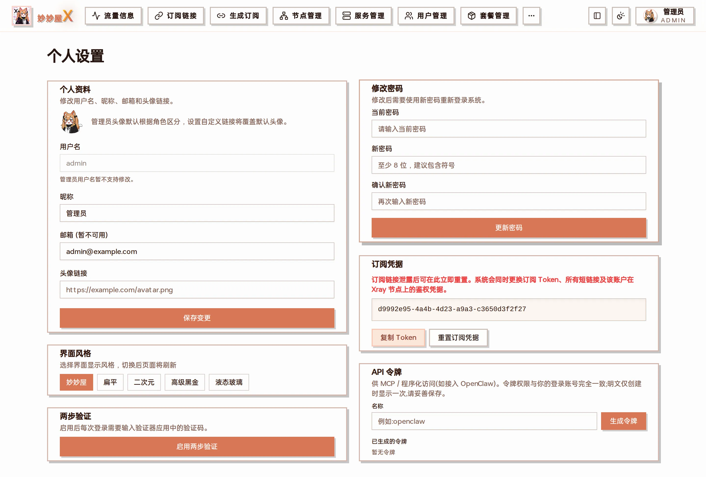

## Overview

MiaoMiaoWu X master has a built-in MCP (Model Context Protocol) service mounted on the `/mcp` route (Streamable HTTP, stateless). Any MCP-compatible AI agent (Claude Code, Codex, OpenClaw, Hermes Agent, Cursor, etc.) can connect directly and manage users, packages, subscriptions, nodes, servers, forward chains, certificates, traffic, security and more with natural language.

Tool calls reuse the master's existing API and authentication. Permissions are identical to your login account: admin tokens can perform admin operations, while regular user tokens calling admin tools will be rejected.

## Step 1: Generate API Token

1. Log in to the master, click the avatar at the top right -> "Profile settings" and scroll to "API Tokens" at the bottom.
2. Enter a name (e.g. `claude-code`) and click "Generate Token".



Profile settings: profile, UI style, two-factor auth, password, subscription credentials and "API Tokens" at the bottom

**The plaintext is shown only once** - copy and save it immediately. Token permissions match the current account; you can delete (revoke) it at any time from the same page.

## Step 2: One-click setup (recommended)

After generating the token, click "**Copy one-click setup for AI agent**" and send the whole copied text to your AI agent. It will:

1. Check the token works with the read-only tool `license_status`;
2. Write the MCP configuration for whichever client it is (Claude Code, Codex, OpenClaw, Hermes, Cursor…), overwriting an existing server with the same name;
3. Download the companion skills from [mmwX-plugins](https://github.com/MMWOrg/mmwX-plugins) into its skills directory;
4. After reloading, call `license_status` again and report the result and how many tools were registered. Clients that cannot restart themselves tell you what to do.

The text also sets the ground rules: dangerous tools with a `confirm` parameter need your go-ahead first, and new passwords or subscription links go to you only.

:::caution
The copied text contains the **token in plain text**. Only send it to your own agent, never to group chats or anywhere public.
:::

If you already have a token but didn't keep the plaintext, you can still click the button: the copied instructions leave the token out and the agent asks you for it first.

## Manual configuration

If you'd rather not let the agent edit its own configuration, fill it in per client. Common details:

- URL: `https://your-master/mcp` (Streamable HTTP)
- Header: `Authorization: Bearer <your API token>`
- Tools that install xray / nginx or upgrade agents run for several minutes: set the tool timeout to **600 seconds or more**

### Claude Code

```bash
claude mcp add --transport http --scope user miaomiaowux https://your-master/mcp --header "Authorization: Bearer <your API token>"
```

### Codex (~/.codex/config.toml)

```toml
[mcp_servers.miaomiaowux]
url = "https://your-master/mcp"
http_headers = { "Authorization" = "Bearer <your API token>" }
tool_timeout_sec = 600
```

### OpenClaw (openclaw.json)

```json
{
  "mcp": {
    "servers": {
      "miaomiaowux": {
        "url": "https://your-master/mcp",
        "transport": "streamable-http",
        "headers": { "Authorization": "Bearer <your API token>" }
      }
    }
  }
}
```

### Hermes Agent (~/.hermes/config.yaml, add mcp_servers at the top level)

```yaml
mcp_servers:
  miaomiaowux:
    url: "https://your-master/mcp"
    headers:
      Authorization: "Bearer <your API token>"
    connect_timeout: 15
    timeout: 600        # installing xray/nginx blocks for minutes, give it room
    # Optional: only expose the tools you want
    # tools:
    #   include: [server_list, user_list, package_list, traffic_summary, node_list]
```

Restart Hermes after adding it (MCP connects at startup); the log shows `registered N tool(s)`.

### Cursor (~/.cursor/mcp.json)

```json
{
  "mcpServers": {
    "miaomiaowux": {
      "url": "https://your-master/mcp",
      "headers": { "Authorization": "Bearer <your API token>" }
    }
  }
}
```

Other clients work the same way: add a remote Streamable HTTP MCP server with the URL and header above.

### Verify

Ask the agent to call `license_status` (read-only). License info in the reply means it works; `HTTP 401` in the text = wrong or deleted token, `HTTP 403` = the token's account is not an administrator.

## Tools Overview

150+ tools in total; the list your client shows is authoritative. Representative tools by domain:

| Domain | Representative tools |
| --- | --- |
| Users & packages | user_list / user_detail / user_create / user_set_status / user_set_limits / user_extend, package_create / package_assignment_upsert, user_subscription_links (subscription links ready to import into a client) |
| Accounts & credentials | user_reset_password\*, user_reset_credentials\* (optionally rotating subscription links too), admin_reset_own_credentials\*, user_set_short_code\*, user_reset_traffic\* |
| Security | security_login_locks / security_login_unlock, security_ban_list / security_ban_ip\* / security_unban_ip, security_events |
| Servers | server_list / server_create / server_system_info / server_service_control\*, server_inbound_*, server_routing_*, server_xray_install\*, server_agent_upgrade\* |
| Nodes | node_list / node_get / node_create / node_update / node_delete\*, node_tcping, node_speedtest, routed_outbound_* (routed child nodes) |
| Forward chains | forward_group_*, forward_chain_*, forward_status, forward_chain_speed_test_* |
| Subscriptions & templates | subscribe_file_list / subscribe_file_import / subscribe_file_update, template_v3_*, custom_rule_*, temp_subscription_create |
| Traffic | traffic_summary, traffic_ledger_user / traffic_ledger_node / traffic_ledger_unattributed / traffic_ledger_user_ips |
| Certificates & ops | cert_*, reverse_tunnel_*, logs_system / logs_agent, task_runs, backup_auto_*, node_unlock_list, node_return_routes |

\* = High-risk write operation. The agent must include `confirm: true` in the parameters to execute it; otherwise it only gets a confirmation prompt. Uninstalling xray / nginx, clearing all nodes and resetting agent tokens are not exposed.

The accounts & credentials and security tools, as well as `user_subscription_links` and `subscribe_file_import`, need master v0.5.9 or later.

## Companion Skills

The `skills/` directory of [mmwX-plugins](https://github.com/MMWOrg/mmwX-plugins) holds a set of skills (`SKILL.md`) that teach the agent how to combine the tools above for common operations. One-click setup installs them automatically; to install by hand, copy every `skills/mmwx-*` directory into the agent's skills directory (`~/.claude/skills/` for Claude Code; the agent workspace's skills directory for OpenClaw / Hermes).

| Skill | Usage |
| --- | --- |
| mmwx-onboard-user | Full new-user onboarding (create user -> package -> bind -> send subscription links) |
| mmwx-account-recovery | Reset passwords / credentials / subscription links / traffic, unlock logins, ban and unban IPs |
| mmwx-add-server | Onboard a new server (register -> install xray / nginx -> create nodes) |
| mmwx-forward | Build, rate-limit and troubleshoot forward groups / chains |
| mmwx-routed-outbound | Attach landing nodes (routed child nodes), AI split routing |
| mmwx-reverse-tunnel | Bring servers behind NAT in through a reverse tunnel |
| mmwx-cert | Issue / renew / deploy certificates, what SNI to use for TLS nodes |
| mmwx-traffic-report | Traffic inspection and over-quota list |
| mmwx-traffic-audit | Traffic reconciliation and shared-account investigation |
| mmwx-unlock-routes | Streaming / AI unlock status and carrier return routes of nodes |
| mmwx-node-speedtest | Batch speed tests with a report |
| mmwx-troubleshoot | Offline nodes, broken subscriptions, users who can't connect |

## Security Recommendations

- Token permissions follow the account: before giving full access to an agent, confirm that the agent and its entry point (e.g. a Telegram bot) are trusted.
- Minimize blast radius: use client tool filtering (e.g. Hermes `tools.include`) to expose only read-only tools, or use a regular user token.
- Token plaintext is shown only once. If leaked, delete it under "Profile settings -> API Tokens" to revoke it.
- The `confirm` double check on high-risk operations is a safety net, not a substitute for access control.
