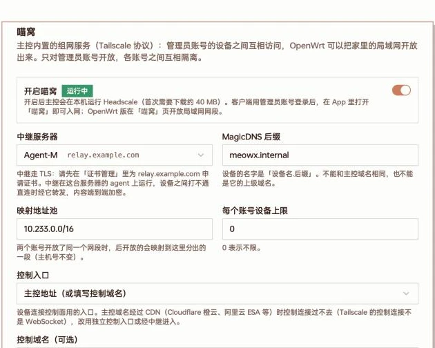
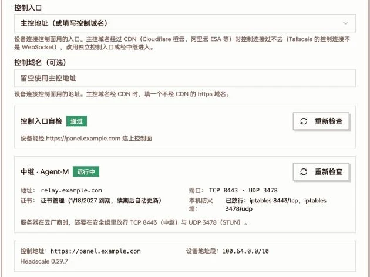
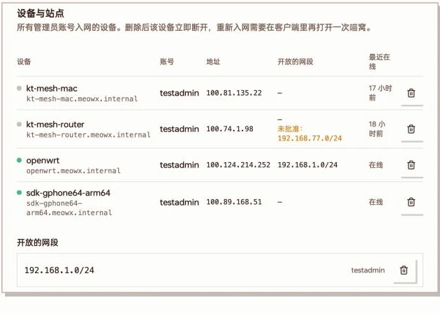

MeowNest is a private network built into the panel. Once enabled, the panel becomes the control center of a private network:

- Phones and computers under the same account can reach each other, wherever they are
- An OpenWrt router or an fnOS NAS can expose your home LAN, so you can reach your NAS, cameras or PCs from outside
- When two devices can't connect directly, traffic is relayed through one of your own servers

It uses the Tailscale protocol: the panel runs Headscale (an open-source Tailscale control server) locally, and the relay runs on a server with the agent. Traffic between devices is end-to-end encrypted; neither the panel nor the relay can read it.

:::note[Scope]
- **Admins and accounts they open it to.** Admins can always use it; other accounts need an admin to tick them under "Accounts that can use MeowNest" in the panel's System settings › MeowNest, otherwise they can't see or join MeowNest. When an account is disabled, demoted or removed from the list, its devices are removed within about half a minute.
- No PRO license required.
- Requires a panel release **after v0.6.2-beta.8**, and an agent release **after v1.3.0** on the relay server. Supported by the MeowX client from iOS / macOS 0.8.0 and Android / Windows / Linux 0.5.0, by the OpenWrt plugin from 0.3.0, and by the fnOS NAS edition.
:::

## Parts

| Role | What it does |
| --- | --- |
| Panel | Runs Headscale, manages devices, issues join credentials, distributes the network policy |
| Relay server | A server in the panel with the agent, running the relay (DERP) and STUN. Used when devices can't connect directly |
| Device | A MeowX client logged in with an account that can use MeowNest; gets an address in `100.64.0.0/10` |
| Site | An OpenWrt router with the MeowX plugin, or a NAS running MeowX for fnOS, exposing LAN subnets to the account's devices |

Each account is its own isolated network: it can only reach its own devices and the subnets it exposed.

Devices are named `device-name.MagicDNS-suffix`, e.g. `macbook.meowx.internal`, and can be reached by name.

## Requirements

- **The panel is reached over an https domain.** The relay and control connections use TLS; a panel on a bare IP or http can't enable MeowNest.
- The panel runs on Linux / macOS, amd64 or arm64. On first enable it downloads Headscale (about 40 MB).
- At least one **of your own** servers with a recent agent to act as relay. [Shared servers](/docs/en/share-server) can't be relays; to use the panel's own machine, install an agent on it.
- If the relay server's address or domain is a domain name, request a certificate for it in [Certificates](/docs/en/certificates) first. Servers with only an IP use a self-signed certificate that devices pin by fingerprint.
- Allow the relay ports in the cloud provider's security group (see below; TCP 443 or 8443, UDP 3478 by default).

## Enabling MeowNest

Open **System settings → MeowNest** (screenshots are from the Chinese UI):

System settings → MeowNest: switch, relay server, MagicDNS suffix, mapping pool, device limit and control entry

1. Turn on **Enable MeowNest**.
2. **Relay server**: pick a server. Servers marked offline or needing an agent upgrade can't be used yet. A hint below tells you whether a certificate is needed first. You can't save without a relay.
3. Leave the rest at their defaults unless you need to change them:

   | Option | Default | Notes |
   | --- | --- | --- |
   | MagicDNS suffix | `meowx.internal` | Suffix for device names. Can't equal the panel's domain or a parent of it |
   | Mapping pool | `10.233.0.0/16` | When two accounts expose the same subnet (both `192.168.1.0/24`, say), the later one is mapped into a slice of this pool, keeping host numbers |
   | Devices per account | `0` | 0 means unlimited |
   | Control entry | Panel address | See next section |

4. Click **Save**.

The panel then deploys the relay; the status badge goes "starting" → "waiting for relay" → "running". Headscale doesn't start until the relay is ready; the panel retries every 30 seconds, and once ready reconciles every 5 minutes.

Relay ports are chosen automatically: TCP 443 if free, otherwise one in 8443–8543; STUN on UDP 3478, otherwise 3479–3499. The agent opens them in ufw / firewalld / iptables (machines with hand-written nftables rules must open them yourself). **Cloud security groups still need to be opened manually.**

## Control entry

Devices connect to the panel's control plane to join and stay online. **Control entry** decides where they connect:

| Option | Use when | Notes |
| --- | --- | --- |
| Panel address (or the control domain below) | The panel domain isn't behind a CDN | Default. You can enter a separate https domain that bypasses the CDN |
| Dedicated entry (separate panel port, bypasses the CDN) | The panel domain is behind a CDN | The panel serves the control plane directly on its own port |
| Through the relay (hides the panel IP) | Behind a CDN and you don't want to expose the panel IP | Devices connect to the relay's domain; the relay forwards control traffic to the panel |

**Why CDNs don't work:** Tailscale's control connection isn't WebSocket, so Cloudflare (orange cloud), Alibaba ESA, Tencent EdgeOne and similar CDNs can't pass it. When the panel domain is behind a CDN, the control entry check fails and names the CDN.

### Dedicated entry

Enter a subdomain that is not behind a CDN (e.g. `ts.your-domain`) and a port (8443 by default), then click **Set up automatically**. The panel will:

1. Pick a free port (moving up if taken)
2. Add an A record for the subdomain in your DNS provider pointing to the panel's public IP (no CDN; overwrites an existing record of the same name)
3. Request a certificate via DNS validation in Certificates (about 1–3 minutes)
4. Enable it and run the check

This needs a DNS provider account in the panel that manages the domain, and the TCP port open in the security group. **The subdomain exposes the panel IP**; use "Through the relay" if you'd rather not.

### Through the relay

Devices connect to the relay server's domain, and the relay forwards control traffic to a panel port (8443 by default). That port on the panel **only needs to be open to the relay server's IP**.

The relay server needs a domain with a certificate in Certificates, and an agent that supports acting as control entry. Otherwise the option is disabled with the reason: the relay has no domain, or its agent is offline / too old.

### Checks and relay status

After saving, the page shows the control entry check, relay status and runtime info:

Control entry check passed; relay running, with its address, ports, certificate and local firewall, plus control URL, device range and Headscale version

Click **Check again** after changing certificates, firewalls or security groups.

When the panel address is the control entry, the panel adds a long read timeout for the control connection to the Nginx it manages. If you run your own reverse proxy in front, raise the read timeout for `/ts2021` yourself (e.g. 1 hour).

## Joining devices

No config files, QR codes or keys to copy:

1. In the MeowX client, log in to the panel with an **admin account or an account MeowNest is open to** (QR code or username/password).
2. Open the network settings (iOS, Android, Windows, Linux: Me › Network; macOS: menu-bar panel › Settings › Network) and choose **MeowNest**.
3. The client requests a one-time join credential from the panel (valid 10 minutes) and joins automatically.

Notes:

- MeowX must be connected. In rule, global and direct modes alike, MeowNest addresses go through MeowNest.
- MeowNest and Tailscale nodes from your subscription can't be on at the same time; switching asks for confirmation and reconnects once.
- The network page lists your devices (direct or relayed, last seen) and sites; **Leave MeowNest** at the bottom removes the device from the panel. Logging out also turns MeowNest off.
- An account can join at most 5 times per minute.

### Device name

The **Device name** on the network page can be changed. In MeowNest the device shows up as `<device name>.meowx.internal` (the suffix is the MagicDNS suffix set in the panel), and the account's other devices can reach it by that name.

- Leave it empty to use the device's own name. On iOS the system gives every app the device name "iPhone", so several iPhones end up as `iphone`, `iphone-1`, `iphone-2`; give each one its own name.
- Only letters, digits and hyphens are allowed, and capitals become lowercase. Other characters (Chinese, spaces and so on) are turned into hyphens or dropped; a name made only of such characters can't be saved.
- Names are unique across the whole panel (all accounts). If the name is taken, the panel appends `-1`, `-2` and so on; the device list shows the actual name.
- Changing the name while MeowNest is on and connected reconnects once, and the new name takes effect.
- Requires iOS / macOS 0.8.1 or Android / Windows / Linux 0.5.1 or later. The OpenWrt and fnOS editions set their device name on their own MeowNest page.

:::note
The client UI is authoritative.
:::

## Exposing a LAN from OpenWrt

Install the MeowX OpenWrt plugin (LuCI), log in to the panel with an admin account (or one MeowNest is open to) in the plugin settings, then open the plugin's **MeowNest** page:

1. Click **Install tailscale** (from the system package feed, about 24 MB of space).
2. Tick the LAN subnets to expose (subnets of interfaces in the lan zone are listed; you can add others), then turn the switch on.
3. Optional: always map, device name, access the router itself.

Exposed subnets are approved by the panel automatically and are reachable from the account's devices right away. Limits:

- IPv4 private ranges only (within `10.0.0.0/8`, `172.16.0.0/12`, `192.168.0.0/16`), sized /16 to /30, at most 16 per router
- Must not overlap the mapping pool
- If another account already exposes the same subnet, yours is mapped into the mapping pool (e.g. `10.233.1.0/24`), keeping host numbers: `192.168.1.10` becomes `10.233.1.10`

## fnOS NAS

The [fnOS NAS edition](/docs/en/client-download#fnos-nas) of MeowX ships the official tailscaled, so nothing else needs installing. In its web UI (`http://<NAS address>:7899`), first sign in to the panel with an admin account (or one MeowNest is open to) on the “Subscriptions” page, then open the “MeowNest” page:

1. Turn on “MeowNest”; the NAS joins within a minute or two.
2. Optional: tick the “LAN subnets to share” (the subnets of the NAS's network interfaces); “MeowNest devices can access the NAS itself” is on by default; “Always map” and the device name work as on OpenWrt.
3. “Leave MeowNest” deletes the device from the panel and withdraws the subnets it shared.

Subnet limits and mapping are the same as for OpenWrt above. If your home router already shares the NAS's subnet, the NAS doesn't need to share it again: the account's devices reach the NAS's LAN address through the router, and the NAS's own MeowNest address works directly too.

## Managing devices and sites

Below the settings, **Devices and sites** lists every device and exposed subnet of accounts that can use MeowNest:

Devices and sites: account, MeowNest address, exposed subnets and last seen for each device; all exposed subnets below

- Delete a device: it disconnects immediately; to rejoin, turn MeowNest on again in the client.
- Delete a subnet: it is no longer exposed.
- Subnets marked as conflicting with another account are shown as "original → mapped".
- Subnets marked "Not approved" are not in effect.

## FAQ

**The control entry check fails and mentions a CDN**

The panel domain is behind a CDN. Switch to "Dedicated entry" or "Through the relay", or enter a non-CDN https domain as the control domain.

**With "Through the relay", devices can't connect and the relay can't reach the panel**

- Timeout: the panel's security group or firewall probably doesn't allow the control port (TCP 8443 by default); allow it with the relay server's IP as source.
- Refused: the panel's control entry isn't running on that port. Check its status on the settings page and whether another program took the port.
- Certificate check failed (certificate or fingerprint changed): click **Check again** to push the relay config again.

**The relay stays "waiting" or "not ready"**

Check that the relay's agent is online and recent enough, that the server domain has a certificate in Certificates, and that the cloud security group allows the relay's TCP and UDP ports.

**"MeowNest needs the panel to be reached over an https domain"**

Set up a domain and HTTPS for the panel first; see [Panel domain](/docs/en/domain-master).

**Device limit reached**

Delete unused devices under Devices and sites, or raise "Devices per account".
