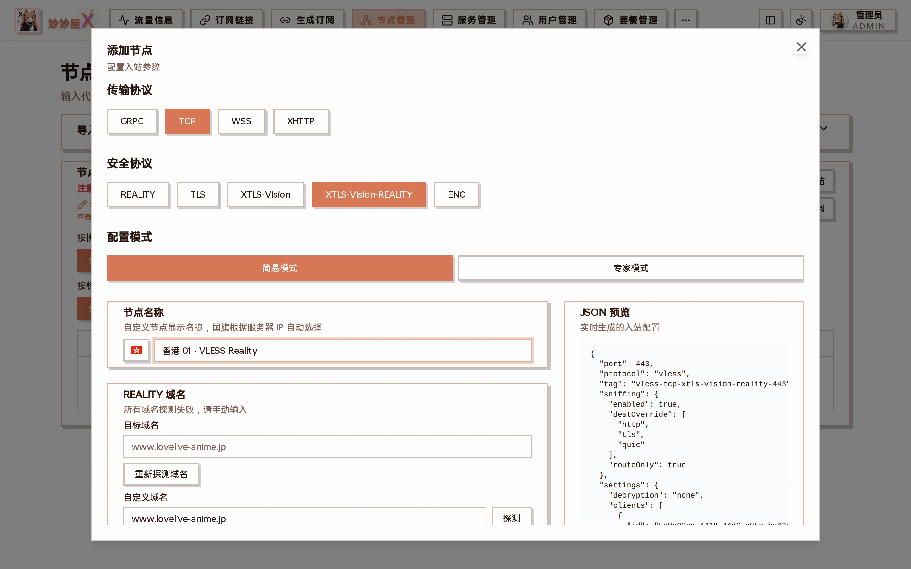

## Full Matrix

Below are all 31 combinations the add-node wizard offers. Unless a note says otherwise, they all work with mihomo-family clients. The add-node wizard only shows the transports and security layers valid for the selected protocol:

The three button rows at the top of the wizard: protocol → transport → security

| #   | Protocol    | Transport   | Security              | Notes                                                                                   |
| --- | ----------- | ----------- | --------------------- | --------------------------------------------------------------------------------------- |
| 1   | VLESS       | TCP         | REALITY               |                                                                                         |
| 2   | VLESS       | TCP         | REALITY + XTLS-Vision | flow: xtls-rprx-vision                                                                  |
| 3   | VLESS       | TCP         | TLS                   |                                                                                         |
| 4   | VLESS       | TCP         | TLS + XTLS-Vision     | flow: xtls-rprx-vision                                                                  |
| 5   | VLESS       | TCP         | Encryption (ENC)      | VLESS's own encryption, no certificate; not supported by sing-box, Quantumult X or Loon |
| 6   | VLESS       | WS          | TLS                   | WSS                                                                                     |
| 7   | VLESS       | gRPC        | REALITY               |                                                                                         |
| 8   | VLESS       | XHTTP       | REALITY               |                                                                                         |
| 9   | VLESS       | XHTTP       | TLS                   | Requires domain and certificate                                                         |
| 10  | VLESS       | XHTTP       | None                  | Behind a CDN / nginx that terminates TLS                                                |
| 11  | VLESS       | XHTTP       | Encryption (ENC)      | VLESS's own encryption; not supported by sing-box, Quantumult X or Loon                 |
| 12  | VLESS       | XHTTP Split | REALITY + CDN         | Upload via CDN, download via REALITY; see [XHTTP](/docs/en/xhttp)                       |
| 13  | Trojan      | TCP         | TLS                   |                                                                                         |
| 14  | Trojan      | TCP         | REALITY               |                                                                                         |
| 15  | Trojan      | gRPC        | REALITY               |                                                                                         |
| 16  | VMess       | TCP         | None                  |                                                                                         |
| 17  | VMess       | TCP         | TLS                   |                                                                                         |
| 18  | VMess       | WS          | None                  |                                                                                         |
| 19  | VMess       | WS          | TLS                   |                                                                                         |
| 20  | Shadowsocks | TCP         | None                  | AEAD, aes-256-gcm by default                                                            |
| 21  | Shadowsocks | TCP         | None                  | SS2022: 2022-blake3-aes-128-gcm / aes-256-gcm / chacha20-poly1305                       |
| 22  | Hysteria2   | UDP         | TLS                   | Requires TLS certificate                                                                |
| 23  | AnyTLS      | TCP         | TLS                   | Requires TLS cert (recommended; mihomo / sing-box compatible)                           |
| 24  | AnyTLS      | TCP         | REALITY               | Officially recommended client MeowX only; subscriptions drop it for other clients       |
| 25  | Miu         | TCP         | TLS                   | Requires TLS cert; sent to the officially recommended client MeowX only by default      |
| 26  | Miu         | TCP         | REALITY               | No certificate; sent to the officially recommended client MeowX only by default         |
| 27  | Snell       | TCP         | None                  | Snell v4 / v5: per-user PSK, supports obfs                                              |
| 28  | Snell       | TCP         | None                  | Snell v6: per-user PSK, hidden salt + shaping                                           |
| 29  | Mieru       | TCP         | None                  | Username + password, self-encrypted                                                     |
| 30  | Mieru       | UDP         | None                  | Listens on TCP and UDP on one port; MeowX Mac / iOS supports TCP only                   |
| 31  | WireGuard   | UDP         | None                  | Keys and tunnel addresses assigned by the master; no forward chains                     |

The wizard can also create SOCKS5 and HTTP inbounds (general-purpose proxies), which are not counted in the table above.

## Protocols that need embedded Xray

AnyTLS, Miu, Snell, Mieru and WireGuard are provided by MiaomiaowuX's [embedded Xray](/docs/en/embedded-xray) core; the official xray does not have them. On a server in external Xray mode these protocols cannot be selected in the wizard, and a server that already hosts such inbounds must delete them before it can switch to external mode.

## Deprecated Combinations

The following combinations have been deprecated or removed in Xray-core:

- HTTP/H2 transport: migrated to XHTTP stream-one (H2 & H3)
- Trojan + Flow (XTLS-Vision): Xray-core has removed flow support for Trojan

## mihomo Compatibility Notes

- Trojan in mihomo uses the sni field (not servername)
- XHTTP puts mode in xhttp-opts (older nodes with mode at the top level still work); advanced options and the download split are covered in [XHTTP](/docs/en/xhttp)
- REALITY's short-id and public-key go in reality-opts
- Hysteria2 uses the hysteria2 type (not hysteria)
