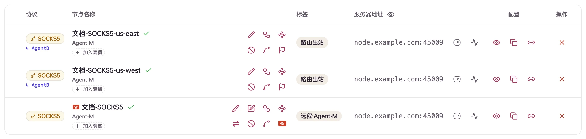
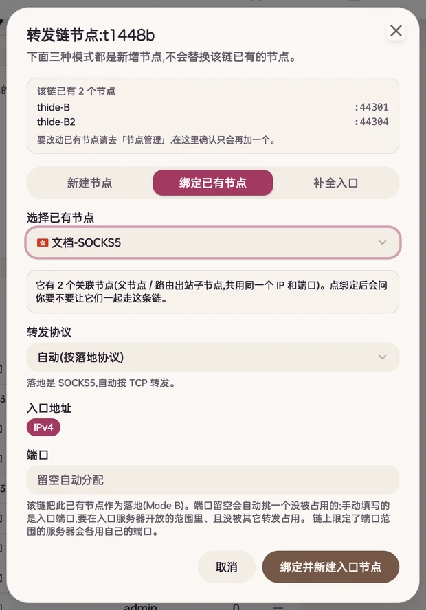
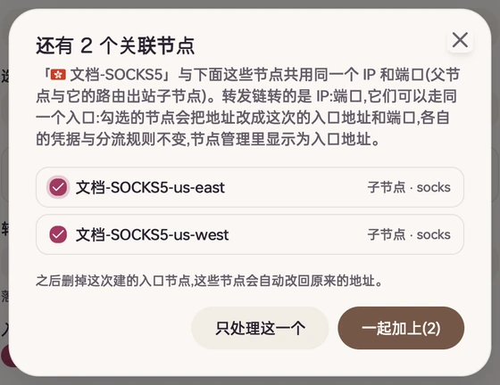
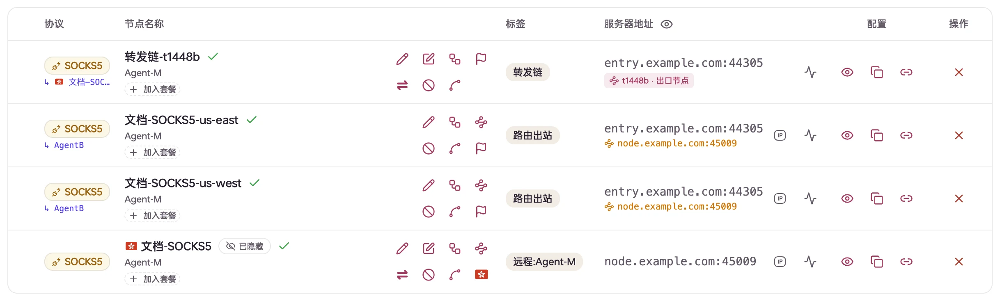
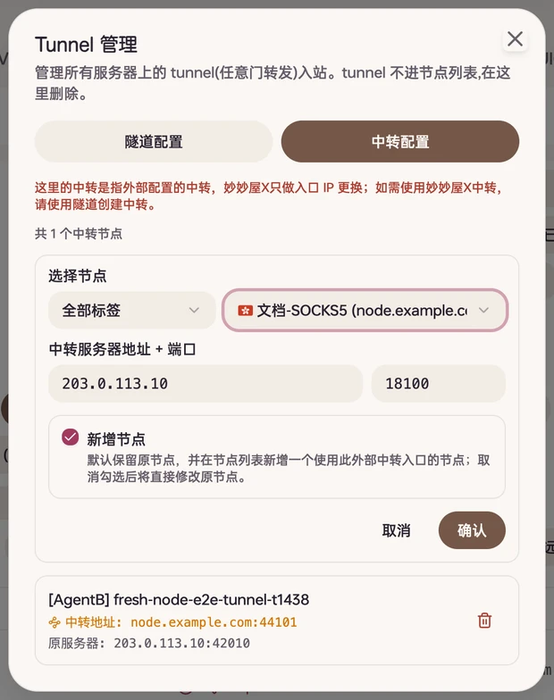
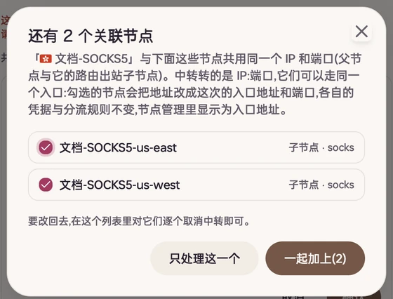
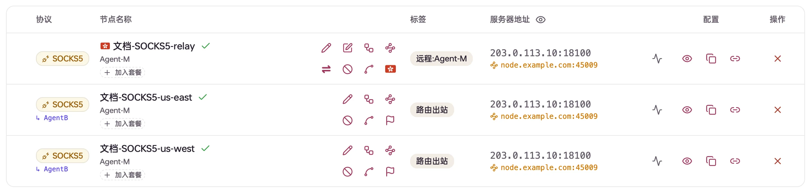

Suppose a SOCKS5 node has a few [routed-outbound](/docs/en/routed-outbound) child nodes, each leaving the internet from a different landing. To a client they look like **several nodes with exactly the same server and port, differing only in username and password**. If you want all of them to come in through the same forward chain (or the same external relay), you don't have to configure them one by one: when you configure one, the panel lists the others, and the ones you tick are changed together.

## What counts as a related node

Nodes that **share the same IP and port** with the node you are working on:

- its parent node (when you are working on a child node);
- the other routed-outbound child nodes under the same parent.

Why they can share one entry: forward chains and external relays forward **IP:port** and don't look at credentials. Once the connection arrives, the landing server still tells users apart by their own username and password and routes them accordingly. So after several nodes switch to the same entry address:port, **each keeps its own credentials and routing rules**.

These are not related nodes:

- nodes you imported separately, even if their address and port happen to be the same — they don't share a parent;
- nodes that already have a relay configured;
- forward-chain entry nodes and port-forward nodes.

:::note[Version requirements]
Related nodes are available from master **v0.5.6**. Creating **two or more** routed-outbound child nodes under the same SOCKS5 / HTTP node requires a master version released **after v0.6.3**. In earlier versions these child nodes all got the same account name, so a later one overwrote an earlier one and one of them could not connect. If you created such child nodes on an older version, delete and recreate them after upgrading.
:::

## Example

The walkthrough below uses a SOCKS5 node "文档-SOCKS5" and two routed-outbound child nodes (us-east, us-west) whose landing is on another server. All three nodes use the address `node.example.com:45009`:

The parent leaves from its own server; each child leaves from its landing.

## Option 1: bind to a forward chain

1. Open the forward chain's details, click **绑定节点** (Bind node) and switch to the **绑定已有节点** (Bind existing node) tab. These two dialogs are currently shown in Chinese only.
2. Under **选择已有节点** (Select existing node), pick the parent or any of the child nodes. If it has related nodes, a hint says it has N related nodes (「它有 N 个关联节点」):

   

3. Click **绑定并新建入口节点** (Bind and create entry node). A list of related nodes pops up, all ticked by default:

   

   - **一起加上** (Add them too): the ticked nodes switch to this chain as well;
   - **只处理这一个** (Only this one): bind just the selected node and leave the rest alone.

After binding:

- A new entry node "转发链-<chain name>" appears, using the parent's credentials.
- Both child nodes now point to the same **entry address:port**; the line underneath shows their original address.
- All three nodes come in through the same entry and still leave where they did before: the entry node from the parent's server, each child from its own landing.

:::tip
If the **隐藏出口节点** (Hide exit nodes) switch at the top of the forward chains page is on, the node you bound ("文档-SOCKS5" above) is automatically hidden. Click **Show hidden** in the node list to see it. Hiding only affects the node list; subscriptions and packages are unaffected.
:::

**To undo**: delete the entry node created by this binding in node management, and the related nodes **switch back to their original address automatically**.

## Option 2: external relay (Tunnel Manager → Relay)

You already have a forward set up elsewhere (for example a machine that forwards `203.0.113.10:18100` to the node's port `45009`) and want the nodes to connect through that address:

1. At the top of node management click **Tunnel Manager**, switch to the **Relay** tab, and click **Add relay**.
2. Pick the node (the parent or any child) and enter the relay server address and port:

   

   **新增节点** (New node) is ticked by default: the original node is kept and a new node that goes through the relay is added. Untick it to change the original node in place.

3. Click **Confirm**. If there are related nodes, the same list pops up:

   

Afterwards:

- The selected node follows your **新增节点** choice: when ticked, a "…-relay" node is added and the original stays;
- related nodes are **always changed in place**, never copied. A copy of a child node would lose its sub-account identity, and routing would no longer be right.

If you leave the port empty, each node keeps its own port (they share the same port anyway).

The **Set up external relay** action on a node row in the node list does the same thing and also asks about related nodes.

**To undo**: click **Cancel relay** for each of them in the **Relay** list, and their address goes back to the original.

## FAQ

**If I add another child node later, does it use the same entry automatically?**

No. Related nodes are only handled at the moment you configure the forward / relay. A new child node connects through its original address. To move it too, add the same relay address for it under **Relay**, or undo the whole group and configure it again.

**Can the parent and the child nodes use different entries?**

Yes. Untick them in the dialog or click **只处理这一个**; the others keep their original address and you can configure them separately later.

**Does traffic accounting or package billing change for child nodes?**

No. Traffic is still counted per account against each node, and the nodes selected in packages stay the same.

**What about several SOCKS5 nodes I imported myself, with the same address but different accounts (not routed-outbound children)?**

They are not related nodes and won't show up in the dialog. Since forward chains and relays forward IP:port, configure one of them first, then change the others under **Relay** to the same entry address and port (untick **新增节点** to edit the original nodes). Each keeps its own account, so they still work separately.
