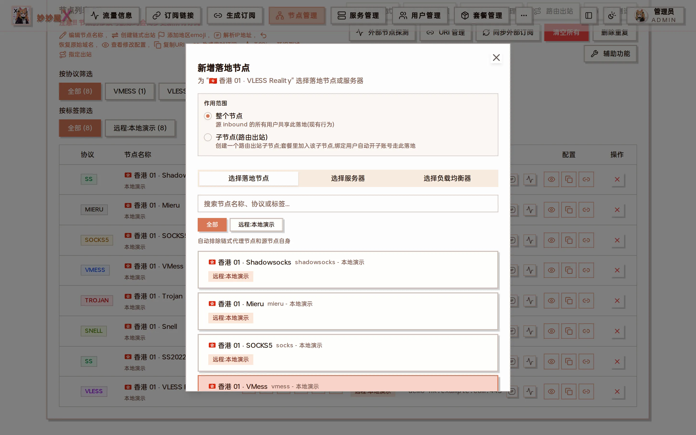
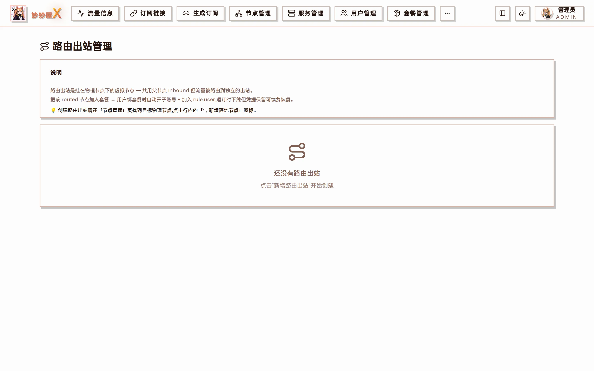
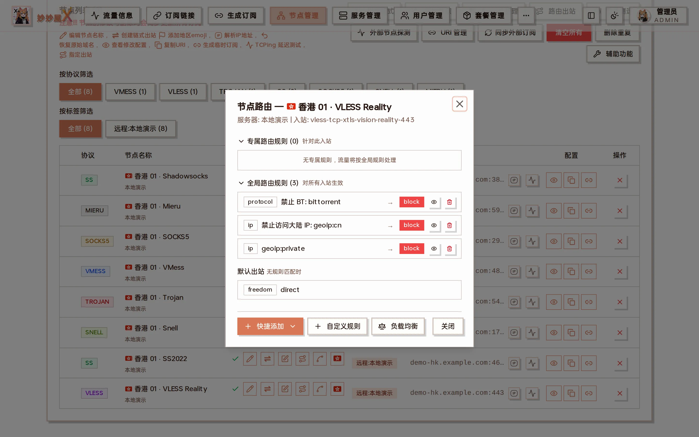

import { DocDemo } from "@/components/docs/islands/routed-outbound";

## Try it: nodes + routed outbound

Below is a local mock of the Node Management table — every action (enable/disable, copy link, routed outbound, edit, delete) is clickable. Click the purple Route icon (the «routed outbound» button) on any row to open the «Create Routed Node» dialog, identical to what's in the master.

<DocDemo lang="en" client:load />

## Two Outbound Configuration Methods

On the node management page, the "Create chained outbound" button (double-arrow icon) on each node row opens the Add Landing Node dialog. The Scope selector at the top provides two distinct capabilities:



Add landing node: scope (entire node / child node), and the "Choose landing node / Choose server / Choose load balancer" tabs

The "Routed outbound" toolbar button opens the overview listing every routed child node created so far:



Routed outbound management: explanation plus the list of created routed outbounds (empty until one is created)

**Prerequisites (Regular Users)**: Routed outbound for regular users is a feature that requires admin activation. The admin can find the Allow Users to Create Routed Outbounds toggle in System Settings > MiaoMiaoWu Feature Settings. The toggle's right side allows configuring quantity limit (default 2) and daily operation limit (default 5). When disabled, both input fields are inactive.

When disabled, regular users won't see the route button on node rows. If the API is called through other means:

- Feature not enabled -> backend returns 403 'Routed outbound feature not available, contact admin to enable'
- Quantity limit reached -> 403 'Routed outbound quantity limit reached (N/M)'
- Daily operation limit reached -> 429 'Daily operation limit reached (N/M), please try again tomorrow'

The dialog Scope has two modes:

| Scope                      | Impact                                                         | Creates New Node                            |
| -------------------------- | -------------------------------------------------------------- | ------------------------------------------- |
| Entire Node                | All users on the source inbound share the same outbound        | No, only changes source node outbound       |
| Per User (Routed Outbound) | Only users with this child node in their package use this exit | Yes, generates a routed outbound child node |

This document focuses on the Per User mode, i.e., Routed Outbound.

## Entire Node (Node Level)

The source node's inbound traffic is routed entirely to one exit. All users under that inbound share the same outbound.

Underlying actions (written to source server xray config):

1. Add outbound, tag = landing-`<source inbound tag>`-`<timestamp>`
2. Add routing rule: `{inboundTag: [source inbound], outboundTag: previous step's tag}`

**Use case: All users should use the same exit, e.g., unified relay from frontend entry to backend landing.**

## What Problem Does Routed Outbound Solve?

In a routing system without a 'user' dimension, an inboundTag -> outboundTag relationship can only have one version, making it impossible to route different users to different exits.

Let's illustrate with a specific example. This document uses the following three nodes:

| Type    | Node Name | Address / Notes                                   |
| ------- | --------- | ------------------------------------------------- |
| Landing | HKT       | hkt.example.com                                   |
| Landing | HINET     | hinet.example.com                                 |
| Transit | HK直连    | hkdirect.example.com（vless reality vision，443） |

Suppose the admin wants 'AI service traffic to go through the HINET exit' and writes a routing rule:

```
{
  "type": "field",
  "domain": ["geosite:openai"],
  "inboundTag": ["HK直连"],
  "outboundTag": "HINET"
}
```

But User A has their own Seednet landing server and wants 'their AI traffic to go through Seednet'. The traditional approach would add another rule with the same inbound but different outbound -- xray routing matches in order, stopping at the first match, so the later rule never takes effect.

Root problem: There is no way to distinguish which rule should apply to 'whose traffic'.

## How Routed Outbound Works

MiaoMiaoWu X registers a dedicated client (unique email) for each user in the parent inbound, with the corresponding routing rule constrained by a user field. Since different users have different emails, multiple rules with the same inbound but different outbounds can coexist.

Currently, routed outbounds can only be created by admins (API: POST /api/admin/routed-outbound). 'User A routes to Seednet' means the admin creates a routed outbound child node for User A and assigns A to that node via a package, not that the user self-configures routing.

### Steps

1. On the node management page, find the transit node HK-Direct, click the route button at the end of the row
2. Select Per User (Routed Outbound) for Scope
3. Enter Label (only \[a-zA-Z0-9-\] allowed, length 2-32), e.g., rout-hinet
4. Select the target landing node (e.g., HINET), click Create Routed Outbound
5. System adds a child node HK-Direct-rout-hinet to the node list, node_type = routed
6. Check this child node in package management and assign to specified users to take effect

### Generated Routing Rule Example

After the admin creates HK-Direct-rout-hinet (landing HINET) and HK-Direct-rout-seednet (landing Seednet) routed outbound child nodes:

```
// 管理员占位规则(尚无用户分配时也存在,user 是占位 admin email)
{
  "type": "field",
  "user": ["_admin__a1b2c3__hinet"],
  "domain": ["geosite:openai"],
  "inboundTag": ["HK直连"],
  "outboundTag": "HINET"
}

// 用户 A 被套餐分配到 HK直连-rout-seednet 后,
// A 的子账号 email 会被自动加进这条规则的 user 列表
{
  "type": "field",
  "user": ["userA__d4e5f6__seednet"],
  "domain": ["geosite:openai"],
  "inboundTag": ["HK直连"],
  "outboundTag": "Seednet"
}
```

Actual email format: `<username>`\_\_`<short>`\_\_`<label>`, admin placeholder is \_admin\_\_`<short>`\_\_`<label>`. short is a randomly generated identifier when creating the routed outbound, used to distinguish multiple creations with the same label.

### Targets other than a landing node

In "Add landing node → Child node (routed outbound)" an admin has three more options besides picking a landing node:

- **Pick several landing nodes at once**: click multiple nodes; they are created one by one in click order with generated labels.
- **Use an existing outbound of this server**: lists the outbounds already in the server's Xray config (except the built-in direct / block), including hand-written ones. Entries shown with a landing node's name re-select that landing node; the others are copied from their configuration.
- **Use an existing balancer of this server**: lists the balancers under "Xray config → Routing → Load balancing". Clicking one creates a child node whose traffic is distributed by that balancer among its member outbounds. No new outbound is created, later changes to the balancer's members or strategy apply immediately, and the node list shows it as `⚖ balancer-name`. A balancer cannot be deleted while a child node points at it.

## Regular User Perspective (Per-User Private Routed Outbound)

After the admin enables Allow Users to Create Routed Outbounds in System Settings, regular users can create their own exclusive exits, independent of package assignment, effective immediately. Differences from admin path: skips admin placeholder, rule.user is set directly to the user's sub-account email; node routed_owner = 'user', visible and deletable only by the creator.

### Toggle & Quota

Location: Admin login -> System Settings -> MiaoMiaoWu Feature Settings card -> Allow Users to Create Routed Outbounds row.

- Off (default): Regular users don't see the route button on node rows; API POST returns 403.
- On: After toggling on, the Quantity and Daily Limit input fields become enabled.
- Quantity: Maximum number of routed outbounds held. Default 2; adjustable to any integer >= 1. Unlimited is not supported (each routed outbound adds an outbound + routing rule to xray, unlimited could cause config bloat).
- Daily Limit: Total create + delete operations per day. Default 5; adjustable to any integer >= 1. Unlimited is not supported. Design reason: xray routing doesn't support gRPC dynamic loading, so agent auto-restarts xray after each routed outbound change. Frequent restarts affect other users' connections, hence rate limiting by operation count.
- Counting window: Based on master server local timezone, from 00:00 to 24:00; not rolling.
- Changes take effect immediately: Saved to system_settings table when switch is toggled or input field loses focus.

### Creation Steps

1. Regular user finds a visible transit node on the node management page (package-assigned or self-imported), clicks the route button
2. Dialog only shows Routed Outbound (Per User) mode (admin's Entire Node radio + server Tab are hidden)
3. Select a landing node from the Select from Existing Nodes tab
4. Label auto-fills as rout-`<target slug>`, can be manually changed
5. Click Create Routed Outbound

System adds a new row `<transit node>`-`<label>` to the node list, visible only to the creator, automatically included in user subscription.

### Delete Your Routed Outbound

The created routed outbound node row shows a delete button on the right (visible only to the creator). Clicking it cleans up the corresponding outbound, routing rule, user client on xray, as well as the node row + user_subaccounts record in DB. Deletion is not restricted by the enabled toggle -- even if the admin turns off the switch, users can still clean up existing routed outbounds.

### Suspend / Resume

The following three situations trigger automatic suspension of user private routed outbounds (removes rule + client, retains outbound + credentials):

- Admin deactivates the user (is_active=false)
- Package expires (package_end_date < now)
- Traffic limit exceeded (traffic limit enforcer blacklists)

Corresponding resume triggers (rebuilds rule + adds back client):

- Enable user
- Traffic drops below limit

Note: When package expires, the routed outbound is auto-suspended due to loss of access to the parent inbound, but won't auto-resume (requires rebinding a package).

## Advanced: Multi-Landing Traffic Sharing on One Transit

Mount multiple outbounds on a single transit inbound, reusing the transit's port, UUID, and Reality config, directly assignable to users via packages. Ideal for multi-region routing with a single transit server.

### Scenario

One HK-Direct transit + two landings (HKT, HINET), creating two routed child nodes via routed outbound:

| Child Node Name   | Parent Inbound | Outbound | Outbound Tag                 |
| ----------------- | -------------- | -------- | ---------------------------- |
| HK直连-rout-hkt   | HK直连         | HKT      | routed:p`<父 id>`:rout-hkt   |
| HK直连-rout-hinet | HK直连         | HINET    | routed:p`<父 id>`:rout-hinet |

### Effect

Assign both child nodes in a package to users. Users see two routes in their subscription, sharing the same underlying transit inbound:

- Saves transit server ports and Reality config (no need to open separate inbounds for each landing)
- Traffic naturally aggregates at the transit inbound level (easy to monitor total transit pressure)
- User-level traffic is still billed independently by sub-account email
- Users seamlessly switch between landings, experiencing them as two independent routes

## Advanced: Full Relay + AI Relay Sharing One Landing

### Scenario

One entry relay server "Line A" plus one landing server (with an SS node on it). You want to offer users two lines at the same time:

- **Full relay**: all traffic exits through the landing SS;
- **AI relay**: only AI services (OpenAI, Claude, Gemini, etc.) go through the landing; everything else exits directly from Line A — saving landing traffic and keeping everyday latency low.

| Line       | Node users connect to       | AI domains | Everything else   |
| ---------- | --------------------------- | ---------- | ----------------- |
| Full relay | Routed child node on Line A | landing SS | landing SS        |
| AI relay   | Line A's own node           | landing SS | Line A's own exit |

Both lines use the **same** landing SS.

### Key point: don't create another routed child node for the AI relay

A routed child node comes with a rule that covers the whole node: **all** of that child node's traffic goes to its landing, so "everything else" can't fall back to Line A. Therefore:

- "Full relay" is a routed child node;
- "AI relay" is a **regular node** on Line A with an AI split rule whose outbound is the landing outbound created for "Full relay".

### Steps

**① Create "Full relay"**

1. In Nodes, find Line A's node and click "Create chain proxy" in the row;
2. In the "新增落地节点" (add landing node) dialog, set 作用范围 (scope) to **子节点(路由出站)** (child node / routed outbound) and give it a recognizable Label, e.g. `all`;
3. Under 选择落地节点 (select landing node), pick the SS node on the landing server and create.


Scope set to 子节点(路由出站) (routed child node), then pick the landing node

This adds the child node `LineA-all` to the node list and an outbound on Line A tagged like `routed:p<parent node id>:all`, which the next step uses.

**② Add an AI split to Line A's own node**

1. On Line A's **own node** (not the child you just created), click "Node Routing";
2. At the bottom of the dialog click "Quick Add" → "AI Services (select outbound)"; the AI domains are filled in for you;
3. Set "Outbound" to the `routed:p…:all` created in step ①, keep the scope as **This inbound only**, and add.



The "Node Routing" dialog: "Quick Add" at the bottom contains "AI Services (select outbound)"

The dialog's dedicated rules now include this AI split rule pointing to `routed:p…:all`; the default outbound stays `direct` (Line A's own exit) and doesn't need changing.

**③ Rename and hand out (optional)**

Rename Line A's own node to something like `LineA-AI-relay`, then add it to a package together with `LineA-all`.

### Result

| Node                      | AI domains | Everything else   |
| ------------------------- | ---------- | ----------------- |
| LineA-all (full relay)    | landing SS | landing SS        |
| LineA-AI-relay (own node) | landing SS | Line A's own exit |

The AI split rule is scoped to Line A's inbound, and the full-relay child node sits on the same inbound, so full-relay users' AI traffic also matches it — it goes to the same landing, so nothing changes for them. Inbound-scoped split rules like this are always placed before routed outbound rules, so the AI rule always matches first.

### Line A's own node must stay fully direct?

Node routing rules apply per inbound ("This inbound only" or "Global (all inbounds)"); nodes sharing one inbound can't be told apart. If Line A's own node must keep sending everything direct, **add another inbound** on Line A (another port) as the AI relay and do step ② on that new node instead; the original node is unaffected.

### Notes

- **Deleting the AI split rule**: in v0.5.8-beta.4 and earlier, deleting it from the "Node Routing" dialog also deletes the landing outbound it points to, taking the "Full relay" rules with it. On those versions delete it under "Servers → Xray Config → Routing tab" instead, which only removes the rule.
- **Deleting the "Full relay" child node**: its landing outbound is removed, and the AI split rule pointing to it is cleared as well. To keep the AI relay, point the AI split rule at another outbound first.

## Implementation Details

### When Creating Routed Outbound

1. Add a placeholder admin client to the parent physical node's inbound (email = \_admin\_\_`<short>`\_\_`<label>`)
2. Add an outbound on the source server, tag = routed:p`<parent node id>`:`<label>`
3. Prepend a rule with marktag to the routing rules array, user = \[admin_email\]
4. Write a child node row to the master database nodes table (node_type=routed, parent_node_id, routed_outbound_tag)

### When Package Assigns User to Child Node

1. Add a sub-account client for the user in the parent inbound (email = `<username>`\_\_`<short>`\_\_`<label>`, UUID independently generated)
2. Append the email to the routing rule's user\[\] array
3. Credentials written to user_subaccounts table, reused on renewal/resume

### During Subscription Generation

The routed outbound child node's clash_config comes from the parent inbound. During subscription generation, the UUID in the node is replaced with the user's sub-account UUID, and the node name is replaced with the child node's configured NodeName. This way, when the client connects using the sub-account email, xray matches the user-constrained routing rule and routes to the specified outbound.

### Traffic Statistics & Email Lookup

The user.`<email>` metric reported by xray stats is reverse-looked up via user_subaccounts.email -> username to find the mmwx username, ultimately aggregated to the user's total traffic.

Therefore, even if a user has multiple sub-accounts (subscribed to multiple routed outbound child nodes), traffic is correctly merged to their main account.

## Comparison: Node Level vs User Level

| Dimension                       | Entire Node (Node Level)    | Per User (Routed Outbound)                         |
| ------------------------------- | --------------------------- | -------------------------------------------------- |
| Impact Scope                    | All users on source inbound | Only package-selected users                        |
| Creates Subscription Node       | No                          | Yes (one routed child node)                        |
| Multi-user differentiated exits | ✗                           | ✓                                                  |
| One transit, multiple landings  | ✗                           | ✓                                                  |
| Triggers Xray restart           | Yes                         | Yes (on first creation and each new user addition) |
| Traffic Statistics Granularity  | Inbound as a whole          | Independent per user email                         |

## Unlock detection

The unlock results of a routed node (the lock icon in node management and the unlock marks in clients) come from its **real exit**:

- The landing is a server managed by this panel: that server's results are used directly.
- The landing is an **external line** (someone else's residential line, a node from an external subscription) or **WARP**: the host server's Agent tests **through this routed outbound** and the results are stored per node. Requires Agent v0.9.1 or later; a newly created node of this kind is tested within 10 minutes, then refreshed with the daily 04:40 run.
- The landing is blocked (blackhole) or the outbound config does not match: nothing is shown, rather than borrowing the host server's results.

Results tested through the outbound may differ from the host server's own results. That is expected: they reflect the path traffic actually takes through this outbound — for example, when the landing's Xray prefers IPv6, some services judge the region by the IPv6 address.

## FAQ

### Can routed outbound child nodes be deleted?

Yes. Delete from the node management page or the Routed Outbound panel at the top. When deleting, the system cleans up the placeholder client on the parent inbound, all user sub-account clients, and routing rules.

### How many routed outbounds can a single parent node create?

No hard limit. Each one is distinguished by a different Label. Common usage is creating one for each landing.

### What happens when a user is assigned to multiple routed outbound child nodes?

The user will have multiple sub-account clients on the parent inbound (one for each routed outbound), seeing multiple routes in their subscription. Xray routing matches rules in order, each sub-account email hits its own rule without interference.

### Can regular users add routing rules themselves?

Directly adding routing rules is not possible (that's an admin API). However, the admin can enable Allow Users to Create Routed Outbounds in System Settings > MiaoMiaoWu Feature Settings, after which regular users can self-create private routed outbounds on their visible nodes (subject to quota, default 2). The API path is POST /api/user/routed-outbound.

### What happens to existing user routed outbounds when the toggle is turned off?

They are retained. Configured outbounds and rules are not automatically removed, and subscription nodes continue to work. Turning off only disables creating new ones. Users can still delete existing nodes (delete API is not restricted by the enabled toggle). To fully clean up, the admin can delete the user in user management, which cascades cleanup of all their private routed outbounds.

### Why is there no 'unlimited' option for quantity?

Each user private routed outbound adds an outbound + routing rule to xray config. If unlimited were allowed, malicious users or scripts could fill up xray config in a short time, causing slow restarts or OOM. Default 2, with admin-configurable upper limit, is a ballast design.

### Why limit daily operation count?

Xray's routing module doesn't support gRPC dynamic rule loading -- any rule change (add, delete, modify user\[\]) requires restarting the xray process. So each time a regular user creates/deletes a routed outbound, agent auto-restarts xray on the same node, briefly interrupting other users' connections (reconnection recovers, but experience is affected). Quantity limit prevents accumulation, daily operation limit prevents frequent short-term changes -- they are complementary. Default 5/day is sufficient for normal exit node switching; excess returns 429 Too Many Requests.

### How is the daily count calculated?

A new table user_routed_outbound_actions(username, action, created_at) is created in the master database. Each successful POST/DELETE (excluding validation-rejected requests) logs a create or delete entry. Validation counts rows from the current day's 00:00 in the master server's local timezone; not a rolling 24-hour window. Resets after midnight.

### Are admin creation paths subject to these two limits?

No. /api/admin/routed-outbound is for admin management of the 'package routed outbound pool' and is not subject to user quota / daily limit constraints. The two API paths also differ internally: admin path has a placeholder admin client, user path does not (see the Entire Node vs Per User comparison above).
