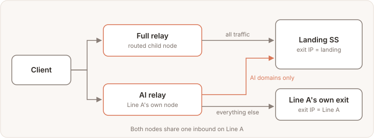
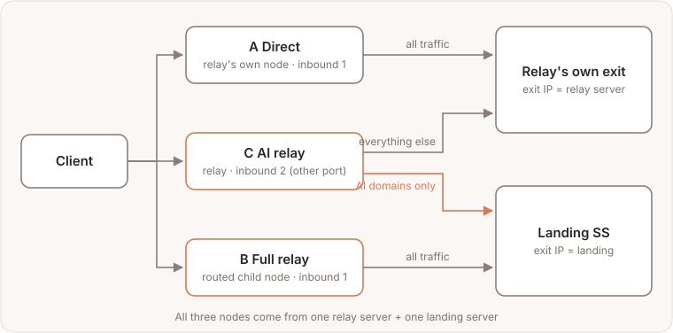
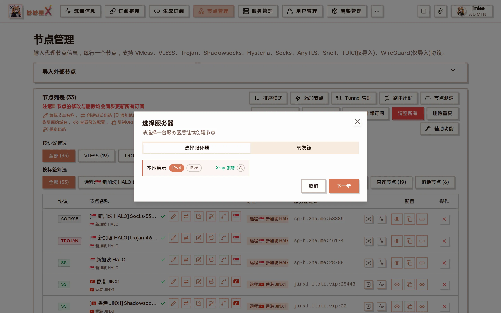

Combining [routed outbounds](/docs/en/routed-outbound/) with "Node Routing" covers common routing needs without extra servers. Each scenario below has a traffic-flow diagram, setup steps and a way to check the result.

The two features used:

- **Routed child node**: an extra node on the same inbound whose traffic all goes to a chosen landing.
- **Node routing**: split rules on an inbound, e.g. "AI domains go to some outbound", with everything else unchanged. Rules apply per inbound.

## Scenario 1: Full Relay + AI Relay Sharing One Landing

Both nodes share one inbound on Line A: the full relay sends everything to the landing; the AI relay sends only AI domains there and the rest out of Line A

### Requirement

One entry relay server "Line A" plus one landing server (with an SS node on it). You want to offer users two lines at the same time:

- **Full relay**: all traffic exits through the landing SS;
- **AI relay**: only AI services (OpenAI, Claude, Gemini, etc.) go through the landing; everything else exits directly from Line A — saving landing traffic and keeping everyday latency low.

| Line       | Node users connect to       | AI domains | Everything else   |
| ---------- | --------------------------- | ---------- | ----------------- |
| Full relay | Routed child node on Line A | landing SS | landing SS        |
| AI relay   | Line A's own node           | landing SS | Line A's own exit |

Both lines use the **same** landing SS.

### Key point: don't create another routed child node for the AI relay

A routed child node comes with a rule that covers the whole node: **all** of that child node's traffic goes to its landing, so "everything else" can't fall back to Line A. Therefore:

- "Full relay" is a routed child node;
- "AI relay" is a **regular node** on Line A with an AI split rule whose outbound is the landing outbound created for "Full relay".

### Steps

**① Create "Full relay"**

1. In Nodes, find Line A's node and click "Create chain proxy" in the row;
2. In the "新增落地节点" (add landing node) dialog, set 作用范围 (scope) to **子节点(路由出站)** (child node / routed outbound) and give it a recognizable Label, e.g. `all`;
3. Under 选择落地节点 (select landing node), pick the SS node on the landing server and create.

Scope set to 子节点(路由出站) (routed child node), then pick the landing node

This adds the child node `LineA-all` to the node list and an outbound on Line A tagged like `routed:p<parent node id>:all`, which the next step uses.

**② Add an AI split to Line A's own node**

1. On Line A's **own node** (not the child you just created), click "Node Routing";
2. At the bottom of the dialog click "Quick Add" → "AI Services (select outbound)"; the AI domains are filled in for you;
3. Set "Outbound" to the `routed:p…:all` created in step ①, keep the scope as **This inbound only**, and add.

The "Node Routing" dialog: "Quick Add" at the bottom contains "AI Services (select outbound)"

The dialog's dedicated rules now include this AI split rule pointing to `routed:p…:all`; the default outbound stays `direct` (Line A's own exit) and doesn't need changing.

**③ Rename and hand out (optional)**

Rename Line A's own node to something like `LineA-AI-relay`, then add it to a package together with `LineA-all`.

### Result

| Node                      | AI domains | Everything else   |
| ------------------------- | ---------- | ----------------- |
| LineA-all (full relay)    | landing SS | landing SS        |
| LineA-AI-relay (own node) | landing SS | Line A's own exit |

The AI split rule is scoped to Line A's inbound, and the full-relay child node sits on the same inbound, so full-relay users' AI traffic also matches it — it goes to the same landing, so nothing changes for them. Inbound-scoped split rules like this are always placed before routed outbound rules, so the AI rule always matches first.

### Line A's own node must stay fully direct?

Then you need three nodes (direct / full relay / AI relay), and the AI relay needs its own inbound — see [Scenario 2](#scenario-2-direct--full-relay--ai-relay-as-three-nodes).

### Notes

- **Deleting the AI split rule**: in v0.5.8-beta.4 and earlier, deleting it from the "Node Routing" dialog also deletes the landing outbound it points to, taking the "Full relay" rules with it. On those versions delete it under "Servers → Xray Config → Routing tab" instead, which only removes the rule.
- **Deleting the "Full relay" child node**: its landing outbound is removed, and the AI split rule pointing to it is cleared as well. To keep the AI relay, point the AI split rule at another outbound first.

## Scenario 2: Direct + Full Relay + AI Relay as Three Nodes

A and B share the relay server's original inbound; C uses an extra inbound

### Requirement

One relay server (VLESS inbound) plus one landing server (SS node), offering clients three nodes, all provided by this one pair of machines:

| Node         | AI domains | Everything else | Exit IP users see                 |
| ------------ | ---------- | --------------- | --------------------------------- |
| A Direct     | relay      | relay           | relay server                      |
| B Full relay | landing SS | landing SS      | landing server                    |
| C AI relay   | landing SS | relay           | AI services: landing; rest: relay |

Unlike Scenario 1, A must be **fully direct**, so C can no longer share A's inbound.

### Why C needs its own inbound

- "Node Routing" rules apply per inbound ("This inbound only" or "Global"). An AI split rule on A's inbound would also send A's AI traffic to the landing, and A would no longer be fully direct.
- C can't be a routed child node either: a child node's own rule covers all of its traffic, so "everything else" can't come back to the relay server.
- Inbound-scoped split rules are always placed before routed outbound rules, so reordering doesn't help.

So C uses **another inbound** (another port) on the relay server. The three nodes still use only this one relay server and one landing server.

### Steps

**① A: the relay server's existing node**

Nothing to change. Its default outbound is `direct`, so all traffic leaves from the relay server.

**② B: full relay**

On A's row click "Create chain proxy", set 作用范围 (scope) to **子节点(路由出站)** (routed child node), set the Label to `all`, pick the SS node on the landing server, and create.

Create a routed child node on A with the SS node as its landing

This gives you child node B and an outbound on the relay server tagged `routed:p<A's node id>:all`.

**③ C: add another inbound on the relay server**

Click "[Add Node](/docs/en/nodes/)" at the top right of Nodes, choose the relay server, pick VLESS again, keep the port the wizard suggests (different from A's), create, and rename the node to something like "AI relay".

Add Node: choose the relay server in step 1

**④ Add the AI split to C**

On C's row click "Node Routing" → "Quick Add" → "AI Services (select outbound)", set "Outbound" to the `routed:p…:all` from step ②, keep the scope as **This inbound only**, and add.

Add the AI split in C's (not A's) "Node Routing" dialog

**⑤ Add them to a package**

Add A, B and C to a package; users get three nodes in their subscription.

### Check

- "Node Routing" of each node: A has no dedicated rules; B's dedicated rule points to `routed:p…:all`; C's dedicated rule is the AI split → `routed:p…:all`, with default outbound `direct`.
- Connect to each node and open `https://chatgpt.com/cdn-cgi/trace` to see `ip=`: A shows the relay IP, B and C the landing IP. Then open any IP-lookup site: A and C show the relay IP, B the landing IP.

### Notes

- C's AI split rule uses the outbound created for B: deleting B removes that outbound and clears C's AI rule with it, leaving C fully direct. Before deleting B, point C's rule at another outbound.
- Deleting C's AI split rule: on v0.5.8-beta.4 and earlier, delete it under "Servers → Xray Config → Routing tab", for the same reason as in Scenario 1.
