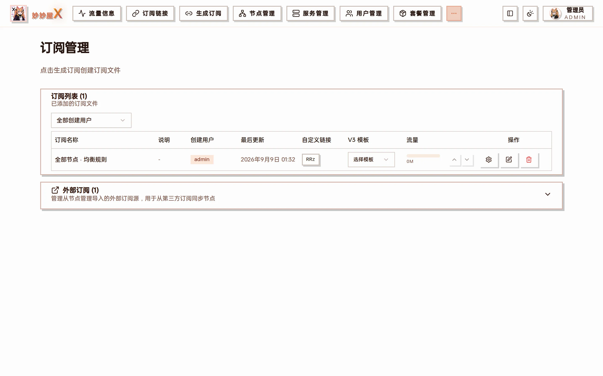
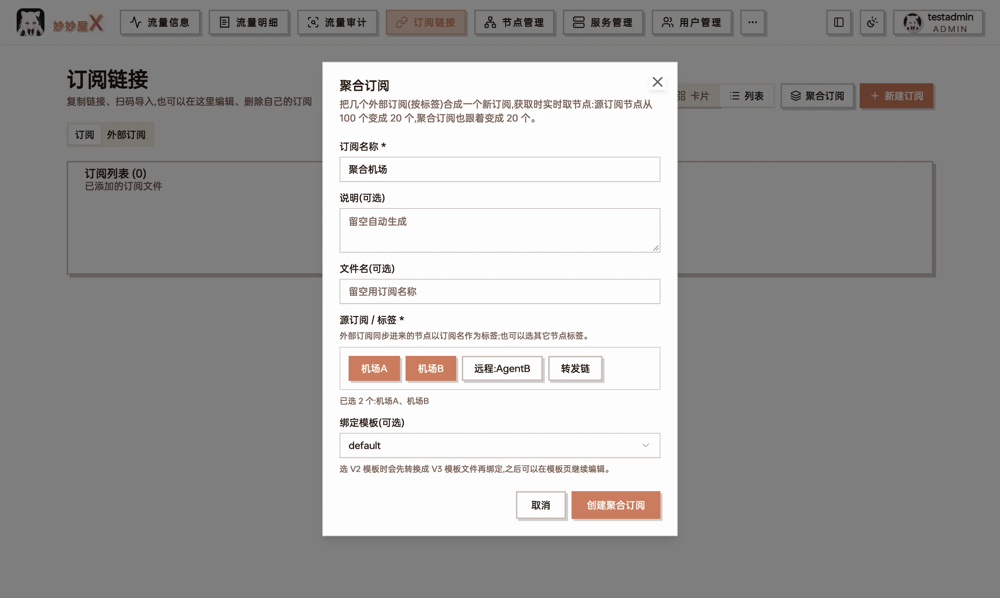
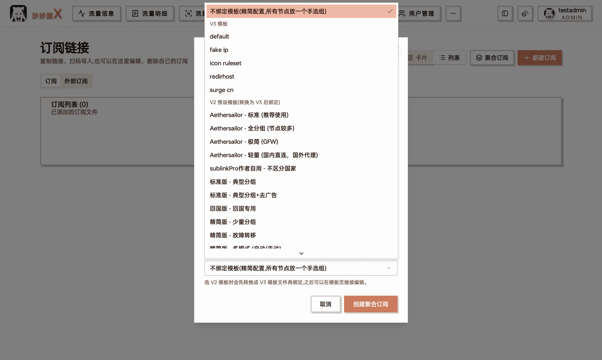
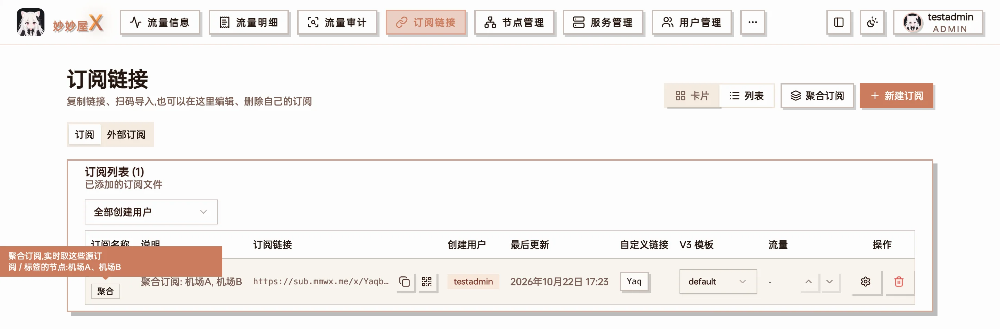
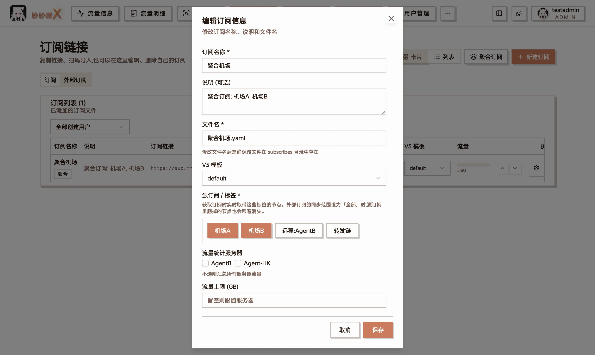

Subscriptions — "Subscription list" (generated files) on top, "External subscriptions" (third-party sources imported from Node Management) below

## Overview

The "Subscriptions" page manages two kinds of things:

- **Subscription list**: files saved from the [Generator](/docs/en/generator) (YAML files in the subscribes directory). Each file can get a custom short link, a bound V3 template and a traffic display.
- **External subscriptions**: airport sources imported in [Nodes → Import external nodes → Subscription](/docs/en/nodes#import-external-nodes). View, sync or delete them here; imported nodes merge with nodes generated from local Xray inbounds and are distributed through the same subscription system.

"Aggregate" at the top of the page combines several external subscriptions into one new subscription by tag; see [Aggregate subscriptions](#aggregate-subscriptions) below.

## Subscription list

| Column          | Description                                                                                          |
| --------------- | ---------------------------------------------------------------------------------------------------- |
| Name            | Name given when saving                                                                               |
| Created by      | The user who generated the file; admins can filter with the dropdown above                           |
| Last updated    | Last generation / regeneration time                                                                  |
| Custom link     | The file's short code; click to copy the `/x/<code>` URL, editable to a custom code                  |
| V3 template     | Bind a V3 template; downloads are then rendered dynamically and new nodes join automatically         |
| Traffic         | Used / limit bar for the subscription; arrows adjust the displayed limit                             |
| Actions         | Settings (node scope / tag filter …), edit content, delete                                            |

## Supported external formats

- Clash/mihomo YAML
- Base64 node lists
- Single-line URIs (ss://, vmess://, vless://, trojan://)

## Add an external subscription

External subscriptions are imported on the Nodes page:

1. Open "Nodes", expand "Import external nodes" → "Subscription"
2. Enter the URL, choose a User-Agent, optionally a tag
3. Click "Import"; nodes are fetched and parsed, confirm with "Save nodes"
4. Back in "Subscriptions" the source shows under "External subscriptions"

## Auto update

External subscriptions can refresh on an interval. "System Settings → Subscription" also configures node-name filters, appended subscription info, traffic sync and automatic re-sync when nodes go offline, see [System Settings](/docs/en/system-settings).

| Interval | Use case                         |
| -------- | -------------------------------- |
| Manual   | Stable nodes                     |
| Hourly   | Frequently changing nodes        |
| Daily    | General use                      |
| Custom   | As needed                        |

## Aggregate subscriptions

An aggregate subscription combines several external subscriptions (or any node tags) into one new subscription. It only remembers which tags to include, not the nodes themselves: every time a client fetches it, the current nodes with those tags are taken live. If a source drops from 100 nodes to 20, the aggregate follows with 20, with no need to regenerate.

Useful for merging several provider subscriptions into one for yourself, or putting external subscriptions and your own nodes into the same config.

### Create one

1. On the "Subscriptions" page, click "Aggregate" at the top.
2. Enter a "Name"; "Description" and "File name" can be left empty to be generated.
3. Under "Sources / tags", tick what to combine:
   - **External subscription**: nodes synced from an external subscription are tagged with its name.
   - **Node tag**: any other node tag, e.g. one entered when importing external nodes.
4. "Template" is optional:
   - No template: a minimal config with all nodes in one selector group `PROXY` (plus DIRECT), and all traffic goes through it.
   - V3 template: generated from the template, with routing rules.
   - My V2 templates / V2 presets: converted into a V3 template file first and then bound (an existing V3 template with the same name is used directly); you can keep editing it on the [Templates](/docs/en/templates) page.
5. Click "Create aggregate".

Creating an aggregate: two external subscriptions ("机场A", "机场B") ticked as sources, bound to the V3 template default

"Template" can be none, a V3 template, or a V2 preset (converted into a V3 template file first, then bound)

If there are no tags to choose from yet, import an external subscription in [Nodes](/docs/en/nodes#import-external-nodes) or tag some nodes first.

### How it differs from a regular subscription

- It has an "Aggregate" badge in the list; hover to see its source tags.
- There's no "Edit config" or "Select nodes": the content is decided by the tags. "Edit info" lets you change the source tags.
- Nodes come from the **creator's own** nodes (usually the external subscriptions they imported) and aren't limited by package scope.
- It's generated the same way as a template-bound subscription: panel nodes still get the recipient's own credentials, and forward chains, WireGuard etc. are handled as usual.
- If generation fails (e.g. no nodes at all under the selected tags), an error is returned instead of an empty config.

An aggregate subscription has an "Aggregate" badge in the list; hover to see its source tags

"Edit info" lets you change the source tags; there's no "Edit config" or "Select nodes"

### Make nodes removed at the source disappear too

By default, syncing an external subscription only updates nodes that are already saved: new nodes at the source aren't added and removed ones aren't deleted. For an aggregate to follow its sources exactly, set the [sync scope](/docs/en/system-settings#sync-scope) under "System Settings → Subscription → External subscription sync" to "Sync All Nodes": new nodes are added automatically, and nodes no longer at the source are deleted on sync (not when an update fails).

## Traffic column

Admins see the aggregate of the selected stat servers (all when none selected); only external subscriptions matched via `selected_tags` are added using their own upload/download/both rule. Regular users only see files they created: the limit comes from the primary package, usage aggregates all of the user's package credentials and excludes external subscriptions. A file's own limit can override the displayed limit. Full definitions: [Traffic Accounting](/docs/en/traffic-accounting).

## Notes

- Imported nodes are merged with local inbound nodes in the output
- Imported nodes can be enabled/disabled and renamed
- After changing a subscription URL, trigger one manual update
