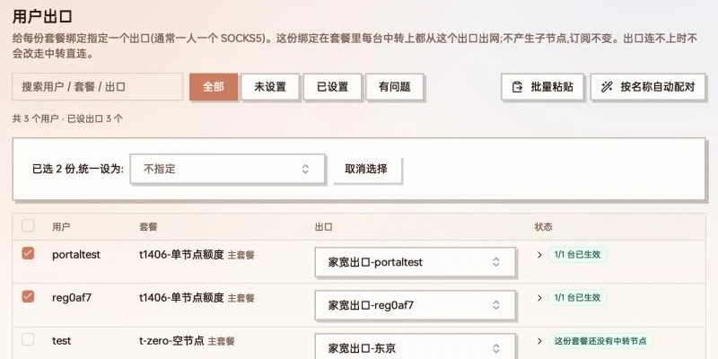
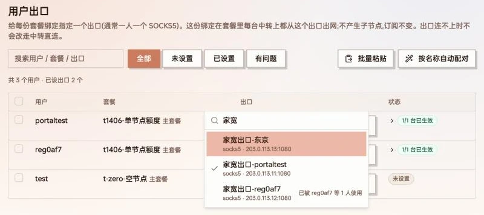
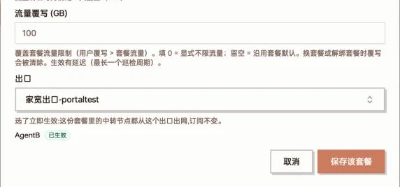
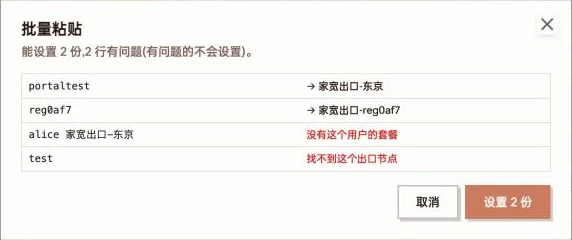
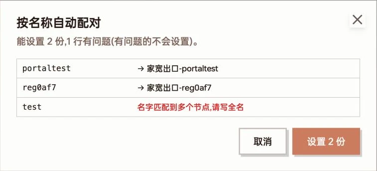
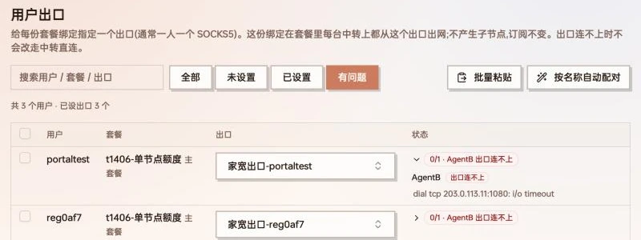

If you have a few SOCKS5 proxies (home broadband, static residential IPs…), a few relays and dozens of users, and want **each user to leave through their own SOCKS5**, use User exits: pick an exit for the user's package, and whichever relay in that package the user connects through, traffic goes out through that exit.

Compared with [routed outbounds](/docs/en/routed-outbound):

| | Routed-outbound child nodes | User exits |
| --- | --- | --- |
| How | One child node per relay × exit, then packages per exit | Pick an exit on the package assignment; all relays follow |
| One exit per user | Child nodes and packages multiply | One extra setting per user |
| Subscription | Gets extra child nodes | Unchanged; users don't notice |
| Best for | Letting users choose their exit | Admin pins the exit for each user |

The two can be used together.

:::note[Version requirements]
User exits need a panel release **after v0.6.2-beta.8**, and the agents on your relays need a release **after v1.3.0**. A relay whose agent is too old shows "Upgrade agent" and is skipped until upgraded.
:::

## How it works

- The exit is set on a **package assignment**, not on the user: a user with two packages can use the exit on one and not the other.
- "Relays" are the servers hosting the nodes of that package — the exit applies on every server where the user has an account through it.
- On each relay the panel creates one outbound per exit in use, plus rules "these users → this exit". Users of the same exit share one outbound. No child nodes are created and the subscription doesn't change.
- Rules match only that package's inbounds on the relay, so the user's other package without an exit is unaffected.

### What can be an exit

Any regular node in Node management, including [imported external nodes](/docs/en/nodes). SOCKS5 is the usual choice; SOCKS5 / HTTP are listed first in the picker.

Not allowed:

- Child nodes of a routed outbound (pick its landing node instead)
- Forward-chain entries and port-forward nodes
- A node on the same server as the relay (that relay shows "Failed: the exit node is on this server")

### Rule order

On a relay, rules are matched top-down; user exits sit here:

1. Steal-self, port forwarding
2. Bans (BT blocking, private-address blocking…)
3. Domain / IP routing rules (direct for local sites, AI routing, unlock rules…)
4. **User exits**
5. Admin-shared routed outbounds
6. Home-broadband / speed-test WARP
7. Everything else (including "whole node" landing)

So your routing rules still apply first; the rest of the traffic goes to the user's exit, which overrides shared routed outbounds and whole-node landing.

### When the exit is down

Traffic **does not fall back to the relay's own connection and does not switch exits** — the point of a pinned exit is to never leave from the wrong IP.

Every 3 minutes each relay makes a TCP connection test to the exit's address and port; it is marked "Exit unreachable" after 2 failed rounds in a row, and recovers after 2 good rounds. Changes trigger notifications ("user exit unreachable" / "user exit recovered"). This notification group is always on; subscribe channels to it under System settings → Push → Notification channels.

:::caution
The test only checks that the exit's port accepts connections. It does not verify SOCKS5 credentials or that the exit can actually reach the internet. Wrong credentials won't show as unreachable, but the user won't get online.
:::

## Setting exits

Open **User exits** in the top menu (admins only). Each row is one active package assignment. Screenshots below are from the Chinese UI.



The User exits page: one row per package assignment; select rows to get "N selected, set all to:"

### One at a time

Click the picker in the Exit column. You can search by node name, address or protocol. Each entry shows "protocol · address:port"; exits already assigned to someone else are marked "used by …", which helps with one-per-user allocation.



The exit picker filtered to three SOCKS5 exits; ones already taken are marked "used by …"

**Selecting saves and pushes immediately — there is no confirm button.** The panel pushes to the affected relays right away, so the status shown after "Saved" is the actual result. Pick the first entry, "None (use each node's own outbound)", to remove the exit.

The same field is in User management: click the user's package to open the package dialog and choose under **Exit**. It also takes effect immediately, without pressing the dialog's save button:



User management → package dialog: the Exit field applies immediately and lists the status on each relay

### In bulk

- **Select rows**: tick some rows, then choose an exit in "N selected, set all to:". Choose "None" to clear them all. The header checkbox selects only the rows visible under the current filter.
- **Paste list**: one `username exit-node-name` per line, separated by a space, tab or comma:

  ```
  alice	Home-Tokyo
  bob Home-Osaka
  ```

  - Usernames must match exactly (case-insensitive). Users with several packages get it on their **primary package** only.
  - Node names match an exact name first; otherwise the single node whose name contains the text. Several matches give "Name matches several nodes; use the full name".
  - Click **Preview** first; nothing is set until you confirm:

  

  Paste preview: valid lines show "→ exit"; problems are shown in red and skipped

- **Auto-match by name**: if exit node names contain the username (e.g. `Home-alice`), match them in one click. Only assignments without an exit are considered, and only when exactly one node name contains the username. Also previewed first:

  

  Auto-match: portaltest and reg0af7 each get the exit carrying their name; "test" appears in several node names and is skipped

## Status and troubleshooting

The Status column shows "applied / total relays" — all green means "3/3 relays applied". Otherwise it shows "0/1 · server state"; expand it to see each relay and the reason. The **Problems** filter shows only rows with red / yellow states.



The Problems filter: both exits are unreachable from AgentB; expanding shows the TCP timeout

| State | Meaning / what to do |
| --- | --- |
| Applied | The relay is sending this user through the exit |
| Pending | Just changed, being pushed; usually turns Applied within seconds |
| Server offline | The relay is offline; pushed automatically when it's back |
| Upgrade agent | The relay's agent is too old; applies after upgrading |
| Not supported | This server can't use exits, e.g. a [shared server](/docs/en/share-server) |
| Failed | Hover for the reason; commonly the exit node is on this same server |
| Exit unreachable | The relay can't connect to the exit's address/port: check the exit is up and its firewall allows this relay's IP |
| This package has no relay nodes yet | The package has no nodes, so there is nowhere to apply it |
| Exit node deleted | The chosen exit node was deleted; pick another |

The page refreshes every 30 seconds. Besides pushing on save, the panel re-pushes after account changes and reconciles everything every 10 minutes, so relays recover automatically after restarts or outages.

## Limitations

- Single-user Shadowsocks inbounds (one shared password) can't tell users apart, so they don't support user exits.
- Routed-outbound sub-accounts are not covered; they keep using their child node's landing.
- Shared servers can't use exits.
