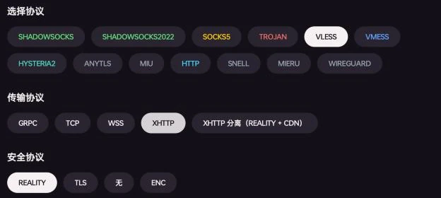
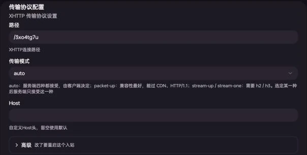
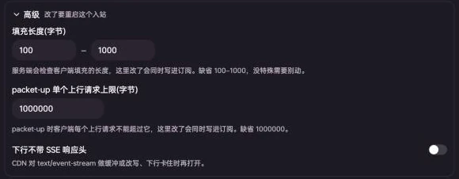
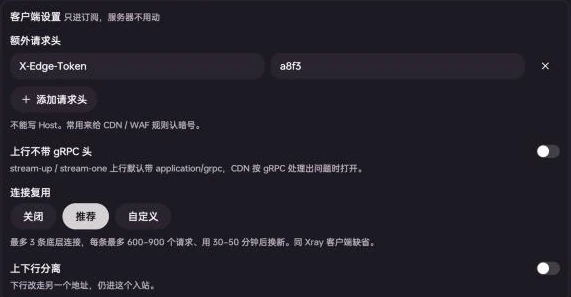
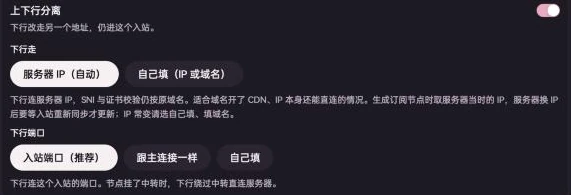
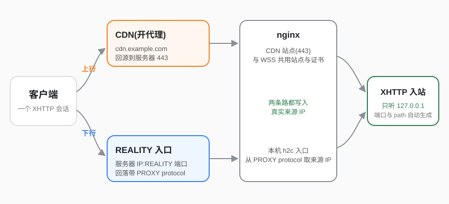
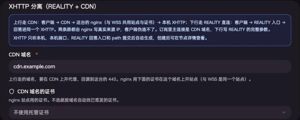

XHTTP is Xray's HTTP transport: proxy traffic is carried in ordinary HTTP requests, so it works both directly and behind a CDN or nginx. "Nodes → Add Node" offers two kinds of XHTTP:

- **XHTTP**: one inbound with REALITY / TLS / None / ENC security, optionally splitting the download direction to another address.
- **XHTTP Split (REALITY + CDN)**: upload goes through a CDN, download goes over direct REALITY, and both reach the same inbound. The panel creates the inbound, the REALITY entry and the nginx site for you.

:::note[Requirements]

- Panel: a release **after v0.6.2-beta.8**. Earlier releases only offer XHTTP with REALITY and have none of the options below.
- Clients: MeowX needs a release **after 0.7.2**; MeowX for Android / Windows / Linux (meowC) works with current releases. For third-party clients see [Subscriptions and clients](#subscriptions-and-clients).
  :::

## Choosing the security layer

| Security | Needs                                  | Good for                                                                                                         |
| -------- | -------------------------------------- | ---------------------------------------------------------------------------------------------------------------- |
| REALITY  | No domain or certificate               | Direct connections, recommended                                                                                  |
| TLS      | A server domain and certificate        | Direct connections with your own domain                                                                          |
| None     | A CDN / nginx in front terminating TLS | Running behind your own reverse proxy. Exposed directly, the traffic is plain HTTP — don't do that               |
| ENC      | No domain or certificate               | VLESS's own encryption (no TLS on the transport). sing-box, Quantumult X and Loon don't support VLESS encryption |

With XHTTP as the transport there are four security options; "XHTTP Split (REALITY + CDN)" next to it is covered [below](#xhttp-split-reality--cdn).

## Choosing the mode

| Mode       | What it does                                                                                    |
| ---------- | ----------------------------------------------------------------------------------------------- |
| auto       | Default. The server accepts every mode and the client decides                                   |
| packet-up  | Upload is split into many small requests. Most compatible: works through CDNs and over HTTP/1.1 |
| stream-up  | Upload is one long streaming request, download is a separate request. Needs h2 / h3             |
| stream-one | Upload and download share one request, lowest latency. Needs h2 / h3 and cannot be split        |

With auto, MeowX and Xray clients use stream-one over REALITY (stream-up when the download direction is split) and packet-up otherwise. Once the server is set to one specific mode, it only accepts that mode (a stream-up server also accepts stream-one).

**If unsure, keep auto.** Pick packet-up to go through a CDN.

## Creating a node

1. "Nodes → Add Node", pick a server, click "Next".
2. Choose **VLESS** as the protocol, **XHTTP** as the transport, then the security layer.
3. Keep **Simple mode**, enter a node name (optional; without one the node is named "[server] inbound tag"), and click "Submit".

In simple mode you only fill in what you have to decide; everything else is generated:

| Generated       | How                                                                                                               |
| --------------- | ----------------------------------------------------------------------------------------------------------------- |
| Port            | A port that is actually free on the server (skipping ports the agent itself uses), inside the server's port range |
| UUID            | Random                                                                                                            |
| Path            | Random, e.g. `/3xo4tg7u`                                                                                          |
| Mode            | auto                                                                                                              |
| REALITY         | Probes target domains (lowest latency that completes a handshake), generates the key pair and a random shortId    |
| TLS certificate | Matches the server's domain against certificates issued in Certificates                                           |
| ENC keys        | Generates an ML-KEM-768 key                                                                                       |

Switching to **Expert mode** keeps all of these values so you can review and change them:

Expert mode's transport settings: path, mode and Host, followed by the "Advanced" and "Client settings" groups.

:::tip[TLS node without a matching certificate]
Simple mode looks for a certificate by the server's domain and warns when none matches. Switch to expert mode, pick a certificate under "Select certificate" (wildcard certificates work), and set SNI to a domain the certificate covers.
:::

## Advanced options

The advanced options live in expert mode, in two groups:

- **Advanced**: written into the inbound on the server and into subscriptions. Changing them restarts the inbound.
- **Client settings**: only written into subscriptions; the server is not touched.

### Advanced (server side)

| Option                       | Default  | What it does                                                                                       |
| ---------------------------- | -------- | -------------------------------------------------------------------------------------------------- |
| Padding length (bytes)       | 100–1000 | Range of padding each request carries. The server checks it and rejects requests outside the range |
| packet-up max upload request | 1000000  | Maximum bytes per upload request in packet-up                                                      |
| No SSE header on download    | Off      | Turn on when a CDN buffers or rewrites `text/event-stream` and downloads stall                     |

Padding length and the request limit are also written into subscriptions so clients follow them. **After changing them, clients must refresh their subscription**, otherwise the server rejects clients still on the old one.

### Client settings (subscriptions only)

| Option                   | What it does                                                                                                                 |
| ------------------------ | ---------------------------------------------------------------------------------------------------------------------------- |
| Extra request headers    | Sent with every request. Handy as a secret for CDN / WAF rules. Host is not allowed here (set it above)                      |
| No gRPC header on upload | stream-up / stream-one uploads send `Content-Type: application/grpc` by default; turn this on if a CDN mishandles it as gRPC |
| Connection reuse         | Lets several proxy connections share a few underlying connections, skipping a handshake each time. See below                 |
| Upload / download split  | Sends the download direction to another address, see [the next section](#upload--download-split)                             |

Connection reuse levels:

| Level       | Behavior                                                                                                                                      |
| ----------- | --------------------------------------------------------------------------------------------------------------------------------------------- |
| Off         | Default. Every proxy connection does its own handshake                                                                                        |
| Recommended | At most 3 underlying connections, each replaced after 600–900 requests or 30–50 minutes (Xray client defaults)                                |
| Custom      | Limit by either max connections or max concurrency per connection, plus max requests and max lifetime per connection (empty = client default) |

Ranges take a single number or "from-to"; the client picks a random value in the range each time. In our tests, time to first byte for back-to-back requests roughly halved with reuse on.

## Upload / download split

Turn on **Upload / download split** under "Client settings" and the download direction goes to another address, still reaching the same inbound. Nothing changes on the server; the subscription just gains a download section.

**Download via**:

| Option                | What it does                                                                                                                                                                                                                                                                                            |
| --------------------- | ------------------------------------------------------------------------------------------------------------------------------------------------------------------------------------------------------------------------------------------------------------------------------------------------------- |
| Server IP (auto)      | Download connects to the server's IP while SNI and certificate checks still use the original domain. Good when the domain is behind a CDN but the IP is still directly reachable. The IP is taken when the node is generated; after the server's IP changes it updates once the inbound is synced again |
| Custom (IP or domain) | Use a domain if the IP changes often                                                                                                                                                                                                                                                                    |

**Download port**:

| Option                     | What it does                                                                                                                           |
| -------------------------- | -------------------------------------------------------------------------------------------------------------------------------------- |
| Inbound port (recommended) | Download uses this inbound's port. When the node goes through a relay, download bypasses the relay and connects to the server directly |
| Same as main connection    | No port written; the client reuses the main connection's port (the relay port if the node goes through a relay)                        |
| Custom                     | 1–65535                                                                                                                                |

- stream-one can't be split (it's a single request). The node is still saved; the subscription just has no download section.
- On dual-stack servers that generate both a v4 node and a `(v6)` node, the `(v6)` node's download connects to the server's IPv6 when "Server IP (auto)" is selected.

## XHTTP Split (REALITY + CDN)

Upload goes through a CDN, download over direct REALITY, and both reach the same XHTTP inbound:

The upload direction hides behind the CDN; the download direction goes over direct REALITY. On both paths nginx writes the real client IP, which clients cannot forge.

### Before you start

- A domain whose DNS points to this server, proxied by the CDN with the origin at the server's port 443.
- nginx installed on the server, and a certificate for the domain in [Certificates](/docs/en/certificates) (wildcard is fine). These are the same requirements as WSS nodes, and the CDN domain's site is shared with WSS.
- The cloud provider's security group allows the REALITY entry port (shown on the node after it's created).

:::caution[Not the panel's own domain]
The nginx site for the CDN domain is fully managed by the panel. If the server already has another site on that domain (the panel's own domain, for example), the wizard says "this domain already has another site on the server" and won't submit — use a different domain.
:::

### Creating the node

1. "Nodes → Add Node", pick a server, and choose **XHTTP Split (REALITY + CDN)** as the transport.
2. In simple mode you only confirm the **CDN domain** (defaults to the server's domain). **Certificate for the CDN domain** is optional; without one, an issued certificate is found by domain.

   

   The XHTTP local port, the REALITY entry's port and keys, the fallback entry and the path are generated on submit.

3. Click "Submit".

Expert mode additionally lets you change:

- **Mode**: auto by default, written as packet-up in subscriptions (works even when the CDN reaches the origin over HTTP/1.1). stream-up needs a CDN that supports streaming uploads. stream-one can't be split and isn't offered.
- **Port**: the REALITY entry's port, not limited by the server's port range. On a server using steal-self (tunnel), 443 is forwarded to tunnel-in's local port like a normal REALITY inbound; on other servers 443 is usually taken by nginx, so pick another port.
- **REALITY**: target domain, keys, shortId and so on, as for a normal REALITY inbound.

### After it's created

- In subscriptions the node's address is `CDN domain:443`, and its download section carries the REALITY entry's full parameters (server IP, port, public key, shortId).
- "Xray Inbounds" shows an extra `…-reality` inbound: the REALITY entry. It can't be deleted on its own; deleting the node (or its XHTTP inbound) removes both and takes the CDN path out of nginx.

### CDN settings

Using Cloudflare as an example:

1. Add an A record for the CDN domain pointing to the server IP, with the proxy on (orange cloud).
2. Set SSL/TLS encryption to "Full (strict)" when the server uses a real certificate issued in Certificates, or "Full".
3. Use packet-up (auto is fine).

packet-up through Cloudflare was tested and works; stream-up through Cloudflare has not been tested. Other CDNs work as long as they reach the origin over HTTPS and don't cache this path; if downloads stall, turn on "No SSE header on download" under [Advanced](#advanced-server-side).

## Subscriptions and clients

| Client                                      | XHTTP   | Advanced options and split                                                          |
| ------------------------------------------- | ------- | ----------------------------------------------------------------------------------- |
| MeowX (iOS / macOS, releases after 0.7.2)   | Yes     | All supported                                                                       |
| MeowX for Android / Windows / Linux (meowC) | Yes     | All supported                                                                       |
| mihomo-based clients                        | Yes     | Delivered in mihomo's format; depends on the client version                         |
| Xray-based clients (v2rayN / v2rayNG …)     | Yes     | Import via share link; advanced options go in the link's `extra`                    |
| Stash (iOS 3.6+ / macOS 4.3+)               | Yes     | Connection reuse is dropped; the rest is passed through, subject to Stash's support |
| Shadowrocket                                | Partial | Only path and Host; no advanced options or split                                    |
| sing-box / Loon / Quantumult X / Surge      | No      | XHTTP nodes are skipped in subscriptions                                            |

A node with a changed padding length only works with clients that understand that setting; other clients send the default padding and are rejected by the server.

## FAQ

**Can't connect after changing the padding length**: the client is still on the old subscription; refresh it. Clients without advanced-option support (such as Shadowrocket) can't use nodes with a changed padding length.

**A CDN node connects but downloads stall**: turn on "No SSE header on download" under "Advanced"; if stream-up doesn't pass through the CDN, switch to packet-up.

**"The port range of this server is fully used"**: an automatically picked port would always collide, so the wizard won't submit. Widen the port range in the server settings or enter a free port yourself. The XHTTP Split REALITY entry isn't limited by the port range.

**"Port already in use" on submit**: if the port was picked automatically, the panel picks another and retries; if you entered it yourself, choose a different one.
