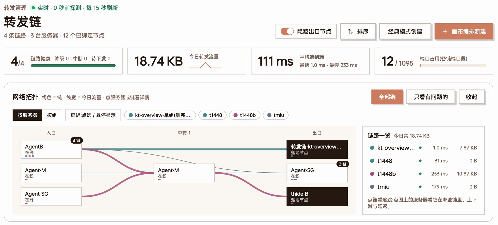
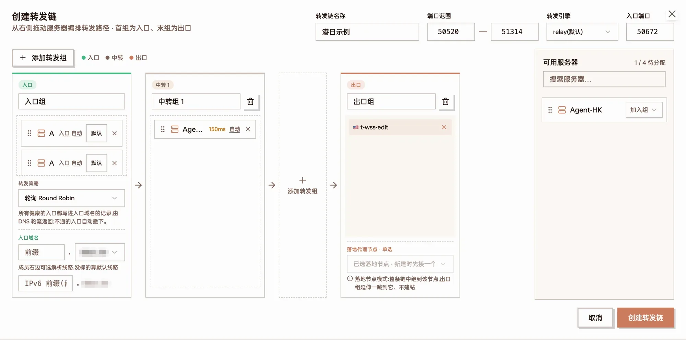
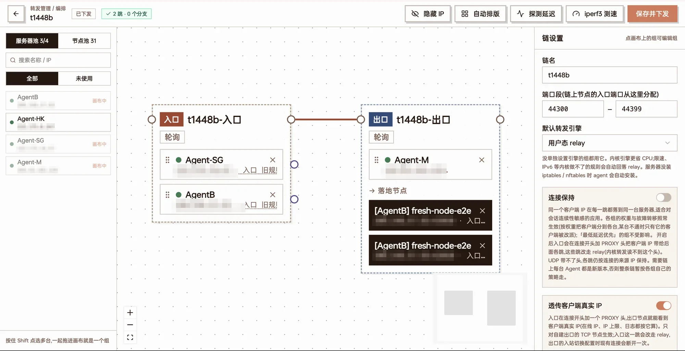
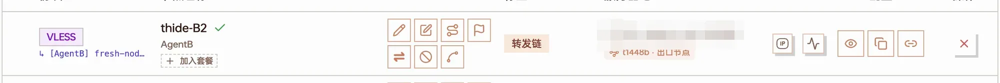
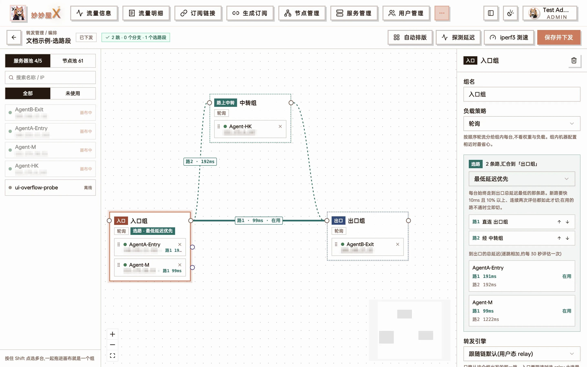
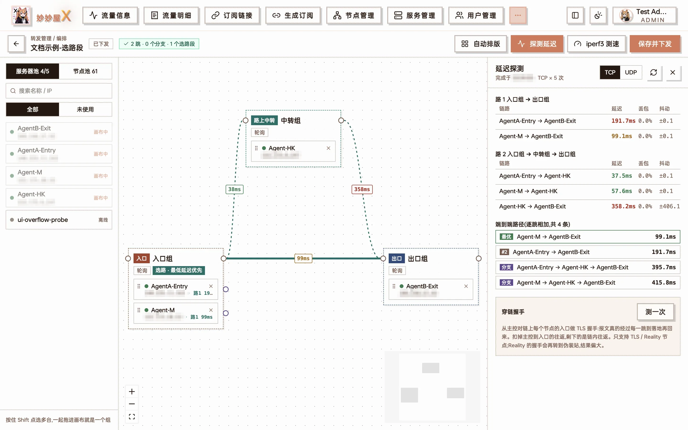
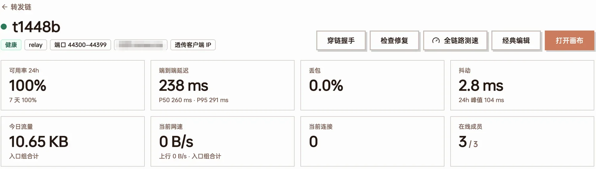
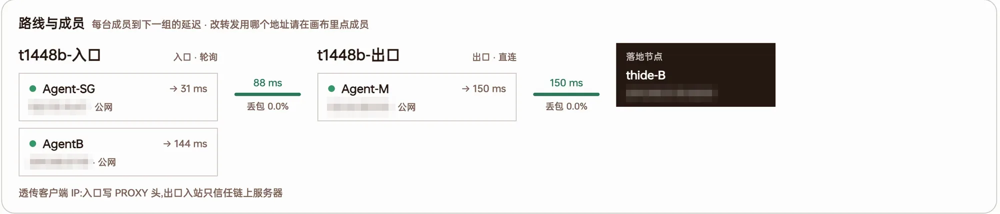

import { Steps } from "@astrojs/starlight/components";
import ForwardDiagram from "@/components/docs/forward-diagram.astro";
import DocShot from "@/components/docs/doc-shot.astro";
import shotCanvasStrategy from "../../assets/screenshots/ft-canvas-strategy.webp";
import shotCanvasFailover from "../../assets/screenshots/ft-canvas-failover.webp";
import shotChainSettingsTop from "../../assets/screenshots/ft-chain-settings-top.webp";
import shotChainSettingsBottom from "../../assets/screenshots/ft-chain-settings-bottom.webp";
import shotBindNew from "../../assets/screenshots/ft-bind-new.webp";
import shotBindExisting from "../../assets/screenshots/ft-bind-existing.webp";
import shotBindComplete from "../../assets/screenshots/ft-bind-complete.webp";
import shotChangeChain from "../../assets/screenshots/ft-change-chain.webp";
import shotAddrPicker from "../../assets/screenshots/ft-addr-picker.webp";
import shotPortPicker from "../../assets/screenshots/ft-port-picker.webp";
import shotServerPortrange from "../../assets/screenshots/ft-server-portrange.webp";
import shotDetailDns from "../../assets/screenshots/ft-detail-dns.webp";
import shotDetailActual from "../../assets/screenshots/ft-detail-actual.webp";
import shotEntryAddr from "../../assets/screenshots/ft-entry-addr.webp";

这篇教程按「要做什么」来组织,每一步都配了界面截图和示意图。每个功能的完整说明与参数见[转发管理](/docs/forward),这里只讲怎么用。

## 先弄清楚几个词

转发链就是把几台服务器串起来:客户端连**入口**,流量经过**中转**,到达**出口**,出口再连到真正的代理节点。

<ForwardDiagram
  caption="一条三跳转发链:两台入口组成入口组,中间一台中转,节点建在出口上"
  nodes={[
    { id: "c", x: 0, y: 0.5, label: "客户端", kind: "client" },
    { id: "a1", x: 1, y: 0, label: "入口-广州", sub: "入口端口 50600", kind: "entry" },
    { id: "a2", x: 1, y: 1, label: "入口-上海", sub: "入口端口 50600", kind: "entry" },
    { id: "r", x: 2.15, y: 0.5, label: "中转-香港", kind: "relay" },
    { id: "e", x: 3.3, y: 0.5, label: "出口-日本", sub: "节点建在这里", kind: "exit" },
  ]}
  groups={[
    { label: "入口组", kind: "entry", members: ["a1", "a2"] },
    { label: "中转组", kind: "relay", members: ["r"] },
    { label: "出口组", kind: "exit", members: ["e"] },
  ]}
  edges={[
    { from: "c", to: "a1" },
    { from: "c", to: "a2", style: "dim" },
    { from: "a1", to: "r" },
    { from: "a2", to: "r" },
    { from: "r", to: "e" },
  ]}
/>

| 词 | 意思 |
| --- | --- |
| 组 | 一跳上的一组服务器。组里有几台,这一跳就能在几台之间分流、互为备份 |
| 入口组 | 第一跳,客户端连的就是它。订阅里的节点地址是入口的地址或入口域名 |
| 中转组 | 入口和出口之间的跳,可以没有,也可以有好几个 |
| 出口组 | 最后一跳。要么节点直接建在出口服务器上(自建出口),要么出口后面再接一个已有的落地节点 |
| 入口端口 | 客户端连的端口,入口组每台都监听它 |

开始之前确认两件事:

- 要用的服务器都已经接入,在「服务管理」里显示在线
- 服务器如果有云厂商的安全组 / 防火墙,放行转发链要用的端口段(默认 50520–51314,下文会讲怎么改)

## 一、建一条转发链

右上角有两个入口:「经典模式创建」适合简单的直线链,「画布编排新建」能用到全部功能。两种方式建出来的是同一种链,经典模式建的随时可以再打开画布继续编排。

转发管理首页:顶部是汇总与网络拓扑,右上角是「经典模式创建」和「画布编排新建」

### 方式一:经典模式

<Steps>

1. 点「经典模式创建」,填「转发链名称」。「端口范围」和「转发引擎」先保持默认
2. 默认已经有「入口组」和「出口组」。要加中转就点「＋ 添加转发组」,会在出口组前面插一个「中转组」
3. 把右侧「可用服务器」里的服务器拖进各组,或者用每行右边的「加入组」下拉选
4. 出口二选一:
   - **自建出口**:把服务器拖进出口组,之后节点会建在它上面
   - **接落地节点**:在出口组下方「落地代理节点 · 单选」里点「＋ 选择落地节点…」,选一个已有节点,顶部会多出「入口端口」
5. 点「创建转发链」。保存即生效,经典模式没有单独的「下发」步骤

</Steps>

经典模式:入口组 2 台、中转组 1 台,出口接了一个落地节点,顶部出现「入口端口」

入口组有两台以上时会出现「转发策略」;入口组下方可以填入口域名(见[入口组的负载均衡](#入口组靠入口域名分流))。

### 方式二:画布编排

<Steps>

1. 点「画布编排新建」。左侧是「服务器池」和「节点池」,右侧是设置面板
2. 把服务器从左侧拖到画布空白处,就建了一个组;拖到已有的组上,就是加进这个组。按住 Shift 点选多台再拖,一次就是一组
3. 从一个组**右上角的圆点**拉线到下一个组。最左边的组是入口,最右边的是出口
4. 出口用落地节点的话,切到「节点池」,把节点拖进出口组
5. 点画布空白处,在右侧「链设置」里填链名
6. 点「自动排版」整理一下,再点「保存并下发」

</Steps>

画布:左边服务器池,中间是「入口组 → 出口组 → 落地节点」,右边是链设置

画布上的修改(包括改策略、加服务器、换引擎)都要点「保存并下发」才生效,顶部徽标会显示「有未保存的修改」。双击一条线可以删掉它。

### 往已有的链里加服务器

在链卡片上点「打开画布」,把服务器从左侧拖进要加的组,点「保存并下发」。服务器池的「未使用」只是「不在这条链上」,不代表没被别的链用过。同一台服务器在一条链里只能出现一次,从别的组拖过来就是移动。

给**入口组**加了服务器之后,转发规则会自动下发到新入口,但订阅里的节点不一定会自动多出它:

- 链设了入口域名:新入口健康后自动加进解析,不用管
- 没设入口域名,或者节点开了[入口分离](#入口分离每台入口一个节点):到链详情页点「绑定节点」→「补全入口」,只给新入口补建节点,复用现有端口和出口

<DocShot src={shotBindComplete} alt="补全入口" />

「补全入口」:用入口域名的节点自动跳过,按入口 IP 建的节点列出「待补」的新入口

:::caution[经典编辑会把权重冲掉]
用「经典编辑」保存一条链时,所有成员的权重都会重置成 1。在画布里设过「加权」权重的链,请一直用画布编辑。
:::

## 二、绑定节点

链建好后还没有节点,客户端没东西可连。绑定节点之后,订阅里会多出一个地址是**入口**、端口是**入口端口**的节点:

<ForwardDiagram
  caption="绑定前客户端直连出口;绑定后连入口,流量经链到出口"
  nodes={[
    { id: "c1", x: 0, y: 0, label: "客户端", kind: "client" },
    { id: "n1", x: 2.5, y: 0, label: "日本节点", sub: "jp.example.com:443", kind: "exit" },
    { id: "c2", x: 0, y: 1.6, label: "客户端", kind: "client" },
    { id: "a", x: 1.2, y: 1.6, label: "入口-广州", sub: "gz.example.com:50600", kind: "entry" },
    { id: "e", x: 2.5, y: 1.6, label: "出口-日本", kind: "exit" },
  ]}
  edges={[
    { from: "c1", to: "n1", style: "dim", label: "绑定前:直连" },
    { from: "c2", to: "a", label: "绑定后" },
    { from: "a", to: "e" },
  ]}
/>

入口在哪找:没绑过节点的链卡片上直接有「绑定节点」;绑过的在卡片「…」菜单里,或者链详情页「已绑定节点」右上角。对话框里有三个页签,三种都是**新增**节点,不会替换已有的。

### 方式 A:新建节点(自建出口)

出口组里是你自己的服务器时用这个。

<Steps>

1. 在「新建节点」页签填「节点名称(可选)」,不填就叫「转发链-链名」
2. 按需打开「入口分离」「出口分离」(见[下一节](#入口分离与出口分离)),下方会显示「将创建 N 个节点」
3. 点「下一步」选协议、传输和证书。主控会在出口组每台服务器上建同一份入站(凭据全链共享),端口自动分配

</Steps>

<DocShot src={shotBindNew} alt="新建节点" />

新建节点:打开「入口分离」后,2 台入口会生成 2 个节点

出口组里有离线服务器、或只有一个组的链,不能新建节点。WireGuard 不支持走转发链。

### 方式 B:绑定已有节点(落地节点)

出口后面接一个已经存在的节点(可以是别人的落地机)时用这个。

<Steps>

1. 切到「绑定已有节点」,在「选择已有节点」里选节点
2. 「端口」是入口端口,留空自动挑一个空闲的
3. 点「绑定并新建入口节点」

</Steps>

<DocShot src={shotBindExisting} alt="绑定已有节点" />

绑定已有节点:选节点,端口留空就自动分配

转发 TCP 还是 UDP 按落地节点的协议自动决定(Hysteria2 等走 UDP)。如果这个节点有共用同一 IP 和端口的「关联节点」(父节点、同一父节点下的路由出站子节点),会弹窗让你勾选是否一起改走这条链。

在画布里也能接落地节点:把节点从「节点池」拖进出口组,右侧面板可以填「入口端口」、选「转发协议」(TCP / UDP / TCP + UDP),再「保存并下发」。

### 也可以从节点管理添加

「节点管理 → 添加节点」选「转发链」页签:选好转发链,「出口方式」选「新建节点」或「已有节点」,端口旁边有「随机」按钮,会挑一个在入口允许范围里的空闲端口。

### 订阅里的地址是什么

- **地址**:链设了入口域名就用入口域名;没设就用入口组第一台的「入口地址」(见下)
- **端口**:入口端口
- **协议和凭据**:来自出口上的入站,或落地节点本身

### 入口地址写 IP 还是域名

入口组每台服务器可以单独设「订阅里写哪个地址」。打开画布,点入口组成员行上的「入口 …」按钮(悬停提示「订阅里写的入口地址,点击切换」),弹层顶部就是「入口地址(写进订阅 / 入口节点,客户端连这个地址)」:

<DocShot src={shotEntryAddr} alt="入口地址" />

入口地址弹层:这条链在功能上线前就有,所以多了「旧规则」一行;下半部分是这台连下一跳用的出站地址

| 选项 | 订阅里写的地址 |
| --- | --- |
| 自动(跟随服务器地址) | 和普通节点一样:服务器有域名用域名,没有用 IP;服务器地址变了跟着变。新建的链、新加进入口组的服务器默认是它 |
| IPv4 / IPv6 | 这台的公网 IPv4 / IPv6(开了「锁定节点入口 IP」时取手填的地址);这台没有对应地址时选项是灰的 |
| 手填 / 登记的域名 | 「指定」一个域名或 IP,比如套了 CDN 的域名;这台在服务管理里登记过的域名会直接列出来 |
| 旧规则(IP 优先) | 只在功能上线前就有的链上出现:有 IP 用 IP,没有才用域名。没改过就一直照旧 |

- 点一项就立即保存;已经停在这台旧地址上的入口节点会挪到新地址,客户端更新订阅后生效
- 链设了入口域名时,不分离的那个入口节点照旧用入口域名,这里的设定只用于[入口分离](#入口分离每台入口一个节点)和「补全入口」生成的、按台分开的节点
- 没设入口域名、也没开入口分离时,整条链只有一个入口节点,用的是入口组**第一台**的设定
- 按设定取不到地址(比如选了 IPv6,后来服务器没了 IPv6)时退回旧规则,不会写出空地址
- 新建链时(经典模式)入口组成员行上的「入口 自动」按钮也能改这一项

### 怎么解绑

界面上没有单独的「解绑」按钮,用下面任一种:

- 在节点管理里删掉那个入口节点,关联节点会自动改回原地址
- 落地节点:在画布 / 经典编辑里把它从出口组移出,保存
- 改绑到别的链:在[「更换转发链」对话框](#改已绑节点的入口端口)里点另一条链

## 入口分离与出口分离

这两个开关只在「新建节点」时有。不开的时候,一条转发链只生成**一个**节点;开了以后按入口 / 出口拆成多个。

### 入口分离:每台入口一个节点

<ForwardDiagram
  caption="不分离:订阅里只有一个节点,地址是入口域名,由 DNS 决定连哪台入口"
  nodes={[
    { id: "n", x: 0, y: 0.5, label: "节点", sub: "hk.example.com:50600", kind: "plain", w: 1.1 },
    { id: "d", x: 1.3, y: 0.5, label: "入口域名", kind: "dns" },
    { id: "a1", x: 2.5, y: 0, label: "入口-电信", kind: "entry" },
    { id: "a2", x: 2.5, y: 1, label: "入口-联通", kind: "entry" },
  ]}
  edges={[
    { from: "n", to: "d", style: "dns" },
    { from: "d", to: "a1", style: "dns" },
    { from: "d", to: "a2", style: "dns" },
  ]}
/>

<ForwardDiagram
  caption="入口分离:每台入口一个节点,地址是那台入口的 IP,用户自己挑"
  nodes={[
    { id: "m1", x: 0, y: 0, label: "节点 [入口-电信]", sub: "203.0.113.10:50600", kind: "plain", w: 1.2 },
    { id: "m2", x: 0, y: 1, label: "节点 [入口-联通]", sub: "198.51.100.20:50600", kind: "plain", w: 1.2 },
    { id: "b1", x: 1.6, y: 0, label: "入口-电信", kind: "entry" },
    { id: "b2", x: 1.6, y: 1, label: "入口-联通", kind: "entry" },
  ]}
  edges={[
    { from: "m1", to: "b1" },
    { from: "m2", to: "b2" },
  ]}
/>

- 每个节点的地址是那台入口自己的 IP,端口都一样;转发规则不变(入口组每台本来就都监听这个端口)
- 节点不走入口域名,所以入口组的 DNS 策略和[分线路解析](#分线路解析)对它们**不起作用**,选哪个入口由用户在客户端里决定
- 适合:没有入口域名,或 DNS 服务商不支持分线路,又想让用户自己挑电信入口 / 联通入口

### 出口分离 vs 出口组负载均衡

出口组有多台时,有两种完全相反的用法:

<ForwardDiagram
  caption="不分离:一个节点,按出口组的负载策略把连接分到两台出口(这就是「出口分流」)"
  nodes={[
    { id: "n", x: 0, y: 0.5, label: "节点", sub: ":50600", kind: "plain" },
    { id: "a", x: 1.2, y: 0.5, label: "入口", kind: "entry" },
    { id: "e1", x: 2.6, y: 0, label: "出口-日本", kind: "exit" },
    { id: "e2", x: 2.6, y: 1, label: "出口-美国", kind: "exit" },
  ]}
  groups={[{ label: "出口组 · 轮询", kind: "exit", members: ["e1", "e2"] }]}
  edges={[
    { from: "n", to: "a" },
    { from: "a", to: "e1", label: "按策略分", dx: -6, dy: -8 },
    { from: "a", to: "e2" },
  ]}
/>

<ForwardDiagram
  caption="出口分离:每台出口一个节点、一个独立入口端口,连接固定落到那一台"
  nodes={[
    { id: "n1", x: 0, y: 0, label: "节点 [→日本]", sub: ":50601", kind: "plain" },
    { id: "n2", x: 0, y: 1, label: "节点 [→美国]", sub: ":50602", kind: "plain" },
    { id: "a", x: 1.45, y: 0.5, label: "入口", kind: "entry" },
    { id: "e1", x: 2.9, y: 0, label: "出口-日本", kind: "exit" },
    { id: "e2", x: 2.9, y: 1, label: "出口-美国", kind: "exit" },
  ]}
  edges={[
    { from: "n1", to: "a", label: ":50601" },
    { from: "n2", to: "a", label: ":50602", dy: 22 },
    { from: "a", to: "e1", label: "只去日本" },
    { from: "a", to: "e2", label: "只去美国", dy: 22 },
  ]}
/>

| | 不开出口分离 | 开出口分离 |
| --- | --- | --- |
| 节点数 | 1 个 | 出口组有几台就几个 |
| 入口端口 | 整组共用一个 | 每台出口一个 |
| 连接去哪台出口 | 按出口组的负载策略分 | 固定去节点对应的那台,出口组策略对它不生效 |
| 适合 | 多台出口分担流量、互为备份 | 各台出口用途不同(解锁、地区),用户要固定选某一台 |

想要「流量分到多台出口」,就**不要**开出口分离,而是在出口组上选负载策略(见[负载均衡](#四负载均衡))。两个开关都开时,节点数 = 入口数 × 出口数,命名为「名称 [入口→出口]」。

## 三、修改端口

### 端口是怎么分配的

一条绑定只有一个入口端口,入口组每台都监听它。后面的中转、出口各用各的端口:入口端口在这台允许的范围里就沿用,不在就在它自己的范围里另挑一个,上一跳会自动指向它。

<ForwardDiagram
  caption="入口端口 50600;中转没限定范围就沿用;出口限定了 45000–45009,于是在范围里另挑 45003"
  nodes={[
    { id: "c", x: 0, y: 0.5, label: "客户端", kind: "client" },
    { id: "a1", x: 1.2, y: 0, label: "入口 A", sub: "监听 :50600", kind: "entry" },
    { id: "a2", x: 1.2, y: 1, label: "入口 B", sub: "监听 :50600", kind: "entry" },
    { id: "r", x: 2.45, y: 0.5, label: "中转", sub: "沿用 :50600", kind: "relay" },
    { id: "e", x: 3.75, y: 0.5, label: "出口", sub: "范围内另挑 :45003", kind: "exit", w: 1.1 },
  ]}
  edges={[
    { from: "c", to: "a1", label: ":50600", dx: -8, dy: -6 },
    { from: "c", to: "a2", style: "dim" },
    { from: "a1", to: "r" },
    { from: "a2", to: "r" },
    { from: "r", to: "e", label: "→ :45003" },
  ]}
/>

### 改链的端口段

链的端口段决定新节点的入口端口从哪里挑,默认 50520–51314。画布里点空白处,在「链设置」的「端口段(链上节点的入口端口从这里分配)」里改,再「保存并下发」;经典模式里叫「端口范围」。

<DocShot src={shotChainSettingsTop} alt="链设置" />

链设置:链名、端口段、默认转发引擎、连接保持

改端口段只影响以后新分配的端口,已经绑好的节点不会跟着换。

### 给某台服务器限定端口范围

NAT 机只映射了一段端口、或者某台只放行了部分端口时,给它限定范围:

- **对所有链生效**:「服务管理」→ 编辑服务器 →「随机端口范围(可选)」。这台加节点、参与转发时,端口都会落在这个范围里

<DocShot src={shotServerPortrange} alt="服务器的随机端口范围" />

服务管理里给服务器设的端口范围,转发也会遵守

- **只对这条链生效**:打开画布,点成员行上的「· 端口」,填「起始端口」「结束(留空=单个)」,点弹层里的「保存并下发」立即生效(不用再点顶部的保存)。「改回默认」恢复用服务器自己的范围

<DocShot src={shotPortPicker} alt="成员的端口设置" />

成员端口弹层:这台没单独设,用服务器自己的范围 45000–45009;下面列出入口端口与这台实际监听端口的对应

优先级:链里单独设的 > 服务器自己的 > 不限。入口服务器限定范围时,限制的是入口端口能选哪些,入口组各台的范围要有交集,否则只能开[入口分离](#入口分离每台入口一个节点)。

### 改已绑节点的入口端口

这个入口不在转发管理里,而在**节点管理**:

<Steps>

1. 在节点管理找到这个节点,点地址下方的转发链标记(悬停提示「点击更换转发链」)

   

2. 在弹出的「更换转发链」对话框里,改「入口端口」,点「修改端口」

   <DocShot src={shotChangeChain} alt="更换转发链对话框" />

3. 提示「入口端口已改为 …,客户端更新订阅后生效」后,让用户更新订阅

</Steps>

转发规则、同端口的兄弟节点(入口分离生成的)、关联节点和出口上的入站会一起换:先在新端口建好、下发成功再删旧的,中途失败整体回滚,不会断流。对话框下面的链列表点一条,就是把节点改绑到那条链(端口自动分配)。

### 端口相关的报错

| 提示 | 原因与处理 |
| --- | --- |
| 入口组各台开放的端口范围没有交集 | 入口组几台的范围对不上,调整范围或开入口分离 |
| 入口服务器「X」只开放端口 a-b | 填的端口不在这台入口的范围里 |
| 已被这条链或同一入口服务器上的其它转发占用 | 换一个,或留空自动分配 |
| 入口 / 出口服务器 X 上这个端口已被其它程序占用 | 服务器上有别的程序在用这个端口 |

## 四、负载均衡

### 先记住一句话:策略配在被分流的那一组

一个组的「负载策略」决定的是**连接怎么分给这个组的成员**,执行它的是**上一跳**。想调「入口 → 中转」这一跳怎么分,要改的是**中转组**的策略。

<ForwardDiagram
  caption="在中转组上选「加权」并填权重 2 : 1,入口每台就按 2 : 1 把连接分给两台中转"
  nodes={[
    { id: "a", x: 0, y: 0.5, label: "入口 A", kind: "entry" },
    { id: "r1", x: 1.5, y: 0, label: "中转 1", sub: "权重 2", kind: "relay" },
    { id: "r2", x: 1.5, y: 1, label: "中转 2", sub: "权重 1", kind: "relay" },
    { id: "e", x: 3, y: 0.5, label: "出口", kind: "exit" },
  ]}
  groups={[{ label: "中转组 · 加权", kind: "relay", members: ["r1", "r2"] }]}
  edges={[
    { from: "a", to: "r1", label: "约 2/3" },
    { from: "a", to: "r2", label: "约 1/3", dy: 20 },
    { from: "r1", to: "e" },
    { from: "r2", to: "e" },
  ]}
/>

### 组的七种负载策略

画布里点选一个组,右侧「负载策略」里选:

<DocShot src={shotCanvasStrategy} alt="负载策略" />

组设置里的负载策略下拉

| 策略 | 怎么分 | 适合 |
| --- | --- | --- |
| 轮询 | 按顺序轮流分给每台 | 组里机器配置相近 |
| 加权 | 按权重分,权重 2 拿到的约是权重 1 的两倍 | 带宽、配置不一样 |
| 最少连接 | 优先给当前连接最少的那台 | 长连接、大文件下载 |
| 按剩余流量 | 剩余流量越多分得越多,每 5 分钟重算 | 各台有流量配额 |
| 按周期 | 越接近流量重置日分得越多,先用掉快过期的配额 | 各台重置日不同 |
| 最低延迟优先 | 只用到出口总延迟最低的那台,其余备用,不通时秒级切换 | 追求延迟 |
| 主备 | 只用排在最前、还通的那台,前面的不通才轮到后面,恢复后换回 | 一台主用、其余备用 |

- **权重**:选了「加权」后,右侧「成员与权重」每行会出现数字框
- **主备顺序**:就是成员的先后顺序,用成员行的上移 / 下移按钮调
- 经典模式里叫「转发策略」,只有轮询、最少连接、主备、按剩余流量、按周期五种,要加权和最低延迟优先请用画布

### 故障转移

组设置里打开「故障转移」,填「延迟超过 … ms 视为不健康(0 = 只看掉线)」。组里某台探测不通或延迟超过阈值时暂时摘掉,恢复后自动加回。这个阈值同时也是总览里判定「降级」的标准。

<DocShot src={shotCanvasFailover} alt="故障转移" />

故障转移:阈值填 0 时只在掉线时摘除

### 入口组:靠入口域名分流

入口组没有上一跳,客户端连哪台入口由**入口域名的 DNS 解析**决定。所以入口组的策略要先设入口域名才起作用:画布点空白处,在「入口域名(可选)」里选一张泛域名证书,填 v4 前缀(和可选的 v6 前缀)。主控每 17 秒按入口健康状况和入口组策略维护解析记录。

<DocShot src={shotChainSettingsBottom} alt="入口域名设置" />

链设置下半部分:透传客户端真实 IP 与入口域名

| 入口组策略 | 实际效果 |
| --- | --- |
| 轮询 | 健康的入口都写进解析,DNS 轮流返回,不通的自动撤下 |
| 最低延迟优先 | 只发布到出口总延迟最低的那台;别的入口要快出 15% 再加 5ms 才换 |
| 主备 | 只发布排在最前、还健康的那台 |
| 最少连接 | 健康的都发布,连接数明显多于最闲那台的暂时撤下(分钟级粗调) |
| 按剩余流量 / 按周期 | 明显落后的入口暂时撤下 |
| 加权 | DNS 做不到,按轮询处理(界面上显示「加权(入口不适用)」) |

链详情页的「入口 DNS」卡片可以看到每台入口是否已发布、公网解析是否一致:

<DocShot src={shotDetailDns} alt="入口 DNS 卡片" />

入口 DNS:应有记录与公网解析一致,两台入口都已发布

### 分线路解析

入口域名的 DNS 服务商是阿里云、腾讯云或 DNSPod 时,入口组成员可以标线路:默认 / 电信 / 联通 / 移动 / 境外。电信用户解析到标了电信的入口,联通用户解析到联通的入口。

<ForwardDiagram
  caption="同一个入口域名,不同运营商的用户解析到各自线路的入口"
  nodes={[
    { id: "u1", x: 0, y: 0, label: "电信用户", kind: "client" },
    { id: "u2", x: 0, y: 1, label: "联通用户", kind: "client" },
    { id: "d", x: 1.25, y: 0.5, label: "入口域名", sub: "hk.example.com", kind: "dns" },
    { id: "a1", x: 2.5, y: 0, label: "入口-电信", sub: "线路:电信", kind: "entry" },
    { id: "a2", x: 2.5, y: 1, label: "入口-联通", sub: "线路:联通", kind: "entry" },
  ]}
  edges={[
    { from: "u1", to: "d", style: "dns" },
    { from: "u2", to: "d", style: "dns" },
    { from: "d", to: "a1", style: "dns", label: "电信线路" },
    { from: "d", to: "a2", style: "dns", label: "联通线路", dy: 22 },
  ]}
/>

在画布入口组的成员行、或经典模式入口组每台右边选线路。每条线路里照样按入口组策略挑;某条线路的入口全挂了,那个网络的用户落回默认线路。Cloudflare、NameSilo、GoDaddy 不支持线路,标了也不生效。

### 连接保持

「连接保持」是整条链的开关(在链设置里):打开后同一个客户端 IP 在**每一跳**都落到同一台服务器,各组的权重、故障转移照常生效。适合按出口 IP 做风控的网站、多连接下载、限制在线 IP 数的场景。打开它会同时打开「透传客户端真实 IP」,并要求链上每台 Agent 都是新版本。

### 怎么选

| 想要 | 这样设 |
| --- | --- |
| 几台入口分担,挂了自动摘 | 设入口域名 + 入口组「轮询」 |
| 用户只连最快的入口 | 入口域名 + 入口组「最低延迟优先」 |
| 电信 / 联通用户各连各的入口 | 入口域名(阿里云 / 腾讯云)+ 分线路解析 |
| 几台出口按带宽比例分担 | 出口组「加权」并填权重 |
| 一台出口主用,另一台备用 | 出口组「主备」,主用的排在前面 |
| 同一个用户的出口 IP 不要变 | 打开「连接保持」 |
| 让用户自己挑出口 | 新建节点时开「出口分离」 |

## 五、让机器之间走内网

两台服务器在同一个机房 / 同一个内网时,上一跳连这台用内网地址能省公网流量、降低延迟。

<ForwardDiagram
  caption="中转和出口在同一个内网:上一跳改连出口的内网地址,不再绕公网"
  nodes={[
    { id: "a", x: 0, y: 0.5, label: "入口", kind: "entry" },
    { id: "r", x: 1.3, y: 0.5, label: "中转-东京 1", sub: "10.0.0.11", kind: "relay" },
    { id: "e", x: 2.9, y: 0.5, label: "出口-东京 2", sub: "10.0.0.12 / 公网 IP", kind: "exit", w: 1.1 },
  ]}
  edges={[
    { from: "a", to: "r" },
    { from: "r", to: "e", style: "lan", label: "内网 10.0.0.12" },
  ]}
/>

<Steps>

1. 打开链的画布(链要先保存过),在**被连的那台**(上例的出口)成员行上点地址按钮(悬停提示「转发用的地址,点击切换」)
2. 弹层「转发用的地址(上一跳连过来时用)」里列出这台的所有地址,内网地址标「内网」,还会显示从各个上一跳探测的结果
3. 两种用法:
   - **自动(按探测结果)**:点顶部的「探测延迟」,主控会顺便试内网地址;每个上一跳各自挑最快且通的,一样快时偏向内网。两台不在同一内网时自动继续走公网
   - **直接点内网地址**:所有上一跳都改连这个地址

</Steps>

<DocShot src={shotAddrPicker} alt="转发用的地址" />

地址弹层:上半部分选上一跳连过来用哪个地址,下半部分选这台连下一跳时从哪个地址出去(这台服务器没有内网网卡,所以只有公网地址)

几点注意:

- 点一项就**立即保存并重新下发**,不用再点「保存并下发」
- 内网地址是打开弹层时实时从 Agent 读的网卡列表,只有 10.x / 172.16–31.x / 192.168.x、100.64.x 和 IPv6 ULA 会标成「内网」
- 手动点了内网地址但上一跳其实连不到它,那条转发就会不通。保存时不会校验,所以建议先点「探测延迟」看结果,或者直接用「自动」
- 自动模式只在点「探测延迟」时才会试内网,没有后台定期探测
- 上游是内网地址时,内核转发引擎会自动回落到 relay
- 弹层下半部分「出站地址」用于这台有多个公网 IP、要指定从哪个 IP 连下一跳的场景,一般保持「系统默认」

## 六、让机器之间选路走

同一组里的几台服务器到下一跳的线路质量可能差别很大。有两种办法让它们走不同的路。

### 分支:让某一台固定绕一跳

<ForwardDiagram
  caption="入口 B 直连出口很差,给它拉一条分支,单独经「分支中转」再汇合到出口"
  nodes={[
    { id: "a1", x: 0, y: 0, label: "入口 A", kind: "entry" },
    { id: "a2", x: 0, y: 1.2, label: "入口 B", kind: "entry" },
    { id: "b", x: 1.4, y: 1.2, label: "分支中转", kind: "relay" },
    { id: "e", x: 2.8, y: 0.6, label: "出口", kind: "exit" },
  ]}
  groups={[{ label: "入口组", kind: "entry", members: ["a1", "a2"] }]}
  edges={[
    { from: "a1", to: "e", label: "主干" },
    { from: "a2", to: "b", style: "branch", label: "分支" },
    { from: "b", to: "e", style: "branch" },
  ]}
/>

<Steps>

1. 在画布里,从要绕路的那台成员行**右侧的紫色小圆点**拉线,连到一个组(它会变成「分支中转」组)
2. 再从分支中转组右上角的圆点连回主干的**下一跳**
3. 「保存并下发」

</Steps>

分支必须汇合回下一跳,一台只能拉一条分支,出口组不能拉分支。没汇合时画布会提示「X 的分支还没有汇合回主干」。

### 选路段:每台自己挑最快的路

<ForwardDiagram
  caption="入口组连出两条路到出口组:A 直连更快走路 1,B 经中转更快走路 2"
  nodes={[
    { id: "a1", x: 0, y: 0, label: "入口 A", sub: "路1 20ms · 路2 90ms", kind: "entry", w: 1.1 },
    { id: "a2", x: 0, y: 1.3, label: "入口 B", sub: "路1 180ms · 路2 70ms", kind: "entry", w: 1.1 },
    { id: "r", x: 1.55, y: 1.3, label: "中转-日本", kind: "relay" },
    { id: "e", x: 3, y: 0.65, label: "出口", kind: "exit" },
  ]}
  groups={[{ label: "入口组 · 选路", kind: "entry", members: ["a1", "a2"] }]}
  edges={[
    { from: "a1", to: "e", style: "path", label: "路1 直连 · A 在用" },
    { from: "a2", to: "r", style: "path", label: "路2" },
    { from: "r", to: "e", style: "path", label: "B 在用", dx: 14, dy: 20 },
  ]}
/>

<Steps>

1. 从一个组**右上角的圆点**连出 2~4 条线,各自经过不同的中转(直接连汇合组就是「直连」那条),最后汇合到**同一个组**
2. 这组线会变成青色,点选发起的组,右侧出现「选路策略」:「最低延迟优先」「主备」「按权重分流」
3. 「保存并下发」。链要绑了节点才有探测数据和选路结果

</Steps>

选路区域按服务器列出每条路到出口的总延迟,标出各自在用的那条

「最低延迟优先」是按**每台服务器**各自决定的:约每 30 秒评估一次,新路要快 10ms 以上且快 10% 以上、连续两轮才切换,在用的路不通则立即切走。画布上在用的路是粗实线,线上标「路N · Xms · 在用」;链详情页的「实际路径」显示每台入口此刻真正走的线路:

<DocShot src={shotDetailActual} alt="实际路径" />

实际路径:两台入口各自经过的每一跳和总延迟

### 分支还是选路段

| | 分支 | 选路段 |
| --- | --- | --- |
| 谁决定走哪条 | 你,固定 | 每台服务器按延迟自动挑 |
| 范围 | 组里的某一台 | 整个组的每一台 |
| 以后加机器 | 新机器默认走主干 | 新机器自动参与选路 |
| 适合 | 明确知道某台直连差 | 不确定哪条更好、线路会波动 |

## 七、检查链路通不通

- **画布「探测延迟」**:临时在链的端口段里开监听,逐跳测延迟 / 丢包 / 抖动,并列出入口到出口所有组合的端到端排名;对 TLS / Reality 节点还会真的穿过整条链握手一次

延迟探测面板

- **链详情页**:顶部是可用率、端到端延迟、丢包、抖动、流量;「路线与成员」列出每台到下一组的延迟

链详情页顶部:健康状态、引擎、端口段、入口域名,以及「穿链握手」「全链路测速」「经典编辑」「打开画布」

路线与成员:入口两台到出口的延迟与丢包,出口再到落地节点

- **全链路测速**:详情页顶部按钮,用 iperf3 把每个入口到每个出口都测一遍,走真实转发路径
- **告警**:「系统设置 → 推送」里的「转发链节点不通 / 入口 DNS 异常告警」,节点连续不通或入口解析异常时发 Telegram

## 常见问题

**改了画布却没生效?**
画布上的改动要点「保存并下发」。只有成员行的「端口」和地址弹层是点了就立即生效的。

**入口组选了策略,看起来没效果?**
入口组靠入口域名的 DNS 实现,没设入口域名时客户端连的是固定的一台入口。另外开了入口分离的节点不走入口域名,也不受入口组策略影响。

**给入口组加了服务器,订阅里没有它?**
设了入口域名会自动加进解析;没设或用的是入口分离节点,到「绑定节点 → 补全入口」补建。

**内网地址选了以后整条链不通?**
上一跳连不到这个内网地址。改回「自动(按探测结果)」,或者先点「探测延迟」确认能通再手选。

**用经典编辑保存后,权重都变成 1 了?**
经典模式不保存权重。设过权重的链请用画布编辑,重新填一次权重后「保存并下发」。

**改了链的端口段,已有节点的端口没变?**
端口段只管新分配的端口。要改已有节点,在节点管理点转发链标记,用「修改端口」。
