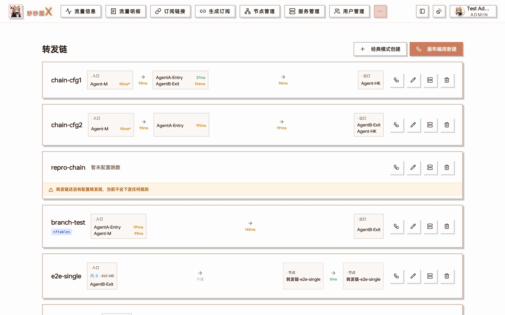
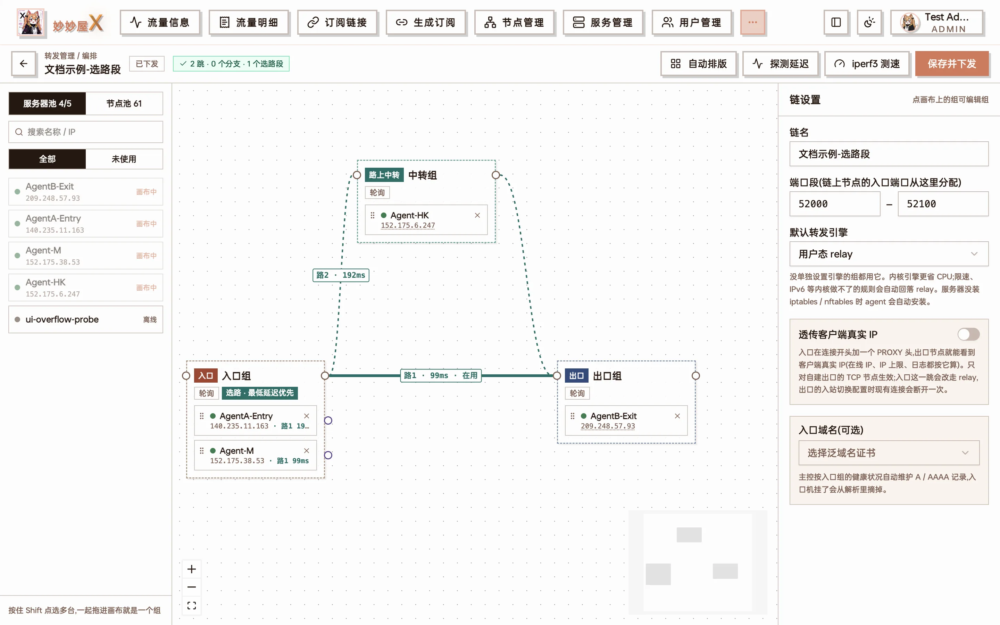
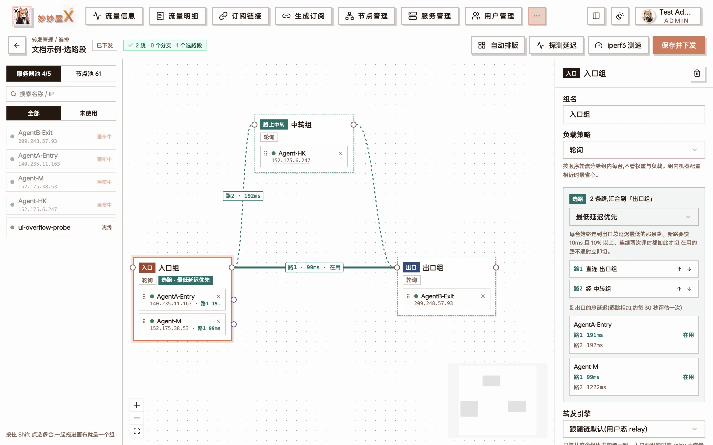
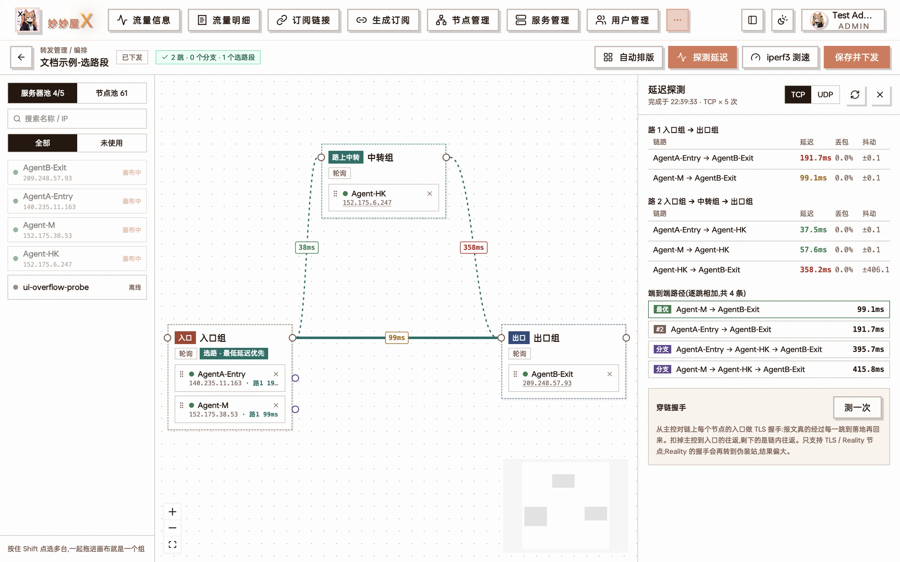
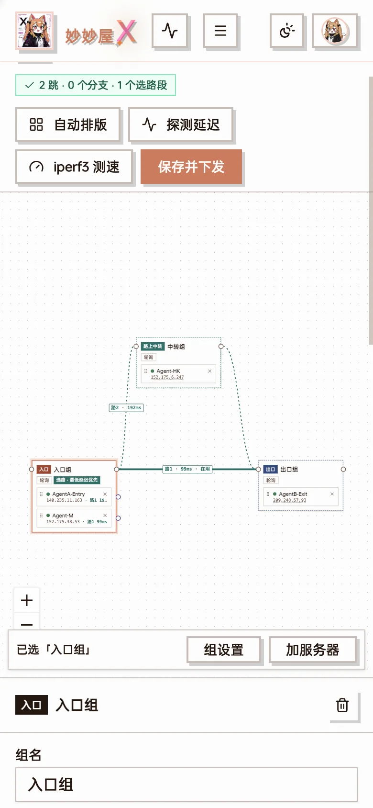

「转发管理」把多台服务器串成一条转发链:客户端连入口服务器,流量逐跳转发到出口,出口再落到一个代理节点。转发由 Agent 原生实现(不经 Xray),每一跳都是独立的端口转发,主控统一编排、下发与监测。

适合这些场景:

- 线路优化:入口用对客户端友好的机器(如国内中转),出口用落地机,中间按需加中转跳
- 一组入口机分担流量,一台挂了自动摘掉
- 同一组机器到出口有多条路可走,每台服务器各自挑到出口最快的那条

转发管理是管理员功能。普通用户能用的是「我的转发」,见文末[给用户开放转发](#给用户开放转发)。

## 基本概念

| 概念 | 说明 |
| --- | --- |
| 转发链 | 一条从入口到出口的完整转发路径,由若干「组」按顺序组成 |
| 组 | 一跳上的一组服务器。连接怎么分给组内成员由**这个组自己**的「负载策略」决定,由上一跳执行 |
| 入口组 / 出口组 | 链的第一跳与最后一跳。客户端连入口;出口要么是自建节点所在的服务器,要么接一个落地节点 |
| 中转组 | 入口与出口之间的跳,可以有零到多个 |
| 分支 | 组内某一台服务器单独绕行自己的中转组,再汇合回下一跳 |
| 选路段 | 从一个组连出 2~4 条路,在同一个组汇合;各台服务器按到出口的总延迟挑最快的一条 |

## 转发链列表

侧栏进入「转发管理」,页面列出全部转发链。右上角两个按钮:

- **经典模式创建**:对话框里把服务器拖进入口 / 中转 / 出口组,适合简单的直线链
- **画布编排新建**:打开编排画布,支持分支、选路段、按组设置引擎等全部能力

转发链总览(截图为旧版界面,布局以下面的说明为准)

页面分三块:顶部是全部链的汇总(平均端到端延迟、端口占用)与网络拓扑图,中间是「待处理」(待下发、不通、离线等,与 Telegram 告警同源),下面是每条链的卡片。卡片上列出各组的在线成员数、端到端延迟、丢包、近 24 小时可用率与今日流量;延迟按颜色区分:绿色 <50ms、橙色 50~200ms、红色 >200ms。

点链名进入**详情页**,可以看到:

- 路线与成员:每台成员到下一组的延迟、丢包,入口每台此刻实际走的线路
- 延迟走势、逐跳延迟、可用性(15 分钟一格)与流量
- 顶部的「全链路测速」「绑定节点」等操作

还没绑定节点的链没有转发规则,也就没有常规探测数据。打开总览或详情页时主控会临时测一次各跳延迟,所以没绑节点的链同样能看到延迟,不会显示成「不通」。

## 画布编排

画布是转发管理的主要入口。左侧是服务器池与节点池,中间是转发链,右侧是选中对象的设置面板。

编排画布:入口组(2 台)→ 出口组,中间并列两条路 —— 路1 直连出口(当前在用,99ms),路2 经中转组;右侧为转发链设置

### 搭链

1. 从服务器池把服务器拖到画布上。按住 Shift 可多选,再点「把选中的 N 台编成一组」直接成组
2. 从组右侧的圆点(组出口)拉线连到下一个组,形成主干
3. 出口组接节点:自建出口的服务器直接拖进出口组;用落地节点则从节点池把节点拖进出口组
4. 点「自动排版」整理布局,确认后点「保存并下发」

画布上三种线:

| 线型 | 含义 |
| --- | --- |
| 实线(锈红) | 主干 |
| 虚线(紫色) | 分支:组内某台服务器单独绕行 |
| 青色线 | 选路段:同一个组连出的多条路 |

双击一条线可以删除。画布上的徽标表示状态:「草稿·未下发」「有未保存的修改」「已下发」;有问题时会出现问题徽标,点开逐条定位。

保存时画布会做校验:主干必须是一条直线,同一台服务器在一条链里只能出现一次,分支必须汇合回下一跳,出口组不能再分支。删除落地节点、切换引擎等会影响在用连接的操作,保存前会再确认一次。

### 组设置

点选一个组,右侧面板可以设置:

- **组名**
- **负载策略**:连接怎么分给**本组**的成员(见下方[负载策略](#负载策略))
- **转发引擎**:覆盖链的默认引擎(见[转发引擎](#转发引擎))
- **故障转移**:组内某台探测不通或延迟超过阈值时暂时摘掉,恢复后自动加回;阈值以毫秒填写

### 负载策略

:::note[策略配在「被分流的那一组」上]
一个组的负载策略决定的是**流量怎么分给这个组的成员**,执行它的是上一跳。例如「入口组 → 中转组 → 出口组」:

- 想让中转组的 3 台按权重分担,在**中转组**上选「加权」并填权重 —— 入口组的每台服务器会按这个权重把连接分给中转组
- 想让出口组优先用连接少的那台,在**出口组**上选「最少连接」—— 由中转组执行

所以要调某一跳的分流,改的是**下一跳那个组**的设置,而不是发起转发的那个组。
:::

| 策略 | 说明 | 适合 |
| --- | --- | --- |
| 轮询 | 按顺序轮流分给组内每台 | 组内机器配置相近 |
| 加权 | 按成员权重分配,权重 2 分到的连接约是权重 1 的两倍 | 机器带宽 / 配置不一 |
| 最少连接 | 优先分给当前活跃连接最少的一台 | 长连接、大文件 |
| 按剩余流量 | 剩余流量越多权重越高,主控每 5 分钟重算 | 各台有流量配额 |
| 按周期 | 越接近流量重置日权重越高,优先用掉快到期的配额 | 各台重置日不同 |
| 最低延迟优先 | 上一跳只用到出口总延迟最低的那一台,其余备用,不通时秒级切换(需新版 Agent) | 追求延迟 |

**入口组比较特殊**:它没有上一跳,客户端连到哪台入口由[入口域名](#转发链设置)的 DNS 记录决定,所以入口组的策略是通过 DNS 实现的:

| 入口组策略 | 实际效果 |
| --- | --- |
| 轮询 | 所有健康的入口都写进入口域名的记录,由 DNS 轮流返回;不通的自动撤下 |
| 最低延迟优先 | 只发布到出口总延迟最低的那一台,其余备用;它不通了自动换下一台,别的入口要快出 15% 以上才会换 |
| 按剩余流量 / 按周期 | 明显落后的入口(剩余流量不到最多那台的四分之一、或配额已用完)暂时从记录里撤下 |
| 加权 / 最少连接 | DNS 做不到(普通记录没有权重,也跟不上连接数),界面上置灰,按轮询处理 |

入口组的策略需要链设了入口域名才起作用,且受 DNS 缓存影响,生效有延迟。被撤下的入口在详情页标为「备用入口 · 未发布到入口域名」。

### 连接保持

「连接保持」是**整条链的开关**(在转发链设置里),不是某个组的负载策略:打开后,同一个客户端 IP 在**每一跳**都落到同一台服务器。

- **与负载策略不冲突**:各组的权重、故障转移照常生效 —— 先按权重把客户端分到各台,同一个客户端之后一直落在那一台;某台不通时,只有原本落在它上面的客户端被改派,其余不动。「最低延迟优先」的组本来就只用一台,不受影响
- **自动开启透传客户端 IP**:要让后面各跳也认得出客户端,入口会在连接开头写 PROXY 头把客户端 IP 带下去,所以打开连接保持会同时打开[透传客户端真实 IP](#透传客户端真实-ip),带头的各跳改走 relay 引擎
- UDP 带不了 PROXY 头,各跳按连接的来源 IP 保持
- 需要链上**每台** Agent 都是新版本;有旧版时界面提示「未生效」,整条链暂按各组自己的策略走

适合的场景:

- 网站 / 游戏 / 流媒体按出口 IP 做风控或登录态绑定,出口组有多台时不希望同一个用户的出口 IP 来回变
- 一个应用同时开多条连接(下载器、视频分片),需要它们走同一个出口
- 限制同时在线 IP 数、按 IP 统计时,希望同一个客户端始终落在同一台出口上

不需要它的场景:出口组只有一台,或只追求把流量摊得尽量均匀。

升级前在组的负载策略里选过「链接保持」的链,升级后会自动改成链上的连接保持开关,组的策略回到轮询。

### 转发链设置

点画布空白处,右侧显示整条链的设置:

- **链名**
- **端口段**:本链在各服务器上占用的端口范围,默认 50520–51314;延迟探测与 iperf3 测速的临时端口也从这里取
- **默认转发引擎**:各组未单独设置时使用
- **连接保持**:同一个客户端在每一跳都落到同一台,见[连接保持](#连接保持)
- **透传客户端真实 IP**:见[透传客户端真实 IP](#透传客户端真实-ip)
- **入口域名**:填一个域名(需泛域名证书),主控每 17 秒按入口服务器的健康状态与入口组的负载策略维护它的 A / AAAA 记录,入口机挂了自动从解析里摘掉

### 各服务器的端口

一条绑定只有一个**入口端口** —— 客户端连的就是它,入口组各台都监听它。后面各跳(中转、出口)各用各的端口:

- 入口端口落在这台服务器允许的范围里,就沿用(没有任何服务器限定端口范围的链,全链仍是同一个端口)
- 不在范围里,这台在自己的范围里另挑一个空闲端口;上一跳转过来时指向的是它自己的端口,自建出口的入站也建在这个端口上

每台服务器允许的范围:默认是服务器自己的端口范围(服务管理里设的,NAT 机只映射了一段端口时填它),没设就不限。画布里点成员行上的「端口」,可以给**这条链**单独设一个范围(只用一个端口时起止填一样的)。

- **入口服务器**设了范围时,限制的是入口端口能选哪些:入口端口从入口组各台范围的交集里取;与链的端口段没有重叠时就用入口自己的范围
- 入口组各台的范围彼此没有交集时无法共用一个入口端口,需要调整范围或开启「入口分离」
- 绑定节点 / 添加节点时,端口一栏下方会列出哪些服务器会用别的端口;「随机」给出的端口保证落在入口允许的范围里
- 延迟探测、全链路测速的临时端口同样按各台自己的范围取

## 分支

主干上每一跳是一个组,组内服务器默认都走同一条路到下一跳。如果组里某台服务器需要单独绕路(例如它到出口的直连很差,但经某台中转很好),可以给它拉一条分支:

1. 从该服务器成员右侧的紫色小圆点拉线,连到一个「分支中转」组
2. 再从分支中转组连回主干的下一跳

分支只走一条线,且必须汇合回主干的下一个组 —— 这保证整条链只有一个出口。没汇合时画布会提示「XX 的分支还没有汇合回主干」。

## 选路段与最低延迟优先

分支是「这台固定走这条路」;选路段则是「每台自己挑最快的路」。

做法:从组右侧的组出口圆点连出 **2~4 条线**,各自经过不同的中转(或直连),最后在**同一个组**汇合。画布会把这组线标成青色,组面板里出现「选路」区域。

入口组的选路区域:2 条路汇合到「出口组」,路1 直连、路2 经中转组;下方按服务器列出每条路到出口的总延迟,标出各自在用的那条

### 每台服务器各自决策

选路是**按服务器**决定的,不是整个组取平均:

- 主控大约每 30 秒评估一次。每台服务器用**它自己**测得的延迟,把每条路到出口的延迟加总,挑总延迟最低的那条
- 同一个组里,可以 A 机走路1、B 机走路2,互不影响
- 为了不来回抖动,只有新路比当前路**快 10ms 以上且快 10% 以上、连续两轮**都如此才切换;当前路探测不通则立即切走
- 画布每 15 秒刷新一次选路结果,在用的路标「在用」

除了「最低延迟优先」,选路段还支持「主备」(路1 不通才用路2)与「按权重分流」。

:::tip[例子:两台香港机,一台直连更快、一台绕一跳更快]
入口组有「香港 A」「香港 B」,出口是「HKT」。从入口组连两条路到出口组:路1 直连,路2 经「日本 JINX」中转。
若 A 直连 HKT 是 20ms、经 JINX 是 90ms,A 就走路1;若 B 直连 HKT 绕路到 180ms、经 JINX 只要 70ms,B 就走路2。以后往入口组再加机器,每台同样各挑各的,不需要额外配置。
:::

几点限制:

- 选路段的多条路必须汇合到同一个组,且不能嵌套
- 链上要有节点绑定(有了规则才有探测与延迟),否则没有选路结果
- 老版本 Agent 只会收到当前选中的那条路,切换要等主控下一轮评估后重新下发

## 转发引擎

| 引擎 | 说明 |
| --- | --- |
| 用户态 relay(默认) | Agent 在用户态转发,功能最全 |
| 内核 iptables | 由内核做 DNAT 转发,不经用户态,CPU 占用低 |
| 内核 nftables | 同上,使用 nftables |

引擎可以在链上设默认值,也可以按组覆盖。Agent 上没有 iptables / nftables 命令时会自动用系统包管理器安装,安装期间先走 relay。

内核引擎做不到的规则会**自动回落 relay**:有限速、要写 PROXY 头、IPv6、开了客户端 IP 白名单的端口、上游是内网地址等。各台实际用的引擎可以在转发状态里查看。

## 透传客户端真实 IP

默认情况下,出口看到的来源地址是上一跳中转机的 IP。打开「透传客户端真实 IP」后,入口会在连接开头写一个 PROXY protocol v2 头,出口据此还原客户端的真实 IP —— 落地节点的访问日志、客户端 IP 白名单、按 IP 的统计都能看到真实来源。

- 只对 **TCP**、**自建出口节点**生效(落地节点不认 PROXY 头)
- 入口跳会强制使用 relay 引擎(内核引擎写不了 PROXY 头)
- 需要新版 Agent。主控会先把出口配置成「可选接受 PROXY 头,且只信任链上服务器」,再让入口开始写头,切换过程中不断连

## 节点:自建出口与落地节点

转发链的最后一跳有两种接法,二选一:

**A. 自建出口**:出口组里是你的服务器,节点就建在出口服务器上。

- 转发链卡片上点「绑定节点 → 新建节点」,可选「入口分离」(订阅里的地址用入口机)或「出口分离」
- 也可以从「节点管理 → 添加节点」,在第一步选「转发链」作为节点入口
- 服务器设了可用端口范围时,链的端口会避开范围外的端口

**B. 落地节点**:出口组接一个已有的代理节点(可以是别人的落地机)。

- 画布上从节点池把落地节点拖进出口组,或在卡片上「绑定已有节点」
- 可选转发的协议:TCP / UDP / TCP+UDP
- 绑定的节点如果有**关联节点**(它的父节点、同一父节点下的路由出站子节点 —— 它们共用同一个 IP 和端口),绑定时会弹窗列出来,勾选的节点一起改走这条链的入口地址,节点管理里显示为入口地址;之后删掉这次建的入口节点,它们自动改回原地址

出口组里的服务器与落地节点不能同时存在;WireGuard 节点不支持经转发链。

## 延迟探测

画布工具栏的「延迟探测」会在链的端口段里临时开监听,逐跳测量:

延迟探测:逐跳的延迟 / 丢包 / 抖动,下方是入口到出口所有组合的端到端排名,以及穿链握手结果

- 可选 TCP 或 UDP,每对服务器采样 5 次,给出延迟、丢包、抖动
- 端到端排名列出入口到出口每条可能路径的总延迟,最优的排在最前
- **穿链握手**:对 TLS / Reality 节点,真的穿过整条链做一次握手,确认节点在链上能用,而不只是端口通

## 测速

**全链路测速**(链详情页顶部的按钮):把入口组的每一台到出口组的每一台都测一遍,走的是真实的转发路径。

- 主控在链的端口段里挑一个空闲端口,临时下发一组只用于测速的转发规则,出口起 iperf3 服务,入口发起测试,测完自动撤掉;临时规则不计入流量、计费与告警
- 可选上行 / 下行 / 双向、TCP / UDP、每对时长与限速
- 结果以热力矩阵、分组柱状图与逐秒曲线(所有入口 × 出口合在一张图)展示,保留最近 20 次历史便于对比
- 关掉弹窗不会中断测速;共享来的服务器会被跳过;出口是落地节点时测到最后一组转发服务器为止

**画布工具栏的 iperf3**:

- **服务器之间**:任选两台测带宽
- **经落地节点**:测经过整条链到落地节点的实际带宽

服务器上没有 iperf3 时会自动安装。

## 手机端

画布在手机上同样可用:拖拽改为点选 —— 点服务器 / 组后,底部操作栏提供「组设置」「加服务器」等按钮,编组、改设置与保存下发都能在手机上完成。

手机端画布:选中「入口组」后,底部出现「组设置 / 加服务器」操作栏

## 告警与监测

- **转发链节点不通告警**:在「系统设置 → 推送」中,默认开启。转发链上的节点连续 2 分钟不通时经 Telegram 通知
- 转发链总览、详情页与画布上的延迟、在用路径会持续刷新;总览的「待处理」列出当前所有问题

## 成员转发地址

上一跳连到本组成员时用哪个地址,可以按成员选择:自动 / 固定入口 IP / 公网 / 域名 / 内网 / 手动填写。同机房的服务器之间选「内网」可以省流量、降延迟。

## 共享服务器

接收到的[分享服务器](/docs/share-server)同样可以放进转发链。转发规则由服务器的拥有方主控合并后下发给 Agent,拥有方始终是 Agent 的唯一控制者。

## 给用户开放转发

普通用户在「我的转发」里给自己的节点建转发规则。需要管理员在套餐里配置「转发配额」:

- 可建的规则数、限速、连接数
- 允许使用哪些转发链

计费只按用户绑定在入口跳上的流量计算,中转与出口跳不重复计费。

## 经典模式与画布的区别

经典模式适合「入口 → 中转 → 出口」的直线链,上手快;以下能力只有画布支持:

- 分支
- 选路段与最低延迟优先
- 按组设置转发引擎

两种方式建出来的是同一种转发链,经典模式建的链随时可以在画布里继续编排。
