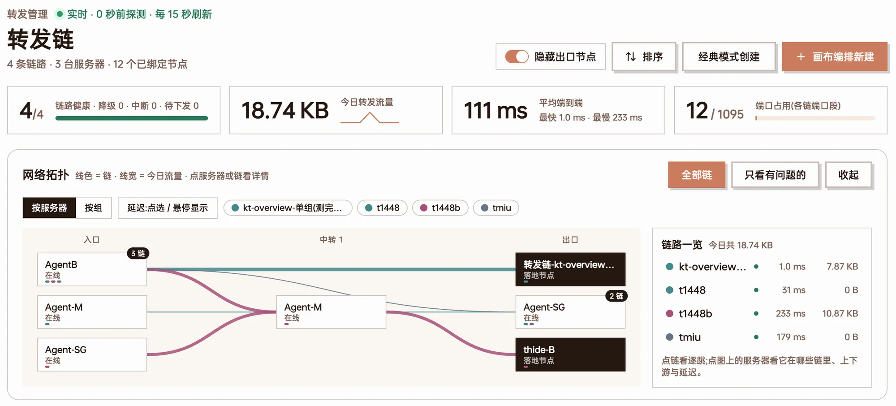
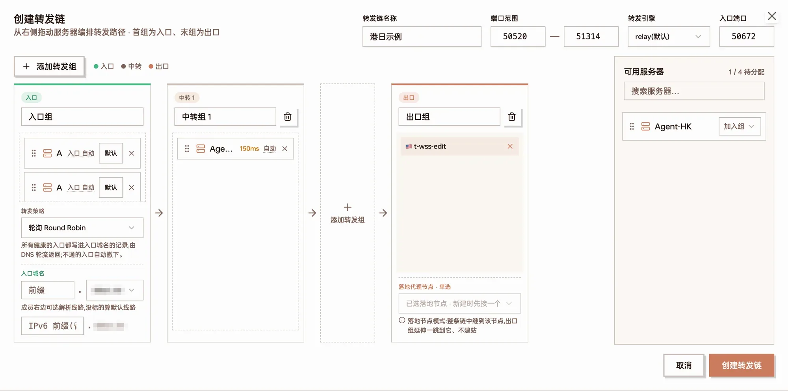
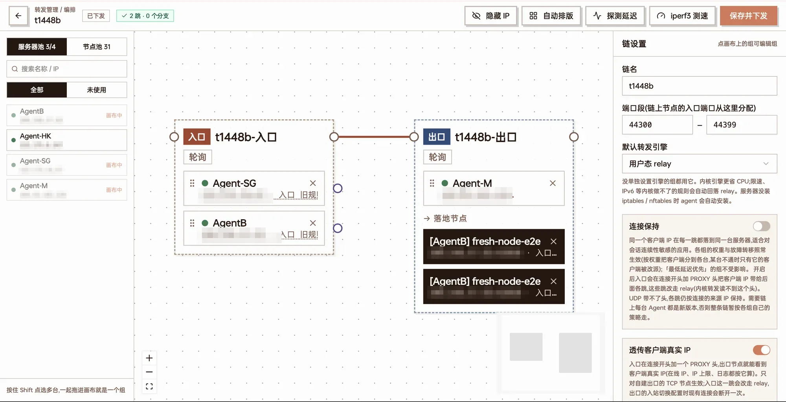
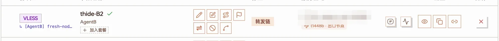
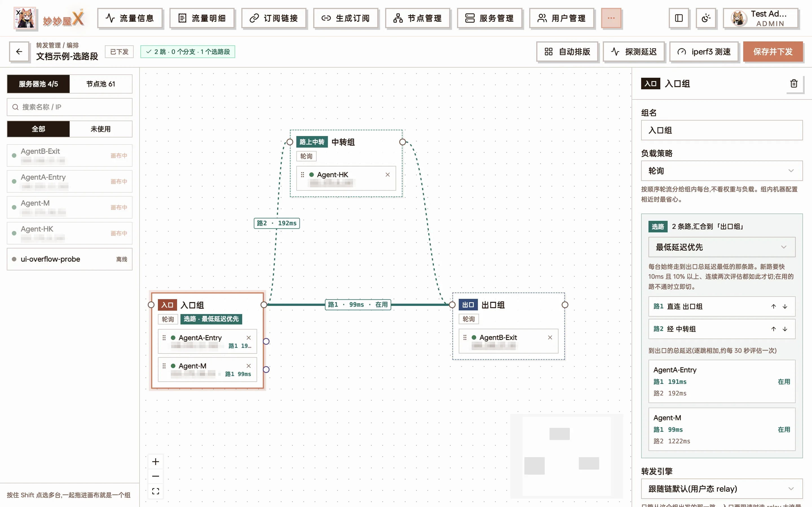
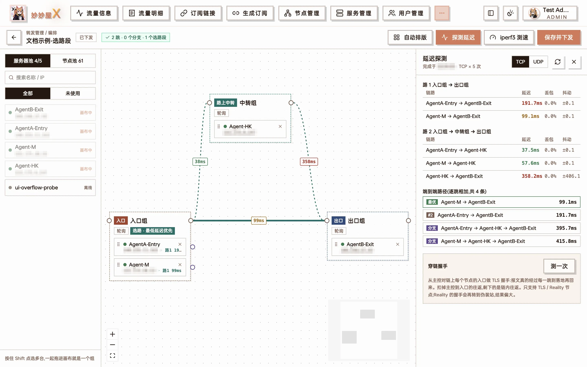
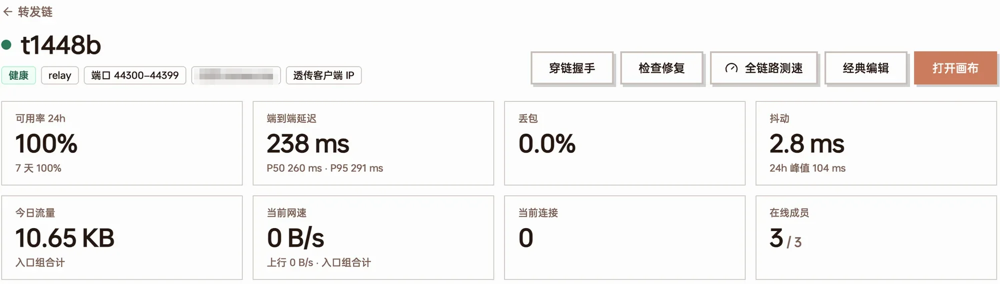
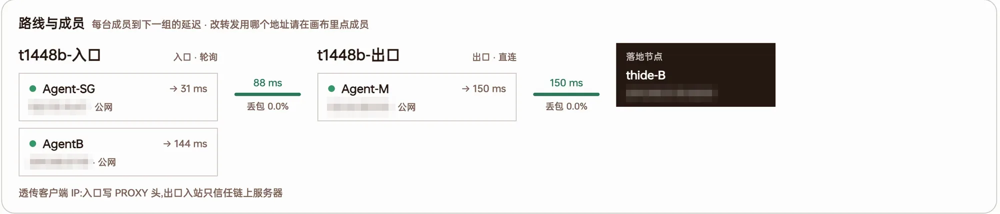
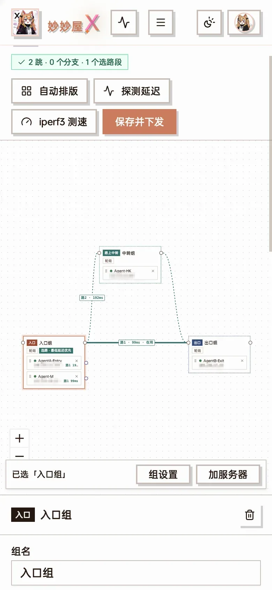

import { Steps } from "@astrojs/starlight/components";
import ForwardDiagram from "@/components/docs/forward-diagram.astro";
import DocShot from "@/components/docs/doc-shot.astro";
import shotCanvasStrategy from "../../assets/screenshots/ft-canvas-strategy.webp";
import shotCanvasFailover from "../../assets/screenshots/ft-canvas-failover.webp";
import shotChainSettingsTop from "../../assets/screenshots/ft-chain-settings-top.webp";
import shotChainSettingsBottom from "../../assets/screenshots/ft-chain-settings-bottom.webp";
import shotBindNew from "../../assets/screenshots/ft-bind-new.webp";
import shotBindExisting from "../../assets/screenshots/ft-bind-existing.webp";
import shotBindComplete from "../../assets/screenshots/ft-bind-complete.webp";
import shotChangeChain from "../../assets/screenshots/ft-change-chain.webp";
import shotAddrPicker from "../../assets/screenshots/ft-addr-picker.webp";
import shotPortPicker from "../../assets/screenshots/ft-port-picker.webp";
import shotServerPortrange from "../../assets/screenshots/ft-server-portrange.webp";
import shotDetailDns from "../../assets/screenshots/ft-detail-dns.webp";
import shotDetailActual from "../../assets/screenshots/ft-detail-actual.webp";
import shotEntryAddr from "../../assets/screenshots/ft-entry-addr.webp";

「转发管理」把多台服务器串成一条转发链:客户端连入口服务器,流量逐跳转发到出口,出口再落到一个代理节点。转发由 Agent 原生实现(不经 Xray),每一跳都是独立的端口转发,主控统一编排、下发与监测。

适合这些场景:

- 线路优化:入口用对客户端友好的机器(如国内中转),出口用落地机,中间按需加中转跳
- 一组入口机分担流量,一台挂了自动摘掉
- 同一组机器到出口有多条路可走,每台服务器各自挑到出口最快的那条
- 机器之间有内网或专线(IX / IPLC),让转发走内网 / 专线而不是公网

这篇按「要做什么」组织,每一步配了界面截图和示意图,各功能的细节规则写在对应小节里。转发管理是管理员功能,普通用户能用的是「我的转发」,见[给用户开放转发](#给用户开放转发)。

## 先弄清楚几个词

转发链就是把几台服务器串起来:客户端连**入口**,流量经过**中转**,到达**出口**,出口再连到真正的代理节点。

<ForwardDiagram
  caption="一条三跳转发链:两台入口组成入口组,中间一台中转,节点建在出口上"
  nodes={[
    { id: "c", x: 0, y: 0.5, label: "客户端", kind: "client" },
    { id: "a1", x: 1, y: 0, label: "入口-广州", sub: "入口端口 50600", kind: "entry" },
    { id: "a2", x: 1, y: 1, label: "入口-上海", sub: "入口端口 50600", kind: "entry" },
    { id: "r", x: 2.15, y: 0.5, label: "中转-香港", kind: "relay" },
    { id: "e", x: 3.3, y: 0.5, label: "出口-日本", sub: "节点建在这里", kind: "exit" },
  ]}
  groups={[
    { label: "入口组", kind: "entry", members: ["a1", "a2"] },
    { label: "中转组", kind: "relay", members: ["r"] },
    { label: "出口组", kind: "exit", members: ["e"] },
  ]}
  edges={[
    { from: "c", to: "a1" },
    { from: "c", to: "a2", style: "dim" },
    { from: "a1", to: "r" },
    { from: "a2", to: "r" },
    { from: "r", to: "e" },
  ]}
/>

| 词 | 意思 |
| --- | --- |
| 转发链 | 一条从入口到出口的完整转发路径,由若干「组」按顺序组成 |
| 组 | 一跳上的一组服务器。组里有几台,这一跳就能在几台之间分流、互为备份。连接怎么分给组内成员由**这个组自己**的负载策略决定,由上一跳执行 |
| 入口组 | 第一跳,客户端连的就是它。订阅里的节点地址是入口的地址或入口域名 |
| 中转组 | 入口和出口之间的跳,可以没有,也可以有好几个 |
| 出口组 | 最后一跳。要么节点直接建在出口服务器上(自建出口),要么出口后面再接一个已有的落地节点 |
| 入口端口 | 客户端连的端口,入口组每台都监听它 |
| 分支 | 组内某一台服务器单独绕行自己的中转组,再汇合回下一跳 |
| 选路段 | 从一个组连出 2~4 条路,在同一个组汇合;各台服务器按到出口的总延迟挑最快的一条 |
| 地址池 / 专线 | 上一跳连这台时可用的多个地址:这台的多个 IP,或专线商给的「专线 IP:端口」 |

开始之前确认两件事:

- 要用的服务器都已经接入,在「服务管理」里显示在线
- 服务器如果有云厂商的安全组 / 防火墙,放行转发链要用的端口段(默认 50520–51314,下文会讲怎么改)

## 一、建一条转发链

侧栏进入「转发管理」,右上角有两个入口:「经典模式创建」适合简单的直线链,「画布编排新建」能用到全部功能。两种方式建出来的是同一种链,经典模式建的随时可以再打开画布继续编排。



转发管理首页:顶部是汇总与网络拓扑,右上角是「经典模式创建」和「画布编排新建」

页面分三块:

- **顶部**:全部链的汇总(平均端到端延迟、端口占用)与网络拓扑图
- **待处理**:待下发、不通、离线等问题,与 Telegram 告警同源
- **链卡片**:各组的在线成员数、端到端延迟、丢包、近 24 小时可用率与今日流量。延迟按颜色区分:绿色低于 50ms、橙色 50~200ms、红色高于 200ms

点链名进入**详情页**:路线与成员(每台成员到下一组的延迟、丢包,入口每台此刻实际走的线路)、延迟走势、逐跳延迟、可用性(15 分钟一格)与流量,顶部有「全链路测速」「绑定节点」等操作。还没绑定节点的链没有转发规则,也就没有常规探测数据;打开总览或详情页时主控会临时测一次各跳延迟,所以同样能看到延迟,不会显示成「不通」。

### 方式一:经典模式

<Steps>

1. 点「经典模式创建」,填「转发链名称」。「端口范围」和「转发引擎」先保持默认
2. 默认已经有「入口组」和「出口组」。要加中转就点「＋ 添加转发组」,会在出口组前面插一个「中转组」
3. 把右侧「可用服务器」里的服务器拖进各组,或者用每行右边的「加入组」下拉选
4. 出口二选一:
   - **自建出口**:把服务器拖进出口组,之后节点会建在它上面
   - **接落地节点**:在出口组下方「落地代理节点 · 单选」里点「＋ 选择落地节点…」,选一个已有节点,顶部会多出「入口端口」
5. 点「创建转发链」。保存即生效,经典模式没有单独的「下发」步骤

</Steps>



经典模式:入口组 2 台、中转组 1 台,出口接了一个落地节点,顶部出现「入口端口」

入口组有两台以上时会出现「转发策略」;入口组下方可以填入口域名(见[入口组的负载均衡](#入口组靠入口域名分流))。经典模式能做的比画布少,见[经典模式与画布的区别](#经典模式与画布的区别)。

### 方式二:画布编排

画布是转发管理的主要入口:左侧是「服务器池」与「节点池」,中间是转发链,右侧是选中对象的设置面板。

<Steps>

1. 点「画布编排新建」
2. 把服务器从左侧拖到画布空白处,就建了一个组;拖到已有的组上,就是加进这个组。按住 Shift 点选多台,再点「把选中的 N 台编成一组」,一次就是一组
3. 从一个组**右上角的圆点**(组出口)拉线到下一个组。最左边的组是入口,最右边的是出口
4. 出口用落地节点的话,切到「节点池」,把节点拖进出口组
5. 点画布空白处,在右侧「链设置」里填链名
6. 点「自动排版」整理一下,再点「保存并下发」

</Steps>



画布:左边服务器池,中间是「入口组 → 出口组 → 落地节点」,右边是链设置

画布上三种线:

| 线型 | 含义 |
| --- | --- |
| 实线(锈红) | 主干 |
| 虚线(紫色) | [分支](#分支让某一台固定绕一跳):组内某台服务器单独绕行 |
| 青色线 | [选路段](#选路段每台自己挑最快的路):同一个组连出的多条路。在用的那条是粗实线,其余是细虚线,线上标「路N · Xms · 在用」 |

- 画布上的修改(包括改策略、加服务器、换引擎)都要点「保存并下发」才生效。徽标显示「草稿·未下发」「有未保存的修改」「已下发」;有问题时出现问题徽标,点开逐条定位
- 双击一条线可以删掉它
- 保存时会校验:主干必须是一条直线,同一台服务器在一条链里只能出现一次,分支必须汇合回下一跳,出口组不能再分支。删除落地节点、切换引擎等会影响在用连接的操作,保存前会再确认一次

### 往已有的链里加服务器

在链卡片上点「打开画布」,把服务器从左侧拖进要加的组,点「保存并下发」。服务器池的「未使用」只是「不在这条链上」,不代表没被别的链用过。同一台服务器在一条链里只能出现一次,从别的组拖过来就是移动。

给**入口组**加了服务器之后,转发规则会自动下发到新入口,但订阅里的节点不一定会自动多出它:

- 链设了入口域名:新入口健康后自动加进解析,不用管
- 没设入口域名,或者节点开了[入口分离](#入口分离每台入口一个节点):到链详情页点「绑定节点」→「补全入口」,只给新入口补建节点,复用现有端口和出口

<DocShot src={shotBindComplete} alt="补全入口" />

「补全入口」:用入口域名的节点自动跳过,按入口 IP 建的节点列出「待补」的新入口

:::caution[经典编辑会把权重冲掉]
用「经典编辑」保存一条链时,所有成员的权重都会重置成 1。在画布里设过「加权」权重的链,请一直用画布编辑。
:::

## 二、绑定节点

链建好后还没有节点,客户端没东西可连。绑定节点之后,订阅里会多出一个地址是**入口**、端口是**入口端口**的节点:

<ForwardDiagram
  caption="绑定前客户端直连出口;绑定后连入口,流量经链到出口"
  nodes={[
    { id: "c1", x: 0, y: 0, label: "客户端", kind: "client" },
    { id: "n1", x: 2.5, y: 0, label: "日本节点", sub: "jp.example.com:443", kind: "exit" },
    { id: "c2", x: 0, y: 1.6, label: "客户端", kind: "client" },
    { id: "a", x: 1.2, y: 1.6, label: "入口-广州", sub: "gz.example.com:50600", kind: "entry" },
    { id: "e", x: 2.5, y: 1.6, label: "出口-日本", kind: "exit" },
  ]}
  edges={[
    { from: "c1", to: "n1", style: "dim", label: "绑定前:直连" },
    { from: "c2", to: "a", label: "绑定后" },
    { from: "a", to: "e" },
  ]}
/>

转发链的最后一跳有两种接法,二选一:**自建出口**(节点建在出口服务器上)或**落地节点**(出口后面接一个已有节点)。出口组里的服务器与落地节点不能同时存在;WireGuard 节点不支持经转发链。

入口在哪找:没绑过节点的链卡片上直接有「绑定节点」;绑过的在卡片「…」菜单里,或者链详情页「已绑定节点」右上角。对话框里有三个页签,三种都是**新增**节点,不会替换已有的。

### 方式 A:新建节点(自建出口)

出口组里是你自己的服务器时用这个。

<Steps>

1. 在「新建节点」页签填「节点名称(可选)」,不填就叫「转发链-链名」
2. 按需打开「入口分离」「出口分离」(见[下一节](#入口分离与出口分离)),下方会显示「将创建 N 个节点」
3. 点「下一步」选协议、传输和证书。主控会在出口组每台服务器上建同一份入站(凭据全链共享),端口自动分配

</Steps>

<DocShot src={shotBindNew} alt="新建节点" />

新建节点:打开「入口分离」后,2 台入口会生成 2 个节点

出口组里有离线服务器、或只有一个组的链,不能新建节点。服务器设了可用端口范围时,链的端口会避开范围外的端口。

### 方式 B:绑定已有节点(落地节点)

出口后面接一个已经存在的节点(可以是别人的落地机)时用这个。

<Steps>

1. 切到「绑定已有节点」,在「选择已有节点」里选节点
2. 「端口」是入口端口,留空自动挑一个空闲的
3. 点「绑定并新建入口节点」

</Steps>

<DocShot src={shotBindExisting} alt="绑定已有节点" />

绑定已有节点:选节点,端口留空就自动分配

- **转发协议**:卡片上「绑定已有节点」和经典模式按落地节点的协议自动决定 TCP 还是 UDP(Hysteria2 / TUIC 等走 UDP)。要手选 TCP / UDP / TCP + UDP,只能在画布右侧面板(新拖进的落地节点)或「节点管理 → 添加节点 → 转发链」里选
- **关联节点**:绑定的节点如果有共用同一 IP 和端口的关联节点(它的父节点、同一父节点下的路由出站子节点),会弹窗列出来,勾选的节点一起改走这条链的入口地址,节点管理里显示为入口地址;之后删掉这次建的入口节点,它们自动改回原地址

在画布里也能接落地节点:把节点从「节点池」拖进出口组,右侧面板可以填「入口端口」、选「转发协议」,再「保存并下发」。

### 也可以从节点管理添加

「节点管理 → 添加节点」选「转发链」页签:选好转发链,「出口方式」选「新建节点」或「已有节点」,端口旁边有「随机」按钮,会挑一个在入口允许范围里的空闲端口。

### 订阅里的地址是什么

- **地址**:链设了入口域名就用入口域名;没设就用入口组第一台的「入口地址」(见下)
- **端口**:入口端口
- **协议和凭据**:来自出口上的入站,或落地节点本身

### 入口地址写 IP 还是域名

入口组每台服务器可以单独设「订阅里写哪个地址」。打开画布,点入口组成员行上的「入口 …」按钮(悬停提示「订阅里写的入口地址,点击切换」),弹层顶部就是「入口地址(写进订阅 / 入口节点,客户端连这个地址)」:

<DocShot src={shotEntryAddr} alt="入口地址" />

入口地址弹层:这条链在功能上线前就有,所以多了「旧规则」一行;下半部分是这台连下一跳用的出站地址

| 选项 | 订阅里写的地址 |
| --- | --- |
| 自动(跟随服务器地址) | 和普通节点一样:服务器有域名用域名,没有用 IP;服务器地址变了跟着变。新建的链、新加进入口组的服务器默认是它 |
| IPv4 / IPv6 | 这台的公网 IPv4 / IPv6(开了「锁定节点入口 IP」时取手填的地址);这台没有对应地址时选项是灰的 |
| 手填 / 登记的域名 | 「指定」一个域名或 IP,比如套了 CDN 的域名;这台在服务管理里登记过的域名会直接列出来 |
| 旧规则(IP 优先) | 只在功能上线前就有的链上出现:有 IP 用 IP,没有才用域名。没改过就一直照旧 |

- 点一项就立即保存;已经停在这台旧地址上的入口节点会挪到新地址,客户端更新订阅后生效
- 链设了入口域名时,不分离的那个入口节点照旧用入口域名,这里的设定只用于[入口分离](#入口分离每台入口一个节点)和「补全入口」生成的、按台分开的节点
- 没设入口域名、也没开入口分离时,整条链只有一个入口节点,用的是入口组**第一台**的设定
- 按设定取不到地址(比如选了 IPv6,后来服务器没了 IPv6)时退回旧规则,不会写出空地址
- 新建链时(经典模式)入口组成员行上的「入口 自动」按钮也能改这一项

### 怎么解绑

界面上没有单独的「解绑」按钮,用下面任一种:

- 在节点管理里删掉那个入口节点,关联节点会自动改回原地址
- 落地节点:在画布 / 经典编辑里把它从出口组移出,保存(会删掉链为它建的入口节点)
- 改绑到别的链:在[「更换转发链」对话框](#改已绑节点的入口端口)里点另一条链

## 入口分离与出口分离

这两个开关只在「新建节点」时有。不开的时候,一条转发链只生成**一个**节点;开了以后按入口 / 出口拆成多个。

### 入口分离:每台入口一个节点

<ForwardDiagram
  caption="不分离:订阅里只有一个节点,地址是入口域名,由 DNS 决定连哪台入口"
  nodes={[
    { id: "n", x: 0, y: 0.5, label: "节点", sub: "hk.example.com:50600", kind: "plain", w: 1.1 },
    { id: "d", x: 1.3, y: 0.5, label: "入口域名", kind: "dns" },
    { id: "a1", x: 2.5, y: 0, label: "入口-电信", kind: "entry" },
    { id: "a2", x: 2.5, y: 1, label: "入口-联通", kind: "entry" },
  ]}
  edges={[
    { from: "n", to: "d", style: "dns" },
    { from: "d", to: "a1", style: "dns" },
    { from: "d", to: "a2", style: "dns" },
  ]}
/>

<ForwardDiagram
  caption="入口分离:每台入口一个节点,地址是那台入口的 IP,用户自己挑"
  nodes={[
    { id: "m1", x: 0, y: 0, label: "节点 [入口-电信]", sub: "203.0.113.10:50600", kind: "plain", w: 1.2 },
    { id: "m2", x: 0, y: 1, label: "节点 [入口-联通]", sub: "198.51.100.20:50600", kind: "plain", w: 1.2 },
    { id: "b1", x: 1.6, y: 0, label: "入口-电信", kind: "entry" },
    { id: "b2", x: 1.6, y: 1, label: "入口-联通", kind: "entry" },
  ]}
  edges={[
    { from: "m1", to: "b1" },
    { from: "m2", to: "b2" },
  ]}
/>

- 每个节点的地址是那台入口自己的 IP,端口都一样;转发规则不变(入口组每台本来就都监听这个端口)
- 节点不走入口域名,所以入口组的 DNS 策略和[分线路解析](#分线路解析)对它们**不起作用**,选哪个入口由用户在客户端里决定
- 适合:没有入口域名,或 DNS 服务商不支持分线路,又想让用户自己挑电信入口 / 联通入口

### 出口分离 vs 出口组负载均衡

出口组有多台时,有两种完全相反的用法:

<ForwardDiagram
  caption="不分离:一个节点,按出口组的负载策略把连接分到两台出口(这就是「出口分流」)"
  nodes={[
    { id: "n", x: 0, y: 0.5, label: "节点", sub: ":50600", kind: "plain" },
    { id: "a", x: 1.2, y: 0.5, label: "入口", kind: "entry" },
    { id: "e1", x: 2.6, y: 0, label: "出口-日本", kind: "exit" },
    { id: "e2", x: 2.6, y: 1, label: "出口-美国", kind: "exit" },
  ]}
  groups={[{ label: "出口组 · 轮询", kind: "exit", members: ["e1", "e2"] }]}
  edges={[
    { from: "n", to: "a" },
    { from: "a", to: "e1", label: "按策略分", dx: -6, dy: -8 },
    { from: "a", to: "e2" },
  ]}
/>

<ForwardDiagram
  caption="出口分离:每台出口一个节点、一个独立入口端口,连接固定落到那一台"
  nodes={[
    { id: "n1", x: 0, y: 0, label: "节点 [→日本]", sub: ":50601", kind: "plain" },
    { id: "n2", x: 0, y: 1, label: "节点 [→美国]", sub: ":50602", kind: "plain" },
    { id: "a", x: 1.45, y: 0.5, label: "入口", kind: "entry" },
    { id: "e1", x: 2.9, y: 0, label: "出口-日本", kind: "exit" },
    { id: "e2", x: 2.9, y: 1, label: "出口-美国", kind: "exit" },
  ]}
  edges={[
    { from: "n1", to: "a", label: ":50601" },
    { from: "n2", to: "a", label: ":50602", dy: 22 },
    { from: "a", to: "e1", label: "只去日本" },
    { from: "a", to: "e2", label: "只去美国", dy: 22 },
  ]}
/>

| | 不开出口分离 | 开出口分离 |
| --- | --- | --- |
| 节点数 | 1 个 | 出口组有几台就几个 |
| 入口端口 | 整组共用一个 | 每台出口一个 |
| 连接去哪台出口 | 按出口组的负载策略分 | 固定去节点对应的那台,出口组策略对它不生效 |
| 适合 | 多台出口分担流量、互为备份 | 各台出口用途不同(解锁、地区),用户要固定选某一台 |

想要「流量分到多台出口」,就**不要**开出口分离,而是在出口组上选负载策略(见[负载均衡](#四负载均衡))。两个开关都开时,节点数 = 入口数 × 出口数,命名为「名称 [入口→出口]」。

## 三、修改端口

### 端口是怎么分配的

一条绑定只有一个**入口端口**,客户端连的就是它,入口组每台都监听它。后面的中转、出口各用各的端口:

- 入口端口落在这台服务器允许的范围里,就沿用(没有任何服务器限定端口范围的链,全链仍是同一个端口)
- 不在范围里,这台在自己的范围里另挑一个空闲端口;上一跳转过来时指向的是它自己的端口,自建出口的入站也建在这个端口上
- 这台的地址池里用了[专线](#六多个-ip-与专线中转),端口还要落进专线的映射里,见[端口怎么对上](#端口怎么对上)

<ForwardDiagram
  caption="入口端口 50600;中转没限定范围就沿用;出口限定了 45000–45009,于是在范围里另挑 45003"
  nodes={[
    { id: "c", x: 0, y: 0.5, label: "客户端", kind: "client" },
    { id: "a1", x: 1.2, y: 0, label: "入口 A", sub: "监听 :50600", kind: "entry" },
    { id: "a2", x: 1.2, y: 1, label: "入口 B", sub: "监听 :50600", kind: "entry" },
    { id: "r", x: 2.45, y: 0.5, label: "中转", sub: "沿用 :50600", kind: "relay" },
    { id: "e", x: 3.75, y: 0.5, label: "出口", sub: "范围内另挑 :45003", kind: "exit", w: 1.1 },
  ]}
  edges={[
    { from: "c", to: "a1", label: ":50600", dx: -8, dy: -6 },
    { from: "c", to: "a2", style: "dim" },
    { from: "a1", to: "r" },
    { from: "a2", to: "r" },
    { from: "r", to: "e", label: "→ :45003" },
  ]}
/>

### 改链的端口段

链的端口段决定新节点的入口端口从哪里挑,默认 50520–51314;延迟探测与 iperf3 测速的临时端口也从这里取。画布里点空白处,在「链设置」的「端口段(链上节点的入口端口从这里分配)」里改,再「保存并下发」;经典模式里叫「端口范围」。

<DocShot src={shotChainSettingsTop} alt="链设置" />

链设置:链名、端口段、默认转发引擎、连接保持

改端口段只影响以后新分配的端口,已经绑好的节点不会跟着换。

### 给某台服务器限定端口范围

NAT 机只映射了一段端口、或者某台只放行了部分端口时,给它限定范围:

- **对所有链生效**:「服务管理」→ 编辑服务器 →「随机端口范围(可选)」。这台加节点、参与转发时,端口都会落在这个范围里

<DocShot src={shotServerPortrange} alt="服务器的随机端口范围" />

服务管理里给服务器设的端口范围,转发也会遵守

- **只对这条链生效**:打开画布,点成员行上的「· 端口」,填「起始端口」「结束(留空=单个)」,点弹层里的「保存并下发」立即生效(不用再点顶部的保存)。「改回默认」恢复用服务器自己的范围

<DocShot src={shotPortPicker} alt="成员的端口设置" />

成员端口弹层:这台没单独设,用服务器自己的范围 45000–45009;下面列出入口端口与这台实际监听端口的对应

- **优先级**:链里单独设的 > 服务器自己的 > 不限
- **入口服务器**设了范围时,限制的是入口端口能选哪些:入口端口从入口组各台范围的交集里取;与链的端口段没有重叠时就用入口自己的范围。入口组各台的范围彼此没有交集时无法共用一个入口端口,需要调整范围或开启[入口分离](#入口分离每台入口一个节点)
- 绑定已有节点 / 添加节点时,端口一栏下方会列出哪些服务器会用别的端口
- 延迟探测、全链路测速的临时端口同样按各台自己的范围取

### 改已绑节点的入口端口

这个入口不在转发管理里,而在**节点管理**:

<Steps>

1. 在节点管理找到这个节点,点地址下方的转发链标记(悬停提示「点击更换转发链」)

   

2. 在弹出的「更换转发链」对话框里,改「入口端口」,点「修改端口」

   <DocShot src={shotChangeChain} alt="更换转发链对话框" />

3. 提示「入口端口已改为 …,客户端更新订阅后生效」后,让用户更新订阅

</Steps>

转发规则、同端口的兄弟节点(入口分离生成的)、关联节点和出口上的入站会一起换,不用删节点重建:先在新端口建好、下发成功再删旧的,中途失败整体回滚,不会断流。对话框下面的链列表点一条,就是把节点改绑到那条链(端口自动分配)。

### 端口相关的报错

| 提示 | 原因与处理 |
| --- | --- |
| 入口组各台开放的端口范围没有交集 | 入口组几台的范围对不上,调整范围或开入口分离 |
| 入口服务器「X」只开放端口 a-b | 填的端口不在这台入口的范围里 |
| 已被这条链或同一入口服务器上的其它转发占用 | 换一个,或留空自动分配 |
| 入口 / 出口服务器 X 上这个端口已被其它程序占用 | 服务器上有别的程序在用这个端口 |

## 四、负载均衡

### 先记住一句话:策略配在被分流的那一组

一个组的「负载策略」决定的是**连接怎么分给这个组的成员**,执行它的是**上一跳**。例如「入口组 → 中转组 → 出口组」:想让中转组的 3 台按权重分担,在**中转组**上选「加权」;想让出口组优先用连接少的那台,在**出口组**上选「最少连接」(由中转组执行)。要调某一跳的分流,改的是**下一跳那个组**的设置。

<ForwardDiagram
  caption="在中转组上选「加权」并填权重 2 : 1,入口每台就按 2 : 1 把连接分给两台中转"
  nodes={[
    { id: "a", x: 0, y: 0.5, label: "入口 A", kind: "entry" },
    { id: "r1", x: 1.5, y: 0, label: "中转 1", sub: "权重 2", kind: "relay" },
    { id: "r2", x: 1.5, y: 1, label: "中转 2", sub: "权重 1", kind: "relay" },
    { id: "e", x: 3, y: 0.5, label: "出口", kind: "exit" },
  ]}
  groups={[{ label: "中转组 · 加权", kind: "relay", members: ["r1", "r2"] }]}
  edges={[
    { from: "a", to: "r1", label: "约 2/3" },
    { from: "a", to: "r2", label: "约 1/3", dy: 20 },
    { from: "r1", to: "e" },
    { from: "r2", to: "e" },
  ]}
/>

### 组的七种负载策略

画布里点选一个组,右侧可以设组名、负载策略、成员顺序、[转发引擎](#转发引擎)和[故障转移](#故障转移):

<DocShot src={shotCanvasStrategy} alt="负载策略" />

组设置里的负载策略下拉

| 策略 | 怎么分 | 适合 |
| --- | --- | --- |
| 轮询 | 按顺序轮流分给每台 | 组里机器配置相近 |
| 加权 | 按权重分,权重 2 拿到的约是权重 1 的两倍 | 带宽、配置不一样 |
| 最少连接 | 优先给当前连接最少的那台 | 长连接、大文件下载 |
| 按剩余流量 | 剩余流量越多分得越多,主控每 5 分钟重算 | 各台有流量配额 |
| 按周期 | 越接近流量重置日分得越多,先用掉快过期的配额 | 各台重置日不同 |
| 最低延迟优先 | 只用到出口总延迟最低的那台,其余备用,不通时秒级切换(需新版 Agent) | 追求延迟 |
| 主备 | 只用排在最前、还通的那台,前面的不通才轮到后面,恢复后换回(需新版 Agent,老版只用第一台) | 一台主用、其余备用 |

- **权重**:选了「加权」后,右侧成员列表标题变成「成员与权重」,每行出现数字框
- **主备顺序**:就是成员的先后顺序,用成员行的上移 / 下移按钮调
- 中转组、出口组的策略由上一跳的 Agent 按每条连接执行,某台不通时秒级切换。下一组用「最低延迟优先」时,画布上上一组的每个成员行会显示它此刻选中的那台(「· → 服务器名 Xms」)
- 经典模式里叫「转发策略」,只有轮询、最少连接、主备、按剩余流量、按周期五种,要加权和最低延迟优先请用画布

### 故障转移

组设置里打开「故障转移」,填「延迟超过 … ms 视为不健康(0 = 只看掉线)」。组里某台探测不通或延迟超过阈值时暂时摘掉,恢复后自动加回。这个阈值同时也是总览里判定「降级」的标准:某一跳延迟超过它或丢包 ≥1% 时显示降级。

<DocShot src={shotCanvasFailover} alt="故障转移" />

故障转移:阈值填 0 时只在掉线时摘除

### 入口组:靠入口域名分流

入口组没有上一跳,客户端连哪台入口由**入口域名的 DNS 解析**决定,所以入口组的策略要先设入口域名才起作用。画布点空白处,在「入口域名(可选)」里先选一张泛域名证书(只列 `*.` 开头的),再填 v4 前缀和可选的 v6 前缀,DNS 服务商自动用证书绑定的那个。主控每 17 秒按入口健康状况和入口组策略维护 A / AAAA 记录,入口机挂了自动从解析里摘掉。

<DocShot src={shotChainSettingsBottom} alt="入口域名设置" />

链设置下半部分:透传客户端真实 IP 与入口域名

| 入口组策略 | 实际效果 |
| --- | --- |
| 轮询 | 健康的入口都写进解析,DNS 轮流返回,不通的自动撤下 |
| 最低延迟优先 | 只发布到出口总延迟最低的那台,其余备用;它不通了自动换下一台,别的入口要快出 15% 再多 5ms 以上才会换 |
| 主备 | 只发布排在最前、还健康的那台,其余备用;它不通了换下一台,恢复后换回来 |
| 最少连接 | 健康的入口都发布,但转发连接数明显多于最闲那台的(超过它的 2 倍再多 50 条)暂时撤下,降到它的 1.5 倍再多 25 条以内再加回;最多撤一半,先撤最忙的 |
| 按剩余流量 / 按周期 | 明显落后的入口(剩余流量不到最多那台的四分之一、或配额已用完)暂时撤下 |
| 加权 | DNS 做不到(普通记录没有权重),按轮询处理(界面上显示「加权(入口不适用)」) |

入口组策略受 DNS 缓存影响,生效有延迟(最少连接是分钟级的粗调,不是逐条连接分配)。被撤下的入口在详情页标为「备用入口 · 未发布到入口域名」。一台入口有多个 IP、想都发进入口域名,见[入口地址池](#入口地址池)。

链详情页的「入口 DNS」卡片可以看到每台入口是否已发布、公网解析是否一致:

<DocShot src={shotDetailDns} alt="入口 DNS 卡片" />

入口 DNS:应有记录与公网解析一致,两台入口都已发布

### 分线路解析

入口域名的 DNS 服务商是阿里云、腾讯云(DNSPod)时,入口组成员可以标线路:**默认 / 电信 / 联通 / 移动 / 境外**。标了之后入口域名每条线路各发一组记录,电信用户解析到标了电信的入口,联通用户解析到联通的入口。

<ForwardDiagram
  caption="同一个入口域名,不同运营商的用户解析到各自线路的入口"
  nodes={[
    { id: "u1", x: 0, y: 0, label: "电信用户", kind: "client" },
    { id: "u2", x: 0, y: 1, label: "联通用户", kind: "client" },
    { id: "d", x: 1.25, y: 0.5, label: "入口域名", sub: "hk.example.com", kind: "dns" },
    { id: "a1", x: 2.5, y: 0, label: "入口-电信", sub: "线路:电信", kind: "entry" },
    { id: "a2", x: 2.5, y: 1, label: "入口-联通", sub: "线路:联通", kind: "entry" },
  ]}
  edges={[
    { from: "u1", to: "d", style: "dns" },
    { from: "u2", to: "d", style: "dns" },
    { from: "d", to: "a1", style: "dns", label: "电信线路" },
    { from: "d", to: "a2", style: "dns", label: "联通线路", dy: 22 },
  ]}
/>

在画布入口组的成员行、或经典模式入口组每台右边选线路。

- **每条线路里照样按入口组的策略挑**:例如入口组选「主备」,电信、联通各自只发布自己线路里排在最前的那台
- **某条线路的入口都不通**:撤掉这条线路的记录,那个网络的用户解析时落回默认线路
- **默认线路不会空**:它兜住其它所有网络。没标线路的入口算默认线路;没有默认线路的入口、或者它们都不通时,默认线路发布全部健康入口
- **只支持阿里云、腾讯云(DNSPod)**:Cloudflare、NameSilo、GoDaddy 没有线路的概念,标的线路不生效,全部入口照旧写进同一组记录,界面会提示
- 主控只管默认和这四条运营商线路上的记录,省份线路、自定义线路上手工加的记录不会动
- 链详情的「入口 DNS」卡片列出每台入口的线路和各线路的记录。主控只解析得到自己所在网络那条线路,所以分线路时不再提示「还没解析到」
- MeowX 客户端会直接收到健康入口的列表(不用等 DNS 生效),这份列表是各线路入口的合集,不分线路

只有入口组能分线路:中转组、出口组的连接来自上一跳的服务器而不是用户,没有运营商可分。想让不同入口走不同的中转,用[分支](#分支让某一台固定绕一跳)或[选路段](#选路段每台自己挑最快的路)。

### 连接保持

「连接保持」是**整条链的开关**(在链设置里),不是某个组的负载策略:打开后同一个客户端 IP 在**每一跳**都落到同一台服务器。

- **与负载策略不冲突**:各组的权重、故障转移照常生效 —— 先按权重把客户端分到各台,同一个客户端之后一直落在那一台;某台不通时,只有原本落在它上面的客户端被改派,其余不动。「最低延迟优先」的组本来就只用一台,不受影响
- **自动开启透传客户端 IP**:要让后面各跳也认得出客户端,入口会在连接开头写 PROXY 头把客户端 IP 带下去,所以打开连接保持会同时打开[透传客户端真实 IP](#透传客户端真实-ip),带头的各跳改走 relay 引擎
- UDP 带不了 PROXY 头,各跳按连接的来源 IP 保持
- 需要链上**每台** Agent 都是新版本;有旧版时界面提示「未生效」,整条链暂按各组自己的策略走

适合:网站 / 游戏 / 流媒体按出口 IP 做风控或登录态绑定、不希望同一个用户的出口 IP 来回变;一个应用同时开多条连接(下载器、视频分片)需要走同一个出口;限制同时在线 IP 数、按 IP 统计。出口组只有一台,或只追求把流量摊得尽量均匀时不需要它。

升级前在组的负载策略里选过「链接保持」的链,升级后会自动改成链上的连接保持开关,组的策略回到轮询。

### 怎么选

| 想要 | 这样设 |
| --- | --- |
| 几台入口分担,挂了自动摘 | 设入口域名 + 入口组「轮询」 |
| 用户只连最快的入口 | 入口域名 + 入口组「最低延迟优先」 |
| 电信 / 联通用户各连各的入口 | 入口域名(阿里云 / 腾讯云)+ 分线路解析 |
| 几台出口按带宽比例分担 | 出口组「加权」并填权重 |
| 一台出口主用,另一台备用 | 出口组「主备」,主用的排在前面 |
| 同一个用户的出口 IP 不要变 | 打开「连接保持」 |
| 让用户自己挑出口 | 新建节点时开「出口分离」 |
| 一台服务器的几个 IP 分担 / 专线主用、公网备用 | 这台的[地址池](#六多个-ip-与专线中转) |

## 五、让机器之间走内网

两台服务器在同一个机房 / 同一个内网时,上一跳连这台用内网地址能省公网流量、降低延迟。

<ForwardDiagram
  caption="中转和出口在同一个内网:上一跳改连出口的内网地址,不再绕公网"
  nodes={[
    { id: "a", x: 0, y: 0.5, label: "入口", kind: "entry" },
    { id: "r", x: 1.3, y: 0.5, label: "中转-东京 1", sub: "10.0.0.11", kind: "relay" },
    { id: "e", x: 2.9, y: 0.5, label: "出口-东京 2", sub: "10.0.0.12 / 公网 IP", kind: "exit", w: 1.1 },
  ]}
  edges={[
    { from: "a", to: "r" },
    { from: "r", to: "e", style: "lan", label: "内网 10.0.0.12" },
  ]}
/>

<Steps>

1. 打开链的画布(链要先保存过),在**被连的那台**(上例的出口)成员行上点地址按钮(悬停提示「转发用的地址,点击切换」)
2. 弹层「转发用的地址(上一跳连过来时用)」里列出这台的所有地址,内网地址标「内网」,还会显示从各个上一跳探测的结果
3. 选一种:
   - **自动(按探测结果)**:双栈之间走 IPv4,任一边只有 IPv6 时改走 IPv6。点顶部的「探测延迟」时主控会顺便试内网地址,每个上一跳各自挑最快且通的,一样快时偏向内网;两台不在同一内网时自动继续走公网
   - **优先 IPv6**:上一跳也有 IPv6 时都改连这台的 IPv6
   - **指定地址**:固定入口 IP / 公网 IPv4 / 公网 IPv6 / 域名 / 内网。直接点内网地址,所有上一跳都改连这个地址

</Steps>

<DocShot src={shotAddrPicker} alt="转发用的地址" />

地址弹层:上半部分选上一跳连过来用哪个地址,下半部分选这台连下一跳时从哪个地址出去(这台服务器没有内网网卡,所以只有公网地址)

几点注意:

- 点一项就**立即保存并重新下发**,不用再点「保存并下发」。经典模式只在新建链时能设
- 内网地址是打开弹层时实时从 Agent 读的网卡列表,只有 10.x / 172.16–31.x / 192.168.x、100.64.x 和 IPv6 ULA 会标成「内网」
- 手选的地址对**所有**上一跳生效,保存时不校验连通;上一跳其实连不到它,那条转发就会不通(面板会标红提示)。建议先点「探测延迟」看结果,或者直接用「自动」
- 自动模式只在点「探测延迟」时才会试内网,没有后台定期探测
- 上游是内网地址时,内核转发引擎会自动回落到 relay
- 弹层下半部分「出站地址」用于这台有多个公网 IP、要指定从哪个 IP 连下一跳的场景,一般保持「系统默认」
- 这里一次只能选一个地址;想同时用几个地址分流,或者走专线商给的地址,用下一节的地址池

## 六、多个 IP 与专线中转

上面的「转发用的地址」一次只能选一个。下面两种情况要让上一跳连这台时用**多个地址**:

- **一台服务器有多个公网 IP**:想让上一跳在这几个 IP 之间分流,或者一个主用、其余备用
- **专线中转**(内网专线 / IX / IPLC):专线商给你一个「专线 IP:端口」,上一跳连这个地址,流量经专线落到这台服务器的某个端口上。这个 IP 在服务器网卡上看不到,专线端口也可能和服务器上的端口不同

两种都在画布里这台成员的**地址池**里配。一台服务器在一条链里仍然只出现一次,多个地址都算它的。

<ForwardDiagram
  caption="中转-上海经专线连出口-香港:平时走专线,专线不通时改走公网"
  nodes={[
    { id: "a", x: 0, y: 1, label: "入口", kind: "entry" },
    { id: "r", x: 1.2, y: 1, label: "中转-上海", kind: "relay" },
    { id: "l", x: 2.4, y: 0, label: "专线入口", sub: "10.88.0.8:30100", kind: "plain" },
    { id: "e", x: 3.6, y: 1, label: "出口-香港", sub: "本机监听 :30100", kind: "exit", w: 1.1 },
  ]}
  edges={[
    { from: "a", to: "r" },
    { from: "r", to: "l", style: "lan", label: "主用", dx: -14 },
    { from: "l", to: "e", style: "lan", label: "专线", dx: 14 },
    { from: "r", to: "e", style: "dim", label: "公网 · 备用", dy: 20 },
  ]}
/>

:::note[版本要求]
地址池与专线需要主控 v0.6.2-beta.8 及以上,Agent 不用升级。专线的连通性测试要用到 Agent 的探测监听,Agent 太旧时测试会提示升级。
:::

### 地址池

<Steps>

1. 打开链的画布(链要先保存过),点**被连的那台**(不是入口组成员)成员行上的地址按钮,弹层顶部是「地址池(多个地址分流 / 专线)」
2. 「这台的地址」列出这台网卡上的 IP 和服务管理里登记的地址;「专线」列出这台登记过的专线(还没有就点「登记专线」,见[登记专线](#登记专线))。勾选要用的
3. 选模式:
   - **按权重分流**:每项填权重,旁边显示各占的百分比
   - **主备**:用上移 / 下移排顺序,排第一的主用,不通时依次换下一个
4. 点「保存地址池」

</Steps>

- **都不勾 = 原来的单地址**。启用地址池后,下面的单地址选择不再生效;「清空地址池(恢复单地址)」回到原样
- **不通的地址会被自动避开**:地址池里的每个地址各自做健康检查,不通的暂时不用,恢复后加回
- **组里有多台时分两层**:先按组的负载策略在服务器之间分,再按 IP 权重拆这台分到的份额。组策略是「主备」或「最低延迟优先」时,同一台先换 IP、IP 都不通了才换服务器
- **池的「主备」什么时候生效**:组策略本身是主备 / 最低延迟优先,或这一跳只有这一台时按主备;其它情况按权重分流(面板会提示),不通的地址仍会被避开
- **只能勾这台上看得到的 IP**。专线商给的 IP 在服务器上看不到,要登记成专线,否则保存时报「这台服务器上看不到 …,专线请登记为专线端点」
- **套用到这台服务器的所有链**:把这条链里这台的地址池复制到包含这台的所有链;不适用的链会跳过并说明原因
- 有地址池的成员行显示「N 个地址」「专线」小标签;弹层里每项显示从各上一跳探测的结果,画布「探测延迟」也会把池里的每个地址、专线都测一遍

### 入口地址池

入口组成员没有上一跳,它的地址池管的是**入口域名发布哪些 IP**:链设了[入口域名](#入口组靠入口域名分流)时,入口成员的「入口 …」弹层里有「入口地址池(多个 IP 发到入口域名)」。

- 勾选的 IP 都会发成入口域名的 A / AAAA 记录(DNS 轮询)
- DNS 服务商支持[分线路](#分线路解析)时,每个 IP 可以单独选「入口线路」,覆盖这台成员的线路
- 是否健康仍按服务器判断:这台不通时它的 IP 一起撤下
- 专线不用于入口(入口是客户端连的,不是上一跳连的)

### 登记专线

专线属于一台服务器:流量经专线落到哪台,就登记在哪台。两个地方打开的是同一个对话框:

- 「服务管理」→ 服务器的 Agent 菜单 →「专线」
- 画布地址池「专线」一栏的「登记专线」或「管理」

<Steps>

1. 点「登记专线」,填「名称」(可选,如「沪港 IPLC」,不填用第一条映射的地址)
2. 专线商做了源地址转换时,填「对端看到的来源 IP(选填)」:这台看到的连接来源 IP,多个用逗号分隔。转发链[透传客户端真实 IP](#透传客户端真实-ip)时会信任它
3. 在「映射」里填专线商给的地址和端口对应关系(见下表),每条映射再选「可用的上一跳」
4. 专线商按端口卖的,把端口表粘进「端口表」,点「加入端口表」
5. 点「保存并测试」,保存后自动逐条映射测连通性(见[测连通性](#测连通性))

</Steps>

每条**映射**是一个专线入口:专线地址 + 端口怎么对应到本机。专线地址只填 IP 或域名,端口在映射里填。

| 端口映射 | 怎么对应 | 例子 |
| --- | --- | --- |
| 端口段一对一 | 专线的这段端口对应本机同号端口(最常见) | 10.88.0.8 的 30000–30199 → 本机 30000–30199 |
| 固定偏移 | 专线端口 = 本机端口 + 偏移量;可选填本机端口范围 | 偏移 200:本机 30100 ↔ 专线 30300 |
| 端口表 | 按端口卖:一行一个「专线地址:端口 本机端口」 | 10.88.0.8:40001 → 本机 31501 |

端口表的粘贴格式:

```text
10.88.0.8:40001 31501
10.88.0.8:40002 31502
10.88.0.8:40003 31503
```

- 一条专线可以有多条映射(专线商给了多个入口 IP、多段端口),最多 500 条;同一条专线里专线端口不能重复
- **可用的上一跳**:按服务器勾,不勾 = 所有上一跳都能用。专线通常只有某几台能接入(比如只有上海机在专线的另一端),只勾它们;新加的映射默认和上一条相同,端口表各行共用一份
- 同一个上一跳能经几条映射接入时,地址池选「主备」按映射的顺序,选「按权重分流」时平分
- 一个专线 IP 被几台服务器共用(不同端口段落到不同服务器)也可以,各台登记各自的映射

### 端口怎么对上

专线只在特定端口上通,所以这台在链里的端口(见[三、修改端口](#三修改端口))会自动落进专线的映射:

- **端口段一对一 / 固定偏移**:这台的端口在链的端口范围与映射段的交集里取,上一跳连「专线地址:换算后的端口」
- **端口表**:每条链(每个入口端口)占一行,这台改用那一行的本机端口。专线列表里显示「端口表 N 行,已占用 M 行」
- 几条映射的端口段不重叠、一个端口顾不全所有上一跳时,挑能覆盖最多上一跳(按组内权重)的那个端口,其余上一跳这一跳走公网,问题列表里提示「…经专线 … 要求本机端口在 a–b,与其他映射不重叠,这条链上走公网」
- 端口表被占满时,这条链在这台走公网,提示「专线端口表已用完」
- 上一跳不在「可用的上一跳」里、或端口不在映射里时,这个上一跳照旧连这台的默认地址(公网)

### 测连通性

- **保存后自动测**:逐条映射,从「可用的上一跳」经专线连这台。有映射没限定上一跳时,先让你选「从哪几台测」,也可以「先不测」
- **怎么测**:在这台临时开一个监听,上一跳连「专线地址:映射后的端口」,测 TCP 和 UDP 并给出延迟。端口正在被转发链使用、开不了监听时只测 TCP 连接,结果标「端口正在使用,只测了 TCP 连接」
- **端口段抽测**:不逐个端口测,而是测链正在用的端口(最多 5 个)加一个临时监听端口
- 专线列表里每条映射显示最近一次结果(通 / 不通 / 还没测过),可以整条「测试」或单条「测这条」;地址池里的「从上一跳测」只从这条链里连这台的上一跳测
- 端口表的某一行刚被一条链占上时,规则下发后会从可用的上一跳自动 TCP 连一次这个专线端口,结果记在这一行上

### 修改与删除

- 改了专线地址或映射,用到它的链会自动重新下发
- 还有链的地址池在用的专线不能删,提示「还有转发链的地址池在用它:…」,先在这些链里取消勾选
- 删除服务器时,它的专线一起删掉

### 例子:沪港 IPLC

中转-上海 → 出口-香港,专线商给了 10.88.0.8 的 30000–30199 端口段,同号落到香港机,只有上海机接在专线另一端。

<Steps>

1. 服务管理 → 出口-香港的 Agent 菜单 →「专线」→「登记专线」:名称「沪港 IPLC」,映射填 10.88.0.8、「端口段一对一」30000–30199,「可用的上一跳」勾「中转-上海」
2. 「保存并测试」,确认「从 中转-上海」TCP / UDP 都通
3. 打开链的画布,点出口-香港成员行的地址按钮,地址池里勾「沪港 IPLC」和这台的公网 IP,模式选「主备」,把专线排第一,「保存地址池」

</Steps>

之后出口-香港在这条链里的端口落在 30000–30199 里,上海机平时经专线连它;专线不通时几十秒内切到公网,恢复后切回。

## 七、让机器之间选路走

同一组里的几台服务器到下一跳的线路质量可能差别很大。有两种办法让它们走不同的路。

### 分支:让某一台固定绕一跳

<ForwardDiagram
  caption="入口 B 直连出口很差,给它拉一条分支,单独经「分支中转」再汇合到出口"
  nodes={[
    { id: "a1", x: 0, y: 0, label: "入口 A", kind: "entry" },
    { id: "a2", x: 0, y: 1.2, label: "入口 B", kind: "entry" },
    { id: "b", x: 1.4, y: 1.2, label: "分支中转", kind: "relay" },
    { id: "e", x: 2.8, y: 0.6, label: "出口", kind: "exit" },
  ]}
  groups={[{ label: "入口组", kind: "entry", members: ["a1", "a2"] }]}
  edges={[
    { from: "a1", to: "e", label: "主干" },
    { from: "a2", to: "b", style: "branch", label: "分支" },
    { from: "b", to: "e", style: "branch" },
  ]}
/>

<Steps>

1. 在画布里,从要绕路的那台成员行**右侧的紫色小圆点**拉线,连到一个组(它会变成「分支中转」组)
2. 再从分支中转组右上角的圆点连回主干的**下一跳**
3. 「保存并下发」

</Steps>

分支只走一条线,且必须汇合回主干的下一个组,这保证整条链只有一个出口。一台只能拉一条分支,出口组不能拉分支。没汇合时画布会提示「X 的分支还没有汇合回主干」。

### 选路段:每台自己挑最快的路

<ForwardDiagram
  caption="入口组连出两条路到出口组:A 直连更快走路 1,B 经中转更快走路 2"
  nodes={[
    { id: "a1", x: 0, y: 0, label: "入口 A", sub: "路1 20ms · 路2 90ms", kind: "entry", w: 1.1 },
    { id: "a2", x: 0, y: 1.3, label: "入口 B", sub: "路1 180ms · 路2 70ms", kind: "entry", w: 1.1 },
    { id: "r", x: 1.55, y: 1.3, label: "中转-日本", kind: "relay" },
    { id: "e", x: 3, y: 0.65, label: "出口", kind: "exit" },
  ]}
  groups={[{ label: "入口组 · 选路", kind: "entry", members: ["a1", "a2"] }]}
  edges={[
    { from: "a1", to: "e", style: "path", label: "路1 直连 · A 在用" },
    { from: "a2", to: "r", style: "path", label: "路2" },
    { from: "r", to: "e", style: "path", label: "B 在用", dx: 14, dy: 20 },
  ]}
/>

<Steps>

1. 从一个组**右上角的圆点**连出 2~4 条线,各自经过不同的中转(直接连汇合组就是「直连」那条),最后汇合到**同一个组**
2. 这组线会变成青色,点选发起的组,右侧出现「选路策略」:「最低延迟优先」「主备」(路1 不通才用路2)「按权重分流」
3. 「保存并下发」。链要绑了节点才有探测数据和选路结果

</Steps>



选路区域按服务器列出每条路到出口的总延迟,标出各自在用的那条

「最低延迟优先」是按**每台服务器**各自决定的,不是整个组取平均:

- 主控约每 30 秒评估一次。每台用**它自己**测得的延迟,把每条路到出口的延迟加总,挑总延迟最低的那条;同一个组里可以 A 机走路1、B 机走路2
- 为了不来回抖动,新路要比当前路**快 10ms 以上且快 10% 以上、连续两轮**才切换;在用的路探测不通则立即切走
- 画布每 15 秒刷新一次选路结果,在用的路是粗实线,线上标「路N · Xms · 在用」;链详情页的「实际路径」显示每台入口此刻真正走的线路

<DocShot src={shotDetailActual} alt="实际路径" />

实际路径:两台入口各自经过的每一跳和总延迟

几点限制:

- 多条路必须汇合到同一个组,且不能嵌套
- 链上要有节点绑定(有了规则才有探测与延迟),否则没有选路结果
- 老版本 Agent 只会收到当前选中的那条路,切换要等主控下一轮评估后重新下发

### 分支还是选路段

| | 分支 | 选路段 |
| --- | --- | --- |
| 谁决定走哪条 | 你,固定 | 每台服务器按延迟自动挑 |
| 范围 | 组里的某一台 | 整个组的每一台 |
| 以后加机器 | 新机器默认走主干 | 新机器自动参与选路 |
| 适合 | 明确知道某台直连差 | 不确定哪条更好、线路会波动 |

## 八、检查链路通不通

### 延迟探测

画布工具栏的「探测延迟」打开「延迟探测」面板,在链的端口段里临时开监听,逐跳测量:



延迟探测:逐跳的延迟 / 丢包 / 抖动,下方是入口到出口所有组合的端到端排名,以及穿链握手结果

- 可选 TCP 或 UDP,每对服务器采样 5 次,给出延迟、丢包、抖动
- 端到端排名列出入口到出口每条可能路径的总延迟,最优的排在最前
- **穿链握手**:对 TLS / Reality 节点,真的穿过整条链做一次握手,确认节点在链上能用,而不只是端口通
- 地址池里的每个地址、专线也会一起测

### 链详情页



链详情页顶部:健康状态、引擎、端口段、入口域名,以及「穿链握手」「全链路测速」「经典编辑」「打开画布」



路线与成员:入口两台到出口的延迟与丢包,出口再到落地节点

### 测速

**全链路测速**(链详情页顶部的按钮):把入口组的每一台到出口组的每一台都测一遍,走的是真实的转发路径。

- 主控在链的端口段里挑一个空闲端口,临时下发一组只用于测速的转发规则,出口起 iperf3 服务,入口发起测试,测完自动撤掉;临时规则不计入流量、计费与告警
- 可选上行 / 下行 / 双向、TCP / UDP、每对时长与限速
- 结果以热力矩阵、分组柱状图与逐秒曲线(所有入口 × 出口合在一张图)展示,保留最近 20 次历史便于对比
- 关掉弹窗不会中断测速;共享来的服务器会被跳过;出口是落地节点时测到最后一组转发服务器为止

**画布工具栏的 iperf3**:「服务器之间」任选两台测带宽;「经落地节点」测经过整条链到落地节点的实际带宽。服务器上没有 iperf3 时会自动安装。

### 告警

- **转发链节点不通 / 入口 DNS 异常告警**:在「系统设置 → 推送」中,默认开启。转发链某一跳持续不通超过设定的分钟数(1–1440,默认 2)时经 Telegram 通知,恢复后再发恢复通知;入口 DNS 同步失败、入口服务器地址不是 IPv4 没进 A 记录、公网解析与应有记录持续 15 分钟以上不一致时也会通知
- 转发链总览、详情页与画布上的延迟、在用路径会持续刷新;总览的「待处理」列出当前所有问题

## 转发引擎

| 引擎 | 说明 |
| --- | --- |
| 用户态 relay(默认) | Agent 在用户态转发,功能最全 |
| 内核 iptables | 由内核做 DNAT 转发,不经用户态,CPU 占用低 |
| 内核 nftables | 同上,使用 nftables |

- 引擎在「链设置」里设默认值,也可以在组设置里按组覆盖。组级引擎管的是**从这个组出发的那一跳**
- Agent 上没有 iptables / nftables 命令时会自动用系统包管理器安装,安装期间先走 relay
- 内核引擎做不到的规则会**自动回落 relay**:有限速或连接数限制、要写或读 PROXY 头(透传客户端 IP、连接保持)、在共享带宽组里、iptables 下开了连接保持、指定了出站地址、端口开了客户端 IP 白名单、上游解析到内网 / 保留地址或本机地址、上游只有 IPv6、主备的上游里有内核转发不了的地址
- 内核引擎下「最少连接」按轮询处理。各台实际用的引擎可以在转发状态里查看

## 透传客户端真实 IP

默认情况下,出口看到的来源地址是上一跳中转机的 IP。在「链设置」里打开「透传客户端真实 IP」后,入口会在连接开头写一个 PROXY protocol v2 头,出口据此还原客户端的真实 IP —— 落地节点的访问日志、客户端 IP 白名单、按 IP 的统计都能看到真实来源。

- 只对 **TCP**、**自建出口节点**生效(落地节点不认 PROXY 头)
- 入口跳会强制使用 relay 引擎(内核引擎写不了 PROXY 头)
- 需要新版 Agent。主控会先把出口配置成「可选接受 PROXY 头,且只信任链上服务器」,再让入口开始写头,切换过程中不断连
- 走专线时,专线的「对端看到的来源 IP」与地址池里的地址也会加进信任列表

## 手机端

画布在手机上同样可用:拖拽改为点选 —— 点服务器 / 组后,底部操作栏提供「组设置」「加服务器」等按钮,编组、改设置与保存下发都能在手机上完成。



手机端画布:选中「入口组」后,底部出现「组设置 / 加服务器」操作栏

## 共享服务器

接收到的[分享服务器](/docs/share-server)同样可以放进转发链。转发规则由服务器的拥有方主控合并后下发给 Agent,拥有方始终是 Agent 的唯一控制者。

## 给用户开放转发

普通用户在「我的转发」里给自己的节点建转发规则。需要管理员在套餐里配置「转发配额」:

- 可建的规则数、入口端口数(0=不限)、限速、连接数
- 允许使用哪些转发链

计费只按用户绑定在入口跳上的流量计算,中转与出口跳不重复计费。

## 经典模式与画布的区别

经典模式适合「入口 → 中转 → 出口」的直线链,上手快;以下能力只有画布支持:

- 分支、选路段与最低延迟优先
- 按组设置转发引擎
- 加权、最低延迟优先两种负载策略(经典模式的「转发策略」只有轮询、最少连接、主备、按剩余流量、按周期 5 项,组里 2 台以上才显示),以及成员权重
- 故障转移、连接保持
- 成员端口范围、地址池与专线;转发用的地址在经典模式里只有新建链时能设

两种方式建出来的是同一种转发链,经典模式建的链随时可以在画布里继续编排。在经典模式里编辑保存会把各组成员的权重全部重置为 1,画布上设过权重的链改完要回画布重新填。

## 常见问题

**改了画布却没生效?**
画布上的改动要点「保存并下发」。只有成员行的「端口」、地址弹层和地址池是点了就立即生效的。

**入口组选了策略,看起来没效果?**
入口组靠入口域名的 DNS 实现,没设入口域名时客户端连的是固定的一台入口。另外开了入口分离的节点不走入口域名,也不受入口组策略影响。

**给入口组加了服务器,订阅里没有它?**
设了入口域名会自动加进解析;没设或用的是入口分离节点,到「绑定节点 → 补全入口」补建。

**内网地址选了以后整条链不通?**
上一跳连不到这个内网地址。改回「自动(按探测结果)」,或者先点「探测延迟」确认能通再手选。

**用经典编辑保存后,权重都变成 1 了?**
经典模式不保存权重。设过权重的链请用画布编辑,重新填一次权重后「保存并下发」。

**改了链的端口段,已有节点的端口没变?**
端口段只管新分配的端口。要改已有节点,在节点管理点转发链标记,用「修改端口」。

**专线商给的 IP 在地址池里勾不到?**
地址池「这台的地址」只列服务器上看得到的 IP。专线 IP 要先在这台的「专线」里登记,再在地址池的「专线」一栏勾选。

**登记了专线,这条链却还在走公网?**
看三处:这条链连这台的上一跳在不在映射的「可用的上一跳」里;链的问题列表有没有「要求本机端口在 a–b」「专线端口表已用完」的提示;专线的连通性测试是否通过(不通的专线会被避开)。

**专线测试只显示 TCP、没有 UDP?**
这个端口正在被转发链使用,开不了临时监听,只能测 TCP 连接。想测 UDP,用「测这条」测一条还空闲的映射。
