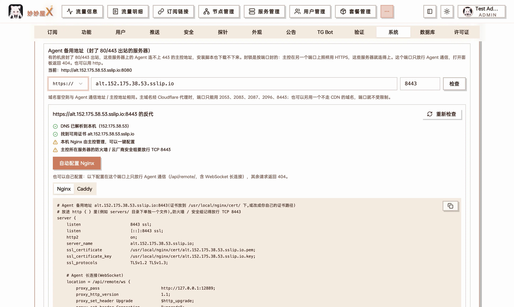
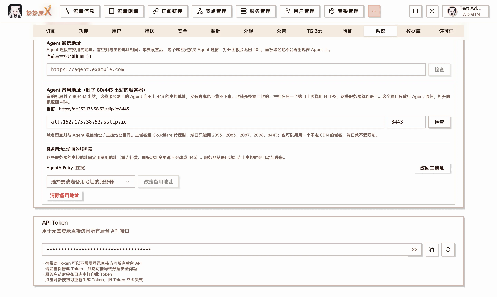
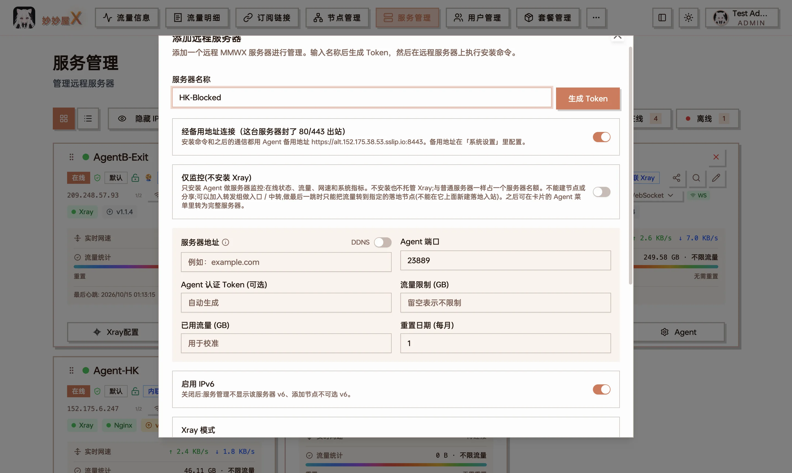

有些机房会封掉服务器的 **80 / 443 出站**。这类服务器上：

- 一键安装命令卡住或报超时，Agent 下载不下来（官方 CDN、GitHub 都走 443）；
- 主控地址是 `https://面板域名`（443）时，Agent 装上了也连不上主控；
- 外置 Xray 装不上（要从 GitHub 下载）。

好在封锁是**按端口**封的，不是按协议：主控在 443 之外再开一个端口，照样走 HTTPS（也可以用 HTTP），这些服务器就连得上。

## 版本要求

| 组件  | 版本                                            | 用到的功能                                               |
| ----- | ----------------------------------------------- | -------------------------------------------------------- |
| 主控  | v0.5.8-beta.3 及以上                            | Agent 备用地址、安装脚本从主控下载 Agent、许可证续租转发 |
| Agent | v1.1.5-beta.1 及以上，**建议 v1.1.5-beta.2 起** | 面板一键升级从主控下载、许可证续租经主控转发             |

v1.1.5-beta.1 在 LXC / OpenVZ 容器里配了 WARP 出站时内联 Xray 会起不来（`CreateTUN("wg0") failed`），beta.2 已修复。这类被封端口的机器很多是容器，直接装 beta.2 或更新的版本。

用安装命令新装的服务器拿到的就是最新版 Agent，不用另外操心版本。

## 先看你属于哪种情况

| 主控地址                                                         | 要做什么                                                                                         |
| ---------------------------------------------------------------- | ------------------------------------------------------------------------------------------------ |
| 本来就不是 80 / 443，例如 `http://IP:12889`、`https://域名:8443` | **什么都不用设置**，直接用面板给的安装命令。安装脚本发现连不上官方 CDN，会自动改从主控下载 Agent |
| `https://面板域名`（443），或经 Cloudflare 等 CDN 的 443         | 先按下文配置 **Agent 备用地址**，再添加服务器                                                    |

不确定的话，在被封的服务器上执行 `curl -m 5 -sI https://github.com`：超时就是被封了。

## 配置 Agent 备用地址

备用地址是一个**只给 Agent 用**的地址，例如 `https://面板域名:8443`：这个端口上只放行 Agent 通信（`/api/remote/`，含 WebSocket 长连接），打开面板返回 404。

### ① 选协议和端口

| 写法                     | 适合                     | 需要什么                                             |
| ------------------------ | ------------------------ | ---------------------------------------------------- |
| `https://域名:8443`      | **推荐**，有证书时都用它 | 覆盖这个域名的证书 + Nginx / Caddy 反代              |
| `http://域名或 IP:8080`  | 没有证书、只有 IP        | Nginx / Caddy 反代，不需要证书                       |
| `http://域名或 IP:12889` | 不想配反代               | 什么都不用配：直接连主控程序自己的端口（默认 12889） |

http 不加密：Agent 的通信内容有加密信道保护，但安装命令里的 token、安装脚本本身会明文传输，能用 https 就用 https。直连主控端口还有两个前提：主控所在服务器放行了这个端口，并且没有开启「关闭公网访问」（开启后主控只监听本机）。

端口：

- 域名**不走 CDN**（DNS 直接解析到主控）：任意没被占用的端口都行，https 常用 `8443`。
- 域名经 **Cloudflare 代理**（橙色云朵）：只能用 Cloudflare 支持的 HTTPS 端口 `2053`、`2083`、`2087`、`2096`、`8443`。也可以另开一个不走 CDN 的子域名（灰色云朵），端口就不受限制。
- 不能用 80、443 和 8001（主控 Nginx 内部用）；主控程序自己的端口（默认 12889）只能用 http 直连。

记得在主控所在服务器的**防火墙 / 云厂商安全组**放行这个 TCP 端口。

### ② 检查

在「系统设置」→「系统」→ **Agent 备用地址** 选协议，填写域名（或 IP）和端口。域名留空则与 Agent 通信地址（没设置时就是主控地址）相同。点 **检查**，面板会检查：

- 域名是否解析到主控（或认得出的 CDN）；
- https：证书管理里有没有覆盖这个域名的证书（泛域名证书也可以）；
- 主控本机的 Nginx 是否由主控管理、这个端口有没有被别的程序占用；
- 经 Cloudflare 代理时端口是否在允许范围内。



检查通过：主控管理的 Nginx 可以一键配置，下面同时给出 Nginx / Caddy 配置模板

### ③ 配置反代

直连主控端口（`http://…:12889`）跳过这一步。

- **主控通过面板启用的 HTTPS**（证书管理里「部署证书到主控」或「开启 HTTPS」）：点 **自动配置 Nginx**，主控会在 Nginx 里写一个只监听这个端口的站点并重载，`nginx -t` 不通过会自动回滚。
- **自己配置的 HTTPS**（自装 Nginx、Caddy、宝塔等）：把面板给出的配置加进去（域名、端口、证书路径都已替换好），保存后检查并重载。

自己配置时请保留这两个请求头，主控靠它们认出「这台服务器是从备用地址连进来的」：

```nginx
proxy_set_header X-Forwarded-Port   $server_port;
proxy_set_header X-Forwarded-Host   $host;
```

Caddy 默认会带上 `X-Forwarded-Host`（含端口），不用额外设置。

### ④ 测试并保存

选一台**在线**的服务器，点 **用这台测试**：它会对备用地址做一次带认证的完整连接（不会改变它当前用的地址），用来确认证书、反代、防火墙都通。测试通过后 30 分钟内点 **保存备用地址**。



测试通过后保存；下方列出经备用地址连接的服务器

还没有任何在线服务器时可以直接保存。

## 添加被封的服务器

在「服务器管理」→ **添加服务器**，打开 **经备用地址连接** 开关；Xray 模式选 **内联 Xray**（外置 Xray 要从 GitHub 下载，装不上）。



打开开关后，安装命令里的主控地址就是备用地址

复制安装命令到被封的服务器上执行。安装脚本会：

1. 先花几秒探测出站 HTTPS，发现不通就**直接从主控下载 Agent**（主控从官方渠道下载后转发，下载后照样用发布公钥验签，主控改不了内容）；
2. 把备用地址写进 Agent 配置，Agent 从备用地址连接主控。

安装输出里会看到这样一段（测试环境里封掉 80 / 443 出站后的实际输出，地址换成了示例）：

```text
Master Server: https://panel.example.com:8443
...
[4/6] Downloading MMWX binary...
这台服务器连不上 https://dl.miaomiaowux.com/(出站 HTTPS 可能被封),改为先从主控下载 Agent。
Downloading Agent from https://panel.example.com:8443/api/remote/agent-dist/<token>/mmw-agent-linux-amd64 ...
Agent verified (.sig).
Agent installed.
[5/6] Starting service...
```

装好后在服务器卡片上能看到它在线；系统设置里「经备用地址连接的服务器」列表也会出现它。

## 已经添加过的服务器

在 **Agent 备用地址** 下方的「经备用地址连接的服务器」里，选中服务器后点 **改走备用地址**：

- 服务器**在线**：主控先让它探测备用地址，通了才下发，不通就保持原样；
- 服务器**离线**（多半就是因为连不上 443）：只做标记，然后在服务器卡片上复制安装命令重新执行即可（命令里已经是备用地址）。

另外，**从备用地址连进来的服务器会被自动加进列表**：手动改过安装命令的、或从备用主控地址切过来的都算。

已经在用的服务器哪天 443 被封了，不用手动处理：Agent 主地址连续 2 分钟连不上时会自动切到备用地址；主控发现它是从备用地址连进来的，就把备用地址写成它的主控地址。之后它不会再去回探连不上的主地址，重启后也直接连备用地址。前提是这台服务器在被封之前就已经拿到了备用地址（保存备用地址后，在线的 Agent 会自动收到）。

### 老版本 Agent

Agent 低于 v1.1.5-beta.1 时，面板一键升级用的是**旧的升级脚本**，它只会去官方渠道下载，被封的机器上升级会失败。先在服务器卡片上复制安装命令，到服务器上重新执行一次（会保留这台服务器的身份，节点不受影响），装上的就是新版；之后的一键升级就能自动从主控下载了。

## 装好之后

经备用地址连接的服务器：

- **主控地址固定是备用地址**：离线重连时的地址补发、更换面板域名、切换 Agent 通信地址，都不会把它改成 443 的地址；它的备用主控地址里也不会再带上连不上的主地址；
- **面板一键升级**（Agent v1.1.5-beta.1 起）：官方渠道下载不到时自动改从主控下载，同样验签；
- **许可证续租**（Agent v1.1.5-beta.1 起）：直连许可证服务失败时自动经主控转发（主控只搬运 Agent 签好的请求）；
- **geo 数据**：内联 Xray 需要的 `geoip.dat` / `geosite.dat` 下载不到时从主控获取。

其余服务器会把备用地址当作一个**备用主控地址**（主地址连续 2 分钟连不上时，Agent 依次尝试备用主控地址）：哪天它们的 443 也被封了，会自动切到备用地址。

要把某台服务器改回主地址，在列表里点 **改回主地址**（主控先让它探测主地址，通了才切换）。还有服务器经备用地址连接时，备用地址不能清除。

## 常见问题

### 能不能直接用主控的 12889 端口，不配反代？

可以：协议选 **http**、端口填主控程序的端口（默认 12889）就是直连主控，不需要 Nginx。但要注意：

- 这是**明文 HTTP**。Agent 的通信内容有加密信道保护，安装命令里的 token、安装脚本本身还是明文传输；
- 主控所在服务器要放行这个端口，并且不能开启「关闭公网访问」（开启后主控只监听本机，检查时会提示）；
- 主控地址还没设置时不能这样用：那时 Agent 本来就是直连主控端口的，被封的服务器也连得上，什么都不用做。

主控已有的「HTTPS 恢复地址」（`http://域名:12889`）是给 HTTPS 整体故障时临时救急用的，和备用地址是两回事，互不影响。

### 测试失败怎么办？

按提示逐项排查：

- **连接超时**：主控防火墙 / 安全组没放行这个端口，或者被测试的那台服务器到主控这个端口不通；
- **证书错误**：证书没覆盖这个域名，或者经 Cloudflare 代理时用了 Cloudflare 不支持的端口；
- **404 / 认证失败**：反代没放行 `/api/remote/`，或者把请求转到了别的服务。

### 外置 Xray 装不上

外置模式安装时要从 GitHub 下载 Xray，出站被封时一定装不上，安装脚本会给出提示。在面板里把这台服务器的 Xray 模式改为 **内联 Xray**（内联 Xray 已包含在 Agent 里，不用另外下载）。
