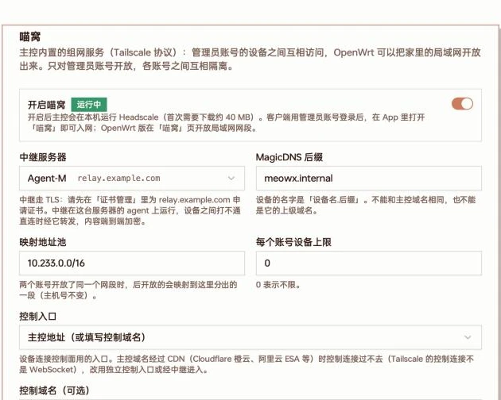
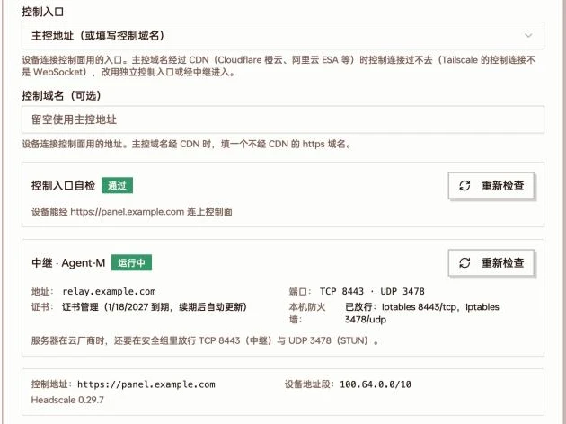
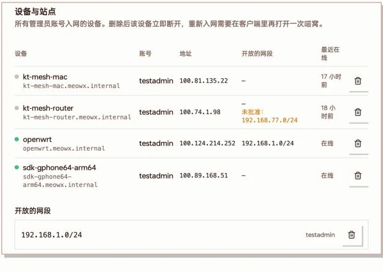

喵窝(MeowNest)是主控内置的组网服务。开启后,主控就是一张私有网络的控制中心:

- 同一个管理员账号下的手机、电脑之间可以互相访问,不管它们在哪个网络里
- OpenWrt 路由器或飞牛 NAS 可以把家里的局域网开放出来,在外面也能访问家里的 NAS、摄像头、电脑
- 设备之间打不通直连时,经你自己的一台服务器中继转发

它用的是 Tailscale 协议:主控在本机运行 Headscale(Tailscale 控制服务器的开源实现),中继是装了 agent 的服务器。设备之间的流量端到端加密,主控和中继都看不到内容。

:::note[适用范围]
- **只对管理员账号开放**。普通用户 / 订阅用户看不到喵窝,也不能入网;管理员账号被停用或降级后,它的设备会被自动移出。
- 不需要 PRO。
- 需要主控 **v0.6.2-beta.8 之后**发布的版本,中继服务器的 agent 也要 **v1.3.0 之后**发布的版本。客户端 MeowX 与 OpenWrt 插件即将发布;飞牛 NAS 版已可使用。
:::

## 组成

| 角色 | 说明 |
| --- | --- |
| 主控 | 运行 Headscale,管理设备、发放入网凭据、下发网络策略 |
| 中继服务器 | 面板里一台装了 agent 的服务器,运行中继(DERP)与 STUN。设备之间打不通直连时经它转发 |
| 设备 | 用管理员账号登录的 MeowX 客户端,入网后获得 `100.64.0.0/10` 段里的地址 |
| 站点 | 装了 MeowX 插件的 OpenWrt 路由器,或装了 MeowX 飞牛版的 NAS,把局域网网段开放给同账号的设备 |

每个管理员账号是一个隔离的小网:只能访问自己的设备和自己开放的网段,看不到其它账号的。

设备的名字是「设备名.MagicDNS 后缀」,如 `macbook.meowx.internal`,可以直接用名字访问。

## 使用前提

- **主控用 https 域名访问**。中继和控制连接都走 TLS,只用 IP 或 http 访问的主控开不了喵窝。
- 主控运行在 Linux / macOS 的 amd64 或 arm64 上。第一次开启时主控会下载 Headscale(约 40 MB)。
- 至少有一台**自己的**服务器装了新版 agent,用来做中继。[共享来的服务器](/docs/share-server)不能做中继;主控机器想做中继,就在上面再装一个 agent。
- 中继服务器的「服务器地址」或「服务器域名」填的是域名时,要先在[证书管理](/docs/certificates)里给这个域名申请证书。只有 IP 的服务器会自动用自签证书,设备按指纹校验。
- 中继服务器的云厂商安全组要放行中继端口(见下文,默认 TCP 443 或 8443,UDP 3478)。

## 开启喵窝

打开「系统设置 → 喵窝」:

系统设置 → 喵窝:开关、中继服务器、MagicDNS 后缀、映射地址池、设备上限与控制入口

1. 打开「**开启喵窝**」。
2. **中继服务器**:选一台服务器。下拉框里标「离线」或「agent 需升级」的暂时不能用。选中后下方会提示中继要不要先申请证书。没选中继不能保存。
3. 其余几项一般保持默认:

   | 选项 | 默认 | 说明 |
   | --- | --- | --- |
   | MagicDNS 后缀 | `meowx.internal` | 设备名的后缀。不能和主控域名相同,也不能是它的上级域名 |
   | 映射地址池 | `10.233.0.0/16` | 两个账号开放了同一个网段时(比如都是 `192.168.1.0/24`),后开放的映射到这里分出的一段,主机号不变 |
   | 每个账号设备上限 | `0` | 0 表示不限 |
   | 控制入口 | 主控地址 | 见下一节 |

4. 点「**保存**」。

保存后主控会先在中继服务器上部署中继,状态徽章依次是「启动中」「等待中继」「运行中」。中继还没就绪时 Headscale 不会启动,主控每 30 秒重试一次;就绪后每 5 分钟核对一次。

中继的端口自动挑选:TCP 优先用 443,被占用就在 8443–8543 里找一个;STUN 优先 UDP 3478,备选 3479–3499。agent 会自动在 ufw / firewalld / iptables 里放行这两个端口(只用 nftables 自写规则的机器要自己放行),**云厂商的安全组仍要手动放行**。

## 控制入口

设备入网和保持在线都要连主控的控制面。「控制入口」决定设备从哪里连:

| 选项 | 适合 | 说明 |
| --- | --- | --- |
| 主控地址(或填写控制域名) | 主控域名没套 CDN | 默认。可以另填一个不经 CDN 的 https 域名作为控制域名 |
| 独立控制入口(主控单独端口,不经 CDN) | 主控域名套了 CDN | 主控在一个单独的端口上直接提供控制面 |
| 经中继进入(不暴露主控 IP) | 主控域名套了 CDN,又不想暴露主控 IP | 设备连中继的域名,中继把控制连接转给主控 |

**为什么 CDN 不行**:Tailscale 的控制连接不是 WebSocket,Cloudflare 橙云、阿里云 ESA、腾讯云 EdgeOne 等 CDN 放不过去。主控域名经过 CDN 时,下方「控制入口自检」会显示没通过并指出是哪家 CDN。

### 独立控制入口

填一个不经 CDN 的子域名(建议 `ts.你的主域名`)和端口(默认 8443),点「**一键生成**」,主控会依次:

1. 挑一个空闲端口(被占用就往后换)
2. 在「DNS 服务商」里给这个子域名加一条 A 记录,指向主控的公网 IP(不开 CDN,会覆盖同名记录)
3. 在「证书管理」里用 DNS 验证申请证书(约 1–3 分钟)
4. 启用并自检

前提是「DNS 服务商」里有能管理这个域名的账号。云服务器要在安全组放行这个 TCP 端口。**这条子域名会暴露主控 IP**,不想暴露就选「经中继进入」。

### 经中继进入

设备连中继服务器的域名,中继再把控制连接转给主控的某个端口(默认 8443)。主控防火墙上这个端口**只需要对中继服务器的 IP 放行**。

要求中继服务器有域名、在证书管理里有证书,并且 agent 支持兼做控制入口。不满足时这个选项不可选,下方会说明原因:「中继服务器没有域名」或「agent 不在线或版本太旧」。

### 自检与中继状态

保存后,下方显示控制入口自检、中继运行状态与运行信息:

控制入口自检通过;中继运行中,列出中继地址、端口、证书与本机防火墙放行情况,以及控制地址、设备地址段和 Headscale 版本

改了服务器的证书、防火墙或安全组后,点「重新检查」。

使用主控地址做控制入口时,主控会自动在它管理的 Nginx 里给控制连接加上长连接超时;主控前面如果是你自己的反向代理,要自己把 `/ts2021` 的读超时调长(例如 1 小时)。

## 客户端入网

设备不需要导入配置、不用扫码、也不用填密钥:

1. 在 MeowX 客户端里用**管理员账号**登录主控(扫码或账号密码)。
2. 进入组网设置(iOS 在「我的 › 组网」,macOS 在菜单栏面板「设置 › 组网」),选「**喵窝**」。
3. 客户端向主控申请一次性入网凭据(10 分钟内有效)并自动入网。

几点说明:

- 要在 MeowX 已连接时入网。规则 / 全局 / 直连三种模式下,喵窝的地址都走喵窝。
- 喵窝和订阅里的 Tailscale 组网节点只能开一个,切换时会提示并重连一次。
- 组网页面列出「我的设备」(直连还是经中继、离线多久)和「我的站点」;底部「退出喵窝」会把这台设备从主控删掉。退出登录时喵窝跟着关闭。
- 同一账号每分钟最多入网 5 次。

:::note
iOS / macOS 版即将发布;Android / Windows 版还在开发中。具体界面以客户端为准。
:::

## OpenWrt 开放局域网

在路由器上装好 MeowX 的 OpenWrt 插件(LuCI 界面),先在插件配置里用管理员账号登录主控,然后打开插件里的「喵窝」页:

1. 点「安装 tailscale」(从系统软件源安装,需要约 24 MB 空间)。
2. 勾选要开放的局域网网段(列出 lan 区域各接口的网段,也可以另外填写),打开开关即生效。
3. 可选:「总是映射」、设备名、「访问路由器本身」。

开放的网段由主控自动批准,同账号的设备马上就能访问。限制:

- 只能开放 IPv4 私网网段(`10.0.0.0/8`、`172.16.0.0/12`、`192.168.0.0/16` 内),大小在 /16 到 /30 之间,一台路由器最多 16 个
- 不能和「映射地址池」重叠
- 和别的账号开放了同一网段时,自动映射到映射地址池里的一段(如 `10.233.1.0/24`),主机号不变:原来的 `192.168.1.10` 用 `10.233.1.10` 访问

## 飞牛 NAS 入网

MeowX 的[飞牛 NAS 版](/docs/client-download#飞牛-nas)自带官方 tailscaled,不用另外安装。在它的管理页面(`http://<NAS 的地址>:7899`)先到「订阅」页用管理员账号登录主控,然后打开「喵窝」页:

1. 打开「喵窝」开关,NAS 自己入网,最多一两分钟。
2. 可选:勾选「要开放的局域网网段」(列出 NAS 网卡所在的网段);「喵窝里的设备能访问 NAS 本身」缺省打开;「总是映射」与设备名同 OpenWrt。
3. 「退出喵窝」会在主控里删掉这台设备、撤掉它开放的网段。

开放网段的限制与映射规则同上面的 OpenWrt。家里路由器已经开放了 NAS 所在的网段时,NAS 不用再开放:同账号的设备经路由器就能访问 NAS 的局域网地址,NAS 自己的喵窝地址也可以直接访问。

## 管理设备与站点

开启后,设置页下方的「设备与站点」列出所有管理员账号入网的设备和开放的网段:

设备与站点:每台设备的账号、喵窝地址、开放的网段与最近在线;下方是所有开放的网段

- 删除设备:设备立即断开;要重新入网,在客户端里再打开一次喵窝。
- 删除网段:这个网段不再开放。
- 网段标「与其他账号冲突,已映射」的,显示为「原网段 → 映射网段」。
- 网段标「未批准」的不会生效。

## 常见问题

**控制入口自检没通过,提示经过 CDN**

主控域名套了 CDN。改用「独立控制入口」或「经中继进入」,或者在「控制域名」里填一个不经 CDN 的 https 域名。

**选了「经中继进入」后设备连不上,提示中继连不上主控**

- 超时:多半是主控的云厂商安全组或防火墙没放行控制端口(默认 TCP 8443),放行时来源填中继服务器的 IP。
- 被拒绝:主控上的控制入口没在这个端口运行。看设置页里控制入口的运行状态,确认端口有没有被别的程序占用。
- 证书校验失败(证书或指纹变了):点「重新检查」重新下发中继配置。

**中继一直显示「等待中继」或「未就绪」**

依次检查:中继服务器的 agent 是否在线、版本是否够新;服务器域名是否已在证书管理里申请证书;云厂商安全组是否放行了中继的 TCP 与 UDP 端口。

**提示「喵窝需要主控用 https 域名访问」**

先给主控配好域名与 HTTPS,见[主控域名](/docs/domain-master)。

**提示设备数达到上限**

在「设备与站点」里删掉不用的设备,或调大「每个账号设备上限」。
