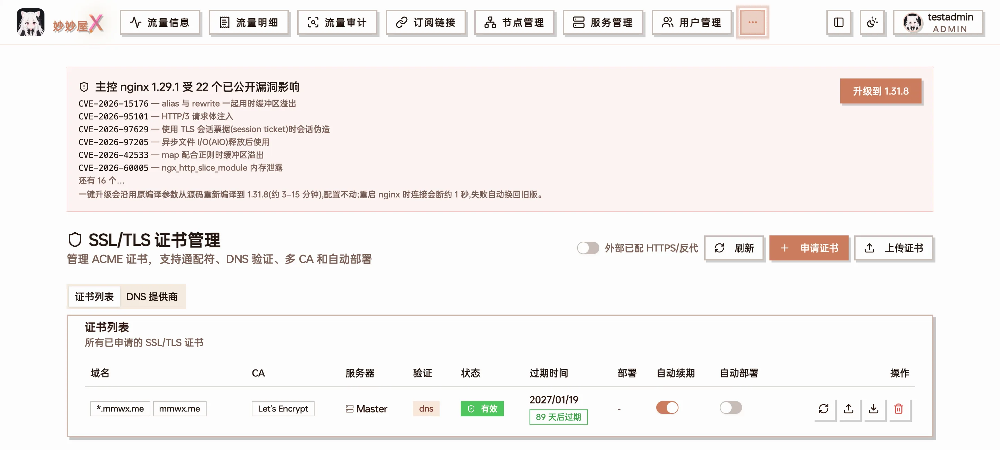
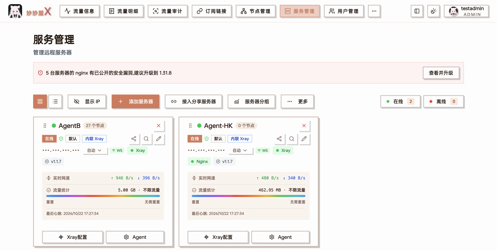
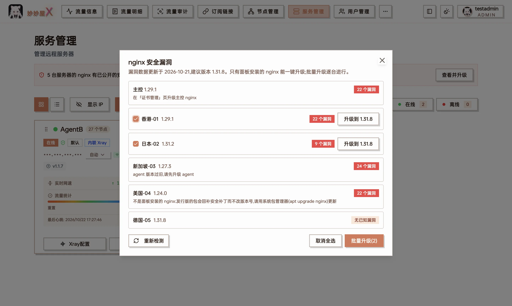
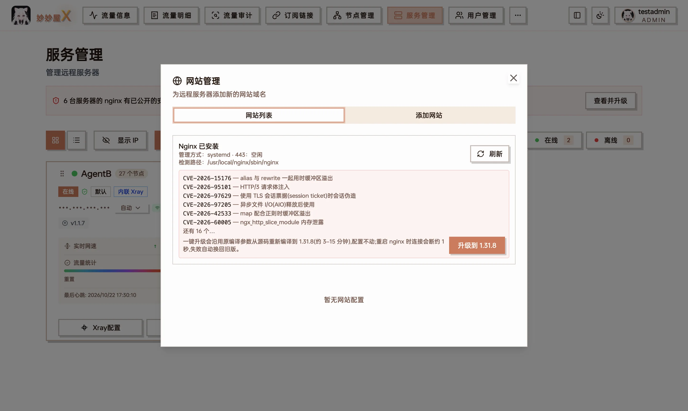

面板装的 nginx（主控开启 HTTPS、服务器开启「偷自己」或添加网站时安装的那个）是从源码编译的，不会随系统更新自动打补丁。nginx 出了安全漏洞时，面板会把受影响的主控和服务器标出来，并提供一键升级。

## 漏洞数据从哪来

- 面板内置一份 nginx 安全公告数据，收录影响 1.25.1 及以上版本的已公开漏洞，每条记录受影响的版本范围和修复版本。
- 主控每 12 小时联网检查一次更新，拿到更新的数据就替换内置那份。新漏洞公布后，**不用升级主控**也能看到提示。
- 判断是否受影响只看 nginx 的版本号。

**升级目标**取 nginx.org 上的最新主线版（mainline），与漏洞数据里的建议版本两者中较新的一个。主控连不上 nginx.org 时用建议版本。只会往上升，不会降级。

## 主控的 nginx

打开「证书管理」页，主控 nginx 的状态显示在页面上方：

| 显示 | 说明 |
| --- | --- |
| 主控 nginx X 受 N 个已公开漏洞影响 | 列出漏洞编号（默认列前 6 条，其余点「还有 N 个…」展开），附「升级到 X」按钮 |
| 主控 nginx X 低于建议版本 Y | 没有命中已知漏洞但版本偏旧，同样可以升级 |
| 主控 nginx 已是 X | 升级完成后显示 |

证书管理页顶部：主控 nginx 命中的漏洞（默认列前 6 条）和「升级到 X」按钮

没有漏洞、版本也不低于建议版本时不显示这张卡片；主控没装 nginx（没开 HTTPS）时也不显示。

点「升级到 X」后：

1. 升级在主控后台进行，弹出的窗口实时显示日志。**关掉窗口不影响升级**，之后回到页面会显示进度或结果。
2. 面板本身就是经这个 nginx 提供的 HTTPS 访问，重启 nginx 时页面会短暂连不上，过一两秒自动恢复。

## 其他服务器的 nginx

### 服务管理页顶部横幅

服务管理页顶部的 nginx 漏洞横幅

有服务器的 nginx 受漏洞影响时，「服务管理」页顶部会出现横幅：「N 台服务器的 nginx 有已公开的安全漏洞，建议升级到 X」。点「查看并升级」打开清单：

- 每台服务器一行，显示当前版本、命中的漏洞数或「无已知漏洞」，以及不能升级的原因。
- 主控那一行提示「在「证书管理」页升级主控 nginx」。
- 可以对单台点「升级」，也可以勾选多台（「全选可升级」）后点「批量升级」。批量升级**逐台进行**，每台显示「等待中 / 升级中 / 已升级 / 失败」；某一台失败不影响后面的。
- 「重新检测」立即重新检查所有在线服务器。

「查看并升级」清单：可升级的服务器可单台升级，也可勾选后批量升级；不能升级的写明原因

### 单台服务器

不想等横幅，也可以在单台服务器上直接看和升级：

- **外置 Xray 的服务器**：服务器卡片「Agent」菜单 →「服务管理」，在「远程服务器管理」窗口的 nginx 一栏。
- **内嵌 Xray 的服务器**（没有「服务管理」菜单）：「Agent」→「网站管理」，在 nginx 状态那一栏。见 [Nginx 网站管理](/docs/website-management)。

内嵌 Xray 的服务器：「Agent」→「网站管理」，nginx 状态下方列出漏洞并可直接升级

## 升级时会做什么

一键升级是在服务器上**从源码重新编译 nginx**，过程如下：

1. 读出当前 nginx 的编译参数（`nginx -V`），用**同样的参数和模块**编译目标版本。用到 nginx-acme 动态模块时，模块也一起重编（动态模块必须和主程序同版本）。
2. 配置文件、网站、证书**一个都不改**。
3. 换上新程序后先用 `nginx -t` 检查配置，不通过就换回旧程序；重启后没起来也会自动换回旧版再启动。
4. 重启 nginx 时现有连接会断开约 1 秒，客户端会自动重连。

整个过程视机器配置约需几十秒到 15 分钟，期间日志每 20 秒报一次进度。升级前的程序会留一份备份，只保留最近一次的。

## 哪些 nginx 不能一键升级

只有面板安装在 `/usr/local/nginx` 的 nginx 有升级按钮。其他情况只显示原因：

| 提示 | 原因与处理 |
| --- | --- |
| 不是面板安装的 nginx | 用 apt / yum 等装的发行版 nginx。发行版会把安全补丁回补到原版本、版本号不变，按版本号判断会误报。请用系统包管理器更新（如 `apt upgrade nginx`） |
| 容器部署的 nginx 随镜像更新 | Docker 部署的主控或服务器，拉取新镜像后重建容器即可 |
| 与主控同机 | 这台服务器和主控共用同一个 nginx，请在「证书管理」页升级主控 nginx |
| agent 版本过旧，请先升级 agent | 老版本 agent 不支持升级 nginx，先在「服务管理」一键升级 Agent |
| nginx 正在安装或升级 | 等当前的安装或升级结束后再试 |
| 当前系统不支持一键升级 | 只支持 Linux 服务器 |
| 服务器离线 / 读不出 nginx 版本 / 检测失败 | 等服务器上线后点「重新检测」 |

## 常见问题

**升级失败了，nginx 还能用吗？**
能。新版本检查或启动失败都会自动换回旧版本，失败原因写在升级日志里。常见原因是服务器下载 nginx 源码失败（网络受限）或内存太小编译不过。

**升级后还提示漏洞？**
点「重新检测」。检测结果有短暂缓存，主控刚重启、Agent 还没连上时也可能暂时显示「未检测」。
