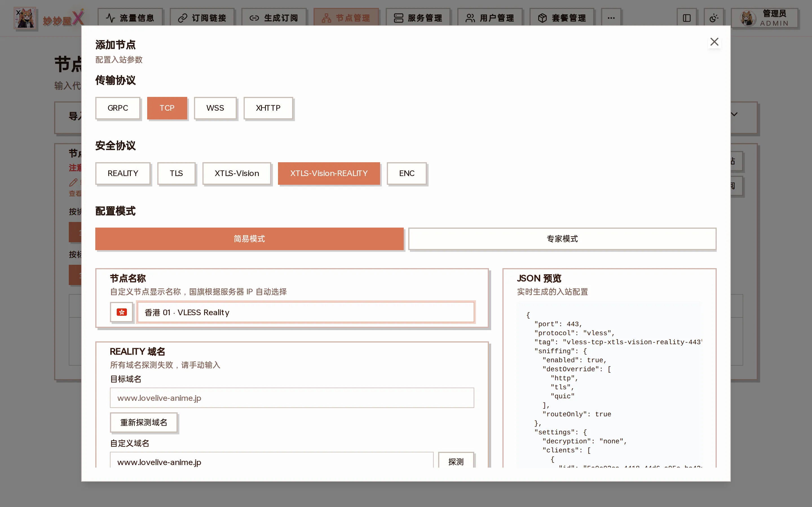

## 完整矩阵

以下是添加节点向导里可以选择的全部组合，共 27 种。除备注里特别说明的以外，都可以用 mihomo 系客户端连接。向导会根据所选协议只显示可用的传输与安全层：

向导顶部三行按钮：选择协议 → 传输协议 → 安全协议

| #   | 协议        | 传输  | 安全层                | 备注                                                              |
| --- | ----------- | ----- | --------------------- | ----------------------------------------------------------------- |
| 1   | VLESS       | TCP   | REALITY               |                                                                   |
| 2   | VLESS       | TCP   | REALITY + XTLS-Vision | flow: xtls-rprx-vision                                            |
| 3   | VLESS       | TCP   | TLS                   |                                                                   |
| 4   | VLESS       | TCP   | TLS + XTLS-Vision     | flow: xtls-rprx-vision                                            |
| 5   | VLESS       | TCP   | Encryption（ENC）     | VLESS 自带加密，不需要证书；sing-box、Quantumult X、Loon 不支持   |
| 6   | VLESS       | WS    | TLS                   | WSS                                                               |
| 7   | VLESS       | gRPC  | REALITY               |                                                                   |
| 8   | VLESS       | XHTTP | REALITY               |                                                                   |
| 9   | Trojan      | TCP   | TLS                   |                                                                   |
| 10  | Trojan      | TCP   | REALITY               |                                                                   |
| 11  | Trojan      | gRPC  | REALITY               |                                                                   |
| 12  | VMess       | TCP   | None                  |                                                                   |
| 13  | VMess       | TCP   | TLS                   |                                                                   |
| 14  | VMess       | WS    | None                  |                                                                   |
| 15  | VMess       | WS    | TLS                   |                                                                   |
| 16  | Shadowsocks | TCP   | None                  | AEAD，默认 aes-256-gcm                                            |
| 17  | Shadowsocks | TCP   | None                  | SS2022：2022-blake3-aes-128-gcm / aes-256-gcm / chacha20-poly1305 |
| 18  | Hysteria2   | UDP   | TLS                   | 需要 TLS 证书                                                     |
| 19  | AnyTLS      | TCP   | TLS                   | 需要 TLS 证书（推荐，mihomo / sing-box 通用）                     |
| 20  | AnyTLS      | TCP   | REALITY               | 只有官方客户端 MeowX 支持，订阅对其它客户端自动滤掉               |
| 21  | Miu         | TCP   | TLS                   | 需要 TLS 证书；默认只下发给官方客户端 MeowX                       |
| 22  | Miu         | TCP   | REALITY               | 不需要证书；默认只下发给官方客户端 MeowX                          |
| 23  | Snell       | TCP   | None                  | Snell v4 / v5：每用户独立 PSK，支持 obfs 混淆                     |
| 24  | Snell       | TCP   | None                  | Snell v6：每用户独立 PSK，隐藏 salt + 流量整形                    |
| 25  | Mieru       | TCP   | None                  | 用户名 + 密码，协议自身加密                                       |
| 26  | Mieru       | UDP   | None                  | 同一端口同时监听 TCP / UDP；MeowX Mac / iOS 仅支持 TCP            |
| 27  | WireGuard   | UDP   | None                  | 密钥与隧道地址由主控分配；不支持转发链                            |

向导里还可以建 SOCKS5、HTTP 两种通用代理入站，不计入上表。

## 只有内联 Xray 支持的协议

AnyTLS、Miu、Snell、Mieru、WireGuard 由妙妙屋X 的[内联 Xray](/docs/embedded-xray)内核提供，官方 xray 没有这些协议。服务器是外置 Xray 模式时，向导里这几个协议不可选；已经建了这些入站的服务器，也要先删掉它们才能切换到外置模式。

## 已废弃的组合

以下组合在 Xray-core 中已被废弃或移除：

- HTTP/H2 传输：已迁移到 XHTTP stream-one（H2 & H3）
- Trojan + Flow（XTLS-Vision）：Xray-core 已移除 Trojan 的 flow 支持

## mihomo 兼容性说明

- Trojan 在 mihomo 中使用 sni 字段（非 servername）
- XHTTP 需要 xhttp-opts 包含 headers: {}，mode 放在顶层
- REALITY 的 short-id 和 public-key 放在 reality-opts 中
- Hysteria2 使用 hysteria2 类型（非 hysteria）
