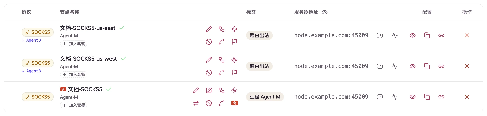
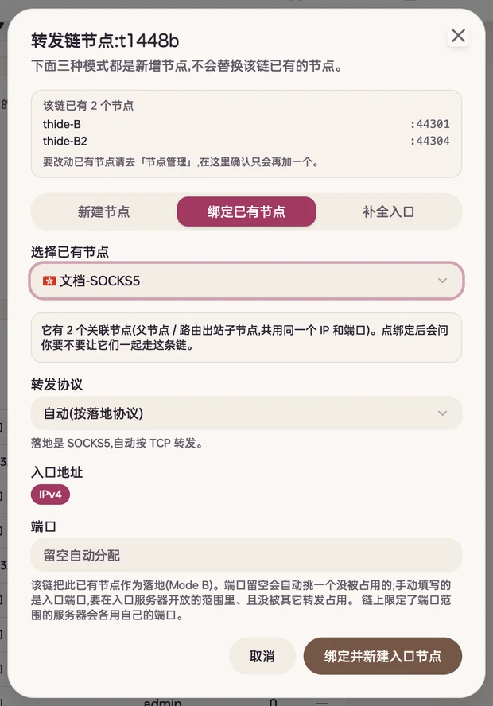
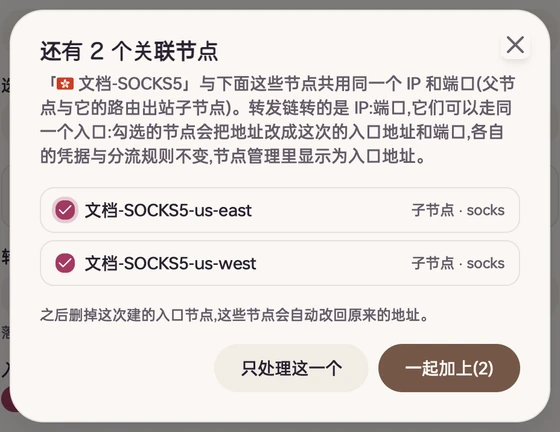
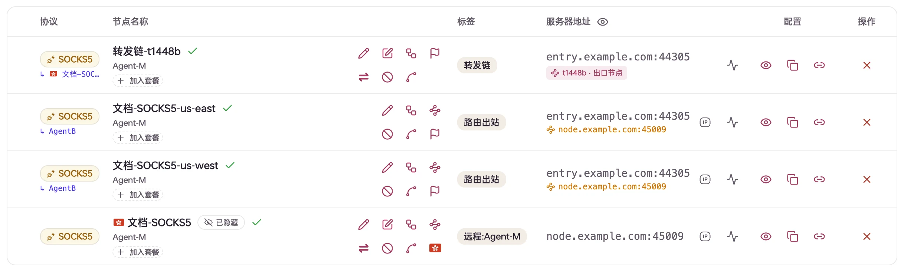
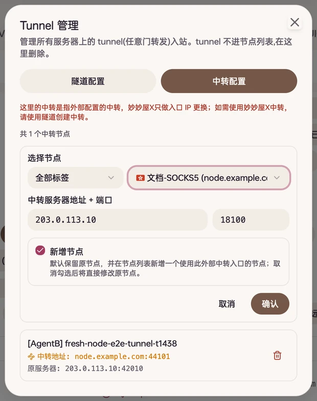
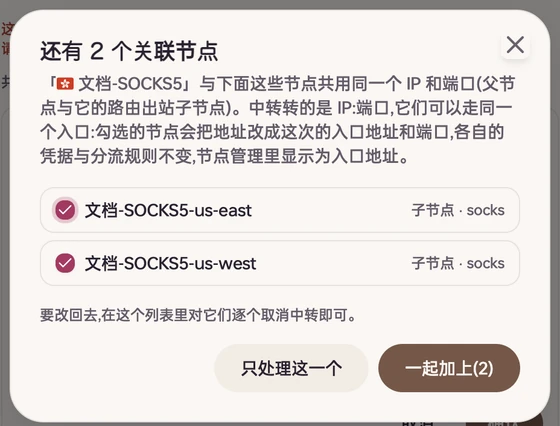
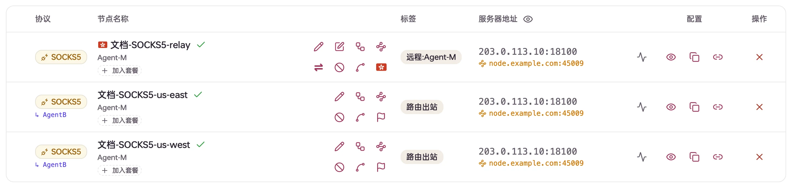

一个 SOCKS5 节点下面建了几个[路由出站](/docs/routed-outbound)子节点,每个子节点从不同的落地出网,在客户端看来就是**服务器和端口完全相同、只是用户名密码不同**的几个节点。这时想让它们都经过同一条转发链(或同一个外部中转)连进来,不用一个个去配:给其中一个配的时候,面板会把其余几个列出来,勾上就一起改。

## 什么是关联节点

和你正在操作的节点**共用同一个 IP 和端口**的这些节点:

- 它的父节点(你操作的是子节点时);
- 同一个父节点下的其它路由出站子节点。

为什么它们可以共用一个入口:转发链和外部中转转的都是 **IP:端口**,不看账号。连进来以后,落地那台服务器照样按各自的用户名密码认出是谁、走哪条分流。所以几个节点改成同一个入口地址:端口以后,**各自的凭据和分流规则都不变**。

以下节点不算关联节点:

- 自己单独导入的节点,即使地址和端口碰巧一样,也不是同一个父节点下的;
- 已经配过中转的节点;
- 转发链的入口节点、端口转发节点。

:::note[版本要求]
关联节点在主控 **v0.5.6** 起提供。在同一个 SOCKS5 / HTTP 节点下建**两个及以上**路由出站子节点,需要主控 **v0.6.3 之后**发布的版本。更早的版本里这些子节点的账号名都相同,后建的会把先建的盖掉,其中一个连不上。用旧版本建过的子节点,升级后删掉重建即可。
:::

## 示例

下面用一个 SOCKS5 节点「文档-SOCKS5」和它的两个路由出站子节点(us-east、us-west,落地在另一台服务器)演示。三个节点的地址都是 `node.example.com:45009`:

父节点从它所在的服务器出网,两个子节点各自从落地出网。

## 做法一:绑定到转发链

1. 打开转发链详情,点「绑定节点」,切到「绑定已有节点」。
2. 「选择已有节点」里选父节点或任意一个子节点。有关联节点时,下面会提示「它有 N 个关联节点」:

   

3. 点「绑定并新建入口节点」,弹出关联节点列表,默认全部勾选:

   

   - **一起加上**:勾选的节点一起改走这条链;
   - **只处理这一个**:只绑选中的那个,其余不动。

绑定完成后:

- 多了一个入口节点「转发链-链名」,用的是父节点的账号;
- 两个子节点的地址改成同一个**入口地址:端口**,下面一行是原来的地址;
- 三个节点从同一个入口连进来,出网的地方和以前一样:入口节点从父节点那台出,子节点各自从自己的落地出。

:::tip
转发链页面顶部的「隐藏出口节点」开关打开时,被绑定的那个节点(上图里的「文档-SOCKS5」)会自动放进隐藏节点,节点列表里点「显示已隐藏」才看得到。隐藏只影响节点列表显示,不影响订阅和套餐。
:::

**改回去**:在节点管理里删掉这次建的入口节点,关联节点会**自动改回原来的地址**。

## 做法二:外部中转(Tunnel 管理 → 中转配置)

已经在别处配好了一个转发(比如一台机器把 `203.0.113.10:18100` 转到节点的 `45009`),要让节点改用这个地址连:

1. 节点管理顶部点「Tunnel 管理」,切到「中转配置」,点「添加中转」。
2. 选择节点(父节点或任意一个子节点),填中转服务器地址和端口:

   

   「新增节点」默认勾选:保留原节点,另外新建一个走中转的节点。取消勾选则直接改原节点。

3. 点「确认」,有关联节点时同样弹出列表:

   

完成后:

- 选中的节点按「新增节点」的选择处理:勾选时多出一个「…-relay」节点,原节点保留;
- 关联节点**一律原地改地址**,不新建副本。子节点做成副本会丢掉子账号身份,分流就不对了。

端口留空时,每个节点沿用自己的端口(它们本来就是同一个端口)。

在节点列表某个节点的操作里点「配置外部中转」,效果和这里一样,也会询问关联节点。

**改回去**:在「中转配置」列表里对它们逐个取消中转,地址恢复成原来的。

## 常见问题

**之后又加了一个子节点,它会自动走同一个入口吗?**

不会。关联节点只在配转发 / 中转的那一刻一起处理。新加的子节点照原来的地址连;要它也走入口,在「中转配置」里给它加同一个中转地址,或者把整组改回去再重新配一次。

**父节点和子节点能分开走不同的入口吗?**

可以。在弹窗里取消勾选、或点「只处理这一个」,其余节点保持原地址,之后再给它们单独配。

**子节点的流量和套餐计费会变吗?**

不会。流量照旧按各自的账号统计到各自的节点,套餐里勾选的节点也不变。

**不是路由出站子节点,而是自己导入的几个同地址、不同账号的 SOCKS5 节点呢?**

它们不算关联节点,不会出现在弹窗里。转发链和中转转的是 IP:端口,所以可以先给其中一个配好,再把其余几个在「中转配置」里改成同一个入口地址和端口(取消勾选「新增节点」直接改原节点)。各自的账号不变,照样能分开用。
