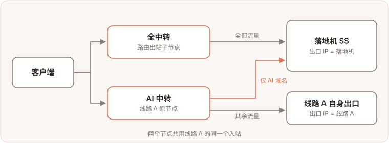
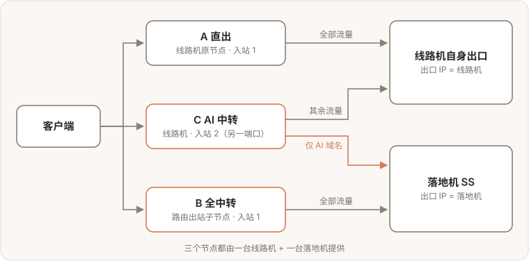

把[路由出站](/docs/routed-outbound/)和「节点路由」组合起来，常见的分流需求不需要额外开机器。下面每个场景都给出流量走向图、配置步骤和核对方法。

用到的两个功能：

- **路由出站子节点**：同一个入站上多出一个节点，这个节点的全部流量走指定的落地。
- **节点路由**：给一个入站加分流规则，例如「AI 域名走某个出站」，其余流量照旧。规则按入站生效。

## 场景一：全中转 + AI 中转共用一个落地

两个节点共用线路 A 的同一个入站：全中转的全部流量走落地；AI 中转只有 AI 域名走落地，其余从线路 A 自己出去

### 需求

一台入口中转机「线路 A」+ 一台落地机（上面有一个 SS 节点）。想同时给用户两条线路：

- **全中转**：全部流量都经落地 SS 出去；
- **AI 中转**：只有 AI 服务（OpenAI、Claude、Gemini 等）的流量走落地，其余流量直接从线路 A 自己出去 —— 省落地流量，日常访问延迟也更低。

| 线路    | 用户连的节点              | AI 域名 | 其余流量        |
| ------- | ------------------------- | ------- | --------------- |
| 全中转  | 线路 A 上的路由出站子节点 | 落地 SS | 落地 SS         |
| AI 中转 | 线路 A 原节点             | 落地 SS | 线路 A 自身出口 |

两条线路用的是**同一个**落地 SS。

### 关键：AI 中转不要再建路由出站子节点

路由出站子节点自带一条覆盖整个节点的规则：这个子节点的**全部**流量都走它的落地，没法再让「其余流量」回到线路 A 自己。所以：

- 「全中转」用路由出站子节点；
- 「AI 中转」用线路 A 上的**普通节点**，加一条 AI 分流规则，出站选「全中转」建出来的那个落地出站。

### 步骤

**① 创建「全中转」**

1. 节点管理里找到线路 A 的节点，点行尾的「创建链式出站」；
2. 「作用范围」选 **子节点(路由出站)**，Label 填一个好认的名字，例如 `all`；
3. 在「选择落地节点」里点落地机上的 SS 节点，创建。

作用范围选「子节点(路由出站)」，再选落地节点

完成后节点列表多出子节点 `线路A-all`，线路 A 上同时多了一个出站，tag 形如 `routed:p<父节点 id>:all`，下一步要用它。

**② 给线路 A 原节点加 AI 分流**

1. 在线路 A **原节点**（不是刚建的子节点）一行点「节点路由」；
2. 点弹窗底部的「快捷添加」→「AI 分流 (需选择出站)」，AI 相关域名会自动填好；
3. 「出站」选第 ① 步建出来的 `routed:p…:all`，「作用范围」保持 **仅此入站**，添加。

「节点路由」弹窗：底部「快捷添加」里有「AI 分流 (需选择出站)」

添加后弹窗的「专属路由规则」里多出这条 AI 分流规则，指向 `routed:p…:all`；「默认出站」仍是 `direct`（线路 A 自身出口），不用改。

**③ 改名并发给用户（可选）**

把线路 A 原节点改名为 `线路A-AI中转` 之类，和 `线路A-all` 一起加进套餐即可。

### 效果

| 节点                   | AI 域名 | 其余流量        |
| ---------------------- | ------- | --------------- |
| 线路A-all（全中转）    | 落地 SS | 落地 SS         |
| 线路A-AI中转（原节点） | 落地 SS | 线路 A 自身出口 |

AI 分流规则限定的是线路 A 的入站，而全中转子节点也挂在同一个入站上，所以全中转用户的 AI 流量同样会命中这条规则 —— 去的是同一个落地，结果不变。系统会把这类「限定入站的分流规则」排在路由出站规则前面，AI 规则总是先命中。

### 原节点还要保持全部直出？

那就要三个节点（直出 / 全中转 / AI 中转），AI 中转得单独开一个入站，见[场景二](#场景二直出--全中转--ai-中转三个节点)。

### 注意

- **删除 AI 分流规则**：v0.5.8-beta.4 及之前的版本，在「节点路由」弹窗里删这条规则，会把它指向的落地出站一起删掉，「全中转」的规则也跟着没了。这些版本请到「服务管理 → Xray 配置 → 路由管理」里删除，那里只删规则。
- **删除「全中转」子节点**：它的落地出站会被删掉，指向这个出站的 AI 分流规则也会一并清除。要保留 AI 中转，先把 AI 分流规则改指向别的出站。

## 场景二：直出 + 全中转 + AI 中转三个节点

A、B 共用线路机原来的入站，C 用另开的入站

### 需求

一台线路机（VLESS 入站）+ 一台落地机（SS 节点），给客户端三个节点，全部由这一对机器提供：

| 节点      | AI 域名 | 其余流量 | 用户看到的出口 IP             |
| --------- | ------- | -------- | ----------------------------- |
| A 直出    | 线路机  | 线路机   | 线路机                        |
| B 全中转  | 落地 SS | 落地 SS  | 落地机                        |
| C AI 中转 | 落地 SS | 线路机   | AI 服务：落地机；其余：线路机 |

和场景一的区别是 A 要**全部直出**，所以 C 不能再借用 A 的入站。

### 为什么 C 要单独一个入站

- 「节点路由」的规则按入站生效（「仅此入站」或「全局」）。AI 分流规则加在 A 的入站上，A 的 AI 流量也会去落地，A 就不再是全部直出。
- C 也不能做成路由出站子节点：子节点自带的规则覆盖它的全部流量，其余流量回不到线路机。
- 系统总把「限定入站的分流规则」排在路由出站规则前面，调整顺序也绕不开。

所以 C 用线路机上**另开的一个入站**（另一个端口）。三个节点仍然只用这一台线路机和一台落地机。

### 步骤

**① A：线路机原有的节点**

不用改。它的默认出站是 `direct`，全部流量从线路机自己出去。

**② B：全中转**

在 A 一行点「创建链式出站」，「作用范围」选 **子节点(路由出站)**，Label 填 `all`，选择落地机上的 SS 节点，创建。

在 A 上创建路由出站子节点，落地选 SS

得到子节点 B，以及线路机上的出站 `routed:p<A 的节点 id>:all`。

**③ C：在线路机上另开一个入站**

节点管理右上角「[添加节点](/docs/nodes/)」，服务器选这台线路机，协议同样选 VLESS，端口用向导给的（和 A 不同的端口），创建后把节点改名为「AI 中转」之类。

添加节点：第一步选线路机

**④ 给 C 加 AI 分流**

在 C 一行点「节点路由」→「快捷添加」→「AI 分流 (需选择出站)」，「出站」选第 ② 步的 `routed:p…:all`，「作用范围」保持 **仅此入站**，添加。

在 C（不是 A）的「节点路由」里加 AI 分流

**⑤ 加进套餐**

把 A、B、C 三个节点都加进套餐，用户订阅里就是三个节点。

### 核对

- 三个节点的「节点路由」：A 没有专属规则；B 的专属规则指向 `routed:p…:all`；C 的专属规则是 AI 分流 → `routed:p…:all`，默认出站 `direct`。
- 用客户端分别连三个节点，打开 `https://chatgpt.com/cdn-cgi/trace` 看 `ip=`：A 是线路机 IP，B、C 是落地机 IP；再打开任意查 IP 的网站：A、C 是线路机 IP，B 是落地机 IP。

### 注意

- C 的 AI 分流规则用的是 B 建出来的出站：删掉 B 时这个出站会被删除，C 的 AI 规则也会一起被清掉，C 就变成全部直出。要删 B，先把 C 的规则改指向别的出站。
- 删除 C 的 AI 分流规则：v0.5.8-beta.4 及之前的版本请到「服务管理 → Xray 配置 → 路由管理」里删，原因同场景一。
