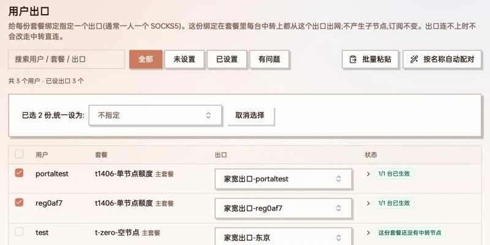
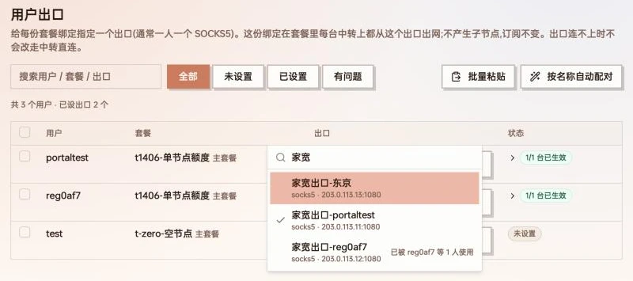
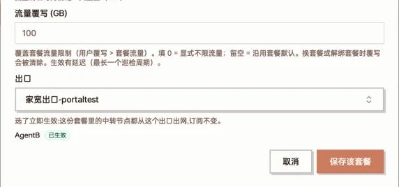
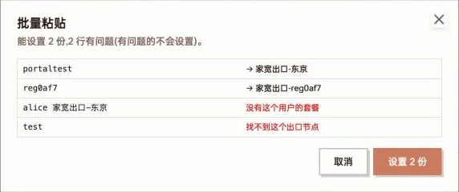
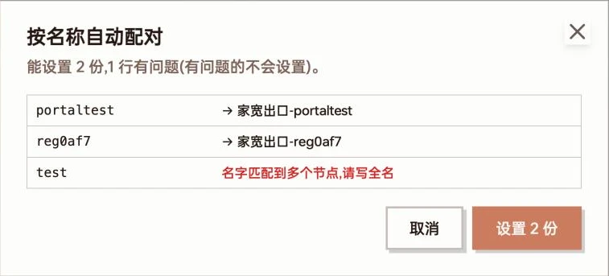
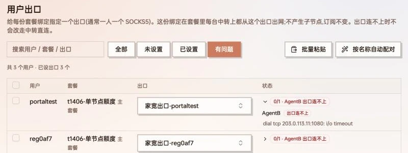

手上有几个 SOCKS5(家宽、静态住宅 IP 之类)、几台中转、几十个用户,希望**每个用户出网时用自己的那个 SOCKS5**,用「用户出口」最省事:给用户的套餐指定一个出口,这个用户经套餐里任何一台中转上网,都会从这个出口出去。

和[路由出站](/docs/routed-outbound)的区别:

| | 路由出站子节点 | 用户出口 |
| --- | --- | --- |
| 怎么做 | 每台中转 × 每个出口建一个子节点,再按出口分套餐 | 给套餐绑定选一个出口,所有中转自动跟随 |
| 一人一个出口时 | 子节点和套餐数量成倍膨胀 | 只是每个用户多一项设置 |
| 订阅 | 多出子节点 | 不变,用户无感 |
| 适合 | 让用户自己挑落地 | 管理员替用户固定出口 |

两者可以同时用,互不影响。

:::note[版本要求]
用户出口需要主控 **v0.6.2-beta.8 之后**发布的版本,中转服务器的 agent 也要升级到 **v1.3.0 之后**发布的版本。agent 版本不够的中转会显示「要升级 agent」,在那台上暂不生效。
:::

## 工作方式

- 出口设在**套餐绑定**上,不是设在用户上:同一个用户绑了两个套餐,可以一个走出口、一个不走。
- 「中转」指这份套餐里的节点所在的服务器 —— 用户在哪几台服务器上有账号,就在哪几台上生效。
- 每台中转上,主控为每个用到的出口建一个出站,再加规则「这些用户 → 这个出口」。同一个出口的用户共用一个出站,不产生子节点,订阅内容不变。
- 规则只匹配这份套餐在那台中转上的入站,所以同一用户另一份没设出口的套餐不受影响。

### 出口节点能选什么

出口可以是节点管理里的任意普通节点,包括[导入的外部节点](/docs/nodes)。最常见的是 SOCKS5,下拉框里 SOCKS5 / HTTP 排在最前。

不能选的:

- 路由出站的子节点(请选它的落地节点)
- 转发链入口、端口转发节点
- 和中转在同一台服务器上的节点(那台会显示「下发失败:出口节点就在这台服务器上」)

### 和其它规则的先后

同一台中转上,规则从上往下匹配,用户出口排在这个位置:

1. 偷自己、端口转发
2. 禁令(如 BT 封禁、内网地址封禁)
3. 按域名 / IP 的分流规则(国内直连、AI 分流、解锁规则等)
4. **用户出口**
5. 管理员共享的路由出站
6. 家宽 / 测速 WARP
7. 其它规则(包括「整个节点」落地)

也就是说:国内直连、AI 分流这些分流规则照常生效,剩下的流量才走用户出口;用户出口会压过共享路由出站和整个节点落地。

### 出口连不上时

**不会改走中转直连,也不会换别的出口** —— 这正是给用户固定出口的目的,宁可断也不能用错 IP。

每台中转每 3 分钟对出口的地址和端口做一次 TCP 连接测试,连续 2 轮失败才判「出口连不上」,恢复也要连续 2 轮。状态翻转时发通知(「用户出口连不上」/「用户出口恢复」),这组通知常开,在「系统设置 → 推送 → 推送渠道」里按渠道订阅。

:::caution
这个测试只看能不能连上出口的端口,不验证 SOCKS5 账号密码,也不验证经出口能否真正上网。账号密码错了不会显示「出口连不上」,但用户会上不了网。
:::

## 设置出口

顶部菜单进入「**用户出口**」(管理员才看得到)。页面列出所有有效的套餐绑定,一行一份。



用户出口页:每行一份套餐绑定;勾选几行后上方出现「已选 N 份,统一设为」,可以一次设成同一个出口

### 逐个设置

点「出口」列的下拉框,可以按节点名、地址、协议搜索。每一项下面是「协议 · 地址:端口」,已经被别的用户占用的出口会标「已被 xxx 使用」,方便一人一个地分配。



出口下拉框:输入「家宽」筛选出三个 SOCKS5 出口,已分配给别人的标「已被 xxx 使用」

**选中就立即保存并下发,没有确认按钮。** 主控当场把受影响的中转都下发一遍,所以提示「已保存」后状态列显示的就是下发结果。选第一项「不指定(按节点自己的出站)」即取消出口。

也可以在「用户管理」里点用户的套餐,打开「管理套餐」对话框,在「出口」一栏选,效果一样,同样是选了立即生效、不用点「保存该套餐」:



用户管理 → 管理套餐:「出口」选了立即生效,下方列出每台中转的生效情况

### 批量设置

- **勾选批量**:勾选几行,上方出现「已选 N 份,统一设为:」,选一个出口即全部设上;选「不指定」即批量清除。表头的「全选」只选当前筛选后看得到的行。
- **批量粘贴**:一行一个「用户名 出口节点名」,用空格、Tab 或逗号隔开,例如:

  ```
  alice	家宽出口-东京
  bob 家宽出口-大阪
  ```

  - 用户名要完全一致(不分大小写)。一个用户有多份套餐时,只设到他的**主套餐**上。
  - 节点名先找完全同名的;没有就找名字里包含这段文字、且只有一个的节点。匹配到多个会提示「名字匹配到多个节点,请写全名」。
  - 点「预览」先看结果,确认后才设置:

  

  批量粘贴预览:能设置的显示「→ 出口名」,有问题的标红说明原因,有问题的行不会设置

- **按名称自动配对**:出口节点名里带着用户名时(如 `家宽出口-alice`),一键配上。只处理还没设出口的绑定;节点名里包含用户名、且只有一个这样的节点才配。同样先预览:

  

  按名称自动配对:portaltest、reg0af7 各自配上名字里带自己用户名的出口;test 被多个节点名包含,不自动配

## 看状态与排查

「状态」列显示「已生效台数 / 中转台数」,全部生效时是绿色的「3/3 台已生效」。有问题时显示「0/1 · 服务器名 状态」,点开能看到每台中转的情况和原因。顶部筛选「有问题」只看有红 / 黄状态的行。



筛选「有问题」:两份绑定的出口在 AgentB 上都连不上,点开可以看到 TCP 连接超时

| 状态 | 含义与处理 |
| --- | --- |
| 已生效 | 这台中转已经按出口出网 |
| 待下发 | 刚改过,正在下发;一般几秒内变成已生效 |
| 服务器离线 | 中转不在线,上线后自动补下发 |
| 要升级 agent | 这台中转的 agent 太旧,升级后自动生效 |
| 不支持 | 这台不能指定出口,例如[共享来的服务器](/docs/share-server) |
| 下发失败 | 看鼠标悬停的原因,常见的是出口节点就在这台服务器上 |
| 出口连不上 | 中转连不上出口的地址端口:检查出口是否在线、防火墙是否放行这台中转的 IP |
| 这份套餐还没有中转节点 | 套餐里没有节点,出口暂时没地方生效 |
| 出口节点已删除 | 选的出口节点被删了,重新选一个 |

页面每 30 秒自动刷新。除了设置时当场下发,主控还会在用户账号变动后补下发,并每 10 分钟全量核对一次,中转重启或离线后回来都会自动恢复。

## 限制

- 单用户的 Shadowsocks 入站(所有用户共用一个密码)分不出是哪个用户,不支持用户出口。
- 路由出站的子账号不在用户出口的范围内,仍按子节点自己的落地出网。
- 共享来的服务器不能指定出口。
