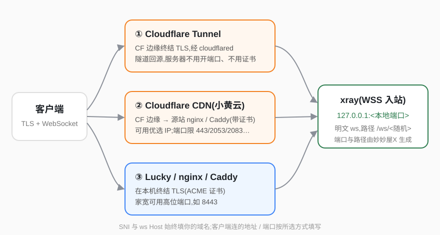
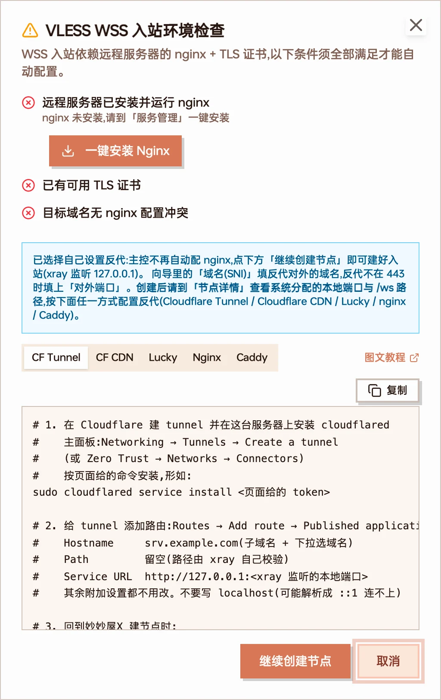
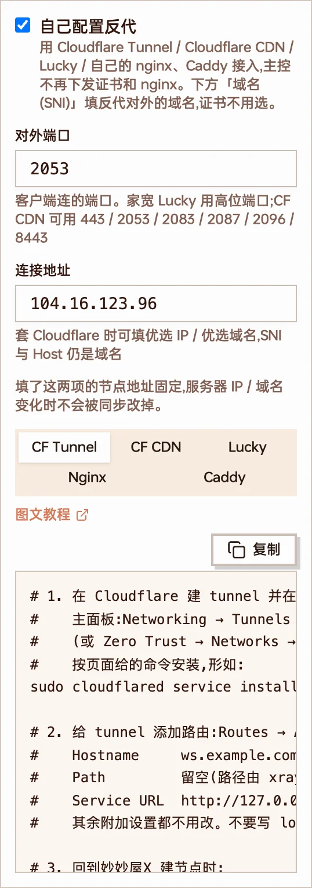
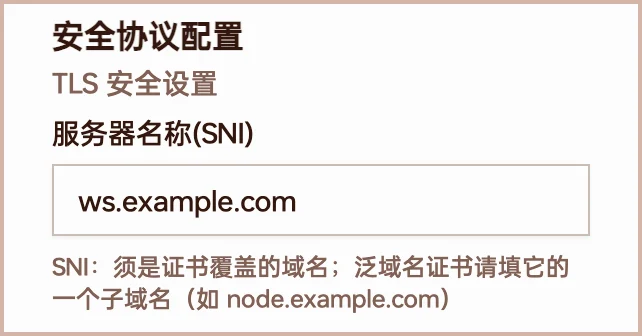
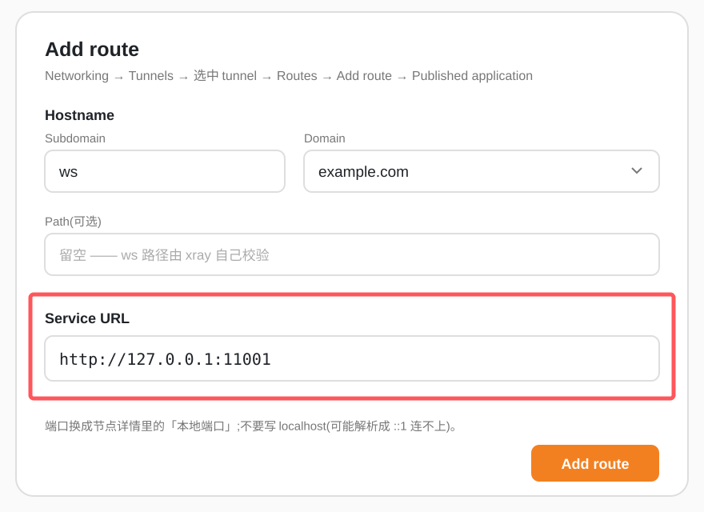
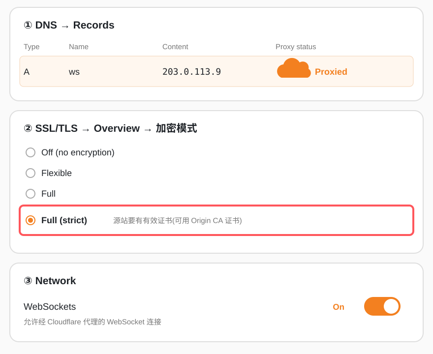
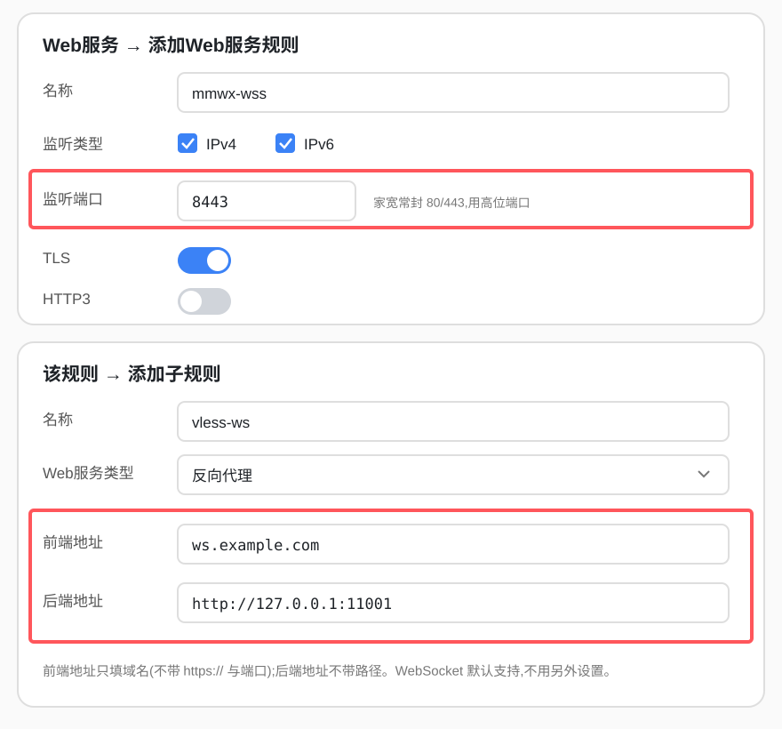

VLESS + WSS 节点的 xray 只在本机 `127.0.0.1:<本地端口>` 上收明文 WebSocket，TLS 与对外端口由前面的反代负责。默认由主控在服务器上自动配置 nginx 和证书；你也可以**自己配置反代**，用 Cloudflare Tunnel、Cloudflare CDN、Lucky 或自己的 nginx / Caddy 接入。



三种方式都由反代终结 TLS，再以明文 ws 转到本机 xray。客户端的 SNI 与 ws Host 始终是你的域名。

## 选哪种方式

| 方式                                    | 适合                                         | 服务器要开的端口 | 证书               | 对外端口                               |
| --------------------------------------- | -------------------------------------------- | ---------------- | ------------------ | -------------------------------------- |
| [Cloudflare Tunnel](#cloudflare-tunnel) | 服务器没有公网 IP、不想开端口、想隐藏源站 IP | 不用开           | 不用               | 443                                    |
| [Cloudflare CDN](#cloudflare-cdn小黄云) | 想用 Cloudflare 优选 IP 加速                 | 源站 HTTPS 端口  | 源站要有           | 443 / 2053 / 2083 / 2087 / 2096 / 8443 |
| [Lucky](#lucky)                         | 家宽、NAS、软路由，已经在用 Lucky            | Lucky 监听的端口 | Lucky 用 ACME 申请 | 任意，家宽建议高位端口                 |
| [nginx / Caddy](#nginx--caddy)          | 已有自己的网站反代                           | 反代端口         | 反代自带           | 反代端口                               |

:::note[不想自己配反代？]
服务器装好 nginx、主控里有这个域名的证书时，新建 WSS 节点不勾「自己配置反代」，主控会自动下发 nginx 配置和证书。这种情况下仍然可以套 Cloudflare CDN 并填优选 IP，见 [Cloudflare CDN](#cloudflare-cdn小黄云)。
:::

## 第一步：在面板里建 WSS 节点

1. 进入「节点管理 → 添加节点」（或「服务管理 → Xray 入站 → 添加入站」），协议选 **VLESS**，传输选 **WSS**，配置模式选 **专家模式**。
2. 选 WSS 时会弹出「VLESS WSS 入站环境检查」。服务器没装 nginx 或没有证书时，点 **我自己设置 WSS 反代**，再点 **继续创建节点**。

   

   弹窗下方是 CF Tunnel / CF CDN / Lucky / Nginx / Caddy 五种配置模板，可以直接复制。

3. 服务器已经装好 nginx 和证书时，检查通过后弹窗会自动关闭，在向导的 WSS 提示下方勾选 **自己配置反代** 即可。
4. 按所选方式填写下面三项：

   

   示例按 Cloudflare CDN 填写：对外端口 2053，连接地址填 Cloudflare 优选 IP。

   | 字段                                  | 填什么                                                                            |
   | ------------------------------------- | --------------------------------------------------------------------------------- |
   | **服务器名称(SNI)**（安全协议配置里） | 反代对外的域名，例如 `ws.example.com`。客户端的 SNI 和 ws Host 都用它             |
   | **对外端口**                          | 客户端连接的端口。留空 = 443                                                      |
   | **连接地址**                          | 客户端连接的地址。留空 = 直接连上面的域名；套 Cloudflare 时可填优选 IP / 优选域名 |

   

   自己配置反代时证书由反代负责，向导里不再显示证书选项，SNI 也不会被自动换成服务器的域名。

5. 提交后到 **节点详情** 查看系统生成的 **本地端口** 和 **ws 路径**（形如 `/ws/abcd1234`），下面配置反代时要用。

:::tip[节点地址不会被改回去]
自己配置反代、或填了对外端口 / 连接地址的 WSS 节点，地址和端口是固定的：服务器 IP 或域名变化时的地址同步、编辑入站都不会把它改成服务器自己的地址。
:::

## Cloudflare Tunnel

cloudflared 装在跑 agent 的这台服务器上，主动连到 Cloudflare。服务器不用开任何入站端口，也不用证书。域名需要托管在 Cloudflare。

1. 在 Cloudflare 主面板进入 **Networking → Tunnels**，点 **Create a tunnel**，填一个名字。
   - 也可以在 Zero Trust 面板的 **Networks → Connectors** 里创建，两边管理的是同一个 tunnel。
2. 按页面选择操作系统，复制安装命令在服务器上执行：

   ```bash
   sudo cloudflared service install <页面给的 token>
   ```

   页面显示连接成功后点 **Continue**。

3. 在 tunnel 的 **Routes** 标签页点 **Add route**，选 **Published application**：

   

   示意图，以 Cloudflare 实际界面为准。

   | 字段        | 填写                                         |
   | ----------- | -------------------------------------------- |
   | Hostname    | 子域名 + 选择域名，例如 `ws` + `example.com` |
   | Path        | 留空。ws 路径由 xray 自己校验                |
   | Service URL | `http://127.0.0.1:<本地端口>`                |

   其余附加设置都不用改。

4. 回到面板，节点的 SNI 填 `ws.example.com`，对外端口留空（443），连接地址留空或填优选 IP。

:::caution

- Service URL 写 `127.0.0.1`，不要写 `localhost`：localhost 可能先解析成 IPv6 的 `::1`，而 xray 只听 IPv4 的 127.0.0.1。
- 添加路由时 Cloudflare 会自动建一条指向 tunnel 的 CNAME，同名记录已存在会冲突，先删掉旧记录。
- 免费证书只覆盖一级子域名，`a.b.example.com` 这种多级子域名会握手失败。
- Path 如果要填，它按正则在路径的任意位置匹配，想精确匹配写成 `^/ws/abcd1234$`。
  :::

## Cloudflare CDN（小黄云）

域名开启 Cloudflare 代理，客户端连 Cloudflare 边缘，Cloudflare 再回源到你的服务器。源站仍要有 HTTPS 反代，可以是主控自动配置的 nginx，也可以是自己的 nginx / Caddy。

1. **源站**：先确认不经过 Cloudflare 时 `https://<域名>:<端口>/<ws 路径>` 能握手。
   - 用主控自动配置：建节点时不勾「自己配置反代」。
   - 自己配置：按下面的 [nginx / Caddy](#nginx--caddy) 模板配置。
2. 在 Cloudflare 做三处设置：

   

   示意图，以 Cloudflare 实际界面为准。
   - **DNS → Records**：域名的 A / AAAA 记录 Proxy status 设为 **Proxied**（橙色云）。
   - **SSL/TLS → Overview**：加密模式选 **Full (strict)**。源站证书可以用 Let's Encrypt，也可以在 **SSL/TLS → Origin Server → Create Certificate** 生成 Cloudflare Origin CA 证书。
   - **Network**：确认 **WebSockets** 为 On。

3. 回到面板填写节点：
   - SNI 填你的域名。
   - 对外端口只能是 Cloudflare 代理的 HTTPS 端口：`443`、`2053`、`2083`、`2087`、`2096`、`8443`。
   - 连接地址填优选 IP 或优选域名，留空则直接连域名。

:::caution

- Cloudflare 用客户端访问的同一个端口回源。对外端口填 2053 时，源站也要在 2053 上提供 HTTPS；主控自动配置的 nginx 只监听 443，要换端口请用 Cloudflare 的 Origin Rules 改写回源端口。
- Origin CA 证书只有 Cloudflare 信任。把小黄云关掉直连源站、或拿去给 Lucky 用，客户端都会报证书不受信任。
- 优选 IP 能用的前提是 SNI 和 ws Host 都是你的域名，面板生成的节点已经这样填好。
  :::

## Lucky

[Lucky](https://lucky666.cn) 的 Web服务反向代理和 SSL 证书（ACME）可以代替 nginx。Lucky 要和 agent 装在**同一台机器**上，回源地址才能用 127.0.0.1。

1. **准备证书**：进入 **SSL证书 → 添加**，添加方式选 **ACME**。
   - 证书颁发机构：ZeroSSL 或 Let's Encrypt。
   - DNS服务商：选你的域名托管商，并填好它的 API 密钥。
   - 域名列表：填节点域名，例如 `ws.example.com`。
   - 不要上传 Cloudflare Origin CA 证书，客户端不信任它。
2. **添加 Web服务规则**：进入 **Web服务 → 添加Web服务规则**。
   - 监听类型：IPv4、IPv6 按需勾选。
   - 监听端口：家宽一般封了 80 / 443，用高位端口，例如 `8443`。
   - TLS：开启。HTTP3：关闭。
3. **添加子规则**：在这条规则下点 **添加子规则**。
   - Web服务类型：**反向代理**。
   - 前端地址：只填域名，例如 `ws.example.com`，不带 `https://` 和端口。
   - 后端地址：`http://127.0.0.1:<本地端口>`，不带路径。

   

   示意图，以 Lucky 实际界面为准。WebSocket 默认支持，不用另外设置。

4. 回到面板，节点的 SNI 填前端地址的域名，对外端口填 Lucky 的监听端口（例如 `8443`），连接地址留空。

:::caution

- Lucky 用 Docker 部署时要用 host 网络（`--net=host`），否则 127.0.0.1 指的是容器自己。
- 手动添加证书后，要重启一次对应的 Web服务规则才生效。
- 客户端的 SNI / Host 必须和前端地址一致，否则请求会落到默认子规则，表现为连不上。
- 如果 Lucky 前面还套了 Cloudflare 小黄云，监听端口必须是 Cloudflare 支持的 HTTPS 端口。
  :::

## nginx / Caddy

已经有自己的 nginx 或 Caddy 时，把节点的 ws 路径反代到 `127.0.0.1:<本地端口>` 即可。面板在「自己配置反代」的模板里提供了完整配置，可直接复制。

### nginx

```nginx
server {
    listen 443 ssl http2;
    server_name ws.example.com;

    ssl_certificate     /path/to/fullchain.pem;
    ssl_certificate_key /path/to/privkey.pem;

    location = /ws/abcd1234 {
        if ($http_upgrade != "websocket") { return 404; }
        proxy_pass         http://127.0.0.1:11001;
        proxy_http_version 1.1;
        proxy_set_header   Upgrade    $http_upgrade;
        proxy_set_header   Connection "upgrade";
        proxy_set_header   Host       $host;
        proxy_read_timeout 5d;
    }
}
```

`proxy_http_version 1.1` 和 `Upgrade` / `Connection` 两个请求头缺一不可，否则 WebSocket 握手失败。

### Caddy

```caddy
ws.example.com {
    @ws path /ws/abcd1234
    reverse_proxy @ws 127.0.0.1:11001
    respond 404
}
```

Caddy 会自动申请证书并处理 WebSocket。

把示例里的域名、`/ws/abcd1234` 和 `11001` 换成节点详情里的实际值。

## 检查是否连通

配置完成后，用客户端导入订阅连一次。连不上时按顺序排查：

1. **服务器上 xray 是否在听**：`ss -lntp | grep <本地端口>` 应能看到 `127.0.0.1:<本地端口>`。
2. **反代能否握手**：在任意一台机器上执行（把地址、端口、路径换成实际值）：

   ```bash
   curl -i --http1.1 -H "Connection: Upgrade" -H "Upgrade: websocket" \
     -H "Sec-WebSocket-Version: 13" -H "Sec-WebSocket-Key: dGhlIHNhbXBsZSBub25jZQ==" \
     https://ws.example.com:443/ws/abcd1234
   ```

   返回 `101 Switching Protocols` 说明反代到 xray 这段是通的。返回 404 多半是路径不对，502 多半是本地端口不对或反代和 xray 不在同一台机器。

3. **客户端参数**：SNI、ws Host 是否为域名，端口是否为对外端口，路径是否和节点详情一致。

相关：[节点管理](/docs/nodes)、[VLESS](/docs/protocol-vless)、[证书管理](/docs/certificates)、[使用 Cloudflare Tunnel 发布主控](/docs/cloudflare-tunnel)。
