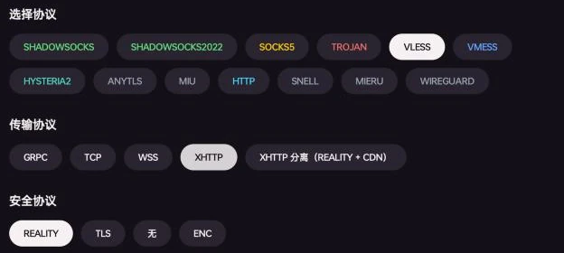
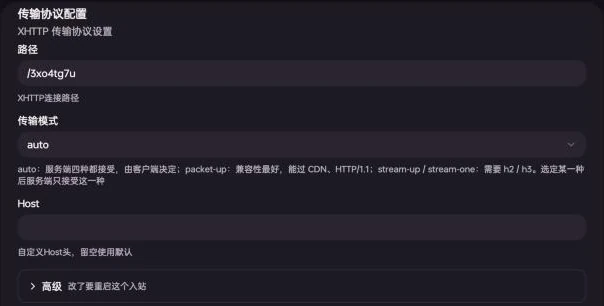
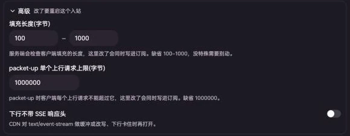
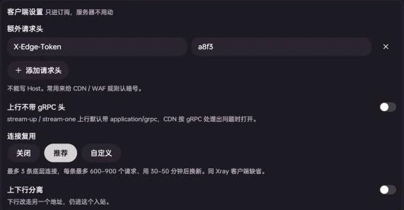
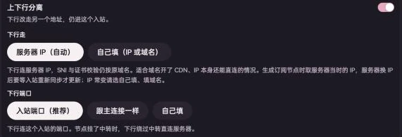
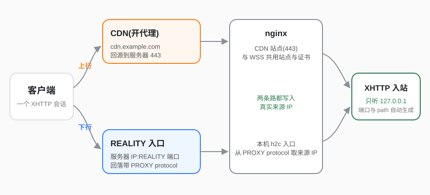
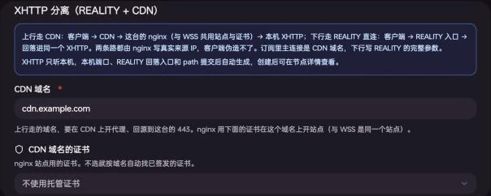

XHTTP 是 Xray 的 HTTP 传输:代理流量装在普通的 HTTP 请求里,既能直连,也能放在 CDN / nginx 后面。妙妙屋X 在「节点管理 → 添加节点」里提供两种 XHTTP:

- **XHTTP**:一个入站,安全层可选 REALITY / TLS / 无 / ENC,可选上下行分离(下行改走另一个地址)。
- **XHTTP 分离(REALITY + CDN)**:上行走 CDN、下行走 REALITY 直连,两条路进同一个入站。主控自动建好入站、REALITY 入口和 nginx 站点。

:::note[适用范围]

- 需要主控 **v0.6.2-beta.8 之后**发布的版本。之前的版本 XHTTP 只能选 REALITY,也没有本文的进阶选项。
- 客户端:MeowX 需要 **0.7.2 之后**发布的版本;MeowX 安卓 / Windows / Linux 版(meowC)现有版本即可。第三方客户端见[订阅与客户端](#订阅与客户端)。
  :::

## 选安全层

| 安全层  | 需要                        | 适合                                                                           |
| ------- | --------------------------- | ------------------------------------------------------------------------------ |
| REALITY | 不需要域名和证书            | 直连,推荐                                                                      |
| TLS     | 服务器域名 + 证书           | 用自己的域名直连                                                               |
| 无      | 前面有 CDN / nginx 终结 TLS | 放在自己的反代后面。直接对外开放时流量是明文 HTTP,不要这样用                   |
| ENC     | 不需要域名和证书            | VLESS 自带加密(传输层不加 TLS)。sing-box、Quantumult X、Loon 不支持 VLESS 加密 |

传输协议选 XHTTP 后,安全协议有四种;旁边的「XHTTP 分离(REALITY + CDN)」见[后文](#xhttp-分离reality--cdn)。

## 选模式

| 模式       | 说明                                                       |
| ---------- | ---------------------------------------------------------- |
| auto       | 缺省。服务端几种都接受,由客户端决定                        |
| packet-up  | 上行拆成一个个小请求。兼容性最好,能过 CDN,HTTP/1.1 也能用  |
| stream-up  | 上行是一个持续的流式请求,下行另开一个请求。要 h2 / h3      |
| stream-one | 上下行在同一个请求里,延迟最低。要 h2 / h3,不能做上下行分离 |

选了 auto 时,MeowX 与 Xray 客户端在 REALITY 下用 stream-one(开了上下行分离时用 stream-up),其余用 packet-up。服务端选定某一种后,就只接受这一种(stream-up 的服务端也接受 stream-one)。

**不确定就保持 auto**。要过 CDN 选 packet-up。

## 建节点

1. 「节点管理 → 添加节点」,选服务器,点「下一步」。
2. 协议选 **VLESS**,传输协议选 **XHTTP**,再选安全协议。
3. 配置模式保持 **简易模式**,填节点名称(可以不填,不填时用「[服务器] 入站标签」),点「提交配置」。

简易模式下只有必须由你决定的项要填,其余都自动生成:

| 自动生成的 | 怎么来的                                                                 |
| ---------- | ------------------------------------------------------------------------ |
| 端口       | 向服务器要一个真正空着的端口(避开 agent 自己占着的),在服务器的端口范围内 |
| UUID       | 随机                                                                     |
| 路径       | 随机,如 `/3xo4tg7u`                                                      |
| 模式       | auto                                                                     |
| 连接复用   | 推荐                                                                     |
| REALITY    | 自动探测目标域名(选延迟最低且能握手的)、生成密钥对和随机 shortId         |
| TLS 证书   | 按服务器域名匹配证书管理里已签发的证书                                   |
| ENC 密钥   | 自动生成 ML-KEM-768 密钥                                                 |

切到 **专家模式** 时这些值都保留,可以逐项查看、修改:

专家模式的「传输协议配置」:路径、传输模式、Host,下面是「高级」与「客户端设置」两组进阶选项。

:::tip[TLS 节点没匹配到证书]
简易模式按服务器的域名找证书,找不到时会提示。切到专家模式,在「选择证书」里选一张证书(泛域名证书也可以),再把 SNI 填成证书覆盖的域名。
:::

## 进阶选项

进阶选项都在专家模式里,分两组:

- **高级**:写在服务器上的入站里,同时写进订阅。改了要重启这个入站。
- **客户端设置**:只写进订阅,服务器不用动。

### 高级(服务端)

| 选项                       | 缺省     | 说明                                                                    |
| -------------------------- | -------- | ----------------------------------------------------------------------- |
| 填充长度(字节)             | 100–1000 | 每个请求带的填充长度范围。服务端会检查,客户端填充不在范围内的请求被拒绝 |
| packet-up 单个上行请求上限 | 1000000  | packet-up 时每个上行请求的最大字节数                                    |
| 下行不带 SSE 响应头        | 关       | CDN 对 `text/event-stream` 做缓冲或改写、下行卡住时再打开               |

填充长度与单个请求上限会同时写进订阅,客户端照着发。**改了之后客户端要刷新订阅**,否则旧订阅的客户端会被服务端拒绝。

### 客户端设置(只进订阅)

| 选项             | 说明                                                                                              |
| ---------------- | ------------------------------------------------------------------------------------------------- |
| 额外请求头       | 客户端每个请求都带上。常用来给 CDN / WAF 规则认暗号。不能写 Host(Host 在上面单独填)               |
| 上行不带 gRPC 头 | stream-up / stream-one 的上行缺省带 `Content-Type: application/grpc`,CDN 按 gRPC 处理出问题时打开 |
| 连接复用         | 多条代理连接共用几条底层连接,省去每次握手。见下表                                                 |
| 上下行分离       | 下行改走另一个地址,见[下一节](#上下行分离)                                                        |

连接复用的三档:

| 档位   | 行为                                                                                                 |
| ------ | ---------------------------------------------------------------------------------------------------- |
| 关闭   | 每条代理连接各自握手                                                                                 |
| 推荐   | 新建节点的缺省。最多 3 条底层连接,每条最多 600–900 个请求、用 30–50 分钟后换新(同 Xray 客户端的缺省) |
| 自定义 | 限制方式二选一:最多几条连接 / 每条连接最多并发;再填每条最多请求数与最长使用秒数(留空用客户端缺省)    |

范围可以填一个数或「起-止」,客户端每次在范围里随机取。实测打开复用后,连续请求的首字节耗时约为不复用时的一半。

## 上下行分离

打开「客户端设置」里的 **上下行分离**,下行(下载方向)改走另一个地址,仍然进同一个入站。服务器上不用改任何东西,只是订阅里多写一段下行设置。

**下行走**:

| 选项              | 说明                                                                                                                                                |
| ----------------- | --------------------------------------------------------------------------------------------------------------------------------------------------- |
| 服务器 IP(自动)   | 下行连服务器 IP,SNI 与证书校验仍按原域名。适合域名开了 CDN、IP 本身还能直连的情况。取的是生成节点时服务器的 IP;服务器换 IP 后要等入站重新同步才更新 |
| 自己填(IP 或域名) | IP 常变就填一个域名                                                                                                                                 |

**下行端口**:

| 选项           | 说明                                                        |
| -------------- | ----------------------------------------------------------- |
| 入站端口(推荐) | 下行连这个入站的端口。节点挂了中转时,下行绕过中转直连服务器 |
| 跟主连接一样   | 不写端口,客户端沿用主连接的端口(节点挂了中转时就是中转端口) |
| 自己填         | 填 1–65535                                                  |

- 模式是 stream-one 时不能拆上下行(只有一个请求),节点照样保存,订阅里不写下行设置。
- 双栈服务器同时生成 v4 和 `(v6)` 两个节点时,选「服务器 IP(自动)」的 `(v6)` 节点下行连服务器的 IPv6。

## XHTTP 分离(REALITY + CDN)

上行走 CDN,下行走 REALITY 直连,两条路进同一个 XHTTP 入站:

上传方向藏在 CDN 后面,下载方向走 REALITY 直连。两条路都由 nginx 写入真实来源 IP,客户端伪造不了。

### 准备

- 一个域名,DNS 解析到这台服务器,并在 CDN 上开代理、回源到服务器的 443。
- 服务器上装好 nginx,[证书管理](/docs/certificates)里有这个域名的证书(泛域名证书也可以)。这和 WSS 节点的要求一样,CDN 域名的站点也和 WSS 共用。
- 云厂商安全组放行 REALITY 入口的端口(提交后在节点里能看到)。

:::caution[不能用主控自己的域名]
CDN 域名所在的 nginx 站点会被主控整份管理。服务器上已经有别的站点(比如主控自己的域名)时,向导会直接提示「这个域名在服务器上已经有别的站点」,不让提交,请换一个域名。
:::

### 建节点

1. 「节点管理 → 添加节点」,选服务器,传输协议选 **XHTTP 分离(REALITY + CDN)**。
2. 简易模式下只需要确认 **CDN 域名**(缺省填服务器的域名)。**CDN 域名的证书**可以不选,不选就按域名自动找已签发的证书。

   

   XHTTP 的本机端口、REALITY 入口的端口与密钥、回落入口、path 都在提交后自动生成。

3. 点「提交配置」。

专家模式下还能改:

- **模式**:缺省 auto,订阅里写 packet-up(CDN 回源是 HTTP/1.1 也能用)。stream-up 要 CDN 支持流式上传。stream-one 拆不了上下行,不能选。
- **端口**:REALITY 入口的端口,不受服务器端口范围限制。开了偷自己(tunnel)的服务器填 443 时,和普通 REALITY 入站一样转到 tunnel-in 的本机端口;其它服务器上 443 一般被 nginx 占着,请换一个。
- **REALITY**:目标域名、密钥、shortId 等,同普通 REALITY 入站。

### 建好之后

- 订阅里节点的地址是 `CDN 域名:443`,下行设置里是 REALITY 入口的完整参数(服务器 IP、端口、公钥、shortId)。
- 「Xray 入站管理」里会多一个 `…-reality` 入站,这是 REALITY 入口。它不能单独删除;删除这个节点(或它的 XHTTP 入站)时会一起删掉,nginx 里的 CDN 路径也一起撤掉。

### CDN 设置

以 Cloudflare 为例:

1. DNS 里给 CDN 域名加一条 A 记录指向服务器 IP,打开代理(橙色云朵)。
2. SSL/TLS 加密模式选「完全(严格)」(服务器上是证书管理签发的正式证书时),或「完全」。
3. 模式用 packet-up(auto 即可)。

实测经 Cloudflare 转发的 packet-up 能正常使用;stream-up 过 Cloudflare 没有实测。其它 CDN 只要支持 HTTPS 回源、不缓存这个路径即可;下行卡住时打开[高级](#高级服务端)里的「下行不带 SSE 响应头」。

## 订阅与客户端

| 客户端                                 | XHTTP  | 进阶选项与上下行分离                              |
| -------------------------------------- | ------ | ------------------------------------------------- |
| MeowX(iOS / macOS,0.7.2 之后的版本)    | 支持   | 全部支持                                          |
| MeowX 安卓 / Windows / Linux(meowC)    | 支持   | 全部支持                                          |
| mihomo 内核的客户端                    | 支持   | 照 mihomo 的写法下发,以客户端版本为准             |
| Xray 内核的客户端(v2rayN / v2rayNG 等) | 支持   | 用分享链接导入,进阶选项写在链接的 `extra` 里      |
| Stash(iOS 3.6+ / macOS 4.3+)           | 支持   | 连接复用不下发,其余照写下发,是否生效以 Stash 为准 |
| Shadowrocket                           | 部分   | 只带路径与 Host,进阶选项与上下行分离不带          |
| sing-box / Loon / Quantumult X / Surge | 不支持 | 订阅里自动跳过 XHTTP 节点                         |

改了填充长度的节点只能给读得懂这项设置的客户端用,其它客户端按缺省填充发,会被服务端拒绝。

## 常见问题

**改了填充长度后连不上**:客户端还在用旧订阅,刷新订阅即可。不支持进阶选项的客户端(如 Shadowrocket)用不了改过填充长度的节点。

**过 CDN 的节点连得上但下载卡住**:打开「高级」里的「下行不带 SSE 响应头」;stream-up 过 CDN 不通时换 packet-up。

**提示「这台服务器的端口范围已全部占用」**:向导自动挑的端口一定会撞,不让提交。在服务器设置里扩大端口范围,或手动填一个空闲端口。XHTTP 分离的 REALITY 入口不受端口范围限制。

**提交时提示端口已被占用**:自动挑的端口被占时主控会换一个重试;自己填的端口被占时直接报错,换一个即可。
